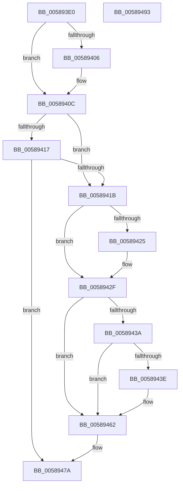

# HvlResumeFromRootCrashdump

- RVA: `0x005893E0`–`0x00589494` (길이 `180` bytes)
- VA: `0x00000001405893E0`
- 실행 섹션: `.text`
- PDB 이름 있음: `예`; PDB Function 태그: `아니요`
- unwind 정보 RVA: `0x000AF554`
- 디코드: `46`개 명령, `180/180` bytes 표시
- 미해석 바이트: `0` (있으면 어셈블리에 `.byte`로 보존)

> 이 문서는 커널 이미지의 기계어와 PDB 기호를 분석해 생성했습니다. 4번과 5번은 함수 원형과 자료형을 바이너리 사용 방식에서 추정한 C 해석이며 원본 소스 복구 결과는 아닙니다.

## 1. Dependencies

- 직접 호출 지점: **7**; 고유 호출 대상: **6**
- 직접 호출자로 확인된 함수: **2**
- RIP 상대 이미지 참조: **7**

### Outgoing calls
- `0x0058940E` → [HvlQueryVsmConnection](../45/HvlQueryVsmConnection_function_0045D180.md) (function, `0x0045D180`)
- `0x0058942A` → [HvlNotifyRootCrashdump](HvlNotifyRootCrashdump_function_00588EF8.md) (function, `0x00588EF8`)
- `0x00589431` → [HvlQueryVsmConnection](../45/HvlQueryVsmConnection_function_0045D180.md) (function, `0x0045D180`)
- `0x00589449` → [memset](../6C/memset_function_006C6C40.md) (function, `0x006C6C40`)
- `0x0058945D` → [VslpEnterIumSecureMode](../23/VslpEnterIumSecureMode_function_00235E50.md) (function, `0x00235E50`)
- `0x00589475` → [guard_dispatch_icall](../6B/guard_dispatch_icall_function_006BAAD0.md) (function, `0x006BAAD0`)
- `0x00589485` → [_security_check_cookie](../6A/_security_check_cookie_function_006AC640.md) (function, `0x006AC640`)

### Direct callers
- [KeBugCheck2](../5B/KeBugCheck2_function_005B27D0.md) at `0x005B3718`
- [KiBugCheckRecoveryCleanupFromCrashDump](../5C/KiBugCheckRecoveryCleanupFromCrashDump_function_005C706C.md) at `0x005C7097`

### Static image references
- `0x005893E9` → RVA `0x00E0A740` (`.data`; read)
- `0x005893FB` → RVA `0x00FC6A84` (`ALMOSTRO`; read)
- `0x00589406` → RVA `0x00F8ECA8` (`.data`; read/write)
- `0x0058941B` → RVA `0x00FC6A90` (`ALMOSTRO`; read)
- `0x00589462` → RVA `0x00FC6C98` (`ALMOSTRO`; read)
- `0x00589468` → RVA `0x00FC6AB8` (`ALMOSTRO`; write)
- `0x0058946E` → RVA `0x00E00A08` (`.data`; read)

## 2. Other-region calls and transfers

- 다른 실행 섹션으로 향하는 call: **0**
- 별도 외부 분기/꼬리 이동을 확인하지 못했습니다.

## 3. Assembly (complete function range)

```asm
005893E0  40 53                           push rbx
005893E2  48 81 EC A0 00 00 00            sub rsp, 0xa0
005893E9  48 8B 05 50 13 88 00            mov rax, qword ptr [rip + 0x881350]
005893F0  48 33 C4                        xor rax, rsp
005893F3  48 89 84 24 90 00 00 00         mov qword ptr [rsp + 0x90], rax
005893FB  80 3D 82 D6 A3 00 00            cmp byte ptr [rip + 0xa3d682], 0
00589402  8A D9                           mov bl, cl
00589404  74 06                           je 0x14058940c
00589406  D1 2D 9C 58 A0 00               shr dword ptr [rip + 0xa0589c], 1
0058940C  33 C9                           xor ecx, ecx
0058940E  E8 6D 3D ED FF                  call 0x14045d180
00589413  84 C0                           test al, al
00589415  74 04                           je 0x14058941b
00589417  84 DB                           test bl, bl
00589419  74 5F                           je 0x14058947a
0058941B  8B 05 6F D6 A3 00               mov eax, dword ptr [rip + 0xa3d66f]
00589421  A8 02                           test al, 2
00589423  74 0A                           je 0x14058942f
00589425  B9 03 00 00 00                  mov ecx, 3
0058942A  E8 C9 FA FF FF                  call 0x140588ef8
0058942F  33 C9                           xor ecx, ecx
00589431  E8 4A 3D ED FF                  call 0x14045d180
00589436  84 C0                           test al, al
00589438  74 28                           je 0x140589462
0058943A  84 DB                           test bl, bl
0058943C  74 24                           je 0x140589462
0058943E  44 8D 41 68                     lea r8d, [rcx + 0x68]
00589442  33 D2                           xor edx, edx
00589444  48 8D 4C 24 20                  lea rcx, [rsp + 0x20]
00589449  E8 F2 D7 13 00                  call 0x1406c6c40
0058944E  BA 03 08 00 00                  mov edx, 0x803
00589453  4C 8D 4C 24 20                  lea r9, [rsp + 0x20]
00589458  45 33 C0                        xor r8d, r8d
0058945B  B1 02                           mov cl, 2
0058945D  E8 EE C9 CA FF                  call 0x140235e50
00589462  8B 05 30 D8 A3 00               mov eax, dword ptr [rip + 0xa3d830]
00589468  89 05 4A D6 A3 00               mov dword ptr [rip + 0xa3d64a], eax
0058946E  48 8B 05 93 75 87 00            mov rax, qword ptr [rip + 0x877593]
00589475  E8 56 16 13 00                  call 0x1406baad0
0058947A  48 8B 8C 24 90 00 00 00         mov rcx, qword ptr [rsp + 0x90]
00589482  48 33 CC                        xor rcx, rsp
00589485  E8 B6 31 12 00                  call 0x1406ac640
0058948A  48 81 C4 A0 00 00 00            add rsp, 0xa0
00589491  5B                              pop rbx
00589492  C3                              ret
00589493  CC                              int3
```

## 4. C-style interpretation (structured pseudocode)

```c
__int64 __fastcall HvlResumeFromRootCrashdump(int a1, int a2)
{
    __int64 result;
    __int64 v_rsp;
    unsigned __int64 v_stack_m18;
    unsigned __int64 v_stack_m88;

    v_rsp = (v_rsp) - (160);
    result = (*(unsigned __int64 *)(v_rip + 8917840)) ^ (v_rsp);
    v_stack_m18 = result;
    if ((*(unsigned __int8 *)(v_rip + 10737282)) != 0) {
    }
    a1 = 0;
    result = HvlQueryVsmConnection(a1, a2, a3, a4);
    if ((unsigned __int8)(result) == 0) goto loc_0058941B;
    if ((unsigned __int8)((unsigned __int8)(a1)) == 0) goto loc_0058947A;
loc_0058941B:
    result = (unsigned int)(*(unsigned int *)(v_rip + 10737263));
    if ((((unsigned __int8)((unsigned int)(*(unsigned int *)(v_rip + 10737263)))) & (2)) != 0) {
        a1 = 3;
        result = HvlNotifyRootCrashdump(a1, a2, a3, a4);
    }
    a1 = 0;
    result = HvlQueryVsmConnection(a1, a2, a3, a4);
    if ((unsigned __int8)(result) == 0) goto loc_00589462;
    if ((unsigned __int8)((unsigned __int8)(a1)) != 0) {
        a3 = a1 + 104;
        a2 = 0;
        a1 = v_stack_m88;
        result = memset(a1, a2, a3, a4);
        a2 = 0x803ULL;
        a4 = v_stack_m88;
        a3 = 0;
        a1 = 2;
        result = VslpEnterIumSecureMode(a1, a2, a3, a4);
    }
    *(unsigned int *)(v_rip + 10737226) = (unsigned int)((unsigned int)(*(unsigned int *)(v_rip + 10737712)));
    result = guard_dispatch_icall(a1, a2, a3, a4);
loc_0058947A:
    a1 = (v_stack_m18) ^ (v_rsp);
    result = _security_check_cookie(a1, a2, a3, a4);
    v_rsp = (v_rsp) + (160);
    return result;
}
```

## 5. (Beta) C Style

```c
int64_t HvlResumeFromRootCrashdump(int32_t Arg1, int32_t Arg2)
{
    int64_t result;
    int64_t local_rsp;
    uint64_t v_stack_m18;
    uint64_t v_stack_m88;

    local_rsp = (local_rsp) - (160);
    result = (*(uint64_t *)(v_rip + 0x881350)) ^ (local_rsp);
    v_stack_m18 = result;
    if ((*(uint8_t *)(v_rip + 0xA3D682)) != 0) {
    }
    Arg1 = 0;
    result = HvlQueryVsmConnection(Arg1, Arg2, a3, a4);
    if ((uint8_t)(result) == 0) goto loc_0058941B;
    if ((uint8_t)((uint8_t)(Arg1)) == 0) goto loc_0058947A;
loc_0058941B:
    result = (uint32_t)(*(uint32_t *)(v_rip + 0xA3D66F));
    if ((((uint8_t)((uint32_t)(*(uint32_t *)(v_rip + 0xA3D66F)))) & (2)) != 0) {
        Arg1 = 3;
        result = HvlNotifyRootCrashdump(Arg1, Arg2, a3, a4);
    }
    Arg1 = 0;
    result = HvlQueryVsmConnection(Arg1, Arg2, a3, a4);
    if ((uint8_t)(result) == 0) goto loc_00589462;
    if ((uint8_t)((uint8_t)(Arg1)) != 0) {
        a3 = Arg1 + 104;
        Arg2 = 0;
        Arg1 = v_stack_m88;
        result = memset(Arg1, Arg2, a3, a4);
        Arg2 = 0x803ULL;
        a4 = v_stack_m88;
        a3 = 0;
        Arg1 = 2;
        result = VslpEnterIumSecureMode(Arg1, Arg2, a3, a4);
    }
    *(uint32_t *)(v_rip + 0xA3D64A) = (uint32_t)((uint32_t)(*(uint32_t *)(v_rip + 0xA3D830)));
    result = guard_dispatch_icall(Arg1, Arg2, a3, a4);
loc_0058947A:
    Arg1 = (v_stack_m18) ^ (local_rsp);
    result = _security_check_cookie(Arg1, Arg2, a3, a4);
    local_rsp = (local_rsp) + (160);
    return result;
}
```

## 6. Execution-region graph

[열기: 2D/3D 그래프와 함수 탐색 컨트롤 패널](../../../control-panel.html?section=text&rva=0x005893E0&view=graph)

- 2D 그래프는 위에서 아래로 흐르고, 3D 그래프는 빈 공간을 드래그해 회전합니다. Shift+드래그는 이동, 휠은 확대·축소, 함수 노드 선택은 대상 보고서 이동입니다.

### Static fallback


