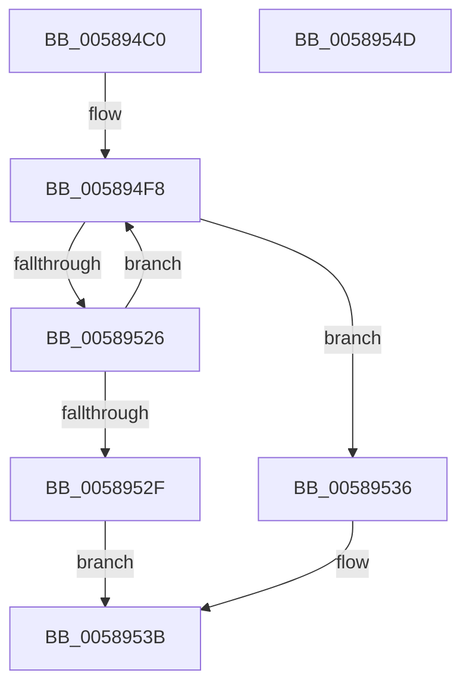

# HvlSetDeviceCapabilities

- RVA: `0x005894C0`–`0x0058954E` (길이 `142` bytes)
- VA: `0x00000001405894C0`
- 실행 섹션: `.text`
- PDB 이름 있음: `예`; PDB Function 태그: `아니요`
- unwind 정보 RVA: `0x000A02F8`
- 디코드: `34`개 명령, `142/142` bytes 표시
- 미해석 바이트: `0` (있으면 어셈블리에 `.byte`로 보존)

> 이 문서는 커널 이미지의 기계어와 PDB 기호를 분석해 생성했습니다. 4번과 5번은 함수 원형과 자료형을 바이너리 사용 방식에서 추정한 C 해석이며 원본 소스 복구 결과는 아닙니다.

## 1. Dependencies

- 직접 호출 지점: **5**; 고유 호출 대상: **5**
- 직접 호출자로 확인된 함수: **0**
- RIP 상대 이미지 참조: **1**

### Outgoing calls
- `0x0058950E` → [HvcallFastExtended](../31/HvcallFastExtended_function_003130E0.md) (function, `0x003130E0`)
- `0x00589519` → [HvlpHvStatusIsInsufficientMemory](../30/HvlpHvStatusIsInsufficientMemory_function_00307BB0.md) (function, `0x00307BB0`)
- `0x00589526` → [HvlpHandleInsufficientMemory](HvlpHandleInsufficientMemory_function_00584514.md) (function, `0x00584514`)
- `0x00589536` → [HvlpHvToNtStatus](../30/HvlpHvToNtStatus_function_00307BD8.md) (function, `0x00307BD8`)
- `0x00589543` → [_security_check_cookie](../6A/_security_check_cookie_function_006AC640.md) (function, `0x006AC640`)

### Direct callers
- 이 함수 시작 RVA로 연결되는 직접 call은 확인되지 않았습니다. 간접 호출은 완전히 역산할 수 없습니다.

### Static image references
- `0x005894C4` → RVA `0x00E0A740` (`.data`; read)

## 2. Other-region calls and transfers

- 다른 실행 섹션으로 향하는 call: **0**
- 별도 외부 분기/꼬리 이동을 확인하지 못했습니다.

## 3. Assembly (complete function range)

```asm
005894C0  48 83 EC 78                     sub rsp, 0x78
005894C4  48 8B 05 75 12 88 00            mov rax, qword ptr [rip + 0x881275]
005894CB  48 33 C4                        xor rax, rsp
005894CE  48 89 44 24 60                  mov qword ptr [rsp + 0x60], rax
005894D3  48 83 4C 24 40 FF               or qword ptr [rsp + 0x40], 0xffffffffffffffff
005894D9  48 C7 44 24 30 00 01 00 00      mov qword ptr [rsp + 0x30], 0x100
005894E2  C7 44 24 30 00 01 01 00         mov dword ptr [rsp + 0x30], 0x10100
005894EA  48 89 4C 24 48                  mov qword ptr [rsp + 0x48], rcx
005894EF  89 54 24 50                     mov dword ptr [rsp + 0x50], edx
005894F3  44 89 44 24 54                  mov dword ptr [rsp + 0x54], r8d
005894F8  48 8B 4C 24 30                  mov rcx, qword ptr [rsp + 0x30]
005894FD  48 8D 54 24 40                  lea rdx, [rsp + 0x40]
00589502  83 64 24 20 00                  and dword ptr [rsp + 0x20], 0
00589507  45 33 C9                        xor r9d, r9d
0058950A  45 8D 41 18                     lea r8d, [r9 + 0x18]
0058950E  E8 CD 9B D8 FF                  call 0x1403130e0
00589513  0F B7 C8                        movzx ecx, ax
00589516  4C 8B C0                        mov r8, rax
00589519  E8 92 E6 D7 FF                  call 0x140307bb0
0058951E  41 0F B7 C8                     movzx ecx, r8w
00589522  84 C0                           test al, al
00589524  74 10                           je 0x140589536
00589526  E8 E9 AF FF FF                  call 0x140584514
0058952B  85 C0                           test eax, eax
0058952D  79 C9                           jns 0x1405894f8
0058952F  B8 9A 00 00 C0                  mov eax, 0xc000009a
00589534  EB 05                           jmp 0x14058953b
00589536  E8 9D E6 D7 FF                  call 0x140307bd8
0058953B  48 8B 4C 24 60                  mov rcx, qword ptr [rsp + 0x60]
00589540  48 33 CC                        xor rcx, rsp
00589543  E8 F8 30 12 00                  call 0x1406ac640
00589548  48 83 C4 78                     add rsp, 0x78
0058954C  C3                              ret
0058954D  CC                              int3
```

## 4. C-style interpretation (structured pseudocode)

```c
__int64 __fastcall HvlSetDeviceCapabilities(__int64 a1, int a2, int a3, int a4)
{
    __int64 result;
    __int64 v_rsp;
    unsigned __int64 v_stack_m18;
    unsigned int v_stack_m24;
    unsigned int v_stack_m28;
    unsigned __int64 v_stack_m30;
    unsigned __int64 v_stack_m38;
    unsigned __int64 v_stack_m48;
    unsigned int v_stack_m58;

    v_rsp = (v_rsp) - (120);
    result = (*(unsigned __int64 *)(v_rip + 8917621)) ^ (v_rsp);
    v_stack_m18 = result;
    v_stack_m48 = 256;
    v_stack_m48 = 0x10100ULL;
    v_stack_m30 = a1;
    v_stack_m28 = a2;
    v_stack_m24 = a3;
loc_005894F8:
    a4 = 0;
    result = HvcallFastExtended(v_stack_m48, v_stack_m38, a4 + 24, a4);
    result = HvlpHvStatusIsInsufficientMemory((unsigned __int16)(result), v_stack_m38, result, a4);
    if ((unsigned __int8)(result) == 0) goto loc_00589536;
    result = HvlpHandleInsufficientMemory((unsigned __int16)(result), v_stack_m38, result, a4);
    if (!sign_flag) goto loc_005894F8;
    goto loc_0058953B;
loc_00589536:
    result = HvlpHvToNtStatus((unsigned __int16)(result), v_stack_m38, result, a4);
loc_0058953B:
    a1 = (v_stack_m18) ^ (v_rsp);
    result = _security_check_cookie(a1, v_stack_m38, result, a4);
    v_rsp = (v_rsp) + (120);
    return result;
}
```

## 5. (Beta) C Style

```c
int64_t HvlSetDeviceCapabilities(int64_t Arg1, int32_t Arg2, int32_t Arg3, int32_t Arg4)
{
    int64_t result;
    int64_t local_rsp;
    uint64_t v_stack_m18;
    uint32_t v_stack_m24;
    uint32_t v_stack_m28;
    uint64_t v_stack_m30;
    uint64_t v_stack_m38;
    uint64_t v_stack_m48;
    uint32_t v_stack_m58;

    local_rsp = (local_rsp) - (120);
    result = (*(uint64_t *)(v_rip + 0x881275)) ^ (local_rsp);
    v_stack_m18 = result;
    v_stack_m48 = 256;
    v_stack_m48 = 0x10100ULL;
    v_stack_m30 = Arg1;
    v_stack_m28 = Arg2;
    v_stack_m24 = Arg3;
loc_005894F8:
    Arg4 = 0;
    result = HvcallFastExtended(v_stack_m48, v_stack_m38, Arg4 + 24, Arg4);
    result = HvlpHvStatusIsInsufficientMemory((uint16_t)(result), v_stack_m38, result, Arg4);
    if ((uint8_t)(result) == 0) goto loc_00589536;
    result = HvlpHandleInsufficientMemory((uint16_t)(result), v_stack_m38, result, Arg4);
    if (!sign_flag) goto loc_005894F8;
    goto loc_0058953B;
loc_00589536:
    result = HvlpHvToNtStatus((uint16_t)(result), v_stack_m38, result, Arg4);
loc_0058953B:
    Arg1 = (v_stack_m18) ^ (local_rsp);
    result = _security_check_cookie(Arg1, v_stack_m38, result, Arg4);
    local_rsp = (local_rsp) + (120);
    return result;
}
```

## 6. Execution-region graph

[열기: 2D/3D 그래프와 함수 탐색 컨트롤 패널](../../../control-panel.html?section=text&rva=0x005894C0&view=graph)

- 2D 그래프는 위에서 아래로 흐르고, 3D 그래프는 빈 공간을 드래그해 회전합니다. Shift+드래그는 이동, 휠은 확대·축소, 함수 노드 선택은 대상 보고서 이동입니다.

### Static fallback


