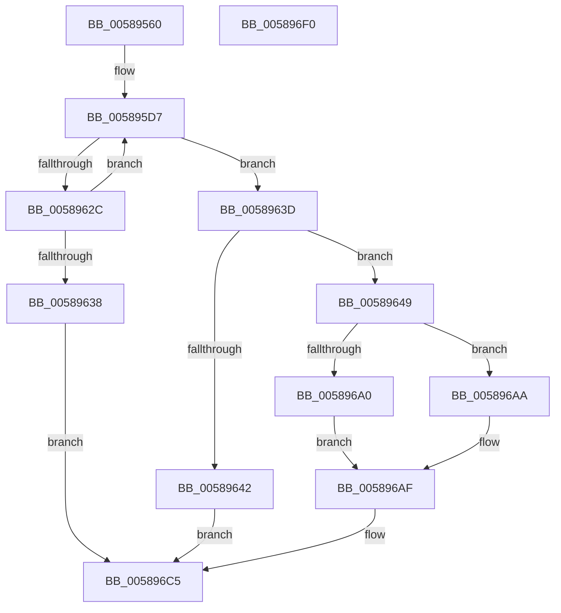

# HvlSetHpetConfig

- RVA: `0x00589560`–`0x005896F1` (길이 `401` bytes)
- VA: `0x0000000140589560`
- 실행 섹션: `.text`
- PDB 이름 있음: `예`; PDB Function 태그: `아니요`
- unwind 정보 RVA: `0x000C679C`
- 디코드: `101`개 명령, `401/401` bytes 표시
- 미해석 바이트: `0` (있으면 어셈블리에 `.byte`로 보존)

> 이 문서는 커널 이미지의 기계어와 PDB 기호를 분석해 생성했습니다. 4번과 5번은 함수 원형과 자료형을 바이너리 사용 방식에서 추정한 C 해석이며 원본 소스 복구 결과는 아닙니다.

## 1. Dependencies

- 직접 호출 지점: **12**; 고유 호출 대상: **7**
- 직접 호출자로 확인된 함수: **0**
- RIP 상대 이미지 참조: **1**

### Outgoing calls
- `0x005895D0` → [memset](../6C/memset_function_006C6C40.md) (function, `0x006C6C40`)
- `0x005895EB` → [HvlpAcquireHypercallPage](../47/HvlpAcquireHypercallPage_function_00471410.md) (function, `0x00471410`)
- `0x0058960E` → [HvcallInitiateHypercall](../31/HvcallInitiateHypercall_function_00313630.md) (function, `0x00313630`)
- `0x0058961B` → [HvlpReleaseHypercallPage](../31/HvlpReleaseHypercallPage_function_00313480.md) (function, `0x00313480`)
- `0x00589623` → [HvlpHvStatusIsInsufficientMemory](../30/HvlpHvStatusIsInsufficientMemory_function_00307BB0.md) (function, `0x00307BB0`)
- `0x0058962F` → [HvlpHandleInsufficientMemory](HvlpHandleInsufficientMemory_function_00584514.md) (function, `0x00584514`)
- `0x0058965D` → [HvlpAcquireHypercallPage](../47/HvlpAcquireHypercallPage_function_00471410.md) (function, `0x00471410`)
- `0x00589679` → [HvlpAcquireHypercallPage](../47/HvlpAcquireHypercallPage_function_00471410.md) (function, `0x00471410`)
- `0x00589696` → [HvcallInitiateHypercall](../31/HvcallInitiateHypercall_function_00313630.md) (function, `0x00313630`)
- `0x005896B4` → [HvlpReleaseHypercallPage](../31/HvlpReleaseHypercallPage_function_00313480.md) (function, `0x00313480`)
- `0x005896BE` → [HvlpReleaseHypercallPage](../31/HvlpReleaseHypercallPage_function_00313480.md) (function, `0x00313480`)
- `0x005896CF` → [_security_check_cookie](../6A/_security_check_cookie_function_006AC640.md) (function, `0x006AC640`)

### Direct callers
- 이 함수 시작 RVA로 연결되는 직접 call은 확인되지 않았습니다. 간접 호출은 완전히 역산할 수 없습니다.

### Static image references
- `0x00589581` → RVA `0x00E0A740` (`.data`; read)

## 2. Other-region calls and transfers

- 다른 실행 섹션으로 향하는 call: **0**
- 별도 외부 분기/꼬리 이동을 확인하지 못했습니다.

## 3. Assembly (complete function range)

```asm
00589560  48 89 5C 24 08                  mov qword ptr [rsp + 8], rbx
00589565  48 89 74 24 10                  mov qword ptr [rsp + 0x10], rsi
0058956A  55                              push rbp
0058956B  57                              push rdi
0058956C  41 54                           push r12
0058956E  41 56                           push r14
00589570  41 57                           push r15
00589572  48 8D AC 24 60 F8 FF FF         lea rbp, [rsp - 0x7a0]
0058957A  48 81 EC A0 08 00 00            sub rsp, 0x8a0
00589581  48 8B 05 B8 11 88 00            mov rax, qword ptr [rip + 0x8811b8]
00589588  48 33 C4                        xor rax, rsp
0058958B  48 89 85 90 07 00 00            mov qword ptr [rbp + 0x790], rax
00589592  33 C0                           xor eax, eax
00589594  0F 57 C0                        xorps xmm0, xmm0
00589597  41 8A F0                        mov sil, r8b
0058959A  48 89 44 24 30                  mov qword ptr [rsp + 0x30], rax
0058959F  4C 8B FA                        mov r15, rdx
005895A2  89 44 24 38                     mov dword ptr [rsp + 0x38], eax
005895A6  44 8B E1                        mov r12d, ecx
005895A9  48 89 44 24 50                  mov qword ptr [rsp + 0x50], rax
005895AE  33 D2                           xor edx, edx
005895B0  89 44 24 58                     mov dword ptr [rsp + 0x58], eax
005895B4  41 B8 2F 08 00 00               mov r8d, 0x82f
005895BA  88 44 24 7F                     mov byte ptr [rsp + 0x7f], al
005895BE  48 8D 4C 24 60                  lea rcx, [rsp + 0x60]
005895C3  4D 8B F1                        mov r14, r9
005895C6  0F 11 44 24 20                  movups xmmword ptr [rsp + 0x20], xmm0
005895CB  0F 11 44 24 40                  movups xmmword ptr [rsp + 0x40], xmm0
005895D0  E8 6B D6 13 00                  call 0x1406c6c40
005895D5  33 FF                           xor edi, edi
005895D7  41 B9 28 00 00 00               mov r9d, 0x28
005895DD  4C 8D 44 24 60                  lea r8, [rsp + 0x60]
005895E2  48 8D 4C 24 20                  lea rcx, [rsp + 0x20]
005895E7  41 8D 51 D9                     lea edx, [r9 - 0x27]
005895EB  E8 20 7E EE FF                  call 0x140471410
005895F0  48 8B 54 24 38                  mov rdx, qword ptr [rsp + 0x38]
005895F5  45 33 C0                        xor r8d, r8d
005895F8  C7 00 06 00 00 00               mov dword ptr [rax], 6
005895FE  41 8D 48 6F                     lea ecx, [r8 + 0x6f]
00589602  44 89 60 10                     mov dword ptr [rax + 0x10], r12d
00589606  4C 89 78 18                     mov qword ptr [rax + 0x18], r15
0058960A  40 88 70 20                     mov byte ptr [rax + 0x20], sil
0058960E  E8 1D A0 D8 FF                  call 0x140313630
00589613  48 8D 4C 24 20                  lea rcx, [rsp + 0x20]
00589618  48 8B D8                        mov rbx, rax
0058961B  E8 60 9E D8 FF                  call 0x140313480
00589620  0F B7 CB                        movzx ecx, bx
00589623  E8 88 E5 D7 FF                  call 0x140307bb0
00589628  84 C0                           test al, al
0058962A  74 11                           je 0x14058963d
0058962C  0F B7 CB                        movzx ecx, bx
0058962F  E8 E0 AE FF FF                  call 0x140584514
00589634  85 C0                           test eax, eax
00589636  79 9F                           jns 0x1405895d7
00589638  E9 88 00 00 00                  jmp 0x1405896c5
0058963D  66 85 DB                        test bx, bx
00589640  74 07                           je 0x140589649
00589642  B8 01 00 00 C0                  mov eax, 0xc0000001
00589647  EB 7C                           jmp 0x1405896c5
00589649  41 B9 10 00 00 00               mov r9d, 0x10
0058964F  4C 8D 44 24 60                  lea r8, [rsp + 0x60]
00589654  48 8D 4C 24 20                  lea rcx, [rsp + 0x20]
00589659  41 8D 51 F1                     lea edx, [r9 - 0xf]
0058965D  E8 AE 7D EE FF                  call 0x140471410
00589662  41 B9 08 04 00 00               mov r9d, 0x408
00589668  4C 8D 45 80                     lea r8, [rbp - 0x80]
0058966C  BA 02 00 00 00                  mov edx, 2
00589671  48 8D 4C 24 40                  lea rcx, [rsp + 0x40]
00589676  48 8B D8                        mov rbx, rax
00589679  E8 92 7D EE FF                  call 0x140471410
0058967E  4C 8B 44 24 58                  mov r8, qword ptr [rsp + 0x58]
00589683  B9 7B 00 00 00                  mov ecx, 0x7b
00589688  48 8B 54 24 38                  mov rdx, qword ptr [rsp + 0x38]
0058968D  48 8B F0                        mov rsi, rax
00589690  C7 03 07 00 00 00               mov dword ptr [rbx], 7
00589696  E8 95 9F D8 FF                  call 0x140313630
0058969B  66 85 C0                        test ax, ax
0058969E  75 0A                           jne 0x1405896aa
005896A0  0F 10 06                        movups xmm0, xmmword ptr [rsi]
005896A3  F3 41 0F 7F 06                  movdqu xmmword ptr [r14], xmm0
005896A8  EB 05                           jmp 0x1405896af
005896AA  BF 01 00 00 C0                  mov edi, 0xc0000001
005896AF  48 8D 4C 24 40                  lea rcx, [rsp + 0x40]
005896B4  E8 C7 9D D8 FF                  call 0x140313480
005896B9  48 8D 4C 24 20                  lea rcx, [rsp + 0x20]
005896BE  E8 BD 9D D8 FF                  call 0x140313480
005896C3  8B C7                           mov eax, edi
005896C5  48 8B 8D 90 07 00 00            mov rcx, qword ptr [rbp + 0x790]
005896CC  48 33 CC                        xor rcx, rsp
005896CF  E8 6C 2F 12 00                  call 0x1406ac640
005896D4  4C 8D 9C 24 A0 08 00 00         lea r11, [rsp + 0x8a0]
005896DC  49 8B 5B 30                     mov rbx, qword ptr [r11 + 0x30]
005896E0  49 8B 73 38                     mov rsi, qword ptr [r11 + 0x38]
005896E4  49 8B E3                        mov rsp, r11
005896E7  41 5F                           pop r15
005896E9  41 5E                           pop r14
005896EB  41 5C                           pop r12
005896ED  5F                              pop rdi
005896EE  5D                              pop rbp
005896EF  C3                              ret
005896F0  CC                              int3
```

## 4. C-style interpretation (structured pseudocode)

```c
__int64 __fastcall HvlSetHpetConfig(int a1, __int64 a2, unsigned __int8 a3, __int64 a4)
{
    __int64 result;
    __int64 v_rdi;
    __int64 v_rsp;
    unsigned __int64 v_stack_m28;
    unsigned __int64 v_stack_m38;
    unsigned __int64 v_stack_m7C8;
    unsigned __int64 v_stack_m848;
    unsigned __int8 v_stack_m849;
    unsigned __int64 v_stack_m868;
    unsigned int v_stack_m870;
    unsigned __int64 v_stack_m878;
    unsigned __int64 v_stack_m888;
    unsigned int v_stack_m890;
    unsigned __int64 v_stack_m898;
    unsigned __int64 v_stack_m8A8;
    unsigned __int64 v_stack_p10;
    unsigned __int64 v_stack_p8;

    v_stack_p8 = v_rbx;
    v_stack_p10 = v_rsi;
    v_rsp = (v_rsp) - (0x8A0ULL);
    result = (*(unsigned __int64 *)(v_rip + 8917432)) ^ (v_rsp);
    v_stack_m38 = result;
    result = 0;
    v_stack_m898 = 0;
    v_stack_m890 = 0;
    v_stack_m878 = 0;
    a2 = 0;
    v_stack_m870 = 0;
    v_stack_m849 = 0;
    v_stack_m8A8 = v_xmm0;
    v_stack_m888 = v_xmm0;
    result = memset(v_stack_m868, a2, (unsigned int)(0x82FULL), a4);
    v_rdi = 0;
loc_005895D7:
    result = HvlpAcquireHypercallPage(v_stack_m8A8, 40 - 39, v_stack_m868, 40);
    a3 = 0;
    *(unsigned int *)(result) = 6;
    *(unsigned int *)(result + 16) = (unsigned int)((unsigned int)(a1));
    *(unsigned __int64 *)(result + 24) = 0;
    *(unsigned __int8 *)(result + 32) = 0;
    result = HvcallInitiateHypercall(a3 + 111, v_stack_m890, a3, 40);
    result = HvlpReleaseHypercallPage(v_stack_m8A8, v_stack_m890, a3, 40);
    result = HvlpHvStatusIsInsufficientMemory((unsigned __int16)(result), v_stack_m890, a3, 40);
    if ((unsigned __int8)(result) == 0) goto loc_0058963D;
    result = HvlpHandleInsufficientMemory((unsigned __int16)(result), v_stack_m890, a3, 40);
    if (!sign_flag) goto loc_005895D7;
    goto loc_005896C5;
loc_0058963D:
    if ((unsigned __int16)(result) == 0) goto loc_00589649;
    goto loc_005896C5;
loc_00589649:
    result = HvlpAcquireHypercallPage(v_stack_m8A8, 16 - 15, v_stack_m868, 16);
    result = HvlpAcquireHypercallPage(v_stack_m888, 2, v_stack_m848, (unsigned int)(0x408ULL));
    *(unsigned int *)(result) = 7;
    result = HvcallInitiateHypercall(123, v_stack_m890, v_stack_m870, (unsigned int)(0x408ULL));
    if ((unsigned __int16)(result) != 0) goto loc_005896AA;
    *(unsigned __int64 *)(a4) = v_xmm0;
    goto loc_005896AF;
loc_005896AA:
loc_005896AF:
    result = HvlpReleaseHypercallPage(v_stack_m888, v_stack_m890, v_stack_m870, (unsigned int)(0x408ULL));
    result = HvlpReleaseHypercallPage(v_stack_m8A8, v_stack_m890, v_stack_m870, (unsigned int)(0x408ULL));
loc_005896C5:
    a1 = (v_stack_m38) ^ (v_rsp);
    result = _security_check_cookie(a1, v_stack_m890, v_stack_m870, (unsigned int)(0x408ULL));
    return result;
}
```

## 5. (Beta) C Style

```c
int64_t HvlSetHpetConfig(int32_t Arg1, int64_t Arg2, uint8_t Arg3, void *Arg4)
{
    uint8_t *arg4 = (uint8_t *)Arg4;

    int64_t result;
    int64_t local_rdi;
    int64_t local_rsp;
    uint64_t v_stack_m28;
    uint64_t v_stack_m38;
    uint64_t v_stack_m7C8;
    uint64_t v_stack_m848;
    uint8_t v_stack_m849;
    uint64_t v_stack_m868;
    uint32_t v_stack_m870;
    uint64_t v_stack_m878;
    uint64_t v_stack_m888;
    uint32_t v_stack_m890;
    uint64_t v_stack_m898;
    uint64_t v_stack_m8A8;
    uint64_t v_stack_p10;
    uint64_t v_stack_p8;

    v_stack_p8 = local_rbx;
    v_stack_p10 = local_rsi;
    local_rsp = (local_rsp) - (0x8A0ULL);
    result = (*(uint64_t *)(v_rip + 0x8811B8)) ^ (local_rsp);
    v_stack_m38 = result;
    result = 0;
    v_stack_m898 = 0;
    v_stack_m890 = 0;
    v_stack_m878 = 0;
    Arg2 = 0;
    v_stack_m870 = 0;
    v_stack_m849 = 0;
    v_stack_m8A8 = v_xmm0;
    v_stack_m888 = v_xmm0;
    result = memset(v_stack_m868, Arg2, (uint32_t)(0x82FULL), Arg4);
    local_rdi = 0;
loc_005895D7:
    result = HvlpAcquireHypercallPage(v_stack_m8A8, 40 - 39, v_stack_m868, 40);
    Arg3 = 0;
    *(uint32_t *)(result) = 6;
    *(uint32_t *)(result + 0x10) = (uint32_t)((uint32_t)(Arg1));
    *(uint64_t *)(result + 0x18) = 0;
    *(uint8_t *)(result + 0x20) = 0;
    result = HvcallInitiateHypercall(Arg3 + 111, v_stack_m890, Arg3, 40);
    result = HvlpReleaseHypercallPage(v_stack_m8A8, v_stack_m890, Arg3, 40);
    result = HvlpHvStatusIsInsufficientMemory((uint16_t)(result), v_stack_m890, Arg3, 40);
    if ((uint8_t)(result) == 0) goto loc_0058963D;
    result = HvlpHandleInsufficientMemory((uint16_t)(result), v_stack_m890, Arg3, 40);
    if (!sign_flag) goto loc_005895D7;
    goto loc_005896C5;
loc_0058963D:
    if ((uint16_t)(result) == 0) goto loc_00589649;
    goto loc_005896C5;
loc_00589649:
    result = HvlpAcquireHypercallPage(v_stack_m8A8, 16 - 15, v_stack_m868, 16);
    result = HvlpAcquireHypercallPage(v_stack_m888, 2, v_stack_m848, (uint32_t)(0x408ULL));
    *(uint32_t *)(result) = 7;
    result = HvcallInitiateHypercall(123, v_stack_m890, v_stack_m870, (uint32_t)(0x408ULL));
    if ((uint16_t)(result) != 0) goto loc_005896AA;
    *(uint64_t *)(arg4) = v_xmm0;
    goto loc_005896AF;
loc_005896AA:
loc_005896AF:
    result = HvlpReleaseHypercallPage(v_stack_m888, v_stack_m890, v_stack_m870, (uint32_t)(0x408ULL));
    result = HvlpReleaseHypercallPage(v_stack_m8A8, v_stack_m890, v_stack_m870, (uint32_t)(0x408ULL));
loc_005896C5:
    Arg1 = (v_stack_m38) ^ (local_rsp);
    result = _security_check_cookie(Arg1, v_stack_m890, v_stack_m870, (uint32_t)(0x408ULL));
    return result;
}
```

### 관측된 메모리 오프셋

구조체 형식이 확인되지 않은 접근은 인자 기준의 오프셋으로만 기록했습니다.

| 기준 인자 | 오프셋 표현 | 폭 (bit) | 접근 |
|---|---:|---:|---|
| `Arg4` | `+ 0x0` | `128` | `W` |

## 6. Execution-region graph

[열기: 2D/3D 그래프와 함수 탐색 컨트롤 패널](../../../control-panel.html?section=text&rva=0x00589560&view=graph)

- 2D 그래프는 위에서 아래로 흐르고, 3D 그래프는 빈 공간을 드래그해 회전합니다. Shift+드래그는 이동, 휠은 확대·축소, 함수 노드 선택은 대상 보고서 이동입니다.

### Static fallback


