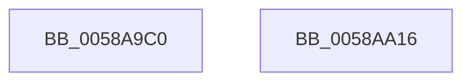

# HvlSetLogicalProcessorCppcRequest

- RVA: `0x0058A9C0`–`0x0058AA17` (길이 `87` bytes)
- VA: `0x000000014058A9C0`
- 실행 섹션: `.text`
- PDB 이름 있음: `예`; PDB Function 태그: `아니요`
- unwind 정보 RVA: `0x000BD438`
- 디코드: `21`개 명령, `87/87` bytes 표시
- 미해석 바이트: `0` (있으면 어셈블리에 `.byte`로 보존)

> 이 문서는 커널 이미지의 기계어와 PDB 기호를 분석해 생성했습니다. 4번과 5번은 함수 원형과 자료형을 바이너리 사용 방식에서 추정한 C 해석이며 원본 소스 복구 결과는 아닙니다.

## 1. Dependencies

- 직접 호출 지점: **2**; 고유 호출 대상: **2**
- 직접 호출자로 확인된 함수: **0**
- RIP 상대 이미지 참조: **0**

### Outgoing calls
- `0x0058A9E5` → [memset](../6C/memset_function_006C6C40.md) (function, `0x006C6C40`)
- `0x0058AA00` → [HvlpSetPowerProperty](../4C/HvlpSetPowerProperty_function_004C9124.md) (function, `0x004C9124`)

### Direct callers
- 이 함수 시작 RVA로 연결되는 직접 call은 확인되지 않았습니다. 간접 호출은 완전히 역산할 수 없습니다.

### Static image references
- 디코드된 RIP-relative 메모리 참조가 없습니다.

## 2. Other-region calls and transfers

- 다른 실행 섹션으로 향하는 call: **0**
- 별도 외부 분기/꼬리 이동을 확인하지 못했습니다.

## 3. Assembly (complete function range)

```asm
0058A9C0  48 89 5C 24 08                  mov qword ptr [rsp + 8], rbx
0058A9C5  57                              push rdi
0058A9C6  48 81 EC 40 02 00 00            sub rsp, 0x240
0058A9CD  48 8B FA                        mov rdi, rdx
0058A9D0  8B D9                           mov ebx, ecx
0058A9D2  33 C0                           xor eax, eax
0058A9D4  48 8D 4C 24 20                  lea rcx, [rsp + 0x20]
0058A9D9  33 D2                           xor edx, edx
0058A9DB  89 44 24 24                     mov dword ptr [rsp + 0x24], eax
0058A9DF  41 B8 14 02 00 00               mov r8d, 0x214
0058A9E5  E8 56 C2 13 00                  call 0x1406c6c40
0058A9EA  48 8D 4C 24 20                  lea rcx, [rsp + 0x20]
0058A9EF  C7 44 24 20 06 00 00 00         mov dword ptr [rsp + 0x20], 6
0058A9F7  89 5C 24 28                     mov dword ptr [rsp + 0x28], ebx
0058A9FB  48 89 7C 24 30                  mov qword ptr [rsp + 0x30], rdi
0058AA00  E8 1F E7 F3 FF                  call 0x1404c9124
0058AA05  48 8B 9C 24 50 02 00 00         mov rbx, qword ptr [rsp + 0x250]
0058AA0D  48 81 C4 40 02 00 00            add rsp, 0x240
0058AA14  5F                              pop rdi
0058AA15  C3                              ret
0058AA16  CC                              int3
```

## 4. C-style interpretation (structured pseudocode)

```c
__int64 __fastcall HvlSetLogicalProcessorCppcRequest(int a1, __int64 a2)
{
    __int64 result;
    __int64 v_rsp;
    unsigned __int64 v_stack_m218;
    unsigned int v_stack_m220;
    unsigned int v_stack_m224;
    unsigned __int64 v_stack_m228;
    unsigned __int64 v_stack_p8;

    v_stack_p8 = v_rbx;
    v_rsp = (v_rsp) - (576);
    result = 0;
    a2 = 0;
    v_stack_m224 = 0;
    result = memset(v_stack_m228, a2, 532, a4);
    v_stack_m228 = 6;
    v_stack_m220 = (unsigned int)((unsigned int)(a1));
    v_stack_m218 = 0;
    result = HvlpSetPowerProperty(v_stack_m228, a2, 532, a4);
    v_rsp = (v_rsp) + (576);
    return result;
}
```

## 5. (Beta) C Style

```c
int64_t HvlSetLogicalProcessorCppcRequest(int32_t Arg1, int64_t Arg2)
{
    int64_t result;
    int64_t local_rsp;
    uint64_t v_stack_m218;
    uint32_t v_stack_m220;
    uint32_t v_stack_m224;
    uint64_t v_stack_m228;
    uint64_t v_stack_p8;

    v_stack_p8 = local_rbx;
    local_rsp = (local_rsp) - (576);
    result = 0;
    Arg2 = 0;
    v_stack_m224 = 0;
    result = memset(v_stack_m228, Arg2, 532, a4);
    v_stack_m228 = 6;
    v_stack_m220 = (uint32_t)((uint32_t)(Arg1));
    v_stack_m218 = 0;
    result = HvlpSetPowerProperty(v_stack_m228, Arg2, 532, a4);
    local_rsp = (local_rsp) + (576);
    return result;
}
```

## 6. Execution-region graph

[열기: 2D/3D 그래프와 함수 탐색 컨트롤 패널](../../../control-panel.html?section=text&rva=0x0058A9C0&view=graph)

- 2D 그래프는 위에서 아래로 흐르고, 3D 그래프는 빈 공간을 드래그해 회전합니다. Shift+드래그는 이동, 휠은 확대·축소, 함수 노드 선택은 대상 보고서 이동입니다.

### Static fallback


