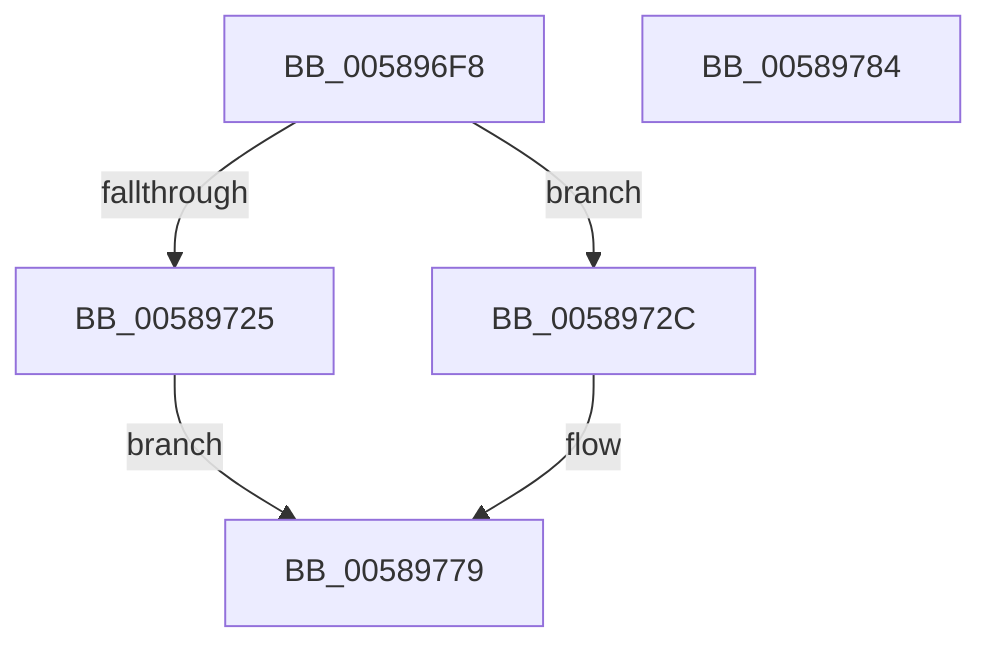

# HvlSetPartitionProperty

- RVA: `0x005896F8`–`0x00589785` (길이 `141` bytes)
- VA: `0x00000001405896F8`
- 실행 섹션: `.text`
- PDB 이름 있음: `예`; PDB Function 태그: `아니요`
- unwind 정보 RVA: `0x00065960`
- 디코드: `38`개 명령, `141/141` bytes 표시
- 미해석 바이트: `0` (있으면 어셈블리에 `.byte`로 보존)

> 이 문서는 커널 이미지의 기계어와 PDB 기호를 분석해 생성했습니다. 4번과 5번은 함수 원형과 자료형을 바이너리 사용 방식에서 추정한 C 해석이며 원본 소스 복구 결과는 아닙니다.

## 1. Dependencies

- 직접 호출 지점: **3**; 고유 호출 대상: **3**
- 직접 호출자로 확인된 함수: **2**
- RIP 상대 이미지 참조: **1**

### Outgoing calls
- `0x0058973E` → [HvlpAcquireHypercallPage](../47/HvlpAcquireHypercallPage_function_00471410.md) (function, `0x00471410`)
- `0x0058975D` → [HvcallInitiateHypercall](../31/HvcallInitiateHypercall_function_00313630.md) (function, `0x00313630`)
- `0x0058976A` → [HvlpReleaseHypercallPage](../31/HvlpReleaseHypercallPage_function_00313480.md) (function, `0x00313480`)

### Direct callers
- [HvlResumePartition](HvlResumePartition_function_005894A0.md) at `0x005894A7`
- [HvlSuspendPartition](HvlSuspendPartition_function_00589A30.md) at `0x00589A3A`

### Static image references
- `0x00589716` → RVA `0x00FC6A90` (`ALMOSTRO`; read)

## 2. Other-region calls and transfers

- 다른 실행 섹션으로 향하는 call: **0**
- 별도 외부 분기/꼬리 이동을 확인하지 못했습니다.

## 3. Assembly (complete function range)

```asm
005896F8  48 89 5C 24 08                  mov qword ptr [rsp + 8], rbx
005896FD  57                              push rdi
005896FE  48 83 EC 40                     sub rsp, 0x40
00589702  33 C0                           xor eax, eax
00589704  0F 57 C0                        xorps xmm0, xmm0
00589707  48 89 44 24 30                  mov qword ptr [rsp + 0x30], rax
0058970C  49 8B D8                        mov rbx, r8
0058970F  89 44 24 38                     mov dword ptr [rsp + 0x38], eax
00589713  48 8B F9                        mov rdi, rcx
00589716  8B 05 74 D3 A3 00               mov eax, dword ptr [rip + 0xa3d374]
0058971C  0F 11 44 24 20                  movups xmmword ptr [rsp + 0x20], xmm0
00589721  A8 02                           test al, 2
00589723  75 07                           jne 0x14058972c
00589725  B8 22 00 00 C0                  mov eax, 0xc0000022
0058972A  EB 4D                           jmp 0x140589779
0058972C  41 B9 18 00 00 00               mov r9d, 0x18
00589732  48 8D 4C 24 20                  lea rcx, [rsp + 0x20]
00589737  45 33 C0                        xor r8d, r8d
0058973A  41 8D 51 E9                     lea edx, [r9 - 0x17]
0058973E  E8 CD 7C EE FF                  call 0x140471410
00589743  48 8B 54 24 38                  mov rdx, qword ptr [rsp + 0x38]
00589748  45 33 C0                        xor r8d, r8d
0058974B  48 89 38                        mov qword ptr [rax], rdi
0058974E  41 8D 48 45                     lea ecx, [r8 + 0x45]
00589752  C7 40 08 00 00 02 00            mov dword ptr [rax + 8], 0x20000
00589759  48 89 58 10                     mov qword ptr [rax + 0x10], rbx
0058975D  E8 CE 9E D8 FF                  call 0x140313630
00589762  48 8D 4C 24 20                  lea rcx, [rsp + 0x20]
00589767  48 8B D8                        mov rbx, rax
0058976A  E8 11 9D D8 FF                  call 0x140313480
0058976F  66 F7 DB                        neg bx
00589772  1B C0                           sbb eax, eax
00589774  25 01 00 00 C0                  and eax, 0xc0000001
00589779  48 8B 5C 24 50                  mov rbx, qword ptr [rsp + 0x50]
0058977E  48 83 C4 40                     add rsp, 0x40
00589782  5F                              pop rdi
00589783  C3                              ret
00589784  CC                              int3
```

## 4. C-style interpretation (structured pseudocode)

```c
__int64 __fastcall HvlSetPartitionProperty(__int64 a1, __int64 a2, __int64 a3)
{
    __int64 result;
    __int64 v_rbx;
    __int64 v_rsp;
    unsigned int v_stack_m10;
    unsigned __int64 v_stack_m18;
    unsigned __int64 v_stack_m28;
    unsigned __int64 v_stack_p8;

    v_stack_p8 = v_rbx;
    v_rsp = (v_rsp) - (64);
    result = 0;
    v_stack_m18 = 0;
    v_stack_m10 = 0;
    v_stack_m28 = v_xmm0;
    if ((((unsigned __int8)((unsigned int)(*(unsigned int *)(v_rip + 10736500)))) & (2)) != 0) goto loc_0058972C;
    goto loc_00589779;
loc_0058972C:
    a3 = 0;
    result = HvlpAcquireHypercallPage(v_stack_m28, 24 - 23, a3, 24);
    a3 = 0;
    *(unsigned __int64 *)(result) = a1;
    *(unsigned int *)(result + 8) = 0x20000ULL;
    *(unsigned __int64 *)(result + 16) = 0;
    result = HvcallInitiateHypercall(a3 + 69, v_stack_m10, a3, 24);
    result = HvlpReleaseHypercallPage(v_stack_m28, v_stack_m10, a3, 24);
    v_rbx = (unsigned __int16)(-(result));
    result = (unsigned int)((result) & (0xC0000001ULL));
loc_00589779:
    v_rsp = (v_rsp) + (64);
    return result;
}
```

## 5. (Beta) C Style

```c
int64_t HvlSetPartitionProperty(int64_t Arg1, int64_t Arg2, int64_t Arg3)
{
    int64_t result;
    int64_t local_rbx;
    int64_t local_rsp;
    uint32_t v_stack_m10;
    uint64_t v_stack_m18;
    uint64_t v_stack_m28;
    uint64_t v_stack_p8;

    v_stack_p8 = local_rbx;
    local_rsp = (local_rsp) - (64);
    result = 0;
    v_stack_m18 = 0;
    v_stack_m10 = 0;
    v_stack_m28 = v_xmm0;
    if ((((uint8_t)((uint32_t)(*(uint32_t *)(v_rip + 0xA3D374)))) & (2)) != 0) goto loc_0058972C;
    goto loc_00589779;
loc_0058972C:
    Arg3 = 0;
    result = HvlpAcquireHypercallPage(v_stack_m28, 24 - 23, Arg3, 24);
    Arg3 = 0;
    *(uint64_t *)(result) = Arg1;
    *(uint32_t *)(result + 0x8) = 0x20000ULL;
    *(uint64_t *)(result + 0x10) = 0;
    result = HvcallInitiateHypercall(Arg3 + 69, v_stack_m10, Arg3, 24);
    result = HvlpReleaseHypercallPage(v_stack_m28, v_stack_m10, Arg3, 24);
    local_rbx = (uint16_t)(-(result));
    result = (uint32_t)((result) & (0xC0000001ULL));
loc_00589779:
    local_rsp = (local_rsp) + (64);
    return result;
}
```

## 6. Execution-region graph

[열기: 2D/3D 그래프와 함수 탐색 컨트롤 패널](../../../control-panel.html?section=text&rva=0x005896F8&view=graph)

- 2D 그래프는 위에서 아래로 흐르고, 3D 그래프는 빈 공간을 드래그해 회전합니다. Shift+드래그는 이동, 휠은 확대·축소, 함수 노드 선택은 대상 보고서 이동입니다.

### Static fallback


