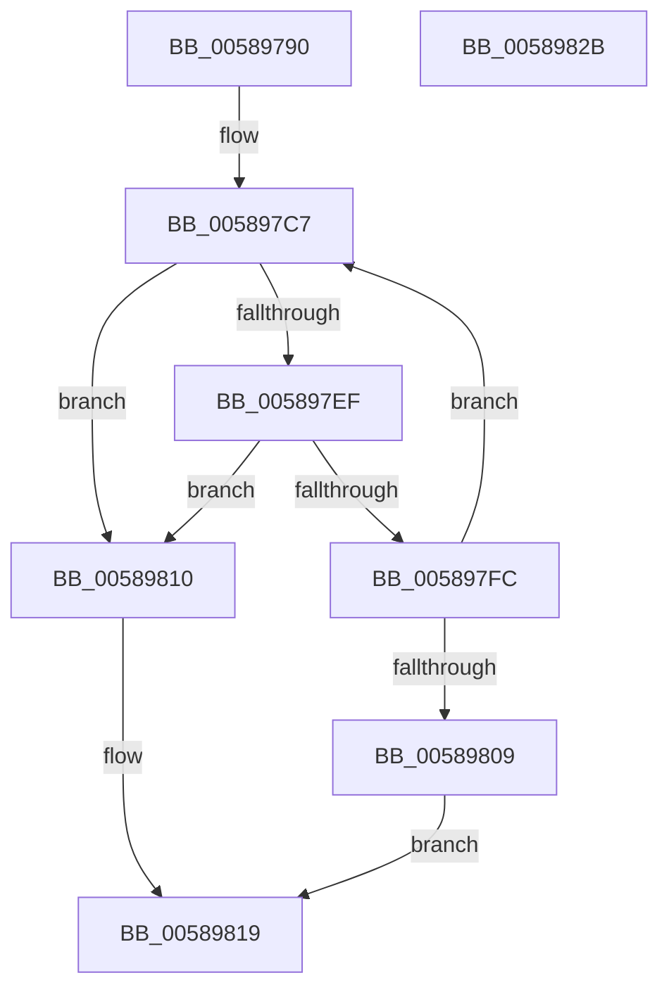

# HvlSetPasidAddressSpace

- RVA: `0x00589790`–`0x0058982C` (길이 `156` bytes)
- VA: `0x0000000140589790`
- 실행 섹션: `.text`
- PDB 이름 있음: `예`; PDB Function 태그: `아니요`
- unwind 정보 RVA: `0x000A02F8`
- 디코드: `38`개 명령, `156/156` bytes 표시
- 미해석 바이트: `0` (있으면 어셈블리에 `.byte`로 보존)

> 이 문서는 커널 이미지의 기계어와 PDB 기호를 분석해 생성했습니다. 4번과 5번은 함수 원형과 자료형을 바이너리 사용 방식에서 추정한 C 해석이며 원본 소스 복구 결과는 아닙니다.

## 1. Dependencies

- 직접 호출 지점: **5**; 고유 호출 대상: **5**
- 직접 호출자로 확인된 함수: **0**
- RIP 상대 이미지 참조: **2**

### Outgoing calls
- `0x005897DD` → [HvcallFastExtended](../31/HvcallFastExtended_function_003130E0.md) (function, `0x003130E0`)
- `0x005897F3` → [HvlpHvStatusIsInsufficientMemory](../30/HvlpHvStatusIsInsufficientMemory_function_00307BB0.md) (function, `0x00307BB0`)
- `0x00589800` → [HvlpHandleInsufficientMemory](HvlpHandleInsufficientMemory_function_00584514.md) (function, `0x00584514`)
- `0x00589814` → [HvlpHvToNtStatus](../30/HvlpHvToNtStatus_function_00307BD8.md) (function, `0x00307BD8`)
- `0x00589821` → [_security_check_cookie](../6A/_security_check_cookie_function_006AC640.md) (function, `0x006AC640`)

### Direct callers
- 이 함수 시작 RVA로 연결되는 직접 call은 확인되지 않았습니다. 간접 호출은 완전히 역산할 수 없습니다.

### Static image references
- `0x00589794` → RVA `0x00E0A740` (`.data`; read)
- `0x005897E5` → RVA `0x00FC6A90` (`ALMOSTRO`; read)

## 2. Other-region calls and transfers

- 다른 실행 섹션으로 향하는 call: **0**
- 별도 외부 분기/꼬리 이동을 확인하지 못했습니다.

## 3. Assembly (complete function range)

```asm
00589790  48 83 EC 78                     sub rsp, 0x78
00589794  48 8B 05 A5 0F 88 00            mov rax, qword ptr [rip + 0x880fa5]
0058979B  48 33 C4                        xor rax, rsp
0058979E  48 89 44 24 60                  mov qword ptr [rsp + 0x60], rax
005897A3  48 83 4C 24 40 FF               or qword ptr [rsp + 0x40], 0xffffffffffffffff
005897A9  48 C7 44 24 30 9F 00 00 00      mov qword ptr [rsp + 0x30], 0x9f
005897B2  C7 44 24 30 9F 00 01 00         mov dword ptr [rsp + 0x30], 0x1009f
005897BA  89 4C 24 4C                     mov dword ptr [rsp + 0x4c], ecx
005897BE  89 54 24 48                     mov dword ptr [rsp + 0x48], edx
005897C2  4C 89 44 24 50                  mov qword ptr [rsp + 0x50], r8
005897C7  48 8B 4C 24 30                  mov rcx, qword ptr [rsp + 0x30]
005897CC  48 8D 54 24 40                  lea rdx, [rsp + 0x40]
005897D1  83 64 24 20 00                  and dword ptr [rsp + 0x20], 0
005897D6  45 33 C9                        xor r9d, r9d
005897D9  45 8D 41 18                     lea r8d, [r9 + 0x18]
005897DD  E8 FE 98 D8 FF                  call 0x1403130e0
005897E2  4C 8B C0                        mov r8, rax
005897E5  8B 05 A5 D2 A3 00               mov eax, dword ptr [rip + 0xa3d2a5]
005897EB  A8 02                           test al, 2
005897ED  74 21                           je 0x140589810
005897EF  41 0F B7 C8                     movzx ecx, r8w
005897F3  E8 B8 E3 D7 FF                  call 0x140307bb0
005897F8  84 C0                           test al, al
005897FA  74 14                           je 0x140589810
005897FC  41 0F B7 C8                     movzx ecx, r8w
00589800  E8 0F AD FF FF                  call 0x140584514
00589805  85 C0                           test eax, eax
00589807  79 BE                           jns 0x1405897c7
00589809  B8 9A 00 00 C0                  mov eax, 0xc000009a
0058980E  EB 09                           jmp 0x140589819
00589810  41 0F B7 C8                     movzx ecx, r8w
00589814  E8 BF E3 D7 FF                  call 0x140307bd8
00589819  48 8B 4C 24 60                  mov rcx, qword ptr [rsp + 0x60]
0058981E  48 33 CC                        xor rcx, rsp
00589821  E8 1A 2E 12 00                  call 0x1406ac640
00589826  48 83 C4 78                     add rsp, 0x78
0058982A  C3                              ret
0058982B  CC                              int3
```

## 4. C-style interpretation (structured pseudocode)

```c
__int64 __fastcall HvlSetPasidAddressSpace(int a1, int a2, __int64 a3, int a4)
{
    __int64 result;
    __int64 v_rsp;
    unsigned __int64 v_stack_m18;
    unsigned __int64 v_stack_m28;
    unsigned int v_stack_m2C;
    unsigned int v_stack_m30;
    unsigned __int64 v_stack_m38;
    unsigned __int64 v_stack_m48;
    unsigned int v_stack_m58;

    v_rsp = (v_rsp) - (120);
    result = (*(unsigned __int64 *)(v_rip + 8916901)) ^ (v_rsp);
    v_stack_m18 = result;
    v_stack_m48 = 159;
    v_stack_m48 = 0x1009FULL;
    v_stack_m2C = a1;
    v_stack_m30 = a2;
    v_stack_m28 = a3;
loc_005897C7:
    a4 = 0;
    result = HvcallFastExtended(v_stack_m48, v_stack_m38, a4 + 24, a4);
    if ((((unsigned __int8)((unsigned int)(*(unsigned int *)(v_rip + 10736293)))) & (2)) == 0) goto loc_00589810;
    result = HvlpHvStatusIsInsufficientMemory((unsigned __int16)(result), v_stack_m38, result, a4);
    if ((unsigned __int8)(result) == 0) goto loc_00589810;
    result = HvlpHandleInsufficientMemory((unsigned __int16)(result), v_stack_m38, result, a4);
    if (!sign_flag) goto loc_005897C7;
    goto loc_00589819;
loc_00589810:
    result = HvlpHvToNtStatus((unsigned __int16)(result), v_stack_m38, result, a4);
loc_00589819:
    a1 = (v_stack_m18) ^ (v_rsp);
    result = _security_check_cookie(a1, v_stack_m38, result, a4);
    v_rsp = (v_rsp) + (120);
    return result;
}
```

## 5. (Beta) C Style

```c
int64_t HvlSetPasidAddressSpace(int32_t Arg1, int32_t Arg2, int64_t Arg3, int32_t Arg4)
{
    int64_t result;
    int64_t local_rsp;
    uint64_t v_stack_m18;
    uint64_t v_stack_m28;
    uint32_t v_stack_m2C;
    uint32_t v_stack_m30;
    uint64_t v_stack_m38;
    uint64_t v_stack_m48;
    uint32_t v_stack_m58;

    local_rsp = (local_rsp) - (120);
    result = (*(uint64_t *)(v_rip + 0x880FA5)) ^ (local_rsp);
    v_stack_m18 = result;
    v_stack_m48 = 159;
    v_stack_m48 = 0x1009FULL;
    v_stack_m2C = Arg1;
    v_stack_m30 = Arg2;
    v_stack_m28 = Arg3;
loc_005897C7:
    Arg4 = 0;
    result = HvcallFastExtended(v_stack_m48, v_stack_m38, Arg4 + 24, Arg4);
    if ((((uint8_t)((uint32_t)(*(uint32_t *)(v_rip + 0xA3D2A5)))) & (2)) == 0) goto loc_00589810;
    result = HvlpHvStatusIsInsufficientMemory((uint16_t)(result), v_stack_m38, result, Arg4);
    if ((uint8_t)(result) == 0) goto loc_00589810;
    result = HvlpHandleInsufficientMemory((uint16_t)(result), v_stack_m38, result, Arg4);
    if (!sign_flag) goto loc_005897C7;
    goto loc_00589819;
loc_00589810:
    result = HvlpHvToNtStatus((uint16_t)(result), v_stack_m38, result, Arg4);
loc_00589819:
    Arg1 = (v_stack_m18) ^ (local_rsp);
    result = _security_check_cookie(Arg1, v_stack_m38, result, Arg4);
    local_rsp = (local_rsp) + (120);
    return result;
}
```

## 6. Execution-region graph

[열기: 2D/3D 그래프와 함수 탐색 컨트롤 패널](../../../control-panel.html?section=text&rva=0x00589790&view=graph)

- 2D 그래프는 위에서 아래로 흐르고, 3D 그래프는 빈 공간을 드래그해 회전합니다. Shift+드래그는 이동, 휠은 확대·축소, 함수 노드 선택은 대상 보고서 이동입니다.

### Static fallback


