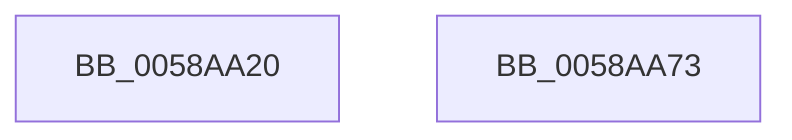

# HvlSetPlatformIdleState

- RVA: `0x0058AA20`–`0x0058AA74` (길이 `84` bytes)
- VA: `0x000000014058AA20`
- 실행 섹션: `.text`
- PDB 이름 있음: `예`; PDB Function 태그: `아니요`
- unwind 정보 RVA: `0x000C6898`
- 디코드: `20`개 명령, `84/84` bytes 표시
- 미해석 바이트: `0` (있으면 어셈블리에 `.byte`로 보존)

> 이 문서는 커널 이미지의 기계어와 PDB 기호를 분석해 생성했습니다. 4번과 5번은 함수 원형과 자료형을 바이너리 사용 방식에서 추정한 C 해석이며 원본 소스 복구 결과는 아닙니다.

## 1. Dependencies

- 직접 호출 지점: **3**; 고유 호출 대상: **3**
- 직접 호출자로 확인된 함수: **1**
- RIP 상대 이미지 참조: **0**

### Outgoing calls
- `0x0058AA3E` → [memset](../6C/memset_function_006C6C40.md) (function, `0x006C6C40`)
- `0x0058AA53` → [HvlGetLpIndexFromProcessorIndex](../44/HvlGetLpIndexFromProcessorIndex_function_0044FFE0.md) (function, `0x0044FFE0`)
- `0x0058AA65` → [HvlpSetPowerProperty](../4C/HvlpSetPowerProperty_function_004C9124.md) (function, `0x004C9124`)

### Direct callers
- [PpmIdleExecuteTransition](../2D/PpmIdleExecuteTransition_function_002D0A1C.md) at `0x002D0E20`
- [PpmIdleExecuteTransition](../2D/PpmIdleExecuteTransition_function_002D0A1C.md) at `0x002D10ED`

### Static image references
- 디코드된 RIP-relative 메모리 참조가 없습니다.

## 2. Other-region calls and transfers

- 다른 실행 섹션으로 향하는 call: **0**
- 별도 외부 분기/꼬리 이동을 확인하지 못했습니다.

## 3. Assembly (complete function range)

```asm
0058AA20  40 53                           push rbx
0058AA22  48 81 EC 40 02 00 00            sub rsp, 0x240
0058AA29  8B D9                           mov ebx, ecx
0058AA2B  33 C0                           xor eax, eax
0058AA2D  48 8D 4C 24 20                  lea rcx, [rsp + 0x20]
0058AA32  89 44 24 24                     mov dword ptr [rsp + 0x24], eax
0058AA36  33 D2                           xor edx, edx
0058AA38  41 B8 14 02 00 00               mov r8d, 0x214
0058AA3E  E8 FD C1 13 00                  call 0x1406c6c40
0058AA43  65 8B 0C 25 A4 01 00 00         mov ecx, dword ptr gs:[0x1a4]
0058AA4B  C7 44 24 20 03 00 00 00         mov dword ptr [rsp + 0x20], 3
0058AA53  E8 88 55 EC FF                  call 0x14044ffe0
0058AA58  48 8D 4C 24 20                  lea rcx, [rsp + 0x20]
0058AA5D  89 44 24 28                     mov dword ptr [rsp + 0x28], eax
0058AA61  89 5C 24 30                     mov dword ptr [rsp + 0x30], ebx
0058AA65  E8 BA E6 F3 FF                  call 0x1404c9124
0058AA6A  48 81 C4 40 02 00 00            add rsp, 0x240
0058AA71  5B                              pop rbx
0058AA72  C3                              ret
0058AA73  CC                              int3
```

## 4. C-style interpretation (structured pseudocode)

```c
__int64 __fastcall HvlSetPlatformIdleState(int a1, int a2)
{
    __int64 result;
    __int64 v_rsp;
    unsigned int v_stack_m218;
    unsigned int v_stack_m220;
    unsigned int v_stack_m224;
    unsigned __int64 v_stack_m228;

    v_rsp = (v_rsp) - (576);
    result = 0;
    v_stack_m224 = 0;
    a2 = 0;
    result = memset(v_stack_m228, a2, 532, a4);
    v_stack_m228 = 3;
    result = HvlGetLpIndexFromProcessorIndex((unsigned int)(*(unsigned int *)(gs_base + (0 + 420))), a2, 532, a4);
    v_stack_m220 = (unsigned int)(result);
    v_stack_m218 = (unsigned int)((unsigned int)(a1));
    result = HvlpSetPowerProperty(v_stack_m228, a2, 532, a4);
    v_rsp = (v_rsp) + (576);
    return result;
}
```

## 5. (Beta) C Style

```c
int64_t HvlSetPlatformIdleState(int32_t Arg1, int32_t Arg2)
{
    int64_t result;
    int64_t local_rsp;
    uint32_t v_stack_m218;
    uint32_t v_stack_m220;
    uint32_t v_stack_m224;
    uint64_t v_stack_m228;

    local_rsp = (local_rsp) - (576);
    result = 0;
    v_stack_m224 = 0;
    Arg2 = 0;
    result = memset(v_stack_m228, Arg2, 532, a4);
    v_stack_m228 = 3;
    result = HvlGetLpIndexFromProcessorIndex((uint32_t)(*(uint32_t *)(gs_base + (0 + 0x1A4))), Arg2, 532, a4);
    v_stack_m220 = (uint32_t)(result);
    v_stack_m218 = (uint32_t)((uint32_t)(Arg1));
    result = HvlpSetPowerProperty(v_stack_m228, Arg2, 532, a4);
    local_rsp = (local_rsp) + (576);
    return result;
}
```

## 6. Execution-region graph

[열기: 2D/3D 그래프와 함수 탐색 컨트롤 패널](../../../control-panel.html?section=text&rva=0x0058AA20&view=graph)

- 2D 그래프는 위에서 아래로 흐르고, 3D 그래프는 빈 공간을 드래그해 회전합니다. Shift+드래그는 이동, 휠은 확대·축소, 함수 노드 선택은 대상 보고서 이동입니다.

### Static fallback


