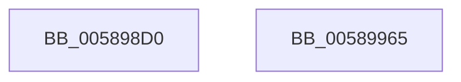

# HvlSetSystemMachineCheckProperty

- RVA: `0x005898D0`–`0x00589966` (길이 `150` bytes)
- VA: `0x00000001405898D0`
- 실행 섹션: `.text`
- PDB 이름 있음: `예`; PDB Function 태그: `아니요`
- unwind 정보 RVA: `0x000AF554`
- 디코드: `36`개 명령, `150/150` bytes 표시
- 미해석 바이트: `0` (있으면 어셈블리에 `.byte`로 보존)

> 이 문서는 커널 이미지의 기계어와 PDB 기호를 분석해 생성했습니다. 4번과 5번은 함수 원형과 자료형을 바이너리 사용 방식에서 추정한 C 해석이며 원본 소스 복구 결과는 아닙니다.

## 1. Dependencies

- 직접 호출 지점: **4**; 고유 호출 대상: **4**
- 직접 호출자로 확인된 함수: **0**
- RIP 상대 이미지 참조: **1**

### Outgoing calls
- `0x00589912` → [HvlpAcquireHypercallPage](../47/HvlpAcquireHypercallPage_function_00471410.md) (function, `0x00471410`)
- `0x00589930` → [HvcallInitiateHypercall](../31/HvcallInitiateHypercall_function_00313630.md) (function, `0x00313630`)
- `0x0058993D` → [HvlpReleaseHypercallPage](../31/HvlpReleaseHypercallPage_function_00313480.md) (function, `0x00313480`)
- `0x00589957` → [_security_check_cookie](../6A/_security_check_cookie_function_006AC640.md) (function, `0x006AC640`)

### Direct callers
- 이 함수 시작 RVA로 연결되는 직접 call은 확인되지 않았습니다. 간접 호출은 완전히 역산할 수 없습니다.

### Static image references
- `0x005898D9` → RVA `0x00E0A740` (`.data`; read)

## 2. Other-region calls and transfers

- 다른 실행 섹션으로 향하는 call: **0**
- 별도 외부 분기/꼬리 이동을 확인하지 못했습니다.

## 3. Assembly (complete function range)

```asm
005898D0  40 53                           push rbx
005898D2  48 81 EC A0 00 00 00            sub rsp, 0xa0
005898D9  48 8B 05 60 0E 88 00            mov rax, qword ptr [rip + 0x880e60]
005898E0  48 33 C4                        xor rax, rsp
005898E3  48 89 84 24 90 00 00 00         mov qword ptr [rsp + 0x90], rax
005898EB  33 C0                           xor eax, eax
005898ED  4C 8D 44 24 40                  lea r8, [rsp + 0x40]
005898F2  48 8B D9                        mov rbx, rcx
005898F5  48 89 44 24 30                  mov qword ptr [rsp + 0x30], rax
005898FA  0F 57 C0                        xorps xmm0, xmm0
005898FD  89 44 24 38                     mov dword ptr [rsp + 0x38], eax
00589901  48 8D 4C 24 20                  lea rcx, [rsp + 0x20]
00589906  44 8D 48 28                     lea r9d, [rax + 0x28]
0058990A  8D 50 01                        lea edx, [rax + 1]
0058990D  0F 11 44 24 20                  movups xmmword ptr [rsp + 0x20], xmm0
00589912  E8 F9 7A EE FF                  call 0x140471410
00589917  48 8B 54 24 38                  mov rdx, qword ptr [rsp + 0x38]
0058991C  45 33 C0                        xor r8d, r8d
0058991F  C7 00 04 00 00 00               mov dword ptr [rax], 4
00589925  48 8B 0B                        mov rcx, qword ptr [rbx]
00589928  48 89 48 08                     mov qword ptr [rax + 8], rcx
0058992C  41 8D 48 6F                     lea ecx, [r8 + 0x6f]
00589930  E8 FB 9C D8 FF                  call 0x140313630
00589935  48 8D 4C 24 20                  lea rcx, [rsp + 0x20]
0058993A  48 8B D8                        mov rbx, rax
0058993D  E8 3E 9B D8 FF                  call 0x140313480
00589942  66 F7 DB                        neg bx
00589945  1B C0                           sbb eax, eax
00589947  25 01 00 00 C0                  and eax, 0xc0000001
0058994C  48 8B 8C 24 90 00 00 00         mov rcx, qword ptr [rsp + 0x90]
00589954  48 33 CC                        xor rcx, rsp
00589957  E8 E4 2C 12 00                  call 0x1406ac640
0058995C  48 81 C4 A0 00 00 00            add rsp, 0xa0
00589963  5B                              pop rbx
00589964  C3                              ret
00589965  CC                              int3
```

## 4. C-style interpretation (structured pseudocode)

```c
__int64 __fastcall HvlSetSystemMachineCheckProperty(__int64 a1)
{
    __int64 result;
    __int64 v_rbx;
    __int64 v_rsp;
    unsigned __int64 v_stack_m18;
    unsigned __int64 v_stack_m68;
    unsigned int v_stack_m70;
    unsigned __int64 v_stack_m78;
    unsigned __int64 v_stack_m88;

    v_rsp = (v_rsp) - (160);
    result = (*(unsigned __int64 *)(v_rip + 8916576)) ^ (v_rsp);
    v_stack_m18 = result;
    result = 0;
    v_stack_m78 = 0;
    v_stack_m70 = 0;
    v_stack_m88 = v_xmm0;
    result = HvlpAcquireHypercallPage(v_stack_m88, result + 1, v_stack_m68, result + 40);
    a3 = 0;
    *(unsigned int *)(result) = 4;
    *(unsigned __int64 *)(result + 8) = *(unsigned __int64 *)(a1);
    result = HvcallInitiateHypercall(a3 + 111, v_stack_m70, a3, result + 40);
    result = HvlpReleaseHypercallPage(v_stack_m88, v_stack_m70, a3, result + 40);
    v_rbx = (unsigned __int16)(-(result));
    result = (unsigned int)((result) & (0xC0000001ULL));
    a1 = (v_stack_m18) ^ (v_rsp);
    result = _security_check_cookie(a1, v_stack_m70, a3, result + 40);
    v_rsp = (v_rsp) + (160);
    return result;
}
```

## 5. (Beta) C Style

```c
int64_t HvlSetSystemMachineCheckProperty(void *Arg1)
{
    uint8_t *arg1 = (uint8_t *)Arg1;

    int64_t result;
    int64_t local_rbx;
    int64_t local_rsp;
    uint64_t v_stack_m18;
    uint64_t v_stack_m68;
    uint32_t v_stack_m70;
    uint64_t v_stack_m78;
    uint64_t v_stack_m88;

    local_rsp = (local_rsp) - (160);
    result = (*(uint64_t *)(v_rip + 0x880E60)) ^ (local_rsp);
    v_stack_m18 = result;
    result = 0;
    v_stack_m78 = 0;
    v_stack_m70 = 0;
    v_stack_m88 = v_xmm0;
    result = HvlpAcquireHypercallPage(v_stack_m88, result + 1, v_stack_m68, result + 40);
    a3 = 0;
    *(uint32_t *)(result) = 4;
    *(uint64_t *)(result + 0x8) = *(uint64_t *)(arg1);
    result = HvcallInitiateHypercall(a3 + 111, v_stack_m70, a3, result + 40);
    result = HvlpReleaseHypercallPage(v_stack_m88, v_stack_m70, a3, result + 40);
    local_rbx = (uint16_t)(-(result));
    result = (uint32_t)((result) & (0xC0000001ULL));
    Arg1 = (v_stack_m18) ^ (local_rsp);
    result = _security_check_cookie(Arg1, v_stack_m70, a3, result + 40);
    local_rsp = (local_rsp) + (160);
    return result;
}
```

### 관측된 메모리 오프셋

구조체 형식이 확인되지 않은 접근은 인자 기준의 오프셋으로만 기록했습니다.

| 기준 인자 | 오프셋 표현 | 폭 (bit) | 접근 |
|---|---:|---:|---|
| `Arg1` | `+ 0x0` | `64` | `R` |

## 6. Execution-region graph

[열기: 2D/3D 그래프와 함수 탐색 컨트롤 패널](../../../control-panel.html?section=text&rva=0x005898D0&view=graph)

- 2D 그래프는 위에서 아래로 흐르고, 3D 그래프는 빈 공간을 드래그해 회전합니다. Shift+드래그는 이동, 휠은 확대·축소, 함수 노드 선택은 대상 보고서 이동입니다.

### Static fallback


