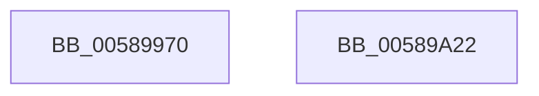

# HvlSetSystemSleepProperty

- RVA: `0x00589970`–`0x00589A23` (길이 `179` bytes)
- VA: `0x0000000140589970`
- 실행 섹션: `.text`
- PDB 이름 있음: `예`; PDB Function 태그: `아니요`
- unwind 정보 RVA: `0x000C6804`
- 디코드: `45`개 명령, `179/179` bytes 표시
- 미해석 바이트: `0` (있으면 어셈블리에 `.byte`로 보존)

> 이 문서는 커널 이미지의 기계어와 PDB 기호를 분석해 생성했습니다. 4번과 5번은 함수 원형과 자료형을 바이너리 사용 방식에서 추정한 C 해석이며 원본 소스 복구 결과는 아닙니다.

## 1. Dependencies

- 직접 호출 지점: **4**; 고유 호출 대상: **4**
- 직접 호출자로 확인된 함수: **0**
- RIP 상대 이미지 참조: **1**

### Outgoing calls
- `0x005899BF` → [HvlpAcquireHypercallPage](../47/HvlpAcquireHypercallPage_function_00471410.md) (function, `0x00471410`)
- `0x005899E1` → [HvcallInitiateHypercall](../31/HvcallInitiateHypercall_function_00313630.md) (function, `0x00313630`)
- `0x005899EE` → [HvlpReleaseHypercallPage](../31/HvlpReleaseHypercallPage_function_00313480.md) (function, `0x00313480`)
- `0x00589A08` → [_security_check_cookie](../6A/_security_check_cookie_function_006AC640.md) (function, `0x006AC640`)

### Direct callers
- 이 함수 시작 RVA로 연결되는 직접 call은 확인되지 않았습니다. 간접 호출은 완전히 역산할 수 없습니다.

### Static image references
- `0x00589983` → RVA `0x00E0A740` (`.data`; read)

## 2. Other-region calls and transfers

- 다른 실행 섹션으로 향하는 call: **0**
- 별도 외부 분기/꼬리 이동을 확인하지 못했습니다.

## 3. Assembly (complete function range)

```asm
00589970  4C 8B DC                        mov r11, rsp
00589973  49 89 5B 08                     mov qword ptr [r11 + 8], rbx
00589977  49 89 73 10                     mov qword ptr [r11 + 0x10], rsi
0058997B  57                              push rdi
0058997C  48 81 EC A0 00 00 00            sub rsp, 0xa0
00589983  48 8B 05 B6 0D 88 00            mov rax, qword ptr [rip + 0x880db6]
0058998A  48 33 C4                        xor rax, rsp
0058998D  48 89 84 24 90 00 00 00         mov qword ptr [rsp + 0x90], rax
00589995  33 C0                           xor eax, eax
00589997  0F 57 C0                        xorps xmm0, xmm0
0058999A  41 8A F0                        mov sil, r8b
0058999D  40 8A FA                        mov dil, dl
005899A0  8B D9                           mov ebx, ecx
005899A2  4D 8D 43 98                     lea r8, [r11 - 0x68]
005899A6  0F 11 44 24 20                  movups xmmword ptr [rsp + 0x20], xmm0
005899AB  49 89 43 88                     mov qword ptr [r11 - 0x78], rax
005899AF  44 8D 48 28                     lea r9d, [rax + 0x28]
005899B3  8D 50 01                        lea edx, [rax + 1]
005899B6  89 44 24 38                     mov dword ptr [rsp + 0x38], eax
005899BA  48 8D 4C 24 20                  lea rcx, [rsp + 0x20]
005899BF  E8 4C 7A EE FF                  call 0x140471410
005899C4  48 8B 54 24 38                  mov rdx, qword ptr [rsp + 0x38]
005899C9  45 33 C0                        xor r8d, r8d
005899CC  C7 00 03 00 00 00               mov dword ptr [rax], 3
005899D2  41 8D 48 6F                     lea ecx, [r8 + 0x6f]
005899D6  89 58 08                        mov dword ptr [rax + 8], ebx
005899D9  40 88 78 0C                     mov byte ptr [rax + 0xc], dil
005899DD  40 88 70 0D                     mov byte ptr [rax + 0xd], sil
005899E1  E8 4A 9C D8 FF                  call 0x140313630
005899E6  48 8D 4C 24 20                  lea rcx, [rsp + 0x20]
005899EB  48 8B D8                        mov rbx, rax
005899EE  E8 8D 9A D8 FF                  call 0x140313480
005899F3  66 F7 DB                        neg bx
005899F6  1B C0                           sbb eax, eax
005899F8  25 01 00 00 C0                  and eax, 0xc0000001
005899FD  48 8B 8C 24 90 00 00 00         mov rcx, qword ptr [rsp + 0x90]
00589A05  48 33 CC                        xor rcx, rsp
00589A08  E8 33 2C 12 00                  call 0x1406ac640
00589A0D  4C 8D 9C 24 A0 00 00 00         lea r11, [rsp + 0xa0]
00589A15  49 8B 5B 10                     mov rbx, qword ptr [r11 + 0x10]
00589A19  49 8B 73 18                     mov rsi, qword ptr [r11 + 0x18]
00589A1D  49 8B E3                        mov rsp, r11
00589A20  5F                              pop rdi
00589A21  C3                              ret
00589A22  CC                              int3
```

## 4. C-style interpretation (structured pseudocode)

```c
__int64 __fastcall HvlSetSystemSleepProperty(int a1, unsigned __int8 a2, unsigned __int8 a3)
{
    __int64 result;
    __int64 v_rbx;
    __int64 v_rsp;
    unsigned __int64 v_stack_m18;
    unsigned int v_stack_m70;
    unsigned __int64 v_stack_m8;
    unsigned __int64 v_stack_m88;

    *(unsigned __int64 *)(v_rsp + 8) = v_rbx;
    *(unsigned __int64 *)(v_rsp + 16) = v_rsi;
    v_rsp = (v_rsp) - (160);
    result = (*(unsigned __int64 *)(v_rip + 8916406)) ^ (v_rsp);
    v_stack_m18 = result;
    result = 0;
    v_stack_m88 = v_xmm0;
    *(unsigned __int64 *)(v_rsp - 120) = 0;
    v_stack_m70 = 0;
    result = HvlpAcquireHypercallPage(v_stack_m88, result + 1, v_rsp - 104, result + 40);
    a3 = 0;
    *(unsigned int *)(result) = 3;
    *(unsigned int *)(result + 8) = (unsigned int)((unsigned int)(a1));
    *(unsigned __int8 *)(result + 12) = a2;
    *(unsigned __int8 *)(result + 13) = 0;
    result = HvcallInitiateHypercall(a3 + 111, v_stack_m70, a3, result + 40);
    result = HvlpReleaseHypercallPage(v_stack_m88, v_stack_m70, a3, result + 40);
    v_rbx = (unsigned __int16)(-(result));
    result = (unsigned int)((result) & (0xC0000001ULL));
    a1 = (v_stack_m18) ^ (v_rsp);
    result = _security_check_cookie(a1, v_stack_m70, a3, result + 40);
    return result;
}
```

## 5. (Beta) C Style

```c
int64_t HvlSetSystemSleepProperty(int32_t Arg1, uint8_t Arg2, uint8_t Arg3)
{
    int64_t result;
    int64_t local_rbx;
    int64_t local_rsp;
    uint64_t v_stack_m18;
    uint32_t v_stack_m70;
    uint64_t v_stack_m8;
    uint64_t v_stack_m88;

    *(uint64_t *)(local_rsp + 0x8) = local_rbx;
    *(uint64_t *)(local_rsp + 0x10) = local_rsi;
    local_rsp = (local_rsp) - (160);
    result = (*(uint64_t *)(v_rip + 0x880DB6)) ^ (local_rsp);
    v_stack_m18 = result;
    result = 0;
    v_stack_m88 = v_xmm0;
    *(uint64_t *)(local_rsp - 0x78) = 0;
    v_stack_m70 = 0;
    result = HvlpAcquireHypercallPage(v_stack_m88, result + 1, local_rsp - 104, result + 40);
    Arg3 = 0;
    *(uint32_t *)(result) = 3;
    *(uint32_t *)(result + 0x8) = (uint32_t)((uint32_t)(Arg1));
    *(uint8_t *)(result + 0xC) = Arg2;
    *(uint8_t *)(result + 0xD) = 0;
    result = HvcallInitiateHypercall(Arg3 + 111, v_stack_m70, Arg3, result + 40);
    result = HvlpReleaseHypercallPage(v_stack_m88, v_stack_m70, Arg3, result + 40);
    local_rbx = (uint16_t)(-(result));
    result = (uint32_t)((result) & (0xC0000001ULL));
    Arg1 = (v_stack_m18) ^ (local_rsp);
    result = _security_check_cookie(Arg1, v_stack_m70, Arg3, result + 40);
    return result;
}
```

## 6. Execution-region graph

[열기: 2D/3D 그래프와 함수 탐색 컨트롤 패널](../../../control-panel.html?section=text&rva=0x00589970&view=graph)

- 2D 그래프는 위에서 아래로 흐르고, 3D 그래프는 빈 공간을 드래그해 회전합니다. Shift+드래그는 이동, 휠은 확대·축소, 함수 노드 선택은 대상 보고서 이동입니다.

### Static fallback


