# HvlSetupLiveDumpBuffer

- RVA: `0x0058DA4C`–`0x0058DE08` (길이 `956` bytes)
- VA: `0x000000014058DA4C`
- 실행 섹션: `.text`
- PDB 이름 있음: `예`; PDB Function 태그: `아니요`
- unwind 정보 RVA: `0x000C6A54`
- 디코드: `256`개 명령, `956/956` bytes 표시
- 미해석 바이트: `0` (있으면 어셈블리에 `.byte`로 보존)

> 이 문서는 커널 이미지의 기계어와 PDB 기호를 분석해 생성했습니다. 4번과 5번은 함수 원형과 자료형을 바이너리 사용 방식에서 추정한 C 해석이며 원본 소스 복구 결과는 아닙니다.

## 1. Dependencies

- 직접 호출 지점: **4**; 고유 호출 대상: **1**
- 직접 호출자로 확인된 함수: **1**
- RIP 상대 이미지 참조: **0**

### Outgoing calls
- `0x0058DB95` → [MmGetPhysicalAddress](../23/MmGetPhysicalAddress_function_0023A500.md) (function, `0x0023A500`)
- `0x0058DBE7` → [MmGetPhysicalAddress](../23/MmGetPhysicalAddress_function_0023A500.md) (function, `0x0023A500`)
- `0x0058DCB8` → [MmGetPhysicalAddress](../23/MmGetPhysicalAddress_function_0023A500.md) (function, `0x0023A500`)
- `0x0058DD68` → [MmGetPhysicalAddress](../23/MmGetPhysicalAddress_function_0023A500.md) (function, `0x0023A500`)

### Direct callers
- [HvlPrepareLivedumpDescriptor](HvlPrepareLivedumpDescriptor_function_0058B734.md) at `0x0058B799`

### Static image references
- 디코드된 RIP-relative 메모리 참조가 없습니다.

## 2. Other-region calls and transfers

- 다른 실행 섹션으로 향하는 call: **0**
- 별도 외부 분기/꼬리 이동을 확인하지 못했습니다.

## 3. Assembly (complete function range)

```asm
0058DA4C  48 8B C4                        mov rax, rsp
0058DA4F  48 89 58 10                     mov qword ptr [rax + 0x10], rbx
0058DA53  48 89 68 18                     mov qword ptr [rax + 0x18], rbp
0058DA57  48 89 70 20                     mov qword ptr [rax + 0x20], rsi
0058DA5B  48 89 48 08                     mov qword ptr [rax + 8], rcx
0058DA5F  57                              push rdi
0058DA60  41 54                           push r12
0058DA62  41 55                           push r13
0058DA64  41 56                           push r14
0058DA66  41 57                           push r15
0058DA68  48 81 EC 80 00 00 00            sub rsp, 0x80
0058DA6F  41 8B E8                        mov ebp, r8d
0058DA72  4C 8B F9                        mov r15, rcx
0058DA75  44 8B C2                        mov r8d, edx
0058DA78  4C 0F AF C5                     imul r8, rbp
0058DA7C  49 83 F8 05                     cmp r8, 5
0058DA80  73 0A                           jae 0x14058da8c
0058DA82  B8 23 00 00 C0                  mov eax, 0xc0000023
0058DA87  E9 5A 03 00 00                  jmp 0x14058dde6
0058DA8C  49 83 E8 02                     sub r8, 2
0058DA90  B9 00 02 00 00                  mov ecx, 0x200
0058DA95  49 8B D8                        mov rbx, r8
0058DA98  48 B8 FD 07 00 E0 3F 00 00 FF   movabs rax, 0xff00003fe00007fd
0058DAA2  49 F7 E0                        mul r8
0058DAA5  48 2B DA                        sub rbx, rdx
0058DAA8  48 D1 EB                        shr rbx, 1
0058DAAB  48 03 DA                        add rbx, rdx
0058DAAE  48 C1 EB 12                     shr rbx, 0x12
0058DAB2  48 3B D9                        cmp rbx, rcx
0058DAB5  48 0F 43 D9                     cmovae rbx, rcx
0058DAB9  48 8B F3                        mov rsi, rbx
0058DABC  48 C1 E6 09                     shl rsi, 9
0058DAC0  48 8B FE                        mov rdi, rsi
0058DAC3  48 89 74 24 20                  mov qword ptr [rsp + 0x20], rsi
0058DAC8  48 C1 E7 09                     shl rdi, 9
0058DACC  48 89 BC 24 E0 00 00 00         mov qword ptr [rsp + 0xe0], rdi
0058DAD4  48 8D 04 3E                     lea rax, [rsi + rdi]
0058DAD8  48 03 C3                        add rax, rbx
0058DADB  4C 2B C0                        sub r8, rax
0058DADE  49 83 F8 03                     cmp r8, 3
0058DAE2  72 5C                           jb 0x14058db40
0058DAE4  48 3B D9                        cmp rbx, rcx
0058DAE7  73 57                           jae 0x14058db40
0058DAE9  49 FF C8                        dec r8
0058DAEC  48 B8 FF 03 F8 0F E0 3F 80 FF   movabs rax, 0xff803fe00ff803ff
0058DAF6  49 F7 E0                        mul r8
0058DAF9  48 FF C3                        inc rbx
0058DAFC  48 C1 EA 09                     shr rdx, 9
0058DB00  48 03 F2                        add rsi, rdx
0058DB03  48 8B C2                        mov rax, rdx
0058DB06  48 C1 E0 09                     shl rax, 9
0058DB0A  48 03 F8                        add rdi, rax
0058DB0D  48 89 74 24 20                  mov qword ptr [rsp + 0x20], rsi
0058DB12  48 69 C2 01 02 00 00            imul rax, rdx, 0x201
0058DB19  48 89 BC 24 E0 00 00 00         mov qword ptr [rsp + 0xe0], rdi
0058DB21  4C 2B C0                        sub r8, rax
0058DB24  49 83 F8 02                     cmp r8, 2
0058DB28  72 16                           jb 0x14058db40
0058DB2A  48 FF C6                        inc rsi
0058DB2D  48 FF CF                        dec rdi
0058DB30  49 03 F8                        add rdi, r8
0058DB33  48 89 74 24 20                  mov qword ptr [rsp + 0x20], rsi
0058DB38  48 89 BC 24 E0 00 00 00         mov qword ptr [rsp + 0xe0], rdi
0058DB40  48 8D 43 02                     lea rax, [rbx + 2]
0058DB44  33 D2                           xor edx, edx
0058DB46  49 89 01                        mov qword ptr [r9], rax
0058DB49  48 8D 0C 30                     lea rcx, [rax + rsi]
0058DB4D  48 89 44 24 38                  mov qword ptr [rsp + 0x38], rax
0058DB52  48 8B 84 24 D0 00 00 00         mov rax, qword ptr [rsp + 0xd0]
0058DB5A  48 89 4C 24 68                  mov qword ptr [rsp + 0x68], rcx
0058DB5F  48 89 08                        mov qword ptr [rax], rcx
0058DB62  8D 42 01                        lea eax, [rdx + 1]
0058DB65  4D 8B 2F                        mov r13, qword ptr [r15]
0058DB68  48 F7 F5                        div rbp
0058DB6B  41 C7 45 08 03 00 00 00         mov dword ptr [r13 + 8], 3
0058DB73  4C 8B F2                        mov r14, rdx
0058DB76  49 89 7D 00                     mov qword ptr [r13], rdi
0058DB7A  49 C1 E6 0C                     shl r14, 0xc
0058DB7E  4C 8B E2                        mov r12, rdx
0058DB81  4C 89 6C 24 70                  mov qword ptr [rsp + 0x70], r13
0058DB86  49 8D 0C C7                     lea rcx, [r15 + rax*8]
0058DB8A  4C 03 31                        add r14, qword ptr [rcx]
0058DB8D  48 89 4C 24 40                  mov qword ptr [rsp + 0x40], rcx
0058DB92  49 8B CE                        mov rcx, r14
0058DB95  E8 66 C9 CA FF                  call 0x14023a500
0058DB9A  48 83 64 24 60 00               and qword ptr [rsp + 0x60], 0
0058DBA0  33 D2                           xor edx, edx
0058DBA2  48 C1 E8 0C                     shr rax, 0xc
0058DBA6  49 89 45 10                     mov qword ptr [r13 + 0x10], rax
0058DBAA  8D 42 02                        lea eax, [rdx + 2]
0058DBAD  48 F7 F5                        div rbp
0058DBB0  48 8B CA                        mov rcx, rdx
0058DBB3  48 89 54 24 28                  mov qword ptr [rsp + 0x28], rdx
0058DBB8  48 C1 E1 0C                     shl rcx, 0xc
0058DBBC  48 89 4C 24 30                  mov qword ptr [rsp + 0x30], rcx
0058DBC1  4D 8D 3C C7                     lea r15, [r15 + rax*8]
0058DBC5  49 03 0F                        add rcx, qword ptr [r15]
0058DBC8  4C 89 7C 24 48                  mov qword ptr [rsp + 0x48], r15
0058DBCD  48 85 DB                        test rbx, rbx
0058DBD0  0F 84 8D 00 00 00               je 0x14058dc63
0058DBD6  48 8B 74 24 60                  mov rsi, qword ptr [rsp + 0x60]
0058DBDB  4D 8B EF                        mov r13, r15
0058DBDE  4C 8B F9                        mov r15, rcx
0058DBE1  48 8B FA                        mov rdi, rdx
0058DBE4  49 8B CF                        mov rcx, r15
0058DBE7  E8 14 C9 CA FF                  call 0x14023a500
0058DBEC  49 89 06                        mov qword ptr [r14], rax
0058DBEF  49 81 C7 00 10 00 00            add r15, 0x1000
0058DBF6  49 83 C6 08                     add r14, 8
0058DBFA  48 FF C6                        inc rsi
0058DBFD  48 F7 C6 FF 01 00 00            test rsi, 0x1ff
0058DC04  75 24                           jne 0x14058dc2a
0058DC06  49 FF C4                        inc r12
0058DC09  33 D2                           xor edx, edx
0058DC0B  49 8B C4                        mov rax, r12
0058DC0E  48 F7 F5                        div rbp
0058DC11  48 85 D2                        test rdx, rdx
0058DC14  75 14                           jne 0x14058dc2a
0058DC16  48 8B 44 24 40                  mov rax, qword ptr [rsp + 0x40]
0058DC1B  48 83 C0 08                     add rax, 8
0058DC1F  48 89 44 24 40                  mov qword ptr [rsp + 0x40], rax
0058DC24  45 33 E4                        xor r12d, r12d
0058DC27  4C 8B 30                        mov r14, qword ptr [rax]
0058DC2A  33 D2                           xor edx, edx
0058DC2C  48 8D 4F 01                     lea rcx, [rdi + 1]
0058DC30  48 8B C1                        mov rax, rcx
0058DC33  48 F7 F5                        div rbp
0058DC36  48 85 D2                        test rdx, rdx
0058DC39  75 08                           jne 0x14058dc43
0058DC3B  49 83 C5 08                     add r13, 8
0058DC3F  4D 8B 7D 00                     mov r15, qword ptr [r13]
0058DC43  48 F7 DA                        neg rdx
0058DC46  48 1B FF                        sbb rdi, rdi
0058DC49  48 23 F9                        and rdi, rcx
0058DC4C  48 3B F3                        cmp rsi, rbx
0058DC4F  72 93                           jb 0x14058dbe4
0058DC51  48 8B BC 24 E0 00 00 00         mov rdi, qword ptr [rsp + 0xe0]
0058DC59  48 8B 74 24 20                  mov rsi, qword ptr [rsp + 0x20]
0058DC5E  4C 8B 7C 24 48                  mov r15, qword ptr [rsp + 0x48]
0058DC63  48 8B 44 24 38                  mov rax, qword ptr [rsp + 0x38]
0058DC68  33 D2                           xor edx, edx
0058DC6A  48 8B 8C 24 B0 00 00 00         mov rcx, qword ptr [rsp + 0xb0]
0058DC72  45 33 ED                        xor r13d, r13d
0058DC75  4C 8B 74 24 30                  mov r14, qword ptr [rsp + 0x30]
0058DC7A  4D 03 37                        add r14, qword ptr [r15]
0058DC7D  48 F7 F5                        div rbp
0058DC80  48 89 54 24 20                  mov qword ptr [rsp + 0x20], rdx
0058DC85  48 8B DA                        mov rbx, rdx
0058DC88  4C 8D 24 C1                     lea r12, [rcx + rax*8]
0058DC8C  48 8B CA                        mov rcx, rdx
0058DC8F  4D 8B 3C 24                     mov r15, qword ptr [r12]
0058DC93  48 C1 E1 0C                     shl rcx, 0xc
0058DC97  4C 03 F9                        add r15, rcx
0058DC9A  4C 89 64 24 38                  mov qword ptr [rsp + 0x38], r12
0058DC9F  48 89 4C 24 30                  mov qword ptr [rsp + 0x30], rcx
0058DCA4  48 85 F6                        test rsi, rsi
0058DCA7  0F 84 84 00 00 00               je 0x14058dd31
0058DCAD  49 8B FC                        mov rdi, r12
0058DCB0  4C 8B 64 24 48                  mov r12, qword ptr [rsp + 0x48]
0058DCB5  49 8B CF                        mov rcx, r15
0058DCB8  E8 43 C8 CA FF                  call 0x14023a500
0058DCBD  49 89 06                        mov qword ptr [r14], rax
0058DCC0  49 81 C7 00 10 00 00            add r15, 0x1000
0058DCC7  49 83 C6 08                     add r14, 8
0058DCCB  49 FF C5                        inc r13
0058DCCE  49 F7 C5 FF 01 00 00            test r13, 0x1ff
0058DCD5  75 27                           jne 0x14058dcfe
0058DCD7  48 8B 4C 24 28                  mov rcx, qword ptr [rsp + 0x28]
0058DCDC  33 D2                           xor edx, edx
0058DCDE  48 FF C1                        inc rcx
0058DCE1  48 8B C1                        mov rax, rcx
0058DCE4  48 89 4C 24 28                  mov qword ptr [rsp + 0x28], rcx
0058DCE9  48 F7 F5                        div rbp
0058DCEC  48 85 D2                        test rdx, rdx
0058DCEF  75 0D                           jne 0x14058dcfe
0058DCF1  49 83 C4 08                     add r12, 8
0058DCF5  48 89 54 24 28                  mov qword ptr [rsp + 0x28], rdx
0058DCFA  4D 8B 34 24                     mov r14, qword ptr [r12]
0058DCFE  33 D2                           xor edx, edx
0058DD00  48 8D 4B 01                     lea rcx, [rbx + 1]
0058DD04  48 8B C1                        mov rax, rcx
0058DD07  48 F7 F5                        div rbp
0058DD0A  48 85 D2                        test rdx, rdx
0058DD0D  75 07                           jne 0x14058dd16
0058DD0F  48 83 C7 08                     add rdi, 8
0058DD13  4C 8B 3F                        mov r15, qword ptr [rdi]
0058DD16  48 F7 DA                        neg rdx
0058DD19  48 1B DB                        sbb rbx, rbx
0058DD1C  48 23 D9                        and rbx, rcx
0058DD1F  4C 3B EE                        cmp r13, rsi
0058DD22  72 91                           jb 0x14058dcb5
0058DD24  48 8B BC 24 E0 00 00 00         mov rdi, qword ptr [rsp + 0xe0]
0058DD2C  4C 8B 64 24 38                  mov r12, qword ptr [rsp + 0x38]
0058DD31  48 8B 44 24 68                  mov rax, qword ptr [rsp + 0x68]
0058DD36  33 D2                           xor edx, edx
0058DD38  48 8B 8C 24 B0 00 00 00         mov rcx, qword ptr [rsp + 0xb0]
0058DD40  45 33 FF                        xor r15d, r15d
0058DD43  4C 8B 6C 24 30                  mov r13, qword ptr [rsp + 0x30]
0058DD48  4D 03 2C 24                     add r13, qword ptr [r12]
0058DD4C  48 F7 F5                        div rbp
0058DD4F  48 8B DA                        mov rbx, rdx
0058DD52  48 8B F2                        mov rsi, rdx
0058DD55  48 C1 E3 0C                     shl rbx, 0xc
0058DD59  4C 8D 34 C1                     lea r14, [rcx + rax*8]
0058DD5D  49 03 1E                        add rbx, qword ptr [r14]
0058DD60  48 85 FF                        test rdi, rdi
0058DD63  74 6F                           je 0x14058ddd4
0058DD65  48 8B CB                        mov rcx, rbx
0058DD68  E8 93 C7 CA FF                  call 0x14023a500
0058DD6D  49 89 45 00                     mov qword ptr [r13], rax
0058DD71  48 81 C3 00 10 00 00            add rbx, 0x1000
0058DD78  49 83 C5 08                     add r13, 8
0058DD7C  49 FF C7                        inc r15
0058DD7F  49 F7 C7 FF 01 00 00            test r15, 0x1ff
0058DD86  75 27                           jne 0x14058ddaf
0058DD88  48 8B 4C 24 20                  mov rcx, qword ptr [rsp + 0x20]
0058DD8D  33 D2                           xor edx, edx
0058DD8F  48 FF C1                        inc rcx
0058DD92  48 8B C1                        mov rax, rcx
0058DD95  48 89 4C 24 20                  mov qword ptr [rsp + 0x20], rcx
0058DD9A  48 F7 F5                        div rbp
0058DD9D  48 85 D2                        test rdx, rdx
0058DDA0  75 0D                           jne 0x14058ddaf
0058DDA2  49 83 C4 08                     add r12, 8
0058DDA6  48 89 54 24 20                  mov qword ptr [rsp + 0x20], rdx
0058DDAB  4D 8B 2C 24                     mov r13, qword ptr [r12]
0058DDAF  48 FF C6                        inc rsi
0058DDB2  33 D2                           xor edx, edx
0058DDB4  48 8B C6                        mov rax, rsi
0058DDB7  48 F7 F5                        div rbp
0058DDBA  48 85 D2                        test rdx, rdx
0058DDBD  75 10                           jne 0x14058ddcf
0058DDBF  4C 3B FF                        cmp r15, rdi
0058DDC2  73 10                           jae 0x14058ddd4
0058DDC4  49 83 C6 08                     add r14, 8
0058DDC8  33 F6                           xor esi, esi
0058DDCA  49 8B 1E                        mov rbx, qword ptr [r14]
0058DDCD  EB 96                           jmp 0x14058dd65
0058DDCF  4C 3B FF                        cmp r15, rdi
0058DDD2  72 91                           jb 0x14058dd65
0058DDD4  48 8B 84 24 D8 00 00 00         mov rax, qword ptr [rsp + 0xd8]
0058DDDC  48 8B 4C 24 70                  mov rcx, qword ptr [rsp + 0x70]
0058DDE1  48 89 08                        mov qword ptr [rax], rcx
0058DDE4  33 C0                           xor eax, eax
0058DDE6  4C 8D 9C 24 80 00 00 00         lea r11, [rsp + 0x80]
0058DDEE  49 8B 5B 38                     mov rbx, qword ptr [r11 + 0x38]
0058DDF2  49 8B 6B 40                     mov rbp, qword ptr [r11 + 0x40]
0058DDF6  49 8B 73 48                     mov rsi, qword ptr [r11 + 0x48]
0058DDFA  49 8B E3                        mov rsp, r11
0058DDFD  41 5F                           pop r15
0058DDFF  41 5E                           pop r14
0058DE01  41 5D                           pop r13
0058DE03  41 5C                           pop r12
0058DE05  5F                              pop rdi
0058DE06  C3                              ret
0058DE07  CC                              int3
```

## 4. C-style interpretation (structured pseudocode)

```c
__int64 __fastcall HvlSetupLiveDumpBuffer(__int64 a1, __int64 a2, int a3, __int64 a4, __int64 a5, __int64 a6, __int64 a7)
{
    __int64 result;
    __int64 v_r12;
    __int64 v_r13;
    __int64 v_r14;
    __int64 v_r15;
    __int64 v_rbx;
    __int64 v_rdi;
    __int64 v_rsi;
    __int64 v_rsp;
    unsigned __int64 v_stack_m28;
    unsigned __int64 v_stack_m38;
    unsigned __int64 v_stack_m40;
    unsigned __int64 v_stack_m48;
    unsigned __int64 v_stack_m60;
    unsigned __int64 v_stack_m68;
    unsigned __int64 v_stack_m70;
    unsigned __int64 v_stack_m78;
    unsigned __int64 v_stack_m80;
    unsigned __int64 v_stack_m88;
    unsigned __int64 v_stack_p38;
    unsigned __int64 v_stack_p8;

    *(unsigned __int64 *)(v_rsp + 16) = v_rbx;
    *(unsigned __int64 *)(v_rsp + 24) = v_rbp;
    *(unsigned __int64 *)(v_rsp + 32) = v_rsi;
    *(unsigned __int64 *)(v_rsp + 8) = a1;
    v_rsp = (v_rsp) - (128);
    a3 = ((unsigned int)((unsigned int)(a2))) * ((unsigned int)(a3));
    if (a3 >= 5) goto loc_0058DA8C;
    goto loc_0058DDE6;
loc_0058DA8C:
    a3 = (a3) - (2);
    v_rbx = (a3) - (a2);
    v_rbx = (v_rbx) >> (1);
    v_rbx = (v_rbx) + (a2);
    v_rbx = (v_rbx) >> (18);
    if (v_rbx >= 512) { v_rbx = 512; }
    v_rsi = (v_rbx) << (9);
    v_stack_m88 = v_rsi;
    v_rdi = (v_rsi) << (9);
    v_stack_p38 = v_rdi;
    result = (v_rsi + v_rdi * 1) + (v_rbx);
    a3 = (a3) - (result);
    if (a3 < 3) goto loc_0058DB40;
    if (v_rbx >= 512) goto loc_0058DB40;
    a3 = (a3) - 1;
    v_rbx = (v_rbx) + 1;
    a2 = (a2) >> (9);
    v_rsi = (v_rsi) + (a2);
    result = (a2) << (9);
    v_rdi = (v_rdi) + (result);
    v_stack_m88 = v_rsi;
    result = (result) * (a2);
    v_stack_p38 = v_rdi;
    a3 = (a3) - (result);
    if (a3 >= 2) {
        v_rsi = (v_rsi) + 1;
        v_rdi = (v_rdi) - 1;
        v_rdi = (v_rdi) + (a3);
        v_stack_m88 = v_rsi;
        v_stack_p38 = v_rdi;
    }
    a2 = 0;
    *(unsigned __int64 *)(a4) = v_rbx + 2;
    v_stack_m70 = v_rbx + 2;
    v_stack_m40 = v_rbx + 2 + v_rsi * 1;
    *(unsigned __int64 *)(a5) = v_rbx + 2 + v_rsi * 1;
    *(unsigned int *)(*(unsigned __int64 *)(a1) + 8) = 3;
    *(unsigned __int64 *)(*(unsigned __int64 *)(a1)) = v_rdi;
    v_r14 = (0) << (12);
    v_stack_m38 = *(unsigned __int64 *)(a1);
    v_r14 = (v_r14) + (*(unsigned __int64 *)(a1 + a2 + 1 * 8));
    v_stack_m68 = a1 + a2 + 1 * 8;
    result = MmGetPhysicalAddress(v_r14, a2, a3, a4);
    a2 = 0;
    result = (result) >> (12);
    *(unsigned __int64 *)(*(unsigned __int64 *)(a1) + 16) = result;
    v_stack_m80 = 0;
    a1 = (0) << (12);
    v_stack_m78 = a1;
    a1 = (a1) + (*(unsigned __int64 *)(a1 + a2 + 2 * 8));
    v_stack_m60 = a1 + a2 + 2 * 8;
    if (v_rbx == 0) goto loc_0058DC63;
loc_0058DBE4:
    result = MmGetPhysicalAddress(a1, a2, a3, a4);
    *(unsigned __int64 *)(v_r14) = result;
    v_r15 = (a1) + (0x1000ULL);
    v_r14 = (v_r14) + (8);
    v_rsi = (v_stack_m48) + 1;
    if (((v_rsi) & (511)) != 0) goto loc_0058DC2A;
    v_r12 = (0) + 1;
    a2 = 0;
    result = v_r12;
    if (0 == 0) {
        result = v_stack_m68;
        result = (result) + (8);
        v_stack_m68 = result;
        v_r12 = 0;
        v_r14 = *(unsigned __int64 *)(result);
    }
    a2 = 0;
    v_r13 = a1 + a2 + 2 * 8;
    if (0 == 0) {
        v_r13 = (a1 + a2 + 2 * 8) + (8);
        v_r15 = *(unsigned __int64 *)(v_r13);
    }
    a2 = -(a2);
    v_rdi = (0) & (0 + 1);
    if (v_rsi < v_rbx) goto loc_0058DBE4;
loc_0058DC63:
    a2 = 0;
    v_r13 = 0;
    v_r14 = (v_stack_m78) + (*(unsigned __int64 *)(v_stack_m60));
    v_stack_m88 = 0;
    a1 = (0) << (12);
    v_r15 = (*(unsigned __int64 *)(v_stack_p8 + v_stack_m70 * 8)) + (a1);
    v_stack_m70 = v_stack_p8 + v_stack_m70 * 8;
    v_stack_m78 = a1;
    if (v_stack_m88 == 0) goto loc_0058DD31;
loc_0058DCB5:
    result = MmGetPhysicalAddress(v_r15, a2, a3, a4);
    *(unsigned __int64 *)(v_r14) = result;
    v_r15 = (v_r15) + (0x1000ULL);
    v_r14 = (v_r14) + (8);
    v_r13 = (v_r13) + 1;
    if (((v_r13) & (511)) != 0) goto loc_0058DCFE;
    a2 = 0;
    a1 = (v_stack_m80) + 1;
    v_stack_m80 = a1;
    v_r12 = v_stack_m60;
    if (0 == 0) {
        v_r12 = (v_stack_m60) + (8);
        v_stack_m80 = 0;
        v_r14 = *(unsigned __int64 *)(v_r12);
    }
    a2 = 0;
    v_rdi = v_stack_p8 + v_stack_m70 * 8;
    if (0 == 0) {
        v_rdi = (v_stack_p8 + v_stack_m70 * 8) + (8);
        v_r15 = *(unsigned __int64 *)(v_rdi);
    }
    a2 = -(a2);
    v_rbx = (0) & (0 + 1);
    if (v_r13 < v_stack_m88) goto loc_0058DCB5;
loc_0058DD31:
    a2 = 0;
    v_r15 = 0;
    v_r13 = (v_stack_m78) + (*(unsigned __int64 *)(v_stack_m70));
    v_rbx = (0) << (12);
    v_rbx = (v_rbx) + (*(unsigned __int64 *)(v_stack_p8 + v_stack_m40 * 8));
    if (a7 == 0) goto loc_0058DDD4;
loc_0058DD65:
    result = MmGetPhysicalAddress(v_rbx, a2, a3, a4);
    *(unsigned __int64 *)(v_r13) = result;
    v_rbx = (v_rbx) + (0x1000ULL);
    v_r13 = (v_r13) + (8);
    v_r15 = (v_r15) + 1;
    if (((v_r15) & (511)) != 0) goto loc_0058DDAF;
    a2 = 0;
    a1 = (v_stack_m88) + 1;
    v_stack_m88 = a1;
    v_r12 = v_stack_m70;
    if (0 == 0) {
        v_r12 = (v_stack_m70) + (8);
        v_stack_m88 = 0;
        v_r13 = *(unsigned __int64 *)(v_r12);
    }
    v_rsi = (0) + 1;
    a2 = 0;
    if (0 != 0) goto loc_0058DDCF;
    if (v_r15 >= a7) goto loc_0058DDD4;
    v_r14 = (v_stack_p8 + v_stack_m40 * 8) + (8);
    v_rsi = 0;
    goto loc_0058DD65;
loc_0058DDCF:
    if (v_r15 < a7) goto loc_0058DD65;
loc_0058DDD4:
    *(unsigned __int64 *)(a6) = v_stack_m38;
    result = 0;
loc_0058DDE6:
    return result;
}
```

## 5. (Beta) C Style

```c
int64_t HvlSetupLiveDumpBuffer(void *Arg1, int64_t Arg2, int32_t Arg3, void *Arg4, void *Arg5, void *Arg6, int64_t Arg7)
{
    uint8_t *arg1 = (uint8_t *)Arg1;
    uint8_t *arg4 = (uint8_t *)Arg4;
    uint8_t *arg5 = (uint8_t *)Arg5;
    uint8_t *arg6 = (uint8_t *)Arg6;

    int64_t result;
    int64_t local_r12;
    int64_t local_r13;
    int64_t local_r14;
    int64_t local_r15;
    int64_t local_rbx;
    int64_t local_rdi;
    int64_t local_rsi;
    int64_t local_rsp;
    uint64_t v_stack_m28;
    uint64_t v_stack_m38;
    uint64_t v_stack_m40;
    uint64_t v_stack_m48;
    uint64_t v_stack_m60;
    uint64_t v_stack_m68;
    uint64_t v_stack_m70;
    uint64_t v_stack_m78;
    uint64_t v_stack_m80;
    uint64_t v_stack_m88;
    uint64_t v_stack_p38;
    uint64_t v_stack_p8;

    *(uint64_t *)(local_rsp + 0x10) = local_rbx;
    *(uint64_t *)(local_rsp + 0x18) = local_rbp;
    *(uint64_t *)(local_rsp + 0x20) = local_rsi;
    *(void **)(local_rsp + 0x8) = Arg1;
    local_rsp = (local_rsp) - (128);
    Arg3 = ((uint32_t)((uint32_t)(Arg2))) * ((uint32_t)(Arg3));
    if (Arg3 >= 5) goto loc_0058DA8C;
    goto loc_0058DDE6;
loc_0058DA8C:
    Arg3 = (Arg3) - (2);
    local_rbx = (Arg3) - (Arg2);
    local_rbx = (local_rbx) >> (1);
    local_rbx = (local_rbx) + (Arg2);
    local_rbx = (local_rbx) >> (18);
    if (local_rbx >= 512) { local_rbx = 512; }
    local_rsi = (local_rbx) << (9);
    v_stack_m88 = local_rsi;
    local_rdi = (local_rsi) << (9);
    v_stack_p38 = local_rdi;
    result = (local_rsi + local_rdi * 1) + (local_rbx);
    Arg3 = (Arg3) - (result);
    if (Arg3 < 3) goto loc_0058DB40;
    if (local_rbx >= 512) goto loc_0058DB40;
    Arg3 = (Arg3) - 1;
    local_rbx = (local_rbx) + 1;
    Arg2 = (Arg2) >> (9);
    local_rsi = (local_rsi) + (Arg2);
    result = (Arg2) << (9);
    local_rdi = (local_rdi) + (result);
    v_stack_m88 = local_rsi;
    result = (result) * (Arg2);
    v_stack_p38 = local_rdi;
    Arg3 = (Arg3) - (result);
    if (Arg3 >= 2) {
        local_rsi = (local_rsi) + 1;
        local_rdi = (local_rdi) - 1;
        local_rdi = (local_rdi) + (Arg3);
        v_stack_m88 = local_rsi;
        v_stack_p38 = local_rdi;
    }
    Arg2 = 0;
    *(uint64_t *)(arg4) = local_rbx + 2;
    v_stack_m70 = local_rbx + 2;
    v_stack_m40 = local_rbx + 2 + local_rsi * 1;
    *(uint64_t *)(arg5) = local_rbx + 2 + local_rsi * 1;
    *(uint32_t *)(*(uint64_t *)(arg1) + 0x8) = 3;
    *(uint64_t *)(*(uint64_t *)(arg1)) = local_rdi;
    local_r14 = (0) << (12);
    v_stack_m38 = *(uint64_t *)(arg1);
    local_r14 = (local_r14) + (*(uint64_t *)(arg1 + Arg2 + 0x1 * 8));
    v_stack_m68 = Arg1 + Arg2 + 1 * 8;
    result = MmGetPhysicalAddress(local_r14, Arg2, Arg3, Arg4);
    Arg2 = 0;
    result = (result) >> (12);
    *(uint64_t *)(*(uint64_t *)(arg1) + 0x10) = result;
    v_stack_m80 = 0;
    Arg1 = (0) << (12);
    v_stack_m78 = Arg1;
    Arg1 = (Arg1) + (*(uint64_t *)(arg1 + Arg2 + 0x2 * 8));
    v_stack_m60 = Arg1 + Arg2 + 2 * 8;
    if (local_rbx == 0) goto loc_0058DC63;
loc_0058DBE4:
    result = MmGetPhysicalAddress(Arg1, Arg2, Arg3, Arg4);
    *(uint64_t *)(local_r14) = result;
    local_r15 = (Arg1) + (0x1000ULL);
    local_r14 = (local_r14) + (8);
    local_rsi = (v_stack_m48) + 1;
    if (((local_rsi) & (511)) != 0) goto loc_0058DC2A;
    local_r12 = (0) + 1;
    Arg2 = 0;
    result = local_r12;
    if (0 == 0) {
        result = v_stack_m68;
        result = (result) + (8);
        v_stack_m68 = result;
        local_r12 = 0;
        local_r14 = *(uint64_t *)(result);
    }
    Arg2 = 0;
    local_r13 = Arg1 + Arg2 + 2 * 8;
    if (0 == 0) {
        local_r13 = (Arg1 + Arg2 + 2 * 8) + (8);
        local_r15 = *(uint64_t *)(local_r13);
    }
    Arg2 = -(Arg2);
    local_rdi = (0) & (0 + 1);
    if (local_rsi < local_rbx) goto loc_0058DBE4;
loc_0058DC63:
    Arg2 = 0;
    local_r13 = 0;
    local_r14 = (v_stack_m78) + (*(uint64_t *)(v_stack_m60));
    v_stack_m88 = 0;
    Arg1 = (0) << (12);
    local_r15 = (*(uint64_t *)(v_stack_p8 + v_stack_m70 * 8)) + (Arg1);
    v_stack_m70 = v_stack_p8 + v_stack_m70 * 8;
    v_stack_m78 = Arg1;
    if (v_stack_m88 == 0) goto loc_0058DD31;
loc_0058DCB5:
    result = MmGetPhysicalAddress(local_r15, Arg2, Arg3, Arg4);
    *(uint64_t *)(local_r14) = result;
    local_r15 = (local_r15) + (0x1000ULL);
    local_r14 = (local_r14) + (8);
    local_r13 = (local_r13) + 1;
    if (((local_r13) & (511)) != 0) goto loc_0058DCFE;
    Arg2 = 0;
    Arg1 = (v_stack_m80) + 1;
    v_stack_m80 = Arg1;
    local_r12 = v_stack_m60;
    if (0 == 0) {
        local_r12 = (v_stack_m60) + (8);
        v_stack_m80 = 0;
        local_r14 = *(uint64_t *)(local_r12);
    }
    Arg2 = 0;
    local_rdi = v_stack_p8 + v_stack_m70 * 8;
    if (0 == 0) {
        local_rdi = (v_stack_p8 + v_stack_m70 * 8) + (8);
        local_r15 = *(uint64_t *)(local_rdi);
    }
    Arg2 = -(Arg2);
    local_rbx = (0) & (0 + 1);
    if (local_r13 < v_stack_m88) goto loc_0058DCB5;
loc_0058DD31:
    Arg2 = 0;
    local_r15 = 0;
    local_r13 = (v_stack_m78) + (*(uint64_t *)(v_stack_m70));
    local_rbx = (0) << (12);
    local_rbx = (local_rbx) + (*(uint64_t *)(v_stack_p8 + v_stack_m40 * 8));
    if (Arg7 == 0) goto loc_0058DDD4;
loc_0058DD65:
    result = MmGetPhysicalAddress(local_rbx, Arg2, Arg3, Arg4);
    *(uint64_t *)(local_r13) = result;
    local_rbx = (local_rbx) + (0x1000ULL);
    local_r13 = (local_r13) + (8);
    local_r15 = (local_r15) + 1;
    if (((local_r15) & (511)) != 0) goto loc_0058DDAF;
    Arg2 = 0;
    Arg1 = (v_stack_m88) + 1;
    v_stack_m88 = Arg1;
    local_r12 = v_stack_m70;
    if (0 == 0) {
        local_r12 = (v_stack_m70) + (8);
        v_stack_m88 = 0;
        local_r13 = *(uint64_t *)(local_r12);
    }
    local_rsi = (0) + 1;
    Arg2 = 0;
    if (0 != 0) goto loc_0058DDCF;
    if (local_r15 >= Arg7) goto loc_0058DDD4;
    local_r14 = (v_stack_p8 + v_stack_m40 * 8) + (8);
    local_rsi = 0;
    goto loc_0058DD65;
loc_0058DDCF:
    if (local_r15 < Arg7) goto loc_0058DD65;
loc_0058DDD4:
    *(uint64_t *)(arg6) = v_stack_m38;
    result = 0;
loc_0058DDE6:
    return result;
}
```

### 관측된 메모리 오프셋

구조체 형식이 확인되지 않은 접근은 인자 기준의 오프셋으로만 기록했습니다.

| 기준 인자 | 오프셋 표현 | 폭 (bit) | 접근 |
|---|---:|---:|---|
| `Arg1` | `+ 0x0` | `64` | `R` |
| `Arg1` | `+ 0x0 + rax*8` | `64` | `R` |
| `Arg4` | `+ 0x0` | `64` | `W` |
| `Arg5` | `+ 0x0` | `64` | `W` |
| `Arg6` | `+ 0x0` | `64` | `W` |

## 6. Execution-region graph

[열기: 2D/3D 그래프와 함수 탐색 컨트롤 패널](../../../control-panel.html?section=text&rva=0x0058DA4C&view=graph)

- 2D 그래프는 위에서 아래로 흐르고, 3D 그래프는 빈 공간을 드래그해 회전합니다. Shift+드래그는 이동, 휠은 확대·축소, 함수 노드 선택은 대상 보고서 이동입니다.

### Static fallback

```mermaid
flowchart TD
  bb_0058DA4C[BB_0058DA4C]
  bb_0058DA82[BB_0058DA82]
  bb_0058DA8C[BB_0058DA8C]
  bb_0058DAE4[BB_0058DAE4]
  bb_0058DAE9[BB_0058DAE9]
  bb_0058DB2A[BB_0058DB2A]
  bb_0058DB40[BB_0058DB40]
  bb_0058DBD6[BB_0058DBD6]
  bb_0058DBE4[BB_0058DBE4]
  bb_0058DC06[BB_0058DC06]
  bb_0058DC16[BB_0058DC16]
  bb_0058DC2A[BB_0058DC2A]
  bb_0058DC3B[BB_0058DC3B]
  bb_0058DC43[BB_0058DC43]
  bb_0058DC51[BB_0058DC51]
  bb_0058DC63[BB_0058DC63]
  bb_0058DCAD[BB_0058DCAD]
  bb_0058DCB5[BB_0058DCB5]
  bb_0058DCD7[BB_0058DCD7]
  bb_0058DCF1[BB_0058DCF1]
  bb_0058DCFE[BB_0058DCFE]
  bb_0058DD0F[BB_0058DD0F]
  bb_0058DD16[BB_0058DD16]
  bb_0058DD24[BB_0058DD24]
  bb_0058DD31[BB_0058DD31]
  bb_0058DD65[BB_0058DD65]
  bb_0058DD88[BB_0058DD88]
  bb_0058DDA2[BB_0058DDA2]
  bb_0058DDAF[BB_0058DDAF]
  bb_0058DDBF[BB_0058DDBF]
  bb_0058DDC4[BB_0058DDC4]
  bb_0058DDCF[BB_0058DDCF]
  bb_0058DDD4[BB_0058DDD4]
  bb_0058DDE6[BB_0058DDE6]
  bb_0058DE07[BB_0058DE07]
  bb_0058DA4C -->|branch| bb_0058DA8C
  bb_0058DA4C -->|fallthrough| bb_0058DA82
  bb_0058DA82 -->|branch| bb_0058DDE6
  bb_0058DA8C -->|branch| bb_0058DB40
  bb_0058DA8C -->|fallthrough| bb_0058DAE4
  bb_0058DAE4 -->|branch| bb_0058DB40
  bb_0058DAE4 -->|fallthrough| bb_0058DAE9
  bb_0058DAE9 -->|branch| bb_0058DB40
  bb_0058DAE9 -->|fallthrough| bb_0058DB2A
  bb_0058DB2A -->|flow| bb_0058DB40
  bb_0058DB40 -->|branch| bb_0058DC63
  bb_0058DB40 -->|fallthrough| bb_0058DBD6
  bb_0058DBD6 -->|flow| bb_0058DBE4
  bb_0058DBE4 -->|branch| bb_0058DC2A
  bb_0058DBE4 -->|fallthrough| bb_0058DC06
  bb_0058DC06 -->|branch| bb_0058DC2A
  bb_0058DC06 -->|fallthrough| bb_0058DC16
  bb_0058DC16 -->|flow| bb_0058DC2A
  bb_0058DC2A -->|branch| bb_0058DC43
  bb_0058DC2A -->|fallthrough| bb_0058DC3B
  bb_0058DC3B -->|flow| bb_0058DC43
  bb_0058DC43 -->|branch| bb_0058DBE4
  bb_0058DC43 -->|fallthrough| bb_0058DC51
  bb_0058DC51 -->|flow| bb_0058DC63
  bb_0058DC63 -->|branch| bb_0058DD31
  bb_0058DC63 -->|fallthrough| bb_0058DCAD
  bb_0058DCAD -->|flow| bb_0058DCB5
  bb_0058DCB5 -->|branch| bb_0058DCFE
  bb_0058DCB5 -->|fallthrough| bb_0058DCD7
  bb_0058DCD7 -->|branch| bb_0058DCFE
  bb_0058DCD7 -->|fallthrough| bb_0058DCF1
  bb_0058DCF1 -->|flow| bb_0058DCFE
  bb_0058DCFE -->|branch| bb_0058DD16
  bb_0058DCFE -->|fallthrough| bb_0058DD0F
  bb_0058DD0F -->|flow| bb_0058DD16
  bb_0058DD16 -->|branch| bb_0058DCB5
  bb_0058DD16 -->|fallthrough| bb_0058DD24
  bb_0058DD24 -->|flow| bb_0058DD31
  bb_0058DD31 -->|branch| bb_0058DDD4
  bb_0058DD31 -->|fallthrough| bb_0058DD65
  bb_0058DD65 -->|branch| bb_0058DDAF
  bb_0058DD65 -->|fallthrough| bb_0058DD88
  bb_0058DD88 -->|branch| bb_0058DDAF
  bb_0058DD88 -->|fallthrough| bb_0058DDA2
  bb_0058DDA2 -->|flow| bb_0058DDAF
  bb_0058DDAF -->|branch| bb_0058DDCF
  bb_0058DDAF -->|fallthrough| bb_0058DDBF
  bb_0058DDBF -->|branch| bb_0058DDD4
  bb_0058DDBF -->|fallthrough| bb_0058DDC4
  bb_0058DDC4 -->|branch| bb_0058DD65
  bb_0058DDCF -->|branch| bb_0058DD65
  bb_0058DDCF -->|fallthrough| bb_0058DDD4
  bb_0058DDD4 -->|flow| bb_0058DDE6
```


