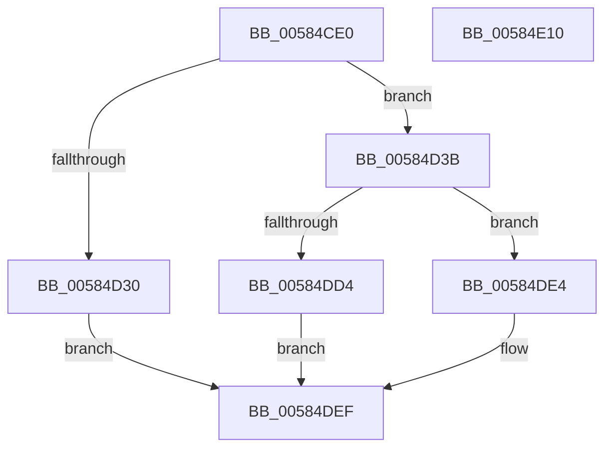

# HvlSetupPhysicalFaultNotificationQueue

- RVA: `0x00584CE0`–`0x00584E11` (길이 `305` bytes)
- VA: `0x0000000140584CE0`
- 실행 섹션: `.text`
- PDB 이름 있음: `예`; PDB Function 태그: `아니요`
- unwind 정보 RVA: `0x000BE68C`
- 디코드: `86`개 명령, `305/305` bytes 표시
- 미해석 바이트: `0` (있으면 어셈블리에 `.byte`로 보존)

> 이 문서는 커널 이미지의 기계어와 PDB 기호를 분석해 생성했습니다. 4번과 5번은 함수 원형과 자료형을 바이너리 사용 방식에서 추정한 C 해석이며 원본 소스 복구 결과는 아닙니다.

## 1. Dependencies

- 직접 호출 지점: **9**; 고유 호출 대상: **7**
- 직접 호출자로 확인된 함수: **1**
- RIP 상대 이미지 참조: **0**

### Outgoing calls
- `0x00584D20` → [HvlpAllocateOverlayPages](HvlpAllocateOverlayPages_function_0058D3F8.md) (function, `0x0058D3F8`)
- `0x00584D46` → [memset](../6C/memset_function_006C6C40.md) (function, `0x006C6C40`)
- `0x00584D4E` → [MmGetPhysicalAddress](../23/MmGetPhysicalAddress_function_0023A500.md) (function, `0x0023A500`)
- `0x00584D67` → [HvlpAcquireHypercallPage](../47/HvlpAcquireHypercallPage_function_00471410.md) (function, `0x00471410`)
- `0x00584D80` → [HvlpAcquireHypercallPage](../47/HvlpAcquireHypercallPage_function_00471410.md) (function, `0x00471410`)
- `0x00584DB3` → [HvcallInitiateHypercall](../31/HvcallInitiateHypercall_function_00313630.md) (function, `0x00313630`)
- `0x00584DC1` → [HvlpReleaseHypercallPage](../31/HvlpReleaseHypercallPage_function_00313480.md) (function, `0x00313480`)
- `0x00584DCA` → [HvlpReleaseHypercallPage](../31/HvlpReleaseHypercallPage_function_00313480.md) (function, `0x00313480`)
- `0x00584DDD` → [MmFreeContiguousMemory](../3F/MmFreeContiguousMemory_function_003F6F60.md) (function, `0x003F6F60`)

### Direct callers
- [KiEpfInitialize](../../init/C3/KiEpfInitialize_function_00C39FC0.md) at `0x00C3A05B`

### Static image references
- 디코드된 RIP-relative 메모리 참조가 없습니다.

## 2. Other-region calls and transfers

- 다른 실행 섹션으로 향하는 call: **0**
- 별도 외부 분기/꼬리 이동을 확인하지 못했습니다.

## 3. Assembly (complete function range)

```asm
00584CE0  48 89 5C 24 08                  mov qword ptr [rsp + 8], rbx
00584CE5  48 89 74 24 10                  mov qword ptr [rsp + 0x10], rsi
00584CEA  48 89 7C 24 18                  mov qword ptr [rsp + 0x18], rdi
00584CEF  55                              push rbp
00584CF0  41 54                           push r12
00584CF2  41 55                           push r13
00584CF4  41 56                           push r14
00584CF6  41 57                           push r15
00584CF8  48 8B EC                        mov rbp, rsp
00584CFB  48 83 EC 60                     sub rsp, 0x60
00584CFF  33 C0                           xor eax, eax
00584D01  0F 57 C0                        xorps xmm0, xmm0
00584D04  0F 11 45 E0                     movups xmmword ptr [rbp - 0x20], xmm0
00584D08  48 89 45 F0                     mov qword ptr [rbp - 0x10], rax
00584D0C  4C 8B E2                        mov r12, rdx
00584D0F  89 45 F8                        mov dword ptr [rbp - 8], eax
00584D12  4C 8B E9                        mov r13, rcx
00584D15  0F 11 45 C0                     movups xmmword ptr [rbp - 0x40], xmm0
00584D19  48 89 45 D0                     mov qword ptr [rbp - 0x30], rax
00584D1D  89 45 D8                        mov dword ptr [rbp - 0x28], eax
00584D20  E8 D3 86 00 00                  call 0x14058d3f8
00584D25  45 33 F6                        xor r14d, r14d
00584D28  4C 8B F8                        mov r15, rax
00584D2B  48 85 C0                        test rax, rax
00584D2E  75 0B                           jne 0x140584d3b
00584D30  41 BE 9A 00 00 C0               mov r14d, 0xc000009a
00584D36  E9 B4 00 00 00                  jmp 0x140584def
00584D3B  33 D2                           xor edx, edx
00584D3D  41 B8 00 10 00 00               mov r8d, 0x1000
00584D43  49 8B CF                        mov rcx, r15
00584D46  E8 F5 1E 14 00                  call 0x1406c6c40
00584D4B  49 8B CF                        mov rcx, r15
00584D4E  E8 AD 57 CB FF                  call 0x14023a500
00584D53  41 B9 18 00 00 00               mov r9d, 0x18
00584D59  48 8D 4D E0                     lea rcx, [rbp - 0x20]
00584D5D  45 33 C0                        xor r8d, r8d
00584D60  48 8B D8                        mov rbx, rax
00584D63  41 8D 51 E9                     lea edx, [r9 - 0x17]
00584D67  E8 A4 C6 EE FF                  call 0x140471410
00584D6C  41 B9 08 00 00 00               mov r9d, 8
00584D72  48 8D 4D C0                     lea rcx, [rbp - 0x40]
00584D76  45 33 C0                        xor r8d, r8d
00584D79  48 8B F8                        mov rdi, rax
00584D7C  41 8D 51 FA                     lea edx, [r9 - 6]
00584D80  E8 8B C6 EE FF                  call 0x140471410
00584D85  48 8B F0                        mov rsi, rax
00584D88  41 B8 00 10 00 00               mov r8d, 0x1000
00584D8E  48 8B C3                        mov rax, rbx
00584D91  B9 01 00 00 00                  mov ecx, 1
00584D96  48 99                           cqo
00584D98  48 89 0F                        mov qword ptr [rdi], rcx
00584D9B  49 F7 F8                        idiv r8
00584D9E  4C 8B 45 D8                     mov r8, qword ptr [rbp - 0x28]
00584DA2  48 8B 55 F8                     mov rdx, qword ptr [rbp - 8]
00584DA6  48 89 4F 10                     mov qword ptr [rdi + 0x10], rcx
00584DAA  B9 04 80 00 00                  mov ecx, 0x8004
00584DAF  48 89 47 08                     mov qword ptr [rdi + 8], rax
00584DB3  E8 78 E8 D8 FF                  call 0x140313630
00584DB8  8B 3E                           mov edi, dword ptr [rsi]
00584DBA  48 8D 4D C0                     lea rcx, [rbp - 0x40]
00584DBE  48 8B D8                        mov rbx, rax
00584DC1  E8 BA E6 D8 FF                  call 0x140313480
00584DC6  48 8D 4D E0                     lea rcx, [rbp - 0x20]
00584DCA  E8 B1 E6 D8 FF                  call 0x140313480
00584DCF  66 85 DB                        test bx, bx
00584DD2  74 10                           je 0x140584de4
00584DD4  49 8B CF                        mov rcx, r15
00584DD7  41 BE 01 00 00 C0               mov r14d, 0xc0000001
00584DDD  E8 7E 21 E7 FF                  call 0x1403f6f60
00584DE2  EB 0B                           jmp 0x140584def
00584DE4  C1 E7 0C                        shl edi, 0xc
00584DE7  41 89 3C 24                     mov dword ptr [r12], edi
00584DEB  4D 89 7D 00                     mov qword ptr [r13], r15
00584DEF  4C 8D 5C 24 60                  lea r11, [rsp + 0x60]
00584DF4  41 8B C6                        mov eax, r14d
00584DF7  49 8B 5B 30                     mov rbx, qword ptr [r11 + 0x30]
00584DFB  49 8B 73 38                     mov rsi, qword ptr [r11 + 0x38]
00584DFF  49 8B 7B 40                     mov rdi, qword ptr [r11 + 0x40]
00584E03  49 8B E3                        mov rsp, r11
00584E06  41 5F                           pop r15
00584E08  41 5E                           pop r14
00584E0A  41 5D                           pop r13
00584E0C  41 5C                           pop r12
00584E0E  5D                              pop rbp
00584E0F  C3                              ret
00584E10  CC                              int3
```

## 4. C-style interpretation (structured pseudocode)

```c
__int64 __fastcall HvlSetupPhysicalFaultNotificationQueue(__int64 a1, __int64 a2)
{
    __int64 result;
    __int64 v_r14;
    __int64 v_rdi;
    __int64 v_rsp;
    unsigned __int64 v_stack_m28;
    unsigned int v_stack_m30;
    unsigned __int64 v_stack_m38;
    unsigned __int64 v_stack_m48;
    unsigned int v_stack_m50;
    unsigned __int64 v_stack_m58;
    unsigned __int64 v_stack_m68;
    unsigned __int64 v_stack_p10;
    unsigned __int64 v_stack_p18;
    unsigned __int64 v_stack_p8;

    v_stack_p8 = v_rbx;
    v_stack_p10 = v_rsi;
    v_stack_p18 = v_rdi;
    v_rsp = (v_rsp) - (96);
    result = 0;
    v_stack_m48 = v_xmm0;
    v_stack_m38 = 0;
    v_stack_m30 = 0;
    v_stack_m68 = v_xmm0;
    v_stack_m58 = 0;
    v_stack_m50 = 0;
    result = HvlpAllocateOverlayPages(a1, a2, a3, a4);
    v_r14 = 0;
    if (result != 0) goto loc_00584D3B;
    goto loc_00584DEF;
loc_00584D3B:
    a2 = 0;
    result = memset(result, a2, (unsigned int)(0x1000ULL), a4);
    result = MmGetPhysicalAddress(result, a2, (unsigned int)(0x1000ULL), a4);
    a3 = 0;
    result = HvlpAcquireHypercallPage(v_stack_m48, 24 - 23, a3, 24);
    a3 = 0;
    result = HvlpAcquireHypercallPage(v_stack_m68, 8 - 6, a3, 8);
    *(unsigned __int64 *)(result) = 1;
    *(unsigned __int64 *)(result + 16) = 1;
    *(unsigned __int64 *)(result + 8) = result;
    result = HvcallInitiateHypercall((unsigned int)(0x8004ULL), v_stack_m30, v_stack_m50, 8);
    result = HvlpReleaseHypercallPage(v_stack_m68, v_stack_m30, v_stack_m50, 8);
    result = HvlpReleaseHypercallPage(v_stack_m48, v_stack_m30, v_stack_m50, 8);
    if ((unsigned __int16)(result) == 0) goto loc_00584DE4;
    result = MmFreeContiguousMemory(result, v_stack_m30, v_stack_m50, 8);
    goto loc_00584DEF;
loc_00584DE4:
    v_rdi = (unsigned int)(((unsigned int)(*(unsigned int *)(result))) << (12));
    *(unsigned int *)(a2) = (unsigned int)(v_rdi);
    *(unsigned __int64 *)(a1) = result;
loc_00584DEF:
    return (unsigned int)((unsigned int)((unsigned int)(0xC0000001ULL)));
}
```

## 5. (Beta) C Style

```c
int64_t HvlSetupPhysicalFaultNotificationQueue(void *Arg1, void *Arg2)
{
    uint8_t *arg1 = (uint8_t *)Arg1;
    uint8_t *arg2 = (uint8_t *)Arg2;

    int64_t result;
    int64_t local_r14;
    int64_t local_rdi;
    int64_t local_rsp;
    uint64_t v_stack_m28;
    uint32_t v_stack_m30;
    uint64_t v_stack_m38;
    uint64_t v_stack_m48;
    uint32_t v_stack_m50;
    uint64_t v_stack_m58;
    uint64_t v_stack_m68;
    uint64_t v_stack_p10;
    uint64_t v_stack_p18;
    uint64_t v_stack_p8;

    v_stack_p8 = local_rbx;
    v_stack_p10 = local_rsi;
    v_stack_p18 = local_rdi;
    local_rsp = (local_rsp) - (96);
    result = 0;
    v_stack_m48 = v_xmm0;
    v_stack_m38 = 0;
    v_stack_m30 = 0;
    v_stack_m68 = v_xmm0;
    v_stack_m58 = 0;
    v_stack_m50 = 0;
    result = HvlpAllocateOverlayPages(Arg1, Arg2, a3, a4);
    local_r14 = 0;
    if (result != 0) goto loc_00584D3B;
    goto loc_00584DEF;
loc_00584D3B:
    Arg2 = 0;
    result = memset(result, Arg2, (uint32_t)(0x1000ULL), a4);
    result = MmGetPhysicalAddress(result, Arg2, (uint32_t)(0x1000ULL), a4);
    a3 = 0;
    result = HvlpAcquireHypercallPage(v_stack_m48, 24 - 23, a3, 24);
    a3 = 0;
    result = HvlpAcquireHypercallPage(v_stack_m68, 8 - 6, a3, 8);
    *(uint64_t *)(result) = 1;
    *(uint64_t *)(result + 0x10) = 1;
    *(uint64_t *)(result + 0x8) = result;
    result = HvcallInitiateHypercall((uint32_t)(0x8004ULL), v_stack_m30, v_stack_m50, 8);
    result = HvlpReleaseHypercallPage(v_stack_m68, v_stack_m30, v_stack_m50, 8);
    result = HvlpReleaseHypercallPage(v_stack_m48, v_stack_m30, v_stack_m50, 8);
    if ((uint16_t)(result) == 0) goto loc_00584DE4;
    result = MmFreeContiguousMemory(result, v_stack_m30, v_stack_m50, 8);
    goto loc_00584DEF;
loc_00584DE4:
    local_rdi = (uint32_t)(((uint32_t)(*(uint32_t *)(result))) << (12));
    *(uint32_t *)(arg2) = (uint32_t)(local_rdi);
    *(uint64_t *)(arg1) = result;
loc_00584DEF:
    return (uint32_t)((uint32_t)((uint32_t)(0xC0000001ULL)));
}
```

### 관측된 메모리 오프셋

구조체 형식이 확인되지 않은 접근은 인자 기준의 오프셋으로만 기록했습니다.

| 기준 인자 | 오프셋 표현 | 폭 (bit) | 접근 |
|---|---:|---:|---|
| `Arg1` | `+ 0x0` | `64` | `W` |
| `Arg2` | `+ 0x0` | `32` | `W` |

## 6. Execution-region graph

[열기: 2D/3D 그래프와 함수 탐색 컨트롤 패널](../../../control-panel.html?section=text&rva=0x00584CE0&view=graph)

- 2D 그래프는 위에서 아래로 흐르고, 3D 그래프는 빈 공간을 드래그해 회전합니다. Shift+드래그는 이동, 휠은 확대·축소, 함수 노드 선택은 대상 보고서 이동입니다.

### Static fallback


