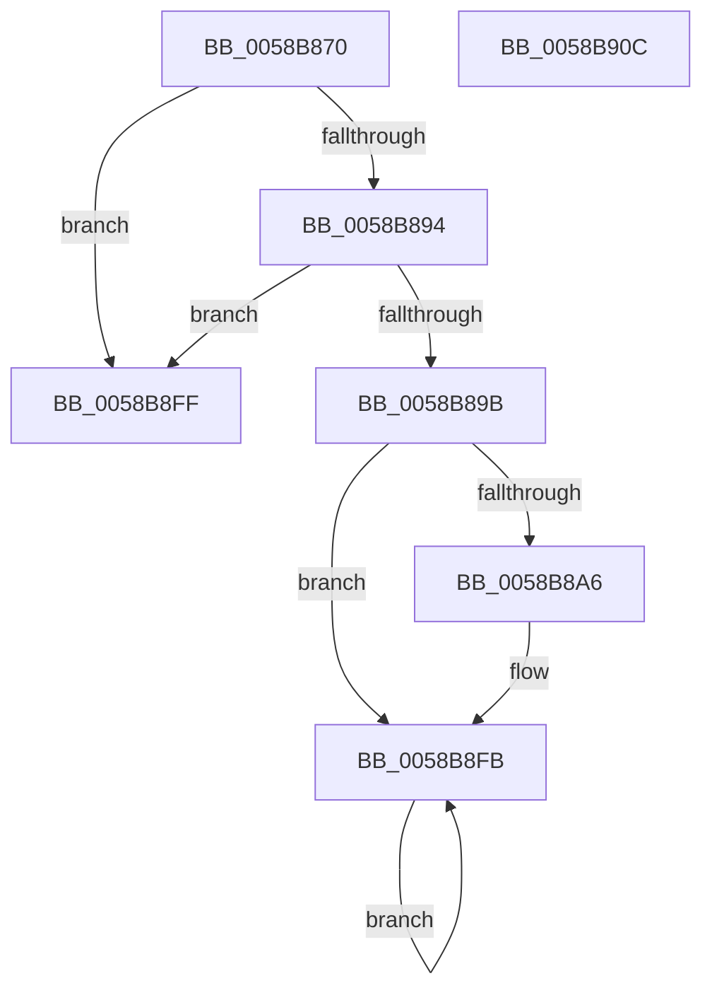

# HvlSkCrashdumpCallbackRoutine

- RVA: `0x0058B870`–`0x0058B90D` (길이 `157` bytes)
- VA: `0x000000014058B870`
- 실행 섹션: `.text`
- PDB 이름 있음: `예`; PDB Function 태그: `아니요`
- unwind 정보 RVA: `0x0006E5F8`
- 디코드: `39`개 명령, `157/157` bytes 표시
- 미해석 바이트: `0` (있으면 어셈블리에 `.byte`로 보존)

> 이 문서는 커널 이미지의 기계어와 PDB 기호를 분석해 생성했습니다. 4번과 5번은 함수 원형과 자료형을 바이너리 사용 방식에서 추정한 C 해석이며 원본 소스 복구 결과는 아닙니다.

## 1. Dependencies

- 직접 호출 지점: **4**; 고유 호출 대상: **3**
- 직접 호출자로 확인된 함수: **0**
- RIP 상대 이미지 참조: **6**

### Outgoing calls
- `0x0058B88A` → [HvlpSnapshotCrashArea](HvlpSnapshotCrashArea_function_0058C0B0.md) (function, `0x0058C0B0`)
- `0x0058B8B9` → [guard_dispatch_icall](../6B/guard_dispatch_icall_function_006BAAD0.md) (function, `0x006BAAD0`)
- `0x0058B8CA` → [guard_dispatch_icall](../6B/guard_dispatch_icall_function_006BAAD0.md) (function, `0x006BAAD0`)
- `0x0058B8F5` → [KeBugCheckEx](../4F/KeBugCheckEx_function_004FD660.md) (function, `0x004FD660`)

### Direct callers
- 이 함수 시작 RVA로 연결되는 직접 call은 확인되지 않았습니다. 간접 호출은 완전히 역산할 수 없습니다.

### Static image references
- `0x0058B87A` → RVA `0x00F8ED88` (`.data`; read)
- `0x0058B8A6` → RVA `0x00E00A00` (`.data`; read)
- `0x0058B8AF` → RVA `0x00FC6AB8` (`ALMOSTRO`; read/write)
- `0x0058B8BE` → RVA `0x00E008F8` (`.data`; read)
- `0x0058B8CF` → RVA `0x00E667E8` (`.data`; write)
- `0x0058B8EE` → RVA `0x00F0BD23` (`.data`; write)

## 2. Other-region calls and transfers

- 다른 실행 섹션으로 향하는 call: **0**
- 별도 외부 분기/꼬리 이동을 확인하지 못했습니다.

## 3. Assembly (complete function range)

```asm
0058B870  48 89 5C 24 08                  mov qword ptr [rsp + 8], rbx
0058B875  57                              push rdi
0058B876  48 83 EC 30                     sub rsp, 0x30
0058B87A  48 8B 1D 07 35 A0 00            mov rbx, qword ptr [rip + 0xa03507]
0058B881  65 48 8B 3C 25 20 00 00 00      mov rdi, qword ptr gs:[0x20]
0058B88A  E8 21 08 00 00                  call 0x14058c0b0
0058B88F  48 85 DB                        test rbx, rbx
0058B892  74 6B                           je 0x14058b8ff
0058B894  8B 43 04                        mov eax, dword ptr [rbx + 4]
0058B897  A8 01                           test al, 1
0058B899  74 64                           je 0x14058b8ff
0058B89B  8B 47 24                        mov eax, dword ptr [rdi + 0x24]
0058B89E  39 83 AC 00 00 00               cmp dword ptr [rbx + 0xac], eax
0058B8A4  75 55                           jne 0x14058b8fb
0058B8A6  48 8B 05 53 51 87 00            mov rax, qword ptr [rip + 0x875153]
0058B8AD  B1 01                           mov cl, 1
0058B8AF  81 25 FF B1 A3 00 00 20 00 00   and dword ptr [rip + 0xa3b1ff], 0x2000
0058B8B9  E8 12 F2 12 00                  call 0x1406baad0
0058B8BE  48 8B 05 33 50 87 00            mov rax, qword ptr [rip + 0x875033]
0058B8C5  B9 01 00 00 00                  mov ecx, 1
0058B8CA  E8 01 F2 12 00                  call 0x1406baad0
0058B8CF  C6 05 12 AF 8D 00 01            mov byte ptr [rip + 0x8daf12], 1
0058B8D6  48 8B 43 28                     mov rax, qword ptr [rbx + 0x28]
0058B8DA  4C 8B 4B 20                     mov r9, qword ptr [rbx + 0x20]
0058B8DE  4C 8B 43 18                     mov r8, qword ptr [rbx + 0x18]
0058B8E2  48 8B 53 10                     mov rdx, qword ptr [rbx + 0x10]
0058B8E6  8B 4B 08                        mov ecx, dword ptr [rbx + 8]
0058B8E9  48 89 44 24 20                  mov qword ptr [rsp + 0x20], rax
0058B8EE  C6 05 2E 04 98 00 01            mov byte ptr [rip + 0x98042e], 1
0058B8F5  E8 66 1D F7 FF                  call 0x1404fd660
0058B8FA  CC                              int3
0058B8FB  F3 90                           pause
0058B8FD  EB FC                           jmp 0x14058b8fb
0058B8FF  48 8B 5C 24 40                  mov rbx, qword ptr [rsp + 0x40]
0058B904  32 C0                           xor al, al
0058B906  48 83 C4 30                     add rsp, 0x30
0058B90A  5F                              pop rdi
0058B90B  C3                              ret
0058B90C  CC                              int3
```

## 4. C-style interpretation (structured pseudocode)

```c
__int64 __fastcall HvlSkCrashdumpCallbackRoutine(void)
{
    __int64 result;
    __int64 v_rsp;
    unsigned __int64 v_stack_m18;
    unsigned __int64 v_stack_p8;

    v_stack_p8 = v_rbx;
    v_rsp = (v_rsp) - (48);
    result = HvlpSnapshotCrashArea(a1, a2, a3, a4);
    if (*(unsigned __int64 *)(v_rip + 10499335) == 0) goto loc_0058B8FF;
    if ((((unsigned __int8)((unsigned int)(*(unsigned int *)(*(unsigned __int64 *)(v_rip + 10499335) + 4)))) & (1)) == 0) goto loc_0058B8FF;
    result = (unsigned int)(*(unsigned int *)(*(unsigned __int64 *)(gs_base + (0 + 32)) + 36));
    if ((*(unsigned int *)(*(unsigned __int64 *)(v_rip + 10499335) + 172)) == ((unsigned int)((unsigned int)(*(unsigned int *)(*(unsigned __int64 *)(gs_base + (0 + 32)) + 36))))) {
        result = *(unsigned __int64 *)(v_rip + 8868179);
        a1 = 1;
        result = guard_dispatch_icall(a1, a2, a3, a4);
        result = *(unsigned __int64 *)(v_rip + 8867891);
        a1 = 1;
        result = guard_dispatch_icall(a1, a2, a3, a4);
        *(unsigned __int8 *)(v_rip + 9285394) = 1;
        result = *(unsigned __int64 *)(*(unsigned __int64 *)(v_rip + 10499335) + 40);
        a4 = *(unsigned __int64 *)(*(unsigned __int64 *)(v_rip + 10499335) + 32);
        a3 = *(unsigned __int64 *)(*(unsigned __int64 *)(v_rip + 10499335) + 24);
        a2 = *(unsigned __int64 *)(*(unsigned __int64 *)(v_rip + 10499335) + 16);
        a1 = *(unsigned int *)(*(unsigned __int64 *)(v_rip + 10499335) + 8);
        v_stack_m18 = result;
        *(unsigned __int8 *)(v_rip + 9962542) = 1;
        result = KeBugCheckEx(a1, a2, a3, a4);
    }
    goto loc_0058B8FB;
loc_0058B8FF:
    result = 0;
    v_rsp = (v_rsp) + (48);
    return result;
}
```

## 5. (Beta) C Style

```c
void HvlSkCrashdumpCallbackRoutine(void)
{
    int64_t result;
    int64_t local_rsp;
    uint64_t v_stack_m18;
    uint64_t v_stack_p8;

    v_stack_p8 = local_rbx;
    local_rsp = (local_rsp) - (48);
    result = HvlpSnapshotCrashArea(a1, a2, a3, a4);
    if (*(uint64_t *)(v_rip + 0xA03507) == 0) goto loc_0058B8FF;
    if ((((uint8_t)((uint32_t)(*(uint32_t *)(*(uint64_t *)(v_rip + 0xA03507) + 0x4)))) & (1)) == 0) goto loc_0058B8FF;
    result = (uint32_t)(*(uint32_t *)(*(uint64_t *)(gs_base + (0 + 0x20)) + 0x24));
    if ((*(uint32_t *)(*(uint64_t *)(v_rip + 0xA03507) + 0xAC)) == ((uint32_t)((uint32_t)(*(uint32_t *)(*(uint64_t *)(gs_base + (0 + 0x20)) + 0x24))))) {
        result = *(uint64_t *)(v_rip + 0x875153);
        a1 = 1;
        result = guard_dispatch_icall(a1, a2, a3, a4);
        result = *(uint64_t *)(v_rip + 0x875033);
        a1 = 1;
        result = guard_dispatch_icall(a1, a2, a3, a4);
        *(uint8_t *)(v_rip + 0x8DAF12) = 1;
        result = *(uint64_t *)(*(uint64_t *)(v_rip + 0xA03507) + 0x28);
        a4 = *(uint64_t *)(*(uint64_t *)(v_rip + 0xA03507) + 0x20);
        a3 = *(uint64_t *)(*(uint64_t *)(v_rip + 0xA03507) + 0x18);
        a2 = *(uint64_t *)(*(uint64_t *)(v_rip + 0xA03507) + 0x10);
        a1 = *(uint32_t *)(*(uint64_t *)(v_rip + 0xA03507) + 0x8);
        v_stack_m18 = result;
        *(uint8_t *)(v_rip + 0x98042E) = 1;
        result = KeBugCheckEx(a1, a2, a3, a4);
    }
    goto loc_0058B8FB;
loc_0058B8FF:
    result = 0;
    local_rsp = (local_rsp) + (48);
    return result;
}
```

## 6. Execution-region graph

[열기: 2D/3D 그래프와 함수 탐색 컨트롤 패널](../../../control-panel.html?section=text&rva=0x0058B870&view=graph)

- 2D 그래프는 위에서 아래로 흐르고, 3D 그래프는 빈 공간을 드래그해 회전합니다. Shift+드래그는 이동, 휠은 확대·축소, 함수 노드 선택은 대상 보고서 이동입니다.

### Static fallback


