# HvlStartBootLogicalProcessors

- RVA: `0x00584E18`–`0x005851FC` (길이 `996` bytes)
- VA: `0x0000000140584E18`
- 실행 섹션: `.text`
- PDB 이름 있음: `예`; PDB Function 태그: `아니요`
- unwind 정보 RVA: `0x00095DA0`
- 디코드: `256`개 명령, `996/996` bytes 표시
- 미해석 바이트: `0` (있으면 어셈블리에 `.byte`로 보존)

> 이 문서는 커널 이미지의 기계어와 PDB 기호를 분석해 생성했습니다. 4번과 5번은 함수 원형과 자료형을 바이너리 사용 방식에서 추정한 C 해석이며 원본 소스 복구 결과는 아닙니다.

## 1. Dependencies

- 직접 호출 지점: **21**; 고유 호출 대상: **18**
- 직접 호출자로 확인된 함수: **1**
- RIP 상대 이미지 참조: **27**

### Outgoing calls
- `0x00584E86` → [guard_dispatch_icall](../6B/guard_dispatch_icall_function_006BAAD0.md) (function, `0x006BAAD0`)
- `0x00584EDF` → [HalQueryMaximumProcessorCount](../4A/HalQueryMaximumProcessorCount_function_004AC9A0.md) (function, `0x004AC9A0`)
- `0x00584EFD` → [MmAllocateIndependentPages](../../page/AA/MmAllocateIndependentPages_function_00AA0CE0.md) (function, `0x00AA0CE0`)
- `0x00584F1C` → [memset](../6C/memset_function_006C6C40.md) (function, `0x006C6C40`)
- `0x00584F28` → [MmAllocateIndependentPages](../../page/AA/MmAllocateIndependentPages_function_00AA0CE0.md) (function, `0x00AA0CE0`)
- `0x00584F4E` → [memset](../6C/memset_function_006C6C40.md) (function, `0x006C6C40`)
- `0x00584FBE` → [HvlpQueryApicIdAndNumaNode](HvlpQueryApicIdAndNumaNode_function_00585C60.md) (function, `0x00585C60`)
- `0x0058500E` → [HvlpDiscoverTopologyLocal](../../page/71/HvlpDiscoverTopologyLocal_function_0071836C.md) (function, `0x0071836C`)
- `0x00585025` → [HvlpSelectLpSet](HvlpSelectLpSet_function_00585D30.md) (function, `0x00585D30`)
- `0x0058504F` → [HvlpEnableNextLogicalProcessor](HvlpEnableNextLogicalProcessor_function_00585680.md) (function, `0x00585680`)
- `0x00585074` → [HvlpSelectVpSet](HvlpSelectVpSet_function_0058616C.md) (function, `0x0058616C`)
- `0x005850A0` → [HvlpGetLpcbByApicId](HvlpGetLpcbByApicId_function_00585858.md) (function, `0x00585858`)
- `0x005850FC` → [qsort](../50/qsort_function_005009F0.md) (function, `0x005009F0`)
- `0x0058511B` → [HvlpUpdateLpcbIndex](HvlpUpdateLpcbIndex_function_00586BD8.md) (function, `0x00586BD8`)
- `0x0058514C` → [HvlpAcquireHypercallPage](../47/HvlpAcquireHypercallPage_function_00471410.md) (function, `0x00471410`)
- `0x0058516C` → [HvcallInitiateHypercall](../31/HvcallInitiateHypercall_function_00313630.md) (function, `0x00313630`)
- `0x00585178` → [HvlpReleaseHypercallPage](../31/HvlpReleaseHypercallPage_function_00313480.md) (function, `0x00313480`)
- `0x0058519C` → [HvlNotifyAllProcessorsStarted](HvlNotifyAllProcessorsStarted_function_00588CF4.md) (function, `0x00588CF4`)
- `0x005851A1` → [HvlpApplyIoCachePolicy](HvlpApplyIoCachePolicy_function_0058D45C.md) (function, `0x0058D45C`)
- `0x005851B1` → [MmFreeIndependentPages](../2A/MmFreeIndependentPages_function_002A2510.md) (function, `0x002A2510`)
- `0x005851CB` → [MmFreeIndependentPages](../2A/MmFreeIndependentPages_function_002A2510.md) (function, `0x002A2510`)

### Direct callers
- [KeStartAllProcessors](../../init/C3/KeStartAllProcessors_function_00C36F78.md) at `0x00C37143`

### Static image references
- `0x00584E38` → RVA `0x00FC5044` (`ALMOSTRO`; read)
- `0x00584E4C` → RVA `0x00FC6A90` (`ALMOSTRO`; read)
- `0x00584E69` → RVA `0x00E00638` (`.data`; read)
- `0x00584E99` → RVA `0x00FC6EE8` (`ALMOSTRO`; write)
- `0x00584EA4` → RVA `0x00FC7098` (`ALMOSTRO`; write)
- `0x00584EAF` → RVA `0x00FC7088` (`ALMOSTRO`; write)
- `0x00584EBA` → RVA `0x00FC7090` (`ALMOSTRO`; write)
- `0x00584F2D` → RVA `0x00FC6C40` (`ALMOSTRO`; write)
- `0x00584F60` → RVA `0x00E3ED60` (`.data`; read)
- `0x00584F70` → RVA `0x00FC6DD8` (`ALMOSTRO`; write)
- `0x00584F76` → RVA `0x00E3ED70` (`.data`; read)
- `0x00584F81` → RVA `0x00E3ED80` (`.data`; read)
- `0x00584F8C` → RVA `0x00E3ED90` (`.data`; read)
- `0x00584F97` → RVA `0x00E3EDA0` (`.data`; read)
- `0x00584FA2` → RVA `0x00E3EDB0` (`.data`; read)
- `0x00584FAD` → RVA `0x00E3EDC0` (`.data`; read)
- `0x00584FD1` → RVA `0x00FCF6C0` (`CACHEALI`; read)
- `0x00585008` → RVA `0x00FC6B46` (`ALMOSTRO`; write)
- `0x00585016` → RVA `0x00FC6BA0` (`ALMOSTRO`; write)
- `0x00585058` → RVA `0x00FC6BA0` (`ALMOSTRO`; read/write)
- `0x005850B4` → RVA `0x00FC6C74` (`ALMOSTRO`; read/write)
- `0x005850C8` → RVA `0x00FC6AD8` (`ALMOSTRO`; read)
- `0x005850D8` → RVA `0x00FC6BA0` (`ALMOSTRO`; read)
- `0x005850DE` → RVA `0x00FC6C74` (`ALMOSTRO`; read)
- `0x005850E6` → RVA `0x00FC6C40` (`ALMOSTRO`; read)
- `0x005850ED` → RVA `0x005852B0` (`HvlpCompareActiveLpcbs`; read)
- `0x00585190` → RVA `0x00FC6AA4` (`ALMOSTRO`; read)

## 2. Other-region calls and transfers

- 다른 실행 섹션으로 향하는 call: **3**
  - `0x00584EFD` → [MmAllocateIndependentPages](../../page/AA/MmAllocateIndependentPages_function_00AA0CE0.md) (`.text` → `PAGE`)
  - `0x00584F28` → [MmAllocateIndependentPages](../../page/AA/MmAllocateIndependentPages_function_00AA0CE0.md) (`.text` → `PAGE`)
  - `0x0058500E` → [HvlpDiscoverTopologyLocal](../../page/71/HvlpDiscoverTopologyLocal_function_0071836C.md) (`.text` → `PAGE`)
- 별도 외부 분기/꼬리 이동을 확인하지 못했습니다.

## 3. Assembly (complete function range)

```asm
00584E18  48 89 5C 24 18                  mov qword ptr [rsp + 0x18], rbx
00584E1D  89 4C 24 08                     mov dword ptr [rsp + 8], ecx
00584E21  55                              push rbp
00584E22  56                              push rsi
00584E23  57                              push rdi
00584E24  41 54                           push r12
00584E26  41 55                           push r13
00584E28  41 56                           push r14
00584E2A  41 57                           push r15
00584E2C  48 8D 6C 24 D9                  lea rbp, [rsp - 0x27]
00584E31  48 81 EC 90 00 00 00            sub rsp, 0x90
00584E38  44 8B 25 05 02 A4 00            mov r12d, dword ptr [rip + 0xa40205]
00584E3F  33 C0                           xor eax, eax
00584E41  0F 57 C0                        xorps xmm0, xmm0
00584E44  48 89 45 17                     mov qword ptr [rbp + 0x17], rax
00584E48  66 89 45 1F                     mov word ptr [rbp + 0x1f], ax
00584E4C  8B 05 3E 1C A4 00               mov eax, dword ptr [rip + 0xa41c3e]
00584E52  0F 11 45 E7                     movups xmmword ptr [rbp - 0x19], xmm0
00584E56  0F 11 45 F7                     movups xmmword ptr [rbp - 9], xmm0
00584E5A  0F 11 45 07                     movups xmmword ptr [rbp + 7], xmm0
00584E5E  A8 02                           test al, 2
00584E60  75 07                           jne 0x140584e69
00584E62  33 C0                           xor eax, eax
00584E64  E9 77 03 00 00                  jmp 0x1405851e0
00584E69  48 8B 05 C8 B7 87 00            mov rax, qword ptr [rip + 0x87b7c8]
00584E70  4C 8D 4D 67                     lea r9, [rbp + 0x67]
00584E74  45 33 ED                        xor r13d, r13d
00584E77  4C 8D 45 E7                     lea r8, [rbp - 0x19]
00584E7B  44 89 6D 67                     mov dword ptr [rbp + 0x67], r13d
00584E7F  41 8D 55 40                     lea edx, [r13 + 0x40]
00584E83  8D 4A CB                        lea ecx, [rdx - 0x35]
00584E86  E8 45 5C 13 00                  call 0x1406baad0
00584E8B  85 C0                           test eax, eax
00584E8D  78 34                           js 0x140584ec3
00584E8F  83 7D 67 40                     cmp dword ptr [rbp + 0x67], 0x40
00584E93  75 2E                           jne 0x140584ec3
00584E95  48 8B 45 EF                     mov rax, qword ptr [rbp - 0x11]
00584E99  48 89 05 48 20 A4 00            mov qword ptr [rip + 0xa42048], rax
00584EA0  48 8B 45 0F                     mov rax, qword ptr [rbp + 0xf]
00584EA4  48 89 05 ED 21 A4 00            mov qword ptr [rip + 0xa421ed], rax
00584EAB  48 8B 45 FF                     mov rax, qword ptr [rbp - 1]
00584EAF  48 89 05 D2 21 A4 00            mov qword ptr [rip + 0xa421d2], rax
00584EB6  48 8B 45 1F                     mov rax, qword ptr [rbp + 0x1f]
00584EBA  48 89 05 CF 21 A4 00            mov qword ptr [rip + 0xa421cf], rax
00584EC1  EB 1C                           jmp 0x140584edf
00584EC3  4C 89 2D 1E 20 A4 00            mov qword ptr [rip + 0xa4201e], r13
00584ECA  4C 89 2D C7 21 A4 00            mov qword ptr [rip + 0xa421c7], r13
00584ED1  4C 89 2D B0 21 A4 00            mov qword ptr [rip + 0xa421b0], r13
00584ED8  4C 89 2D B1 21 A4 00            mov qword ptr [rip + 0xa421b1], r13
00584EDF  E8 BC 7A F2 FF                  call 0x1404ac9a0
00584EE4  8B D8                           mov ebx, eax
00584EE6  83 CA FF                        or edx, 0xffffffff
00584EE9  6B F0 68                        imul esi, eax, 0x68
00584EEC  44 8D 3C 9B                     lea r15d, [rbx + rbx*4]
00584EF0  41 C1 E7 03                     shl r15d, 3
00584EF4  41 8B CF                        mov ecx, r15d
00584EF7  89 75 6F                        mov dword ptr [rbp + 0x6f], esi
00584EFA  41 8B FF                        mov edi, r15d
00584EFD  E8 DE BD 51 00                  call 0x140aa0ce0
00584F02  4C 8B F0                        mov r14, rax
00584F05  48 85 C0                        test rax, rax
00584F08  75 0A                           jne 0x140584f14
00584F0A  BF 9A 00 00 C0                  mov edi, 0xc000009a
00584F0F  E9 A9 02 00 00                  jmp 0x1405851bd
00584F14  4C 8B C7                        mov r8, rdi
00584F17  33 D2                           xor edx, edx
00584F19  49 8B CE                        mov rcx, r14
00584F1C  E8 1F 1D 14 00                  call 0x1406c6c40
00584F21  83 CA FF                        or edx, 0xffffffff
00584F24  8B CE                           mov ecx, esi
00584F26  8B FE                           mov edi, esi
00584F28  E8 B3 BD 51 00                  call 0x140aa0ce0
00584F2D  48 89 05 0C 1D A4 00            mov qword ptr [rip + 0xa41d0c], rax
00584F34  48 8B F0                        mov rsi, rax
00584F37  48 85 C0                        test rax, rax
00584F3A  75 0A                           jne 0x140584f46
00584F3C  BF 9A 00 00 C0                  mov edi, 0xc000009a
00584F41  E9 65 02 00 00                  jmp 0x1405851ab
00584F46  4C 8B C7                        mov r8, rdi
00584F49  33 D2                           xor edx, edx
00584F4B  48 8B CE                        mov rcx, rsi
00584F4E  E8 ED 1C 14 00                  call 0x1406c6c40
00584F53  65 4C 8B 2C 25 20 00 00 00      mov r13, qword ptr gs:[0x20]
00584F5C  4C 8D 46 02                     lea r8, [rsi + 2]
00584F60  0F 28 05 F9 9D 8B 00            movaps xmm0, xmmword ptr [rip + 0x8b9df9]
00584F67  48 8D 56 08                     lea rdx, [rsi + 8]
00584F6B  0F 11 06                        movups xmmword ptr [rsi], xmm0
00584F6E  33 C9                           xor ecx, ecx
00584F70  89 1D 62 1E A4 00               mov dword ptr [rip + 0xa41e62], ebx
00584F76  0F 28 0D F3 9D 8B 00            movaps xmm1, xmmword ptr [rip + 0x8b9df3]
00584F7D  0F 11 4E 10                     movups xmmword ptr [rsi + 0x10], xmm1
00584F81  0F 28 05 F8 9D 8B 00            movaps xmm0, xmmword ptr [rip + 0x8b9df8]
00584F88  0F 11 46 20                     movups xmmword ptr [rsi + 0x20], xmm0
00584F8C  0F 28 0D FD 9D 8B 00            movaps xmm1, xmmword ptr [rip + 0x8b9dfd]
00584F93  0F 11 4E 30                     movups xmmword ptr [rsi + 0x30], xmm1
00584F97  0F 28 05 02 9E 8B 00            movaps xmm0, xmmword ptr [rip + 0x8b9e02]
00584F9E  0F 11 46 40                     movups xmmword ptr [rsi + 0x40], xmm0
00584FA2  0F 28 0D 07 9E 8B 00            movaps xmm1, xmmword ptr [rip + 0x8b9e07]
00584FA9  0F 11 4E 50                     movups xmmword ptr [rsi + 0x50], xmm1
00584FAD  F2 0F 10 05 0B 9E 8B 00         movsd xmm0, qword ptr [rip + 0x8b9e0b]
00584FB5  F2 0F 11 46 60                  movsd qword ptr [rsi + 0x60], xmm0
00584FBA  83 66 04 00                     and dword ptr [rsi + 4], 0
00584FBE  E8 9D 0C 00 00                  call 0x140585c60
00584FC3  8B F8                           mov edi, eax
00584FC5  85 C0                           test eax, eax
00584FC7  0F 88 DB 01 00 00               js 0x1405851a8
00584FCD  0F B7 46 02                     movzx eax, word ptr [rsi + 2]
00584FD1  48 8D 0D E8 A6 A4 00            lea rcx, [rip + 0xa4a6e8]
00584FD8  8B 56 08                        mov edx, dword ptr [rsi + 8]
00584FDB  4C 8D 4E 10                     lea r9, [rsi + 0x10]
00584FDF  4C 8D 46 0C                     lea r8, [rsi + 0xc]
00584FE3  48 8B 04 C1                     mov rax, qword ptr [rcx + rax*8]
00584FE7  0F B7 48 02                     movzx ecx, word ptr [rax + 2]
00584FEB  66 89 4E 60                     mov word ptr [rsi + 0x60], cx
00584FEF  49 8B 85 D0 8B 00 00            mov rax, qword ptr [r13 + 0x8bd0]
00584FF6  48 89 46 18                     mov qword ptr [rsi + 0x18], rax
00584FFA  41 8B 45 24                     mov eax, dword ptr [r13 + 0x24]
00584FFE  89 46 14                        mov dword ptr [rsi + 0x14], eax
00585001  41 8A 85 8D 00 00 00            mov al, byte ptr [r13 + 0x8d]
00585008  88 05 38 1B A4 00               mov byte ptr [rip + 0xa41b38], al
0058500E  E8 59 33 19 00                  call 0x14071836c
00585013  49 8B D6                        mov rdx, r14
00585016  C7 05 80 1B A4 00 01 00 00 00   mov dword ptr [rip + 0xa41b80], 1
00585020  8B CB                           mov ecx, ebx
00585022  C6 06 01                        mov byte ptr [rsi], 1
00585025  E8 06 0D 00 00                  call 0x140585d30
0058502A  45 33 ED                        xor r13d, r13d
0058502D  8B F8                           mov edi, eax
0058502F  85 C0                           test eax, eax
00585031  0F 88 74 01 00 00               js 0x1405851ab
00585037  41 8D 75 01                     lea esi, [r13 + 1]
0058503B  3B DE                           cmp ebx, esi
0058503D  76 2D                           jbe 0x14058506c
0058503F  49 8D 7E 30                     lea rdi, [r14 + 0x30]
00585043  44 38 6F F9                     cmp byte ptr [rdi - 7], r13b
00585047  74 19                           je 0x140585062
00585049  0F B7 17                        movzx edx, word ptr [rdi]
0058504C  8B 4F FC                        mov ecx, dword ptr [rdi - 4]
0058504F  E8 2C 06 00 00                  call 0x140585680
00585054  85 C0                           test eax, eax
00585056  78 14                           js 0x14058506c
00585058  FF 05 42 1B A4 00               inc dword ptr [rip + 0xa41b42]
0058505E  C6 47 FA 01                     mov byte ptr [rdi - 6], 1
00585062  FF C6                           inc esi
00585064  48 83 C7 28                     add rdi, 0x28
00585068  3B F3                           cmp esi, ebx
0058506A  72 D7                           jb 0x140585043
0058506C  45 8B C4                        mov r8d, r12d
0058506F  49 8B D6                        mov rdx, r14
00585072  8B CB                           mov ecx, ebx
00585074  E8 F3 10 00 00                  call 0x14058616c
00585079  8B F8                           mov edi, eax
0058507B  85 C0                           test eax, eax
0058507D  0F 88 28 01 00 00               js 0x1405851ab
00585083  85 DB                           test ebx, ebx
00585085  74 41                           je 0x1405850c8
00585087  4D 8D 46 01                     lea r8, [r14 + 1]
0058508B  4C 8B D3                        mov r10, rbx
0058508E  45 8A 18                        mov r11b, byte ptr [r8]
00585091  45 84 DB                        test r11b, r11b
00585094  75 06                           jne 0x14058509c
00585096  45 38 68 02                     cmp byte ptr [r8 + 2], r13b
0058509A  74 22                           je 0x1405850be
0058509C  41 8B 48 03                     mov ecx, dword ptr [r8 + 3]
005850A0  E8 B3 07 00 00                  call 0x140585858
005850A5  45 84 DB                        test r11b, r11b
005850A8  74 04                           je 0x1405850ae
005850AA  C6 40 01 01                     mov byte ptr [rax + 1], 1
005850AE  45 38 68 02                     cmp byte ptr [r8 + 2], r13b
005850B2  74 0A                           je 0x1405850be
005850B4  FF 05 BA 1B A4 00               inc dword ptr [rip + 0xa41bba]
005850BA  C6 40 62 01                     mov byte ptr [rax + 0x62], 1
005850BE  49 83 C0 28                     add r8, 0x28
005850C2  49 83 EA 01                     sub r10, 1
005850C6  75 C6                           jne 0x14058508e
005850C8  F7 05 06 1A A4 00 00 08 00 00   test dword ptr [rip + 0xa41a06], 0x800
005850D2  0F 84 B8 00 00 00               je 0x140585190
005850D8  8B 05 C2 1A A4 00               mov eax, dword ptr [rip + 0xa41ac2]
005850DE  39 05 90 1B A4 00               cmp dword ptr [rip + 0xa41b90], eax
005850E4  74 48                           je 0x14058512e
005850E6  48 8B 0D 53 1B A4 00            mov rcx, qword ptr [rip + 0xa41b53]
005850ED  4C 8D 0D BC 01 00 00            lea r9, [rip + 0x1bc]
005850F4  8B D0                           mov edx, eax
005850F6  41 B8 68 00 00 00               mov r8d, 0x68
005850FC  E8 EF B8 F7 FF                  call 0x1405009f0
00585101  41 8B DD                        mov ebx, r13d
00585104  3B 1D 96 1A A4 00               cmp ebx, dword ptr [rip + 0xa41a96]
0058510A  73 22                           jae 0x14058512e
0058510C  8B C3                           mov eax, ebx
0058510E  8B D3                           mov edx, ebx
00585110  48 6B C8 68                     imul rcx, rax, 0x68
00585114  48 03 0D 25 1B A4 00            add rcx, qword ptr [rip + 0xa41b25]
0058511B  E8 B8 1A 00 00                  call 0x140586bd8
00585120  8B F8                           mov edi, eax
00585122  85 C0                           test eax, eax
00585124  0F 88 81 00 00 00               js 0x1405851ab
0058512A  FF C3                           inc ebx
0058512C  EB D6                           jmp 0x140585104
0058512E  33 C0                           xor eax, eax
00585130  48 8D 4D C7                     lea rcx, [rbp - 0x39]
00585134  0F 57 C0                        xorps xmm0, xmm0
00585137  48 89 45 D7                     mov qword ptr [rbp - 0x29], rax
0058513B  45 33 C0                        xor r8d, r8d
0058513E  89 45 DF                        mov dword ptr [rbp - 0x21], eax
00585141  0F 11 45 C7                     movups xmmword ptr [rbp - 0x39], xmm0
00585145  44 8D 48 08                     lea r9d, [rax + 8]
00585149  8D 50 01                        lea edx, [rax + 1]
0058514C  E8 BF C2 EE FF                  call 0x140471410
00585151  8B 0D 1D 1B A4 00               mov ecx, dword ptr [rip + 0xa41b1d]
00585157  45 33 C0                        xor r8d, r8d
0058515A  48 8B 55 DF                     mov rdx, qword ptr [rbp - 0x21]
0058515E  89 48 04                        mov dword ptr [rax + 4], ecx
00585161  B9 87 00 00 00                  mov ecx, 0x87
00585166  C7 00 05 00 00 00               mov dword ptr [rax], 5
0058516C  E8 BF E4 D8 FF                  call 0x140313630
00585171  48 8D 4D C7                     lea rcx, [rbp - 0x39]
00585175  48 8B D8                        mov rbx, rax
00585178  E8 03 E3 D8 FF                  call 0x140313480
0058517D  0F B7 CB                        movzx ecx, bx
00585180  66 F7 D9                        neg cx
00585183  1B FF                           sbb edi, edi
00585185  81 E7 01 00 00 C0               and edi, 0xc0000001
0058518B  66 85 DB                        test bx, bx
0058518E  75 1B                           jne 0x1405851ab
00585190  44 38 2D 0D 19 A4 00            cmp byte ptr [rip + 0xa4190d], r13b
00585197  41 8B FD                        mov edi, r13d
0058519A  75 05                           jne 0x1405851a1
0058519C  E8 53 3B 00 00                  call 0x140588cf4
005851A1  E8 B6 82 00 00                  call 0x14058d45c
005851A6  EB 03                           jmp 0x1405851ab
005851A8  45 33 ED                        xor r13d, r13d
005851AB  41 8B D7                        mov edx, r15d
005851AE  49 8B CE                        mov rcx, r14
005851B1  E8 5A D3 D1 FF                  call 0x1402a2510
005851B6  85 FF                           test edi, edi
005851B8  79 24                           jns 0x1405851de
005851BA  8B 75 6F                        mov esi, dword ptr [rbp + 0x6f]
005851BD  48 8B 0D 7C 1A A4 00            mov rcx, qword ptr [rip + 0xa41a7c]
005851C4  48 85 C9                        test rcx, rcx
005851C7  74 15                           je 0x1405851de
005851C9  8B D6                           mov edx, esi
005851CB  E8 40 D3 D1 FF                  call 0x1402a2510
005851D0  4C 89 2D 69 1A A4 00            mov qword ptr [rip + 0xa41a69], r13
005851D7  44 89 2D FA 1B A4 00            mov dword ptr [rip + 0xa41bfa], r13d
005851DE  8B C7                           mov eax, edi
005851E0  48 8B 9C 24 E0 00 00 00         mov rbx, qword ptr [rsp + 0xe0]
005851E8  48 81 C4 90 00 00 00            add rsp, 0x90
005851EF  41 5F                           pop r15
005851F1  41 5E                           pop r14
005851F3  41 5D                           pop r13
005851F5  41 5C                           pop r12
005851F7  5F                              pop rdi
005851F8  5E                              pop rsi
005851F9  5D                              pop rbp
005851FA  C3                              ret
005851FB  CC                              int3
```

## 4. C-style interpretation (structured pseudocode)

```c
__int64 __fastcall HvlStartBootLogicalProcessors(int a1)
{
    __int64 result;
    __int64 v_r10;
    __int64 v_r13;
    __int64 v_r15;
    __int64 v_rbx;
    __int64 v_rdi;
    __int64 v_rsi;
    __int64 v_rsp;
    unsigned __int16 v_stack_m40;
    unsigned __int64 v_stack_m48;
    unsigned __int64 v_stack_m50;
    unsigned __int64 v_stack_m58;
    unsigned __int64 v_stack_m5F;
    unsigned __int64 v_stack_m60;
    unsigned __int64 v_stack_m68;
    unsigned __int64 v_stack_m70;
    unsigned __int64 v_stack_m78;
    unsigned int v_stack_m80;
    unsigned __int64 v_stack_m88;
    unsigned __int64 v_stack_m98;
    unsigned int v_stack_p10;
    unsigned __int64 v_stack_p18;
    unsigned int v_stack_p8;

    v_stack_p18 = v_rbx;
    v_stack_p8 = a1;
    v_rsp = (v_rsp) - (144);
    result = 0;
    v_stack_m48 = 0;
    v_stack_m40 = 0;
    v_stack_m78 = v_xmm0;
    v_stack_m68 = v_xmm0;
    v_stack_m58 = v_xmm0;
    if ((((unsigned __int8)((unsigned int)(*(unsigned int *)(v_rip + 10755134)))) & (2)) != 0) goto loc_00584E69;
    result = 0;
    goto loc_005851E0;
loc_00584E69:
    v_r13 = 0;
    v_stack_p8 = 0;
    result = guard_dispatch_icall(v_r13 + 64 - 53, v_r13 + 64, v_stack_m78, v_stack_p8);
    if (sign_flag) goto loc_00584EC3;
    if (v_stack_p8 != 64) goto loc_00584EC3;
    *(unsigned __int64 *)(v_rip + 10756168) = v_stack_m70;
    *(unsigned __int64 *)(v_rip + 10756589) = v_stack_m50;
    *(unsigned __int64 *)(v_rip + 10756562) = v_stack_m60;
    *(unsigned __int64 *)(v_rip + 10756559) = v_stack_m40;
    goto loc_00584EDF;
loc_00584EC3:
    *(unsigned __int64 *)(v_rip + 10756126) = 0;
    *(unsigned __int64 *)(v_rip + 10756551) = 0;
    *(unsigned __int64 *)(v_rip + 10756528) = 0;
    *(unsigned __int64 *)(v_rip + 10756529) = 0;
loc_00584EDF:
    result = HalQueryMaximumProcessorCount(v_r13 + 64 - 53, v_r13 + 64, v_stack_m78, v_stack_p8);
    a2 = (unsigned int)((v_r13 + 64) | (0xFFFFFFFFULL));
    v_rsi = (unsigned int)((v_rsi) * ((unsigned int)(result)));
    v_r15 = (unsigned int)(((unsigned int)((unsigned int)(result)) + (unsigned int)((unsigned int)(result)) * 4) << (3));
    v_stack_p10 = (unsigned int)(v_rsi);
    result = MmAllocateIndependentPages((unsigned int)((unsigned int)(v_r15)), a2, v_stack_m78, v_stack_p8);
    if (result != 0) goto loc_00584F14;
    goto loc_005851BD;
loc_00584F14:
    a2 = 0;
    result = memset(result, a2, (unsigned int)(0xC000009AULL), v_stack_p8);
    a2 = (unsigned int)((a2) | (0xFFFFFFFFULL));
    result = MmAllocateIndependentPages((unsigned int)((unsigned int)(v_rsi)), a2, (unsigned int)(0xC000009AULL), v_stack_p8);
    *(unsigned __int64 *)(v_rip + 10755340) = result;
    if (result != 0) goto loc_00584F46;
    goto loc_005851AB;
loc_00584F46:
    a2 = 0;
    result = memset(result, a2, (unsigned int)(0xC000009AULL), v_stack_p8);
    *(unsigned __int64 *)(result) = v_xmm0;
    a1 = 0;
    *(unsigned int *)(v_rip + 10755682) = (unsigned int)((unsigned int)((unsigned int)(result)));
    *(unsigned __int64 *)(result + 16) = v_xmm1;
    *(unsigned __int64 *)(result + 32) = v_xmm0;
    *(unsigned __int64 *)(result + 48) = v_xmm1;
    *(unsigned __int64 *)(result + 64) = v_xmm0;
    *(unsigned __int64 *)(result + 80) = v_xmm1;
    *(unsigned __int64 *)(result + 96) = v_xmm0;
    result = HvlpQueryApicIdAndNumaNode(a1, result + 8, result + 2, v_stack_p8);
    if (sign_flag) goto loc_005851A8;
    *(unsigned __int16 *)(result + 96) = (unsigned __int16)(*(unsigned __int16 *)(*(unsigned __int64 *)(v_rip + 10790632 + *(unsigned __int16 *)(result + 2) * 8) + 2));
    *(unsigned __int64 *)(result + 24) = *(unsigned __int64 *)(*(unsigned __int64 *)(gs_base + (0 + 32)) + 35792);
    *(unsigned int *)(result + 20) = (unsigned int)((unsigned int)(*(unsigned int *)(*(unsigned __int64 *)(gs_base + (0 + 32)) + 36)));
    *(unsigned __int8 *)(v_rip + 10754872) = (unsigned __int8)(*(unsigned __int8 *)(*(unsigned __int64 *)(gs_base + (0 + 32)) + 141));
    result = HvlpDiscoverTopologyLocal(*(unsigned __int16 *)(*(unsigned __int64 *)(v_rip + 10790632 + *(unsigned __int16 *)(result + 2) * 8) + 2), (unsigned int)(*(unsigned int *)(result + 8)), result + 12, result + 16);
    *(unsigned int *)(v_rip + 10754944) = 1;
    *(unsigned __int8 *)(result) = 1;
    result = HvlpSelectLpSet((unsigned int)((unsigned int)((unsigned int)((unsigned int)(result)))), result, result + 12, result + 16);
    v_r13 = 0;
    if (sign_flag) goto loc_005851AB;
    if (((unsigned int)((unsigned int)((unsigned int)(result)))) <= ((unsigned int)(v_r13 + 1))) goto loc_0058506C;
loc_00585043:
    if ((*(unsigned __int8 *)(result + 48 - 7)) == 0) goto loc_00585062;
    result = HvlpEnableNextLogicalProcessor((unsigned int)(*(unsigned int *)(result + 48 - 4)), *(unsigned __int16 *)(result + 48), result + 12, result + 16);
    if (sign_flag) goto loc_0058506C;
    *(unsigned __int8 *)(result + 48 - 6) = 1;
loc_00585062:
    v_rsi = (unsigned int)((v_r13 + 1) + 1);
    v_rdi = (result + 48) + (40);
    if (((unsigned int)(v_rsi)) < ((unsigned int)((unsigned int)((unsigned int)(result))))) goto loc_00585043;
loc_0058506C:
    result = HvlpSelectVpSet((unsigned int)((unsigned int)((unsigned int)((unsigned int)(result)))), result, (unsigned int)((unsigned int)((unsigned int)(*(unsigned int *)(v_rip + 10748421)))), result + 16);
    if (sign_flag) goto loc_005851AB;
    if ((unsigned int)((unsigned int)((unsigned int)(result))) == 0) goto loc_005850C8;
loc_0058508E:
    if ((unsigned __int8)(*(unsigned __int8 *)(result + 1)) != 0) goto loc_0058509C;
    if ((*(unsigned __int8 *)(result + 1 + 2)) == 0) goto loc_005850BE;
loc_0058509C:
    result = HvlpGetLpcbByApicId((unsigned int)(*(unsigned int *)(result + 1 + 3)), result, result + 1, result + 16);
    if ((unsigned __int8)(*(unsigned __int8 *)(result + 1)) != 0) {
        *(unsigned __int8 *)(result + 1) = 1;
    }
    if ((*(unsigned __int8 *)(result + 1 + 2)) != 0) {
        *(unsigned __int8 *)(result + 98) = 1;
    }
    a3 = (result + 1) + (40);
    v_r10 = ((unsigned int)((unsigned int)(result))) - (1);
    if (condition_is_not_equal) goto loc_0058508E;
loc_005850C8:
    if (((*(unsigned int *)(v_rip + 10754566)) & (0x800ULL)) == 0) goto loc_00585190;
    if ((*(unsigned int *)(v_rip + 10754960)) == ((unsigned int)((unsigned int)(*(unsigned int *)(v_rip + 10754754))))) goto loc_0058512E;
    result = qsort(*(unsigned __int64 *)(v_rip + 10754899), (unsigned int)((unsigned int)((unsigned int)(*(unsigned int *)(v_rip + 10754754)))), 104, v_rip + 444);
loc_00585104:
    if (0 >= (*(unsigned int *)(v_rip + 10754710))) goto loc_0058512E;
    a1 = (*(unsigned __int64 *)(v_rip + 10754899)) * (0);
    a1 = (a1) + (*(unsigned __int64 *)(v_rip + 10754853));
    result = HvlpUpdateLpcbIndex(a1, 0, 104, v_rip + 444);
    if (sign_flag) goto loc_005851AB;
    v_rbx = (unsigned int)((0) + 1);
    goto loc_00585104;
loc_0058512E:
    result = 0;
    v_stack_m88 = 0;
    a3 = 0;
    v_stack_m80 = 0;
    v_stack_m98 = v_xmm0;
    result = HvlpAcquireHypercallPage(v_stack_m98, result + 1, a3, result + 8);
    a3 = 0;
    *(unsigned int *)(result + 4) = (unsigned int)((unsigned int)(*(unsigned int *)(v_rip + 10754845)));
    *(unsigned int *)(result) = 5;
    result = HvcallInitiateHypercall(135, v_stack_m80, a3, result + 8);
    result = HvlpReleaseHypercallPage(v_stack_m98, v_stack_m80, a3, result + 8);
    a1 = (unsigned __int16)(-((unsigned __int16)(result)));
    v_rdi = (unsigned int)(((unsigned int)((unsigned int)(result))) & (0xC0000001ULL));
    if ((unsigned __int16)(result) != 0) goto loc_005851AB;
loc_00585190:
    if ((*(unsigned __int8 *)(v_rip + 10754317)) == 0) {
        result = HvlNotifyAllProcessorsStarted(a1, v_stack_m80, a3, result + 8);
    }
    result = HvlpApplyIoCachePolicy(a1, v_stack_m80, a3, result + 8);
    goto loc_005851AB;
loc_005851A8:
    v_r13 = 0;
loc_005851AB:
    result = MmFreeIndependentPages(result, (unsigned int)((unsigned int)(v_r15)), a3, result + 8);
    if (!sign_flag) goto loc_005851DE;
loc_005851BD:
    if (*(unsigned __int64 *)(v_rip + 10754684) != 0) {
        a2 = (unsigned int)((unsigned int)(v_stack_p10));
        result = MmFreeIndependentPages(*(unsigned __int64 *)(v_rip + 10754684), a2, a3, result + 8);
        *(unsigned __int64 *)(v_rip + 10754665) = 0;
        *(unsigned int *)(v_rip + 10755066) = 0;
    }
loc_005851E0:
    v_rsp = (v_rsp) + (144);
    return 0;
}
```

## 5. (Beta) C Style

```c
int64_t HvlStartBootLogicalProcessors(int32_t Arg1)
{
    int64_t result;
    int64_t local_r10;
    int64_t local_r13;
    int64_t local_r15;
    int64_t local_rbx;
    int64_t local_rdi;
    int64_t local_rsi;
    int64_t local_rsp;
    uint16_t v_stack_m40;
    uint64_t v_stack_m48;
    uint64_t v_stack_m50;
    uint64_t v_stack_m58;
    uint64_t v_stack_m5F;
    uint64_t v_stack_m60;
    uint64_t v_stack_m68;
    uint64_t v_stack_m70;
    uint64_t v_stack_m78;
    uint32_t v_stack_m80;
    uint64_t v_stack_m88;
    uint64_t v_stack_m98;
    uint32_t v_stack_p10;
    uint64_t v_stack_p18;
    uint32_t v_stack_p8;

    v_stack_p18 = local_rbx;
    v_stack_p8 = Arg1;
    local_rsp = (local_rsp) - (144);
    result = 0;
    v_stack_m48 = 0;
    v_stack_m40 = 0;
    v_stack_m78 = v_xmm0;
    v_stack_m68 = v_xmm0;
    v_stack_m58 = v_xmm0;
    if ((((uint8_t)((uint32_t)(*(uint32_t *)(v_rip + 0xA41C3E)))) & (2)) != 0) goto loc_00584E69;
    result = 0;
    goto loc_005851E0;
loc_00584E69:
    local_r13 = 0;
    v_stack_p8 = 0;
    result = guard_dispatch_icall(local_r13 + 64 - 53, local_r13 + 64, v_stack_m78, v_stack_p8);
    if (sign_flag) goto loc_00584EC3;
    if (v_stack_p8 != 64) goto loc_00584EC3;
    *(uint64_t *)(v_rip + 0xA42048) = v_stack_m70;
    *(uint64_t *)(v_rip + 0xA421ED) = v_stack_m50;
    *(uint64_t *)(v_rip + 0xA421D2) = v_stack_m60;
    *(uint64_t *)(v_rip + 0xA421CF) = v_stack_m40;
    goto loc_00584EDF;
loc_00584EC3:
    *(uint64_t *)(v_rip + 0xA4201E) = 0;
    *(uint64_t *)(v_rip + 0xA421C7) = 0;
    *(uint64_t *)(v_rip + 0xA421B0) = 0;
    *(uint64_t *)(v_rip + 0xA421B1) = 0;
loc_00584EDF:
    result = HalQueryMaximumProcessorCount(local_r13 + 64 - 53, local_r13 + 64, v_stack_m78, v_stack_p8);
    a2 = (uint32_t)((local_r13 + 64) | (0xFFFFFFFFULL));
    local_rsi = (uint32_t)((local_rsi) * ((uint32_t)(result)));
    local_r15 = (uint32_t)(((uint32_t)((uint32_t)(result)) + (uint32_t)((uint32_t)(result)) * 4) << (3));
    v_stack_p10 = (uint32_t)(local_rsi);
    result = MmAllocateIndependentPages((uint32_t)((uint32_t)(local_r15)), a2, v_stack_m78, v_stack_p8);
    if (result != 0) goto loc_00584F14;
    goto loc_005851BD;
loc_00584F14:
    a2 = 0;
    result = memset(result, a2, (uint32_t)(0xC000009AULL), v_stack_p8);
    a2 = (uint32_t)((a2) | (0xFFFFFFFFULL));
    result = MmAllocateIndependentPages((uint32_t)((uint32_t)(local_rsi)), a2, (uint32_t)(0xC000009AULL), v_stack_p8);
    *(uint64_t *)(v_rip + 0xA41D0C) = result;
    if (result != 0) goto loc_00584F46;
    goto loc_005851AB;
loc_00584F46:
    a2 = 0;
    result = memset(result, a2, (uint32_t)(0xC000009AULL), v_stack_p8);
    *(uint64_t *)(result) = v_xmm0;
    Arg1 = 0;
    *(uint32_t *)(v_rip + 0xA41E62) = (uint32_t)((uint32_t)((uint32_t)(result)));
    *(uint64_t *)(result + 0x10) = v_xmm1;
    *(uint64_t *)(result + 0x20) = v_xmm0;
    *(uint64_t *)(result + 0x30) = v_xmm1;
    *(uint64_t *)(result + 0x40) = v_xmm0;
    *(uint64_t *)(result + 0x50) = v_xmm1;
    *(uint64_t *)(result + 0x60) = v_xmm0;
    result = HvlpQueryApicIdAndNumaNode(Arg1, result + 8, result + 2, v_stack_p8);
    if (sign_flag) goto loc_005851A8;
    *(uint16_t *)(result + 0x60) = (uint16_t)(*(uint16_t *)(*(uint64_t *)(v_rip + 0xA4A6E8 + *(uint16_t *)(result + 0x2) * 8) + 0x2));
    *(uint64_t *)(result + 0x18) = *(uint64_t *)(*(uint64_t *)(gs_base + (0 + 0x20)) + 0x8BD0);
    *(uint32_t *)(result + 0x14) = (uint32_t)((uint32_t)(*(uint32_t *)(*(uint64_t *)(gs_base + (0 + 0x20)) + 0x24)));
    *(uint8_t *)(v_rip + 0xA41B38) = (uint8_t)(*(uint8_t *)(*(uint64_t *)(gs_base + (0 + 0x20)) + 0x8D));
    result = HvlpDiscoverTopologyLocal(*(uint16_t *)(*(uint64_t *)(v_rip + 0xA4A6E8 + *(uint16_t *)(result + 0x2) * 8) + 0x2), (uint32_t)(*(uint32_t *)(result + 0x8)), result + 12, result + 16);
    *(uint32_t *)(v_rip + 0xA41B80) = 1;
    *(uint8_t *)(result) = 1;
    result = HvlpSelectLpSet((uint32_t)((uint32_t)((uint32_t)((uint32_t)(result)))), result, result + 12, result + 16);
    local_r13 = 0;
    if (sign_flag) goto loc_005851AB;
    if (((uint32_t)((uint32_t)((uint32_t)(result)))) <= ((uint32_t)(local_r13 + 1))) goto loc_0058506C;
loc_00585043:
    if ((*(uint8_t *)(result + 0x30 - 0x7)) == 0) goto loc_00585062;
    result = HvlpEnableNextLogicalProcessor((uint32_t)(*(uint32_t *)(result + 0x30 - 0x4)), *(uint16_t *)(result + 0x30), result + 12, result + 16);
    if (sign_flag) goto loc_0058506C;
    *(uint8_t *)(result + 0x30 - 0x6) = 1;
loc_00585062:
    local_rsi = (uint32_t)((local_r13 + 1) + 1);
    local_rdi = (result + 48) + (40);
    if (((uint32_t)(local_rsi)) < ((uint32_t)((uint32_t)((uint32_t)(result))))) goto loc_00585043;
loc_0058506C:
    result = HvlpSelectVpSet((uint32_t)((uint32_t)((uint32_t)((uint32_t)(result)))), result, (uint32_t)((uint32_t)((uint32_t)(*(uint32_t *)(v_rip + 0xA40205)))), result + 16);
    if (sign_flag) goto loc_005851AB;
    if ((uint32_t)((uint32_t)((uint32_t)(result))) == 0) goto loc_005850C8;
loc_0058508E:
    if ((uint8_t)(*(uint8_t *)(result + 0x1)) != 0) goto loc_0058509C;
    if ((*(uint8_t *)(result + 0x1 + 0x2)) == 0) goto loc_005850BE;
loc_0058509C:
    result = HvlpGetLpcbByApicId((uint32_t)(*(uint32_t *)(result + 0x1 + 0x3)), result, result + 1, result + 16);
    if ((uint8_t)(*(uint8_t *)(result + 0x1)) != 0) {
        *(uint8_t *)(result + 0x1) = 1;
    }
    if ((*(uint8_t *)(result + 0x1 + 0x2)) != 0) {
        *(uint8_t *)(result + 0x62) = 1;
    }
    a3 = (result + 1) + (40);
    local_r10 = ((uint32_t)((uint32_t)(result))) - (1);
    if (condition_is_not_equal) goto loc_0058508E;
loc_005850C8:
    if (((*(uint32_t *)(v_rip + 0xA41A06)) & (0x800ULL)) == 0) goto loc_00585190;
    if ((*(uint32_t *)(v_rip + 0xA41B90)) == ((uint32_t)((uint32_t)(*(uint32_t *)(v_rip + 0xA41AC2))))) goto loc_0058512E;
    result = qsort(*(uint64_t *)(v_rip + 0xA41B53), (uint32_t)((uint32_t)((uint32_t)(*(uint32_t *)(v_rip + 0xA41AC2)))), 104, v_rip + 444);
loc_00585104:
    if (0 >= (*(uint32_t *)(v_rip + 0xA41A96))) goto loc_0058512E;
    Arg1 = (*(uint64_t *)(v_rip + 0xA41B53)) * (0);
    Arg1 = (Arg1) + (*(uint64_t *)(v_rip + 0xA41B25));
    result = HvlpUpdateLpcbIndex(Arg1, 0, 104, v_rip + 444);
    if (sign_flag) goto loc_005851AB;
    local_rbx = (uint32_t)((0) + 1);
    goto loc_00585104;
loc_0058512E:
    result = 0;
    v_stack_m88 = 0;
    a3 = 0;
    v_stack_m80 = 0;
    v_stack_m98 = v_xmm0;
    result = HvlpAcquireHypercallPage(v_stack_m98, result + 1, a3, result + 8);
    a3 = 0;
    *(uint32_t *)(result + 0x4) = (uint32_t)((uint32_t)(*(uint32_t *)(v_rip + 0xA41B1D)));
    *(uint32_t *)(result) = 5;
    result = HvcallInitiateHypercall(135, v_stack_m80, a3, result + 8);
    result = HvlpReleaseHypercallPage(v_stack_m98, v_stack_m80, a3, result + 8);
    Arg1 = (uint16_t)(-((uint16_t)(result)));
    local_rdi = (uint32_t)(((uint32_t)((uint32_t)(result))) & (0xC0000001ULL));
    if ((uint16_t)(result) != 0) goto loc_005851AB;
loc_00585190:
    if ((*(uint8_t *)(v_rip + 0xA4190D)) == 0) {
        result = HvlNotifyAllProcessorsStarted(Arg1, v_stack_m80, a3, result + 8);
    }
    result = HvlpApplyIoCachePolicy(Arg1, v_stack_m80, a3, result + 8);
    goto loc_005851AB;
loc_005851A8:
    local_r13 = 0;
loc_005851AB:
    result = MmFreeIndependentPages(result, (uint32_t)((uint32_t)(local_r15)), a3, result + 8);
    if (!sign_flag) goto loc_005851DE;
loc_005851BD:
    if (*(uint64_t *)(v_rip + 0xA41A7C) != 0) {
        a2 = (uint32_t)((uint32_t)(v_stack_p10));
        result = MmFreeIndependentPages(*(uint64_t *)(v_rip + 0xA41A7C), a2, a3, result + 8);
        *(uint64_t *)(v_rip + 0xA41A69) = 0;
        *(uint32_t *)(v_rip + 0xA41BFA) = 0;
    }
loc_005851E0:
    local_rsp = (local_rsp) + (144);
    return 0;
}
```

## 6. Execution-region graph

[열기: 2D/3D 그래프와 함수 탐색 컨트롤 패널](../../../control-panel.html?section=text&rva=0x00584E18&view=graph)

- 2D 그래프는 위에서 아래로 흐르고, 3D 그래프는 빈 공간을 드래그해 회전합니다. Shift+드래그는 이동, 휠은 확대·축소, 함수 노드 선택은 대상 보고서 이동입니다.

### Static fallback

```mermaid
flowchart TD
  bb_00584E18[BB_00584E18]
  bb_00584E62[BB_00584E62]
  bb_00584E69[BB_00584E69]
  bb_00584E8F[BB_00584E8F]
  bb_00584E95[BB_00584E95]
  bb_00584EC3[BB_00584EC3]
  bb_00584EDF[BB_00584EDF]
  bb_00584F0A[BB_00584F0A]
  bb_00584F14[BB_00584F14]
  bb_00584F3C[BB_00584F3C]
  bb_00584F46[BB_00584F46]
  bb_00584FCD[BB_00584FCD]
  bb_00585037[BB_00585037]
  bb_0058503F[BB_0058503F]
  bb_00585043[BB_00585043]
  bb_00585049[BB_00585049]
  bb_00585058[BB_00585058]
  bb_00585062[BB_00585062]
  bb_0058506C[BB_0058506C]
  bb_00585083[BB_00585083]
  bb_00585087[BB_00585087]
  bb_0058508E[BB_0058508E]
  bb_00585096[BB_00585096]
  bb_0058509C[BB_0058509C]
  bb_005850AA[BB_005850AA]
  bb_005850AE[BB_005850AE]
  bb_005850B4[BB_005850B4]
  bb_005850BE[BB_005850BE]
  bb_005850C8[BB_005850C8]
  bb_005850D8[BB_005850D8]
  bb_005850E6[BB_005850E6]
  bb_00585104[BB_00585104]
  bb_0058510C[BB_0058510C]
  bb_0058512A[BB_0058512A]
  bb_0058512E[BB_0058512E]
  bb_00585190[BB_00585190]
  bb_0058519C[BB_0058519C]
  bb_005851A1[BB_005851A1]
  bb_005851A8[BB_005851A8]
  bb_005851AB[BB_005851AB]
  bb_005851BA[BB_005851BA]
  bb_005851BD[BB_005851BD]
  bb_005851C9[BB_005851C9]
  bb_005851DE[BB_005851DE]
  bb_005851E0[BB_005851E0]
  bb_005851FB[BB_005851FB]
  bb_00584E18 -->|branch| bb_00584E69
  bb_00584E18 -->|fallthrough| bb_00584E62
  bb_00584E62 -->|branch| bb_005851E0
  bb_00584E69 -->|branch| bb_00584EC3
  bb_00584E69 -->|fallthrough| bb_00584E8F
  bb_00584E8F -->|branch| bb_00584EC3
  bb_00584E8F -->|fallthrough| bb_00584E95
  bb_00584E95 -->|branch| bb_00584EDF
  bb_00584EC3 -->|flow| bb_00584EDF
  bb_00584EDF -->|branch| bb_00584F14
  bb_00584EDF -->|fallthrough| bb_00584F0A
  bb_00584F0A -->|branch| bb_005851BD
  bb_00584F14 -->|branch| bb_00584F46
  bb_00584F14 -->|fallthrough| bb_00584F3C
  bb_00584F3C -->|branch| bb_005851AB
  bb_00584F46 -->|branch| bb_005851A8
  bb_00584F46 -->|fallthrough| bb_00584FCD
  bb_00584FCD -->|branch| bb_005851AB
  bb_00584FCD -->|fallthrough| bb_00585037
  bb_00585037 -->|branch| bb_0058506C
  bb_00585037 -->|fallthrough| bb_0058503F
  bb_0058503F -->|flow| bb_00585043
  bb_00585043 -->|branch| bb_00585062
  bb_00585043 -->|fallthrough| bb_00585049
  bb_00585049 -->|branch| bb_0058506C
  bb_00585049 -->|fallthrough| bb_00585058
  bb_00585058 -->|flow| bb_00585062
  bb_00585062 -->|branch| bb_00585043
  bb_00585062 -->|fallthrough| bb_0058506C
  bb_0058506C -->|branch| bb_005851AB
  bb_0058506C -->|fallthrough| bb_00585083
  bb_00585083 -->|branch| bb_005850C8
  bb_00585083 -->|fallthrough| bb_00585087
  bb_00585087 -->|flow| bb_0058508E
  bb_0058508E -->|branch| bb_0058509C
  bb_0058508E -->|fallthrough| bb_00585096
  bb_00585096 -->|branch| bb_005850BE
  bb_00585096 -->|fallthrough| bb_0058509C
  bb_0058509C -->|branch| bb_005850AE
  bb_0058509C -->|fallthrough| bb_005850AA
  bb_005850AA -->|flow| bb_005850AE
  bb_005850AE -->|branch| bb_005850BE
  bb_005850AE -->|fallthrough| bb_005850B4
  bb_005850B4 -->|flow| bb_005850BE
  bb_005850BE -->|branch| bb_0058508E
  bb_005850BE -->|fallthrough| bb_005850C8
  bb_005850C8 -->|branch| bb_00585190
  bb_005850C8 -->|fallthrough| bb_005850D8
  bb_005850D8 -->|branch| bb_0058512E
  bb_005850D8 -->|fallthrough| bb_005850E6
  bb_005850E6 -->|flow| bb_00585104
  bb_00585104 -->|branch| bb_0058512E
  bb_00585104 -->|fallthrough| bb_0058510C
  bb_0058510C -->|branch| bb_005851AB
  bb_0058510C -->|fallthrough| bb_0058512A
  bb_0058512A -->|branch| bb_00585104
  bb_0058512E -->|branch| bb_005851AB
  bb_0058512E -->|fallthrough| bb_00585190
  bb_00585190 -->|branch| bb_005851A1
  bb_00585190 -->|fallthrough| bb_0058519C
  bb_0058519C -->|flow| bb_005851A1
  bb_005851A1 -->|branch| bb_005851AB
  bb_005851A8 -->|flow| bb_005851AB
  bb_005851AB -->|branch| bb_005851DE
  bb_005851AB -->|fallthrough| bb_005851BA
  bb_005851BA -->|flow| bb_005851BD
  bb_005851BD -->|branch| bb_005851DE
  bb_005851BD -->|fallthrough| bb_005851C9
  bb_005851C9 -->|flow| bb_005851DE
  bb_005851DE -->|flow| bb_005851E0
```


