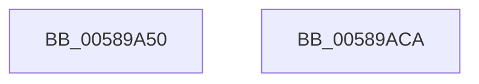

# HvlUnblockDefaultDma

- RVA: `0x00589A50`–`0x00589ACB` (길이 `123` bytes)
- VA: `0x0000000140589A50`
- 실행 섹션: `.text`
- PDB 이름 있음: `예`; PDB Function 태그: `아니요`
- unwind 정보 RVA: `0x000C6750`
- 디코드: `26`개 명령, `123/123` bytes 표시
- 미해석 바이트: `0` (있으면 어셈블리에 `.byte`로 보존)

> 이 문서는 커널 이미지의 기계어와 PDB 기호를 분석해 생성했습니다. 4번과 5번은 함수 원형과 자료형을 바이너리 사용 방식에서 추정한 C 해석이며 원본 소스 복구 결과는 아닙니다.

## 1. Dependencies

- 직접 호출 지점: **3**; 고유 호출 대상: **3**
- 직접 호출자로 확인된 함수: **0**
- RIP 상대 이미지 참조: **1**

### Outgoing calls
- `0x00589AA8` → [HvcallFastExtended](../31/HvcallFastExtended_function_003130E0.md) (function, `0x003130E0`)
- `0x00589AB0` → [HvlpHvToNtStatus](../30/HvlpHvToNtStatus_function_00307BD8.md) (function, `0x00307BD8`)
- `0x00589ABD` → [_security_check_cookie](../6A/_security_check_cookie_function_006AC640.md) (function, `0x006AC640`)

### Direct callers
- 이 함수 시작 RVA로 연결되는 직접 call은 확인되지 않았습니다. 간접 호출은 완전히 역산할 수 없습니다.

### Static image references
- `0x00589A57` → RVA `0x00E0A740` (`.data`; read)

## 2. Other-region calls and transfers

- 다른 실행 섹션으로 향하는 call: **0**
- 별도 외부 분기/꼬리 이동을 확인하지 못했습니다.

## 3. Assembly (complete function range)

```asm
00589A50  48 81 EC 88 00 00 00            sub rsp, 0x88
00589A57  48 8B 05 E2 0C 88 00            mov rax, qword ptr [rip + 0x880ce2]
00589A5E  48 33 C4                        xor rax, rsp
00589A61  48 89 44 24 70                  mov qword ptr [rsp + 0x70], rax
00589A66  33 C0                           xor eax, eax
00589A68  48 C7 44 24 30 6F 00 00 00      mov qword ptr [rsp + 0x30], 0x6f
00589A71  21 44 24 20                     and dword ptr [rsp + 0x20], eax
00589A75  48 8D 54 24 40                  lea rdx, [rsp + 0x40]
00589A7A  0F 57 C0                        xorps xmm0, xmm0
00589A7D  C7 44 24 30 6F 00 01 00         mov dword ptr [rsp + 0x30], 0x1006f
00589A85  48 8B 4C 24 30                  mov rcx, qword ptr [rsp + 0x30]
00589A8A  45 33 C9                        xor r9d, r9d
00589A8D  0F 11 44 24 40                  movups xmmword ptr [rsp + 0x40], xmm0
00589A92  44 8D 40 28                     lea r8d, [rax + 0x28]
00589A96  48 89 44 24 60                  mov qword ptr [rsp + 0x60], rax
00589A9B  0F 11 44 24 50                  movups xmmword ptr [rsp + 0x50], xmm0
00589AA0  C7 44 24 40 1A 00 00 00         mov dword ptr [rsp + 0x40], 0x1a
00589AA8  E8 33 96 D8 FF                  call 0x1403130e0
00589AAD  48 8B C8                        mov rcx, rax
00589AB0  E8 23 E1 D7 FF                  call 0x140307bd8
00589AB5  48 8B 4C 24 70                  mov rcx, qword ptr [rsp + 0x70]
00589ABA  48 33 CC                        xor rcx, rsp
00589ABD  E8 7E 2B 12 00                  call 0x1406ac640
00589AC2  48 81 C4 88 00 00 00            add rsp, 0x88
00589AC9  C3                              ret
00589ACA  CC                              int3
```

## 4. C-style interpretation (structured pseudocode)

```c
__int64 __fastcall HvlUnblockDefaultDma(__int64 a1, __int64 a2, __int64 a3, int a4)
{
    __int64 result;
    __int64 v_rsp;
    unsigned __int64 v_stack_m18;
    unsigned __int64 v_stack_m28;
    unsigned __int64 v_stack_m38;
    unsigned __int64 v_stack_m48;
    unsigned __int64 v_stack_m58;
    unsigned int v_stack_m68;

    v_rsp = (v_rsp) - (136);
    result = (*(unsigned __int64 *)(v_rip + 8916194)) ^ (v_rsp);
    v_stack_m18 = result;
    result = 0;
    v_stack_m58 = 111;
    v_stack_m58 = 0x1006FULL;
    a4 = 0;
    v_stack_m48 = v_xmm0;
    v_stack_m28 = 0;
    v_stack_m38 = v_xmm0;
    v_stack_m48 = 26;
    result = HvcallFastExtended(v_stack_m58, v_stack_m48, result + 40, a4);
    result = HvlpHvToNtStatus(result, v_stack_m48, result + 40, a4);
    a1 = (v_stack_m18) ^ (v_rsp);
    result = _security_check_cookie(a1, v_stack_m48, result + 40, a4);
    v_rsp = (v_rsp) + (136);
    return result;
}
```

## 5. (Beta) C Style

```c
int64_t HvlUnblockDefaultDma(int64_t Arg1, int64_t Arg2, int64_t Arg3, int32_t Arg4)
{
    int64_t result;
    int64_t local_rsp;
    uint64_t v_stack_m18;
    uint64_t v_stack_m28;
    uint64_t v_stack_m38;
    uint64_t v_stack_m48;
    uint64_t v_stack_m58;
    uint32_t v_stack_m68;

    local_rsp = (local_rsp) - (136);
    result = (*(uint64_t *)(v_rip + 0x880CE2)) ^ (local_rsp);
    v_stack_m18 = result;
    result = 0;
    v_stack_m58 = 111;
    v_stack_m58 = 0x1006FULL;
    Arg4 = 0;
    v_stack_m48 = v_xmm0;
    v_stack_m28 = 0;
    v_stack_m38 = v_xmm0;
    v_stack_m48 = 26;
    result = HvcallFastExtended(v_stack_m58, v_stack_m48, result + 40, Arg4);
    result = HvlpHvToNtStatus(result, v_stack_m48, result + 40, Arg4);
    Arg1 = (v_stack_m18) ^ (local_rsp);
    result = _security_check_cookie(Arg1, v_stack_m48, result + 40, Arg4);
    local_rsp = (local_rsp) + (136);
    return result;
}
```

## 6. Execution-region graph

[열기: 2D/3D 그래프와 함수 탐색 컨트롤 패널](../../../control-panel.html?section=text&rva=0x00589A50&view=graph)

- 2D 그래프는 위에서 아래로 흐르고, 3D 그래프는 빈 공간을 드래그해 회전합니다. Shift+드래그는 이동, 휠은 확대·축소, 함수 노드 선택은 대상 보고서 이동입니다.

### Static fallback


