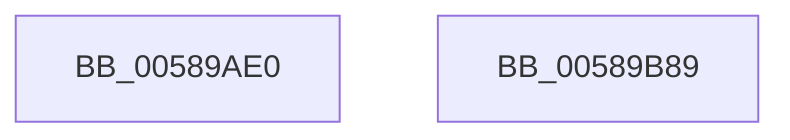

# HvlUnmapDeviceInterrupt

- RVA: `0x00589AE0`–`0x00589B8A` (길이 `170` bytes)
- VA: `0x0000000140589AE0`
- 실행 섹션: `.text`
- PDB 이름 있음: `예`; PDB Function 태그: `아니요`
- unwind 정보 RVA: `0x000B53F0`
- 디코드: `40`개 명령, `170/170` bytes 표시
- 미해석 바이트: `0` (있으면 어셈블리에 `.byte`로 보존)

> 이 문서는 커널 이미지의 기계어와 PDB 기호를 분석해 생성했습니다. 4번과 5번은 함수 원형과 자료형을 바이너리 사용 방식에서 추정한 C 해석이며 원본 소스 복구 결과는 아닙니다.

## 1. Dependencies

- 직접 호출 지점: **5**; 고유 호출 대상: **5**
- 직접 호출자로 확인된 함수: **0**
- RIP 상대 이미지 참조: **1**

### Outgoing calls
- `0x00589B29` → [HvlpAcquireHypercallPage](../47/HvlpAcquireHypercallPage_function_00471410.md) (function, `0x00471410`)
- `0x00589B4E` → [HvcallInitiateHypercall](../31/HvcallInitiateHypercall_function_00313630.md) (function, `0x00313630`)
- `0x00589B5B` → [HvlpReleaseHypercallPage](../31/HvlpReleaseHypercallPage_function_00313480.md) (function, `0x00313480`)
- `0x00589B63` → [HvlpHvToNtStatus](../30/HvlpHvToNtStatus_function_00307BD8.md) (function, `0x00307BD8`)
- `0x00589B73` → [_security_check_cookie](../6A/_security_check_cookie_function_006AC640.md) (function, `0x006AC640`)

### Direct callers
- 이 함수 시작 RVA로 연결되는 직접 call은 확인되지 않았습니다. 간접 호출은 완전히 역산할 수 없습니다.

### Static image references
- `0x00589AED` → RVA `0x00E0A740` (`.data`; read)

## 2. Other-region calls and transfers

- 다른 실행 섹션으로 향하는 call: **0**
- 별도 외부 분기/꼬리 이동을 확인하지 못했습니다.

## 3. Assembly (complete function range)

```asm
00589AE0  48 89 5C 24 08                  mov qword ptr [rsp + 8], rbx
00589AE5  57                              push rdi
00589AE6  48 81 EC A0 00 00 00            sub rsp, 0xa0
00589AED  48 8B 05 4C 0C 88 00            mov rax, qword ptr [rip + 0x880c4c]
00589AF4  48 33 C4                        xor rax, rsp
00589AF7  48 89 84 24 90 00 00 00         mov qword ptr [rsp + 0x90], rax
00589AFF  33 C0                           xor eax, eax
00589B01  4C 8D 44 24 40                  lea r8, [rsp + 0x40]
00589B06  48 8B FA                        mov rdi, rdx
00589B09  48 89 44 24 30                  mov qword ptr [rsp + 0x30], rax
00589B0E  48 8B D9                        mov rbx, rcx
00589B11  89 44 24 38                     mov dword ptr [rsp + 0x38], eax
00589B15  0F 57 C0                        xorps xmm0, xmm0
00589B18  48 8D 4C 24 20                  lea rcx, [rsp + 0x20]
00589B1D  44 8D 48 28                     lea r9d, [rax + 0x28]
00589B21  8D 50 01                        lea edx, [rax + 1]
00589B24  0F 11 44 24 20                  movups xmmword ptr [rsp + 0x20], xmm0
00589B29  E8 E2 78 EE FF                  call 0x140471410
00589B2E  48 8B 54 24 38                  mov rdx, qword ptr [rsp + 0x38]
00589B33  45 33 C0                        xor r8d, r8d
00589B36  48 83 08 FF                     or qword ptr [rax], 0xffffffffffffffff
00589B3A  48 89 58 08                     mov qword ptr [rax + 8], rbx
00589B3E  41 8D 48 7D                     lea ecx, [r8 + 0x7d]
00589B42  0F 10 07                        movups xmm0, xmmword ptr [rdi]
00589B45  83 60 20 00                     and dword ptr [rax + 0x20], 0
00589B49  F3 0F 7F 40 10                  movdqu xmmword ptr [rax + 0x10], xmm0
00589B4E  E8 DD 9A D8 FF                  call 0x140313630
00589B53  48 8D 4C 24 20                  lea rcx, [rsp + 0x20]
00589B58  48 8B D8                        mov rbx, rax
00589B5B  E8 20 99 D8 FF                  call 0x140313480
00589B60  0F B7 CB                        movzx ecx, bx
00589B63  E8 70 E0 D7 FF                  call 0x140307bd8
00589B68  48 8B 8C 24 90 00 00 00         mov rcx, qword ptr [rsp + 0x90]
00589B70  48 33 CC                        xor rcx, rsp
00589B73  E8 C8 2A 12 00                  call 0x1406ac640
00589B78  48 8B 9C 24 B0 00 00 00         mov rbx, qword ptr [rsp + 0xb0]
00589B80  48 81 C4 A0 00 00 00            add rsp, 0xa0
00589B87  5F                              pop rdi
00589B88  C3                              ret
00589B89  CC                              int3
```

## 4. C-style interpretation (structured pseudocode)

```c
__int64 __fastcall HvlUnmapDeviceInterrupt(__int64 a1, __int64 a2)
{
    __int64 result;
    __int64 v_rsp;
    unsigned __int64 v_stack_m18;
    unsigned __int64 v_stack_m68;
    unsigned int v_stack_m70;
    unsigned __int64 v_stack_m78;
    unsigned __int64 v_stack_m88;
    unsigned __int64 v_stack_p8;

    v_stack_p8 = v_rbx;
    v_rsp = (v_rsp) - (160);
    result = (*(unsigned __int64 *)(v_rip + 8916044)) ^ (v_rsp);
    v_stack_m18 = result;
    result = 0;
    v_stack_m78 = 0;
    v_stack_m70 = 0;
    v_stack_m88 = v_xmm0;
    result = HvlpAcquireHypercallPage(v_stack_m88, result + 1, v_stack_m68, result + 40);
    a3 = 0;
    *(unsigned __int64 *)(result + 8) = a1;
    *(unsigned __int64 *)(result + 16) = v_xmm0;
    result = HvcallInitiateHypercall(a3 + 125, v_stack_m70, a3, result + 40);
    result = HvlpReleaseHypercallPage(v_stack_m88, v_stack_m70, a3, result + 40);
    result = HvlpHvToNtStatus((unsigned __int16)(result), v_stack_m70, a3, result + 40);
    a1 = (v_stack_m18) ^ (v_rsp);
    result = _security_check_cookie(a1, v_stack_m70, a3, result + 40);
    v_rsp = (v_rsp) + (160);
    return result;
}
```

## 5. (Beta) C Style

```c
int64_t HvlUnmapDeviceInterrupt(int64_t Arg1, void *Arg2)
{
    uint8_t *arg2 = (uint8_t *)Arg2;

    int64_t result;
    int64_t local_rsp;
    uint64_t v_stack_m18;
    uint64_t v_stack_m68;
    uint32_t v_stack_m70;
    uint64_t v_stack_m78;
    uint64_t v_stack_m88;
    uint64_t v_stack_p8;

    v_stack_p8 = local_rbx;
    local_rsp = (local_rsp) - (160);
    result = (*(uint64_t *)(v_rip + 0x880C4C)) ^ (local_rsp);
    v_stack_m18 = result;
    result = 0;
    v_stack_m78 = 0;
    v_stack_m70 = 0;
    v_stack_m88 = v_xmm0;
    result = HvlpAcquireHypercallPage(v_stack_m88, result + 1, v_stack_m68, result + 40);
    a3 = 0;
    *(uint64_t *)(result + 0x8) = Arg1;
    *(uint64_t *)(result + 0x10) = v_xmm0;
    result = HvcallInitiateHypercall(a3 + 125, v_stack_m70, a3, result + 40);
    result = HvlpReleaseHypercallPage(v_stack_m88, v_stack_m70, a3, result + 40);
    result = HvlpHvToNtStatus((uint16_t)(result), v_stack_m70, a3, result + 40);
    Arg1 = (v_stack_m18) ^ (local_rsp);
    result = _security_check_cookie(Arg1, v_stack_m70, a3, result + 40);
    local_rsp = (local_rsp) + (160);
    return result;
}
```

### 관측된 메모리 오프셋

구조체 형식이 확인되지 않은 접근은 인자 기준의 오프셋으로만 기록했습니다.

| 기준 인자 | 오프셋 표현 | 폭 (bit) | 접근 |
|---|---:|---:|---|
| `Arg2` | `+ 0x0` | `128` | `R` |

## 6. Execution-region graph

[열기: 2D/3D 그래프와 함수 탐색 컨트롤 패널](../../../control-panel.html?section=text&rva=0x00589AE0&view=graph)

- 2D 그래프는 위에서 아래로 흐르고, 3D 그래프는 빈 공간을 드래그해 회전합니다. Shift+드래그는 이동, 휠은 확대·축소, 함수 노드 선택은 대상 보고서 이동입니다.

### Static fallback


