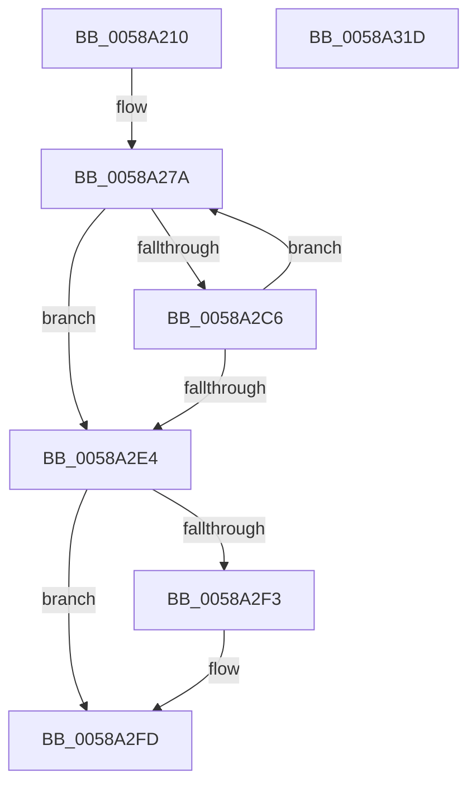

# HvlUnmapDmaRanges

- RVA: `0x0058A210`–`0x0058A31E` (길이 `270` bytes)
- VA: `0x000000014058A210`
- 실행 섹션: `.text`
- PDB 이름 있음: `예`; PDB Function 태그: `아니요`
- unwind 정보 RVA: `0x000BC81C`
- 디코드: `85`개 명령, `270/270` bytes 표시
- 미해석 바이트: `0` (있으면 어셈블리에 `.byte`로 보존)

> 이 문서는 커널 이미지의 기계어와 PDB 기호를 분석해 생성했습니다. 4번과 5번은 함수 원형과 자료형을 바이너리 사용 방식에서 추정한 C 해석이며 원본 소스 복구 결과는 아닙니다.

## 1. Dependencies

- 직접 호출 지점: **5**; 고유 호출 대상: **5**
- 직접 호출자로 확인된 함수: **0**
- RIP 상대 이미지 참조: **0**

### Outgoing calls
- `0x0058A259` → [HvlpAcquireHypercallPage](../47/HvlpAcquireHypercallPage_function_00471410.md) (function, `0x00471410`)
- `0x0058A298` → [memcpy](../6C/memcpy_function_006C6840.md) (function, `0x006C6840`)
- `0x0058A2B9` → [HvcallInitiateHypercall](../31/HvcallInitiateHypercall_function_00313630.md) (function, `0x00313630`)
- `0x0058A2E9` → [HvlpReleaseHypercallPage](../31/HvlpReleaseHypercallPage_function_00313480.md) (function, `0x00313480`)
- `0x0058A2F6` → [HvlpHvToNtStatus](../30/HvlpHvToNtStatus_function_00307BD8.md) (function, `0x00307BD8`)

### Direct callers
- 이 함수 시작 RVA로 연결되는 직접 call은 확인되지 않았습니다. 간접 호출은 완전히 역산할 수 없습니다.

### Static image references
- 디코드된 RIP-relative 메모리 참조가 없습니다.

## 2. Other-region calls and transfers

- 다른 실행 섹션으로 향하는 call: **0**
- 별도 외부 분기/꼬리 이동을 확인하지 못했습니다.

## 3. Assembly (complete function range)

```asm
0058A210  4C 8B DC                        mov r11, rsp
0058A213  49 89 5B 08                     mov qword ptr [r11 + 8], rbx
0058A217  49 89 6B 18                     mov qword ptr [r11 + 0x18], rbp
0058A21B  49 89 73 20                     mov qword ptr [r11 + 0x20], rsi
0058A21F  57                              push rdi
0058A220  41 54                           push r12
0058A222  41 55                           push r13
0058A224  41 56                           push r14
0058A226  41 57                           push r15
0058A228  48 83 EC 40                     sub rsp, 0x40
0058A22C  33 C0                           xor eax, eax
0058A22E  0F 57 C0                        xorps xmm0, xmm0
0058A231  33 F6                           xor esi, esi
0058A233  4D 8B F0                        mov r14, r8
0058A236  4C 8B E2                        mov r12, rdx
0058A239  41 89 30                        mov dword ptr [r8], esi
0058A23C  44 8B F9                        mov r15d, ecx
0058A23F  45 33 C9                        xor r9d, r9d
0058A242  0F 11 44 24 20                  movups xmmword ptr [rsp + 0x20], xmm0
0058A247  49 89 43 C8                     mov qword ptr [r11 - 0x38], rax
0058A24B  8D 50 01                        lea edx, [rax + 1]
0058A24E  45 33 C0                        xor r8d, r8d
0058A251  89 44 24 38                     mov dword ptr [rsp + 0x38], eax
0058A255  49 8D 4B B8                     lea rcx, [r11 - 0x48]
0058A259  E8 B2 71 EE FF                  call 0x140471410
0058A25E  41 8B 16                        mov edx, dword ptr [r14]
0058A261  4C 8B E8                        mov r13, rax
0058A264  B8 00 01 00 00                  mov eax, 0x100
0058A269  48 C7 44 24 78 09 01 00 00      mov qword ptr [rsp + 0x78], 0x109
0058A272  41 8B CF                        mov ecx, r15d
0058A275  8B EE                           mov ebp, esi
0058A277  44 8B C6                        mov r8d, esi
0058A27A  3B C8                           cmp ecx, eax
0058A27C  8B F9                           mov edi, ecx
0058A27E  49 8B CD                        mov rcx, r13
0058A281  41 0F 43 E8                     cmovae ebp, r8d
0058A285  0F 43 F8                        cmovae edi, eax
0058A288  48 C1 E2 04                     shl rdx, 4
0058A28C  8B DD                           mov ebx, ebp
0058A28E  44 8B C7                        mov r8d, edi
0058A291  49 03 D4                        add rdx, r12
0058A294  49 C1 E0 04                     shl r8, 4
0058A298  E8 A3 C5 13 00                  call 0x1406c6840
0058A29D  48 8B 54 24 38                  mov rdx, qword ptr [rsp + 0x38]
0058A2A2  33 EF                           xor ebp, edi
0058A2A4  BF FF 0F 00 00                  mov edi, 0xfff
0058A2A9  45 33 C0                        xor r8d, r8d
0058A2AC  23 EF                           and ebp, edi
0058A2AE  33 EB                           xor ebp, ebx
0058A2B0  89 6C 24 7C                     mov dword ptr [rsp + 0x7c], ebp
0058A2B4  48 8B 4C 24 78                  mov rcx, qword ptr [rsp + 0x78]
0058A2B9  E8 72 93 D8 FF                  call 0x140313630
0058A2BE  48 8B D8                        mov rbx, rax
0058A2C1  66 85 C0                        test ax, ax
0058A2C4  75 1E                           jne 0x14058a2e4
0058A2C6  48 8B D0                        mov rdx, rax
0058A2C9  41 8B CF                        mov ecx, r15d
0058A2CC  48 C1 EA 20                     shr rdx, 0x20
0058A2D0  44 8B C5                        mov r8d, ebp
0058A2D3  23 D7                           and edx, edi
0058A2D5  B8 00 01 00 00                  mov eax, 0x100
0058A2DA  41 03 16                        add edx, dword ptr [r14]
0058A2DD  41 89 16                        mov dword ptr [r14], edx
0058A2E0  2B CA                           sub ecx, edx
0058A2E2  75 96                           jne 0x14058a27a
0058A2E4  48 8D 4C 24 20                  lea rcx, [rsp + 0x20]
0058A2E9  E8 92 91 D8 FF                  call 0x140313480
0058A2EE  66 85 DB                        test bx, bx
0058A2F1  74 0A                           je 0x14058a2fd
0058A2F3  0F B7 CB                        movzx ecx, bx
0058A2F6  E8 DD D8 D7 FF                  call 0x140307bd8
0058A2FB  8B F0                           mov esi, eax
0058A2FD  4C 8D 5C 24 40                  lea r11, [rsp + 0x40]
0058A302  8B C6                           mov eax, esi
0058A304  49 8B 5B 30                     mov rbx, qword ptr [r11 + 0x30]
0058A308  49 8B 6B 40                     mov rbp, qword ptr [r11 + 0x40]
0058A30C  49 8B 73 48                     mov rsi, qword ptr [r11 + 0x48]
0058A310  49 8B E3                        mov rsp, r11
0058A313  41 5F                           pop r15
0058A315  41 5E                           pop r14
0058A317  41 5D                           pop r13
0058A319  41 5C                           pop r12
0058A31B  5F                              pop rdi
0058A31C  C3                              ret
0058A31D  CC                              int3
```

## 4. C-style interpretation (structured pseudocode)

```c
__int64 __fastcall HvlUnmapDmaRanges(int a1, __int64 a2, __int64 a3, int a4)
{
    __int64 result;
    __int64 v_rbp;
    __int64 v_rdi;
    __int64 v_rsi;
    __int64 v_rsp;
    unsigned __int64 v_stack_m28;
    unsigned int v_stack_m30;
    unsigned __int64 v_stack_m48;
    unsigned __int64 v_stack_p10;
    unsigned int v_stack_p14;

    *(unsigned __int64 *)(v_rsp + 8) = v_rbx;
    *(unsigned __int64 *)(v_rsp + 24) = v_rbp;
    *(unsigned __int64 *)(v_rsp + 32) = v_rsi;
    v_rsp = (v_rsp) - (64);
    result = 0;
    v_rsi = 0;
    *(unsigned int *)(a3) = 0;
    a4 = 0;
    v_stack_m48 = v_xmm0;
    *(unsigned __int64 *)(v_rsp - 56) = 0;
    a3 = 0;
    v_stack_m30 = 0;
    result = HvlpAcquireHypercallPage(v_rsp - 72, result + 1, a3, a4);
    v_stack_p10 = 265;
loc_0058A27A:
    v_rbp = 0;
    if (((unsigned int)((unsigned int)((unsigned int)((unsigned int)(a1))))) >= 256) { v_rbp = 0; }
    v_rdi = (unsigned int)((unsigned int)((unsigned int)((unsigned int)((unsigned int)(a1)))));
    if (((unsigned int)((unsigned int)((unsigned int)((unsigned int)(a1))))) >= 256) { v_rdi = 256; }
    a2 = ((unsigned int)(*(unsigned int *)(a3))) << (4);
    a2 = (a2) + (a2);
    a3 = ((unsigned int)((unsigned int)(v_rdi))) << (4);
    result = memcpy(result, a2, a3, a4);
    v_rbp = (unsigned int)((v_rbp) ^ ((unsigned int)(v_rdi)));
    a3 = 0;
    v_rbp = (unsigned int)((v_rbp) & ((unsigned int)((unsigned int)(0xFFFULL))));
    v_rbp = (unsigned int)((v_rbp) ^ ((unsigned int)((unsigned int)((unsigned int)(v_rbp)))));
    v_stack_p14 = (unsigned int)(v_rbp);
    result = HvcallInitiateHypercall(v_stack_p10, v_stack_m30, a3, a4);
    if ((unsigned __int16)(result) != 0) goto loc_0058A2E4;
    a2 = (result) >> (32);
    a2 = (unsigned int)((a2) & ((unsigned int)((unsigned int)(0xFFFULL))));
    a2 = (unsigned int)((a2) + (*(unsigned int *)(a3)));
    *(unsigned int *)(a3) = (unsigned int)(a2);
    a1 = (unsigned int)(((unsigned int)((unsigned int)((unsigned int)(a1)))) - ((unsigned int)(a2)));
    if (condition_is_not_equal) goto loc_0058A27A;
loc_0058A2E4:
    result = HvlpReleaseHypercallPage(v_stack_m48, a2, (unsigned int)((unsigned int)(v_rbp)), a4);
    if ((unsigned __int16)(result) != 0) {
        a1 = (unsigned __int16)(result);
        result = HvlpHvToNtStatus(a1, a2, (unsigned int)((unsigned int)(v_rbp)), a4);
        v_rsi = (unsigned int)(result);
    }
    return (unsigned int)((unsigned int)(v_rsi));
}
```

## 5. (Beta) C Style

```c
int64_t HvlUnmapDmaRanges(int32_t Arg1, int64_t Arg2, void *Arg3, int32_t Arg4)
{
    uint8_t *arg3 = (uint8_t *)Arg3;

    int64_t result;
    int64_t local_rbp;
    int64_t local_rdi;
    int64_t local_rsi;
    int64_t local_rsp;
    uint64_t v_stack_m28;
    uint32_t v_stack_m30;
    uint64_t v_stack_m48;
    uint64_t v_stack_p10;
    uint32_t v_stack_p14;

    *(uint64_t *)(local_rsp + 0x8) = local_rbx;
    *(uint64_t *)(local_rsp + 0x18) = local_rbp;
    *(uint64_t *)(local_rsp + 0x20) = local_rsi;
    local_rsp = (local_rsp) - (64);
    result = 0;
    local_rsi = 0;
    *(uint32_t *)(arg3) = 0;
    Arg4 = 0;
    v_stack_m48 = v_xmm0;
    *(uint64_t *)(local_rsp - 0x38) = 0;
    Arg3 = 0;
    v_stack_m30 = 0;
    result = HvlpAcquireHypercallPage(local_rsp - 72, result + 1, Arg3, Arg4);
    v_stack_p10 = 265;
loc_0058A27A:
    local_rbp = 0;
    if (((uint32_t)((uint32_t)((uint32_t)((uint32_t)(Arg1))))) >= 256) { local_rbp = 0; }
    local_rdi = (uint32_t)((uint32_t)((uint32_t)((uint32_t)((uint32_t)(Arg1)))));
    if (((uint32_t)((uint32_t)((uint32_t)((uint32_t)(Arg1))))) >= 256) { local_rdi = 256; }
    Arg2 = ((uint32_t)(*(uint32_t *)(arg3))) << (4);
    Arg2 = (Arg2) + (Arg2);
    Arg3 = ((uint32_t)((uint32_t)(local_rdi))) << (4);
    result = memcpy(result, Arg2, Arg3, Arg4);
    local_rbp = (uint32_t)((local_rbp) ^ ((uint32_t)(local_rdi)));
    Arg3 = 0;
    local_rbp = (uint32_t)((local_rbp) & ((uint32_t)((uint32_t)(0xFFFULL))));
    local_rbp = (uint32_t)((local_rbp) ^ ((uint32_t)((uint32_t)((uint32_t)(local_rbp)))));
    v_stack_p14 = (uint32_t)(local_rbp);
    result = HvcallInitiateHypercall(v_stack_p10, v_stack_m30, Arg3, Arg4);
    if ((uint16_t)(result) != 0) goto loc_0058A2E4;
    Arg2 = (result) >> (32);
    Arg2 = (uint32_t)((Arg2) & ((uint32_t)((uint32_t)(0xFFFULL))));
    Arg2 = (uint32_t)((Arg2) + (*(uint32_t *)(arg3)));
    *(uint32_t *)(arg3) = (uint32_t)(Arg2);
    Arg1 = (uint32_t)(((uint32_t)((uint32_t)((uint32_t)(Arg1)))) - ((uint32_t)(Arg2)));
    if (condition_is_not_equal) goto loc_0058A27A;
loc_0058A2E4:
    result = HvlpReleaseHypercallPage(v_stack_m48, Arg2, (uint32_t)((uint32_t)(local_rbp)), Arg4);
    if ((uint16_t)(result) != 0) {
        Arg1 = (uint16_t)(result);
        result = HvlpHvToNtStatus(Arg1, Arg2, (uint32_t)((uint32_t)(local_rbp)), Arg4);
        local_rsi = (uint32_t)(result);
    }
    return (uint32_t)((uint32_t)(local_rsi));
}
```

### 관측된 메모리 오프셋

구조체 형식이 확인되지 않은 접근은 인자 기준의 오프셋으로만 기록했습니다.

| 기준 인자 | 오프셋 표현 | 폭 (bit) | 접근 |
|---|---:|---:|---|
| `Arg3` | `+ 0x0` | `32` | `R` |
| `Arg3` | `+ 0x0` | `32` | `W` |

## 6. Execution-region graph

[열기: 2D/3D 그래프와 함수 탐색 컨트롤 패널](../../../control-panel.html?section=text&rva=0x0058A210&view=graph)

- 2D 그래프는 위에서 아래로 흐르고, 3D 그래프는 빈 공간을 드래그해 회전합니다. Shift+드래그는 이동, 휠은 확대·축소, 함수 노드 선택은 대상 보고서 이동입니다.

### Static fallback


