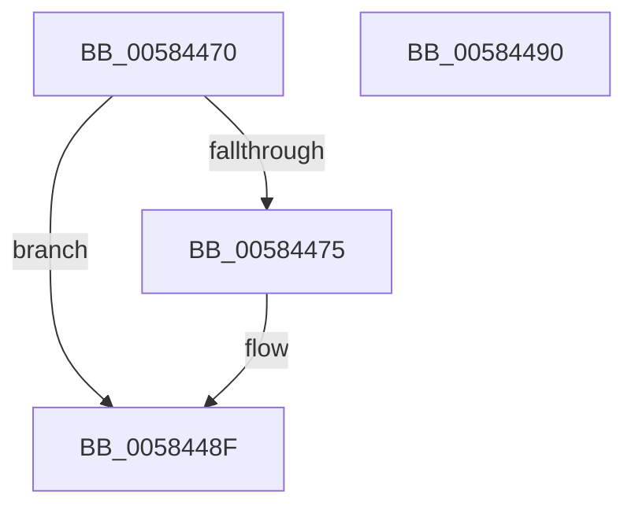

# HvlUnregisterInterruptCallback

- RVA: `0x00584470`–`0x00584491` (길이 `33` bytes)
- VA: `0x0000000140584470`
- 실행 섹션: `.text`
- PDB 이름 있음: `예`; PDB Function 태그: `아니요`
- unwind 정보 RVA: `0x000DB714`
- 디코드: `9`개 명령, `33/33` bytes 표시
- 미해석 바이트: `0` (있으면 어셈블리에 `.byte`로 보존)

> 이 문서는 커널 이미지의 기계어와 PDB 기호를 분석해 생성했습니다. 4번과 5번은 함수 원형과 자료형을 바이너리 사용 방식에서 추정한 C 해석이며 원본 소스 복구 결과는 아닙니다.

## 1. Dependencies

- 직접 호출 지점: **0**; 고유 호출 대상: **0**
- 직접 호출자로 확인된 함수: **0**
- RIP 상대 이미지 참조: **2**

### Outgoing calls
- 직접 디코드된 call 명령이 없습니다.

### Direct callers
- 이 함수 시작 RVA로 연결되는 직접 call은 확인되지 않았습니다. 간접 호출은 완전히 역산할 수 없습니다.

### Static image references
- `0x00584478` → RVA `0x00FC5608` (`ALMOSTRO`; read)
- `0x0058447F` → RVA `0x00583B20` (`HvlDummyInterruptCallback`; read)

## 2. Other-region calls and transfers

- 다른 실행 섹션으로 향하는 call: **0**
- 별도 외부 분기/꼬리 이동을 확인하지 못했습니다.

## 3. Assembly (complete function range)

```asm
00584470  83 F9 04                        cmp ecx, 4
00584473  77 1A                           ja 0x14058448f
00584475  48 63 C9                        movsxd rcx, ecx
00584478  4C 8D 0D 89 11 A4 00            lea r9, [rip + 0xa41189]
0058447F  4C 8D 05 9A F6 FF FF            lea r8, [rip - 0x966]
00584486  48 8B C2                        mov rax, rdx
00584489  F0 4D 0F B1 04 C9               lock cmpxchg qword ptr [r9 + rcx*8], r8
0058448F  C3                              ret
00584490  CC                              int3
```

## 4. C-style interpretation (structured pseudocode)

```c
__int64 __fastcall HvlUnregisterInterruptCallback(int a1, __int64 a2)
{
    __int64 result;

    if (a1 <= 4) {
        a1 = (int)(a1);
        a4 = v_rip + 10752393;
        a3 = v_rip - 2406;
        result = a2;
    }
    return result;
}
```

## 5. (Beta) C Style

```c
int64_t HvlUnregisterInterruptCallback(int32_t Arg1, int64_t Arg2)
{
    int64_t result;

    if (Arg1 <= 4) {
        Arg1 = (int32_t)(Arg1);
        a4 = v_rip + 10752393;
        a3 = v_rip - 2406;
        result = Arg2;
    }
    return result;
}
```

## 6. Execution-region graph

[열기: 2D/3D 그래프와 함수 탐색 컨트롤 패널](../../../control-panel.html?section=text&rva=0x00584470&view=graph)

- 2D 그래프는 위에서 아래로 흐르고, 3D 그래프는 빈 공간을 드래그해 회전합니다. Shift+드래그는 이동, 휠은 확대·축소, 함수 노드 선택은 대상 보고서 이동입니다.

### Static fallback


