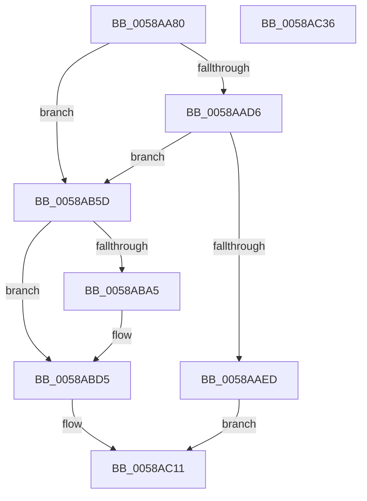

# HvlWakeVirtualProcessors

- RVA: `0x0058AA80`–`0x0058AC37` (길이 `439` bytes)
- VA: `0x000000014058AA80`
- 실행 섹션: `.text`
- PDB 이름 있음: `예`; PDB Function 태그: `아니요`
- unwind 정보 RVA: `0x000C68CC`
- 디코드: `103`개 명령, `439/439` bytes 표시
- 미해석 바이트: `0` (있으면 어셈블리에 `.byte`로 보존)

> 이 문서는 커널 이미지의 기계어와 PDB 기호를 분석해 생성했습니다. 4번과 5번은 함수 원형과 자료형을 바이너리 사용 방식에서 추정한 C 해석이며 원본 소스 복구 결과는 아닙니다.

## 1. Dependencies

- 직접 호출 지점: **12**; 고유 호출 대상: **8**
- 직접 호출자로 확인된 함수: **2**
- RIP 상대 이미지 참조: **3**

### Outgoing calls
- `0x0058AAC3` → [memset](../6C/memset_function_006C6C40.md) (function, `0x006C6C40`)
- `0x0058AB01` → [HvlpAffinityToHvProcessorSet](../30/HvlpAffinityToHvProcessorSet_function_003068F4.md) (function, `0x003068F4`)
- `0x0058AB50` → [HvcallFastExtended](../31/HvcallFastExtended_function_003130E0.md) (function, `0x003130E0`)
- `0x0058AB71` → [HvlpAcquireHypercallPage](../47/HvlpAcquireHypercallPage_function_00471410.md) (function, `0x00471410`)
- `0x0058AB9B` → [HvlpAffinityToHvProcessorSet](../30/HvlpAffinityToHvProcessorSet_function_003068F4.md) (function, `0x003068F4`)
- `0x0058ABAA` → [HvlpReleaseHypercallPage](../31/HvlpReleaseHypercallPage_function_00313480.md) (function, `0x00313480`)
- `0x0058ABBE` → [HvlpAcquireHypercallPage](../47/HvlpAcquireHypercallPage_function_00471410.md) (function, `0x00471410`)
- `0x0058ABD0` → [HvlpAffinityToHvProcessorSet](../30/HvlpAffinityToHvProcessorSet_function_003068F4.md) (function, `0x003068F4`)
- `0x0058ABFF` → [HvcallInitiateHypercall](../31/HvcallInitiateHypercall_function_00313630.md) (function, `0x00313630`)
- `0x0058AC0C` → [HvlpReleaseHypercallPage](../31/HvlpReleaseHypercallPage_function_00313480.md) (function, `0x00313480`)
- `0x0058AC14` → [HvlpHvToNtStatus](../30/HvlpHvToNtStatus_function_00307BD8.md) (function, `0x00307BD8`)
- `0x0058AC20` → [_security_check_cookie](../6A/_security_check_cookie_function_006AC640.md) (function, `0x006AC640`)

### Direct callers
- [KiHaltOnAddressWakeEntireList](../21/KiHaltOnAddressWakeEntireList_function_00217AF4.md) at `0x00217B96`
- [sub_006D6893](../6D/Unknown_function_006D6893.md) at `0x006D6898`

### Static image references
- `0x0058AA92` → RVA `0x00E0A740` (`.data`; read)
- `0x0058AAC8` → RVA `0x00FC6AB8` (`ALMOSTRO`; read)
- `0x0058AAD6` → RVA `0x00FC6A90` (`ALMOSTRO`; read)

## 2. Other-region calls and transfers

- 다른 실행 섹션으로 향하는 call: **0**
- 별도 외부 분기/꼬리 이동을 확인하지 못했습니다.

## 3. Assembly (complete function range)

```asm
0058AA80  48 89 5C 24 10                  mov qword ptr [rsp + 0x10], rbx
0058AA85  55                              push rbp
0058AA86  48 8D 6C 24 E0                  lea rbp, [rsp - 0x20]
0058AA8B  48 81 EC 20 01 00 00            sub rsp, 0x120
0058AA92  48 8B 05 A7 FC 87 00            mov rax, qword ptr [rip + 0x87fca7]
0058AA99  48 33 C4                        xor rax, rsp
0058AA9C  48 89 45 10                     mov qword ptr [rbp + 0x10], rax
0058AAA0  33 C0                           xor eax, eax
0058AAA2  48 8B D9                        mov rbx, rcx
0058AAA5  0F 57 C0                        xorps xmm0, xmm0
0058AAA8  48 89 44 24 48                  mov qword ptr [rsp + 0x48], rax
0058AAAD  48 8D 4C 24 60                  lea rcx, [rsp + 0x60]
0058AAB2  89 44 24 50                     mov dword ptr [rsp + 0x50], eax
0058AAB6  33 D2                           xor edx, edx
0058AAB8  41 B8 B0 00 00 00               mov r8d, 0xb0
0058AABE  0F 11 44 24 38                  movups xmmword ptr [rsp + 0x38], xmm0
0058AAC3  E8 78 C1 13 00                  call 0x1406c6c40
0058AAC8  8B 05 EA BF A3 00               mov eax, dword ptr [rip + 0xa3bfea]
0058AACE  84 C0                           test al, al
0058AAD0  0F 89 87 00 00 00               jns 0x14058ab5d
0058AAD6  8B 05 B4 BF A3 00               mov eax, dword ptr [rip + 0xa3bfb4]
0058AADC  48 C1 E8 08                     shr rax, 8
0058AAE0  83 E0 0F                        and eax, 0xf
0058AAE3  48 83 C0 04                     add rax, 4
0058AAE7  48 83 F8 0E                     cmp rax, 0xe
0058AAEB  73 70                           jae 0x14058ab5d
0058AAED  48 83 4C 24 60 FF               or qword ptr [rsp + 0x60], 0xffffffffffffffff
0058AAF3  48 8D 54 24 68                  lea rdx, [rsp + 0x68]
0058AAF8  41 B8 58 00 00 00               mov r8d, 0x58
0058AAFE  48 8B CB                        mov rcx, rbx
0058AB01  E8 EE BD D7 FF                  call 0x1403068f4
0058AB06  83 64 24 20 00                  and dword ptr [rsp + 0x20], 0
0058AB0B  41 B8 14 01 00 00               mov r8d, 0x114
0058AB11  4C 89 44 24 30                  mov qword ptr [rsp + 0x30], r8
0058AB16  45 33 C9                        xor r9d, r9d
0058AB19  8D 50 07                        lea edx, [rax + 7]
0058AB1C  C1 E2 0E                        shl edx, 0xe
0058AB1F  81 E2 00 00 FE 03               and edx, 0x3fe0000
0058AB25  8B CA                           mov ecx, edx
0058AB27  81 CA 14 01 01 00               or edx, 0x10114
0058AB2D  41 0B C8                        or ecx, r8d
0058AB30  44 8D 40 18                     lea r8d, [rax + 0x18]
0058AB34  89 4C 24 30                     mov dword ptr [rsp + 0x30], ecx
0058AB38  48 8B 4C 24 30                  mov rcx, qword ptr [rsp + 0x30]
0058AB3D  48 89 4C 24 30                  mov qword ptr [rsp + 0x30], rcx
0058AB42  89 54 24 30                     mov dword ptr [rsp + 0x30], edx
0058AB46  48 8D 54 24 60                  lea rdx, [rsp + 0x60]
0058AB4B  48 8B 4C 24 30                  mov rcx, qword ptr [rsp + 0x30]
0058AB50  E8 8B 85 D8 FF                  call 0x1403130e0
0058AB55  48 8B D8                        mov rbx, rax
0058AB58  E9 B4 00 00 00                  jmp 0x14058ac11
0058AB5D  41 B9 58 00 00 00               mov r9d, 0x58
0058AB63  4C 8D 44 24 60                  lea r8, [rsp + 0x60]
0058AB68  48 8D 4C 24 38                  lea rcx, [rsp + 0x38]
0058AB6D  41 8D 51 A9                     lea edx, [r9 - 0x57]
0058AB71  E8 9A 68 EE FF                  call 0x140471410
0058AB76  8B 4C 24 38                     mov ecx, dword ptr [rsp + 0x38]
0058AB7A  80 E1 02                        and cl, 2
0058AB7D  48 83 08 FF                     or qword ptr [rax], 0xffffffffffffffff
0058AB81  48 8D 50 08                     lea rdx, [rax + 8]
0058AB85  F6 D9                           neg cl
0058AB87  48 8B CB                        mov rcx, rbx
0058AB8A  45 1B C0                        sbb r8d, r8d
0058AB8D  41 81 E0 58 F0 FF FF            and r8d, 0xfffff058
0058AB94  41 81 C0 E8 0F 00 00            add r8d, 0xfe8
0058AB9B  E8 54 BD D7 FF                  call 0x1403068f4
0058ABA0  83 F8 FF                        cmp eax, -1
0058ABA3  75 30                           jne 0x14058abd5
0058ABA5  48 8D 4C 24 38                  lea rcx, [rsp + 0x38]
0058ABAA  E8 D1 88 D8 FF                  call 0x140313480
0058ABAF  45 33 C9                        xor r9d, r9d
0058ABB2  48 8D 4C 24 38                  lea rcx, [rsp + 0x38]
0058ABB7  45 33 C0                        xor r8d, r8d
0058ABBA  41 8D 51 01                     lea edx, [r9 + 1]
0058ABBE  E8 4D 68 EE FF                  call 0x140471410
0058ABC3  41 B8 E8 0F 00 00               mov r8d, 0xfe8
0058ABC9  48 8B CB                        mov rcx, rbx
0058ABCC  48 8D 50 08                     lea rdx, [rax + 8]
0058ABD0  E8 1F BD D7 FF                  call 0x1403068f4
0058ABD5  48 8B 54 24 50                  mov rdx, qword ptr [rsp + 0x50]
0058ABDA  83 C0 07                        add eax, 7
0058ABDD  C1 E0 0E                        shl eax, 0xe
0058ABE0  41 B8 14 01 00 00               mov r8d, 0x114
0058ABE6  4C 89 44 24 30                  mov qword ptr [rsp + 0x30], r8
0058ABEB  25 00 00 FE 03                  and eax, 0x3fe0000
0058ABF0  41 0B C0                        or eax, r8d
0058ABF3  45 33 C0                        xor r8d, r8d
0058ABF6  89 44 24 30                     mov dword ptr [rsp + 0x30], eax
0058ABFA  48 8B 4C 24 30                  mov rcx, qword ptr [rsp + 0x30]
0058ABFF  E8 2C 8A D8 FF                  call 0x140313630
0058AC04  48 8D 4C 24 38                  lea rcx, [rsp + 0x38]
0058AC09  48 8B D8                        mov rbx, rax
0058AC0C  E8 6F 88 D8 FF                  call 0x140313480
0058AC11  0F B7 CB                        movzx ecx, bx
0058AC14  E8 BF CF D7 FF                  call 0x140307bd8
0058AC19  48 8B 4D 10                     mov rcx, qword ptr [rbp + 0x10]
0058AC1D  48 33 CC                        xor rcx, rsp
0058AC20  E8 1B 1A 12 00                  call 0x1406ac640
0058AC25  48 8B 9C 24 38 01 00 00         mov rbx, qword ptr [rsp + 0x138]
0058AC2D  48 81 C4 20 01 00 00            add rsp, 0x120
0058AC34  5D                              pop rbp
0058AC35  C3                              ret
0058AC36  CC                              int3
```

## 4. C-style interpretation (structured pseudocode)

```c
__int64 __fastcall HvlWakeVirtualProcessors(__int64 a1, int a2, __int64 a3, int a4)
{
    __int64 result;
    __int64 v_rsp;
    unsigned int v_stack_m108;
    unsigned __int64 v_stack_m18;
    unsigned __int64 v_stack_m28;
    unsigned __int64 v_stack_mC0;
    unsigned __int64 v_stack_mC8;
    unsigned int v_stack_mD8;
    unsigned __int64 v_stack_mE0;
    unsigned __int64 v_stack_mF0;
    unsigned __int64 v_stack_mF8;
    unsigned __int64 v_stack_p10;

    v_stack_p10 = v_rbx;
    v_rsp = (v_rsp) - (288);
    result = (*(unsigned __int64 *)(v_rip + 8912039)) ^ (v_rsp);
    v_stack_m18 = result;
    result = 0;
    v_stack_mE0 = 0;
    v_stack_mD8 = 0;
    a2 = 0;
    v_stack_mF0 = v_xmm0;
    result = memset(v_stack_mC8, a2, 176, a4);
    if (!sign_flag) goto loc_0058AB5D;
    result = ((unsigned int)(*(unsigned int *)(v_rip + 10731444))) >> (8);
    result = (unsigned int)((result) & (15));
    result = (result) + (4);
    if (result >= 14) goto loc_0058AB5D;
    result = HvlpAffinityToHvProcessorSet(a1, v_stack_mC0, 88, a4);
    v_stack_mF8 = 276;
    a4 = 0;
    a2 = (unsigned int)((result + 7) << (14));
    a2 = (unsigned int)((a2) & (0x3FE0000ULL));
    a2 = (unsigned int)((a2) | (0x10114ULL));
    a1 = (unsigned int)(((unsigned int)(a2)) | (276));
    v_stack_mF8 = (unsigned int)(a1);
    v_stack_mF8 = v_stack_mF8;
    v_stack_mF8 = a2;
    result = HvcallFastExtended(v_stack_mF8, v_stack_mC8, result + 24, a4);
    goto loc_0058AC11;
loc_0058AB5D:
    result = HvlpAcquireHypercallPage(v_stack_mF0, 88 - 87, v_stack_mC8, 88);
    a1 = (unsigned __int8)(((unsigned int)(v_stack_mF0)) & (2));
    a1 = (unsigned __int8)(-(a1));
    a3 = (unsigned int)((v_stack_mC8) & (0xFFFFF058ULL));
    a3 = (unsigned int)((a3) + (0xFE8ULL));
    result = HvlpAffinityToHvProcessorSet(result, result + 8, a3, 88);
    if (((unsigned int)(result)) == -1) {
        a1 = v_stack_mF0;
        result = HvlpReleaseHypercallPage(a1, result + 8, a3, 88);
        a4 = 0;
        a1 = v_stack_mF0;
        a3 = 0;
        a2 = a4 + 1;
        result = HvlpAcquireHypercallPage(a1, a2, a3, a4);
        a3 = 0xFE8ULL;
        a1 = result;
        a2 = result + 8;
        result = HvlpAffinityToHvProcessorSet(a1, a2, a3, a4);
    }
    result = (unsigned int)((result) + (7));
    result = (unsigned int)((result) << (14));
    v_stack_mF8 = 276;
    result = (unsigned int)((result) & (0x3FE0000ULL));
    result = (unsigned int)((result) | (276));
    a3 = 0;
    v_stack_mF8 = (unsigned int)(result);
    result = HvcallInitiateHypercall(v_stack_mF8, v_stack_mD8, a3, a4);
    result = HvlpReleaseHypercallPage(v_stack_mF0, v_stack_mD8, a3, a4);
loc_0058AC11:
    result = HvlpHvToNtStatus((unsigned __int16)(result), v_stack_mD8, a3, a4);
    a1 = (v_stack_m18) ^ (v_rsp);
    result = _security_check_cookie(a1, v_stack_mD8, a3, a4);
    v_rsp = (v_rsp) + (288);
    return result;
}
```

## 5. (Beta) C Style

```c
int64_t HvlWakeVirtualProcessors(int64_t Arg1, int32_t Arg2, int64_t Arg3, int32_t Arg4)
{
    int64_t result;
    int64_t local_rsp;
    uint32_t v_stack_m108;
    uint64_t v_stack_m18;
    uint64_t v_stack_m28;
    uint64_t v_stack_mC0;
    uint64_t v_stack_mC8;
    uint32_t v_stack_mD8;
    uint64_t v_stack_mE0;
    uint64_t v_stack_mF0;
    uint64_t v_stack_mF8;
    uint64_t v_stack_p10;

    v_stack_p10 = local_rbx;
    local_rsp = (local_rsp) - (288);
    result = (*(uint64_t *)(v_rip + 0x87FCA7)) ^ (local_rsp);
    v_stack_m18 = result;
    result = 0;
    v_stack_mE0 = 0;
    v_stack_mD8 = 0;
    Arg2 = 0;
    v_stack_mF0 = v_xmm0;
    result = memset(v_stack_mC8, Arg2, 176, Arg4);
    if (!sign_flag) goto loc_0058AB5D;
    result = ((uint32_t)(*(uint32_t *)(v_rip + 0xA3BFB4))) >> (8);
    result = (uint32_t)((result) & (15));
    result = (result) + (4);
    if (result >= 14) goto loc_0058AB5D;
    result = HvlpAffinityToHvProcessorSet(Arg1, v_stack_mC0, 88, Arg4);
    v_stack_mF8 = 276;
    Arg4 = 0;
    Arg2 = (uint32_t)((result + 7) << (14));
    Arg2 = (uint32_t)((Arg2) & (0x3FE0000ULL));
    Arg2 = (uint32_t)((Arg2) | (0x10114ULL));
    Arg1 = (uint32_t)(((uint32_t)(Arg2)) | (276));
    v_stack_mF8 = (uint32_t)(Arg1);
    v_stack_mF8 = v_stack_mF8;
    v_stack_mF8 = Arg2;
    result = HvcallFastExtended(v_stack_mF8, v_stack_mC8, result + 24, Arg4);
    goto loc_0058AC11;
loc_0058AB5D:
    result = HvlpAcquireHypercallPage(v_stack_mF0, 88 - 87, v_stack_mC8, 88);
    Arg1 = (uint8_t)(((uint32_t)(v_stack_mF0)) & (2));
    Arg1 = (uint8_t)(-(Arg1));
    Arg3 = (uint32_t)((v_stack_mC8) & (0xFFFFF058ULL));
    Arg3 = (uint32_t)((Arg3) + (0xFE8ULL));
    result = HvlpAffinityToHvProcessorSet(result, result + 8, Arg3, 88);
    if (((uint32_t)(result)) == -1) {
        Arg1 = v_stack_mF0;
        result = HvlpReleaseHypercallPage(Arg1, result + 8, Arg3, 88);
        Arg4 = 0;
        Arg1 = v_stack_mF0;
        Arg3 = 0;
        Arg2 = Arg4 + 1;
        result = HvlpAcquireHypercallPage(Arg1, Arg2, Arg3, Arg4);
        Arg3 = 0xFE8ULL;
        Arg1 = result;
        Arg2 = result + 8;
        result = HvlpAffinityToHvProcessorSet(Arg1, Arg2, Arg3, Arg4);
    }
    result = (uint32_t)((result) + (7));
    result = (uint32_t)((result) << (14));
    v_stack_mF8 = 276;
    result = (uint32_t)((result) & (0x3FE0000ULL));
    result = (uint32_t)((result) | (276));
    Arg3 = 0;
    v_stack_mF8 = (uint32_t)(result);
    result = HvcallInitiateHypercall(v_stack_mF8, v_stack_mD8, Arg3, Arg4);
    result = HvlpReleaseHypercallPage(v_stack_mF0, v_stack_mD8, Arg3, Arg4);
loc_0058AC11:
    result = HvlpHvToNtStatus((uint16_t)(result), v_stack_mD8, Arg3, Arg4);
    Arg1 = (v_stack_m18) ^ (local_rsp);
    result = _security_check_cookie(Arg1, v_stack_mD8, Arg3, Arg4);
    local_rsp = (local_rsp) + (288);
    return result;
}
```

## 6. Execution-region graph

[열기: 2D/3D 그래프와 함수 탐색 컨트롤 패널](../../../control-panel.html?section=text&rva=0x0058AA80&view=graph)

- 2D 그래프는 위에서 아래로 흐르고, 3D 그래프는 빈 공간을 드래그해 회전합니다. Shift+드래그는 이동, 휠은 확대·축소, 함수 노드 선택은 대상 보고서 이동입니다.

### Static fallback


