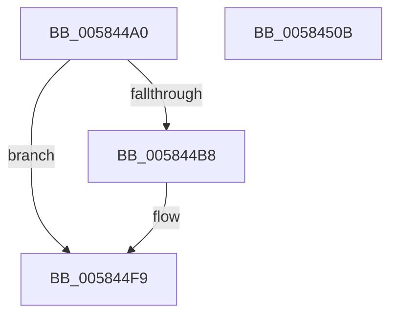

# HvlWheaInUsePageOfflineNotificationCallback

- RVA: `0x005844A0`–`0x0058450C` (길이 `108` bytes)
- VA: `0x00000001405844A0`
- 실행 섹션: `.text`
- PDB 이름 있음: `예`; PDB Function 태그: `아니요`
- unwind 정보 RVA: `0x00060BC4`
- 디코드: `32`개 명령, `108/108` bytes 표시
- 미해석 바이트: `0` (있으면 어셈블리에 `.byte`로 보존)

> 이 문서는 커널 이미지의 기계어와 PDB 기호를 분석해 생성했습니다. 4번과 5번은 함수 원형과 자료형을 바이너리 사용 방식에서 추정한 C 해석이며 원본 소스 복구 결과는 아닙니다.

## 1. Dependencies

- 직접 호출 지점: **1**; 고유 호출 대상: **1**
- 직접 호출자로 확인된 함수: **0**
- RIP 상대 이미지 참조: **1**

### Outgoing calls
- `0x005844EA` → [guard_dispatch_icall](../6B/guard_dispatch_icall_function_006BAAD0.md) (function, `0x006BAAD0`)

### Direct callers
- 이 함수 시작 RVA로 연결되는 직접 call은 확인되지 않았습니다. 간접 호출은 완전히 역산할 수 없습니다.

### Static image references
- `0x005844E3` → RVA `0x00E65E30` (`.data`; read)

## 2. Other-region calls and transfers

- 다른 실행 섹션으로 향하는 call: **0**
- 별도 외부 분기/꼬리 이동을 확인하지 못했습니다.

## 3. Assembly (complete function range)

```asm
005844A0  48 89 5C 24 08                  mov qword ptr [rsp + 8], rbx
005844A5  48 89 74 24 10                  mov qword ptr [rsp + 0x10], rsi
005844AA  57                              push rdi
005844AB  48 83 EC 20                     sub rsp, 0x20
005844AF  33 DB                           xor ebx, ebx
005844B1  49 8B F9                        mov rdi, r9
005844B4  84 D2                           test dl, dl
005844B6  75 41                           jne 0x1405844f9
005844B8  48 C1 E1 0C                     shl rcx, 0xc
005844BC  8D 73 01                        lea esi, [rbx + 1]
005844BF  49 89 08                        mov qword ptr [r8], rcx
005844C2  33 D2                           xor edx, edx
005844C4  41 89 70 1C                     mov dword ptr [r8 + 0x1c], esi
005844C8  49 8B C8                        mov rcx, r8
005844CB  49 89 58 10                     mov qword ptr [r8 + 0x10], rbx
005844CF  41 89 58 18                     mov dword ptr [r8 + 0x18], ebx
005844D3  41 88 58 08                     mov byte ptr [r8 + 8], bl
005844D7  41 C7 40 0A 00 00 00 01         mov dword ptr [r8 + 0xa], 0x1000000
005844DF  41 88 58 0E                     mov byte ptr [r8 + 0xe], bl
005844E3  48 8B 05 46 19 8E 00            mov rax, qword ptr [rip + 0x8e1946]
005844EA  E8 E1 65 13 00                  call 0x1406baad0
005844EF  85 C0                           test eax, eax
005844F1  0F B6 DB                        movzx ebx, bl
005844F4  89 07                           mov dword ptr [rdi], eax
005844F6  0F 49 DE                        cmovns ebx, esi
005844F9  48 8B 74 24 38                  mov rsi, qword ptr [rsp + 0x38]
005844FE  8A C3                           mov al, bl
00584500  48 8B 5C 24 30                  mov rbx, qword ptr [rsp + 0x30]
00584505  48 83 C4 20                     add rsp, 0x20
00584509  5F                              pop rdi
0058450A  C3                              ret
0058450B  CC                              int3
```

## 4. C-style interpretation (structured pseudocode)

```c
__int64 __fastcall HvlWheaInUsePageOfflineNotificationCallback(__int64 a1, int a2, __int64 a3, __int64 a4)
{
    __int64 result;
    __int64 v_rbx;
    __int64 v_rsi;
    __int64 v_rsp;
    unsigned __int64 v_stack_p10;
    unsigned __int64 v_stack_p8;

    v_stack_p8 = v_rbx;
    v_stack_p10 = v_rsi;
    v_rsp = (v_rsp) - (32);
    v_rbx = 0;
    if ((unsigned __int8)(a2) == 0) {
        a1 = (a1) << (12);
        v_rsi = v_rbx + 1;
        *(unsigned __int64 *)(a3) = a1;
        a2 = 0;
        *(unsigned int *)(a3 + 28) = (unsigned int)(v_rsi);
        a1 = a3;
        *(unsigned __int64 *)(a3 + 16) = 0;
        *(unsigned int *)(a3 + 24) = 0;
        *(unsigned __int8 *)(a3 + 8) = 0;
        *(unsigned int *)(a3 + 10) = 0x1000000ULL;
        *(unsigned __int8 *)(a3 + 14) = 0;
        result = *(unsigned __int64 *)(v_rip + 9312582);
        result = guard_dispatch_icall(a1, a2, a3, a4);
        v_rbx = 0;
        *(unsigned int *)(a4) = (unsigned int)(result);
        if (!sign_flag) { v_rbx = (unsigned int)(v_rsi); }
    }
    v_rsp = (v_rsp) + (32);
    return (unsigned __int8)(v_rbx);
}
```

## 5. (Beta) C Style

```c
int64_t HvlWheaInUsePageOfflineNotificationCallback(int64_t Arg1, int32_t Arg2, void *Arg3, void *Arg4)
{
    uint8_t *arg3 = (uint8_t *)Arg3;
    uint8_t *arg4 = (uint8_t *)Arg4;

    int64_t result;
    int64_t local_rbx;
    int64_t local_rsi;
    int64_t local_rsp;
    uint64_t v_stack_p10;
    uint64_t v_stack_p8;

    v_stack_p8 = local_rbx;
    v_stack_p10 = local_rsi;
    local_rsp = (local_rsp) - (32);
    local_rbx = 0;
    if ((uint8_t)(Arg2) == 0) {
        Arg1 = (Arg1) << (12);
        local_rsi = local_rbx + 1;
        *(uint64_t *)(arg3) = Arg1;
        Arg2 = 0;
        *(uint32_t *)(arg3 + 0x1C) = (uint32_t)(local_rsi);
        Arg1 = Arg3;
        *(uint64_t *)(arg3 + 0x10) = 0;
        *(uint32_t *)(arg3 + 0x18) = 0;
        *(uint8_t *)(arg3 + 0x8) = 0;
        *(uint32_t *)(arg3 + 0xA) = 0x1000000ULL;
        *(uint8_t *)(arg3 + 0xE) = 0;
        result = *(uint64_t *)(v_rip + 0x8E1946);
        result = guard_dispatch_icall(Arg1, Arg2, Arg3, Arg4);
        local_rbx = 0;
        *(uint32_t *)(arg4) = (uint32_t)(result);
        if (!sign_flag) { local_rbx = (uint32_t)(local_rsi); }
    }
    local_rsp = (local_rsp) + (32);
    return (uint8_t)(local_rbx);
}
```

### 관측된 메모리 오프셋

구조체 형식이 확인되지 않은 접근은 인자 기준의 오프셋으로만 기록했습니다.

| 기준 인자 | 오프셋 표현 | 폭 (bit) | 접근 |
|---|---:|---:|---|
| `Arg3` | `+ 0x0` | `64` | `W` |
| `Arg3` | `+ 0x8` | `8` | `W` |
| `Arg3` | `+ 0xA` | `32` | `W` |
| `Arg3` | `+ 0xE` | `8` | `W` |
| `Arg3` | `+ 0x10` | `64` | `W` |
| `Arg3` | `+ 0x18` | `32` | `W` |
| `Arg3` | `+ 0x1C` | `32` | `W` |
| `Arg4` | `+ 0x0` | `32` | `W` |

## 6. Execution-region graph

[열기: 2D/3D 그래프와 함수 탐색 컨트롤 패널](../../../control-panel.html?section=text&rva=0x005844A0&view=graph)

- 2D 그래프는 위에서 아래로 흐르고, 3D 그래프는 빈 공간을 드래그해 회전합니다. Shift+드래그는 이동, 휠은 확대·축소, 함수 노드 선택은 대상 보고서 이동입니다.

### Static fallback


