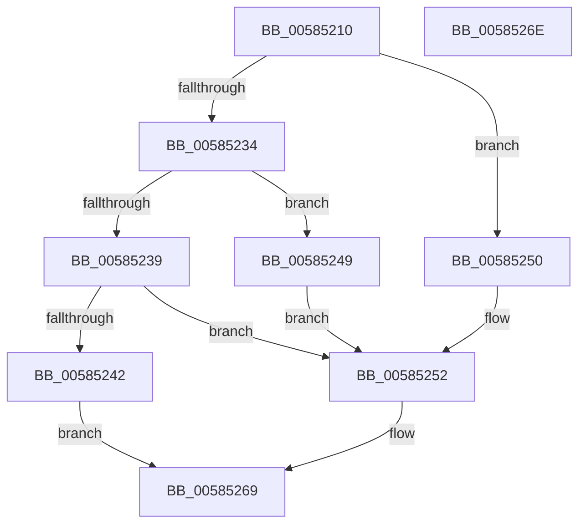

# HvlWritePerfIoPort

- RVA: `0x00585210`–`0x0058526F` (길이 `95` bytes)
- VA: `0x0000000140585210`
- 실행 섹션: `.text`
- PDB 이름 있음: `예`; PDB Function 태그: `아니요`
- unwind 정보 RVA: `0x0005D2F4`
- 디코드: `26`개 명령, `95/95` bytes 표시
- 미해석 바이트: `0` (있으면 어셈블리에 `.byte`로 보존)

> 이 문서는 커널 이미지의 기계어와 PDB 기호를 분석해 생성했습니다. 4번과 5번은 함수 원형과 자료형을 바이너리 사용 방식에서 추정한 C 해석이며 원본 소스 복구 결과는 아닙니다.

## 1. Dependencies

- 직접 호출 지점: **1**; 고유 호출 대상: **1**
- 직접 호출자로 확인된 함수: **0**
- RIP 상대 이미지 참조: **0**

### Outgoing calls
- `0x00585264` → [HvlpWritePerfRegister](HvlpWritePerfRegister_function_00586EF0.md) (function, `0x00586EF0`)

### Direct callers
- 이 함수 시작 RVA로 연결되는 직접 call은 확인되지 않았습니다. 간접 호출은 완전히 역산할 수 없습니다.

### Static image references
- 디코드된 RIP-relative 메모리 참조가 없습니다.

## 2. Other-region calls and transfers

- 다른 실행 섹션으로 향하는 call: **0**
- 별도 외부 분기/꼬리 이동을 확인하지 못했습니다.

## 3. Assembly (complete function range)

```asm
00585210  48 83 EC 38                     sub rsp, 0x38
00585214  48 B8 00 00 00 00 00 00 20 00   movabs rax, 0x20000000000000
0058521E  45 8B D1                        mov r10d, r9d
00585221  48 89 44 24 20                  mov qword ptr [rsp + 0x20], rax
00585226  66 89 54 24 20                  mov word ptr [rsp + 0x20], dx
0058522B  41 0F B7 D0                     movzx edx, r8w
0058522F  83 EA 01                        sub edx, 1
00585232  74 1C                           je 0x140585250
00585234  83 EA 01                        sub edx, 1
00585237  74 10                           je 0x140585249
00585239  B8 02 00 00 00                  mov eax, 2
0058523E  3B D0                           cmp edx, eax
00585240  74 10                           je 0x140585252
00585242  B8 0D 00 00 C0                  mov eax, 0xc000000d
00585247  EB 20                           jmp 0x140585269
00585249  B8 01 00 00 00                  mov eax, 1
0058524E  EB 02                           jmp 0x140585252
00585250  33 C0                           xor eax, eax
00585252  44 8B 4C 24 60                  mov r9d, dword ptr [rsp + 0x60]
00585257  4D 8B C2                        mov r8, r10
0058525A  66 89 44 24 22                  mov word ptr [rsp + 0x22], ax
0058525F  48 8B 54 24 20                  mov rdx, qword ptr [rsp + 0x20]
00585264  E8 87 1C 00 00                  call 0x140586ef0
00585269  48 83 C4 38                     add rsp, 0x38
0058526D  C3                              ret
0058526E  CC                              int3
```

## 4. C-style interpretation (structured pseudocode)

```c
__int64 __fastcall HvlWritePerfIoPort(__int64 a1, unsigned __int16 a2, unsigned __int16 a3, int a4, unsigned int a5)
{
    __int64 result;
    __int64 v_rsp;
    unsigned __int16 v_stack_m16;
    unsigned __int64 v_stack_m18;

    v_rsp = (v_rsp) - (56);
    v_stack_m18 = result;
    v_stack_m18 = a2;
    a2 = (unsigned int)((a3) - (1));
    if (condition_is_equal) goto loc_00585250;
    a2 = (unsigned int)((a2) - (1));
    if (condition_is_equal) goto loc_00585249;
    if (a2 == 2) goto loc_00585252;
    goto loc_00585269;
loc_00585249:
    goto loc_00585252;
loc_00585250:
    result = 0;
loc_00585252:
    v_stack_m16 = 0;
    result = HvlpWritePerfRegister(a1, v_stack_m18, (unsigned int)(a4), (unsigned int)(a5));
loc_00585269:
    v_rsp = (v_rsp) + (56);
    return result;
}
```

## 5. (Beta) C Style

```c
int64_t HvlWritePerfIoPort(int64_t Arg1, uint16_t Arg2, uint16_t Arg3, int32_t Arg4, uint32_t Arg5)
{
    int64_t result;
    int64_t local_rsp;
    uint16_t v_stack_m16;
    uint64_t v_stack_m18;

    local_rsp = (local_rsp) - (56);
    v_stack_m18 = result;
    v_stack_m18 = Arg2;
    Arg2 = (uint32_t)((Arg3) - (1));
    if (condition_is_equal) goto loc_00585250;
    Arg2 = (uint32_t)((Arg2) - (1));
    if (condition_is_equal) goto loc_00585249;
    if (Arg2 == 2) goto loc_00585252;
    goto loc_00585269;
loc_00585249:
    goto loc_00585252;
loc_00585250:
    result = 0;
loc_00585252:
    v_stack_m16 = 0;
    result = HvlpWritePerfRegister(Arg1, v_stack_m18, (uint32_t)(Arg4), (uint32_t)(Arg5));
loc_00585269:
    local_rsp = (local_rsp) + (56);
    return result;
}
```

## 6. Execution-region graph

[열기: 2D/3D 그래프와 함수 탐색 컨트롤 패널](../../../control-panel.html?section=text&rva=0x00585210&view=graph)

- 2D 그래프는 위에서 아래로 흐르고, 3D 그래프는 빈 공간을 드래그해 회전합니다. Shift+드래그는 이동, 휠은 확대·축소, 함수 노드 선택은 대상 보고서 이동입니다.

### Static fallback


