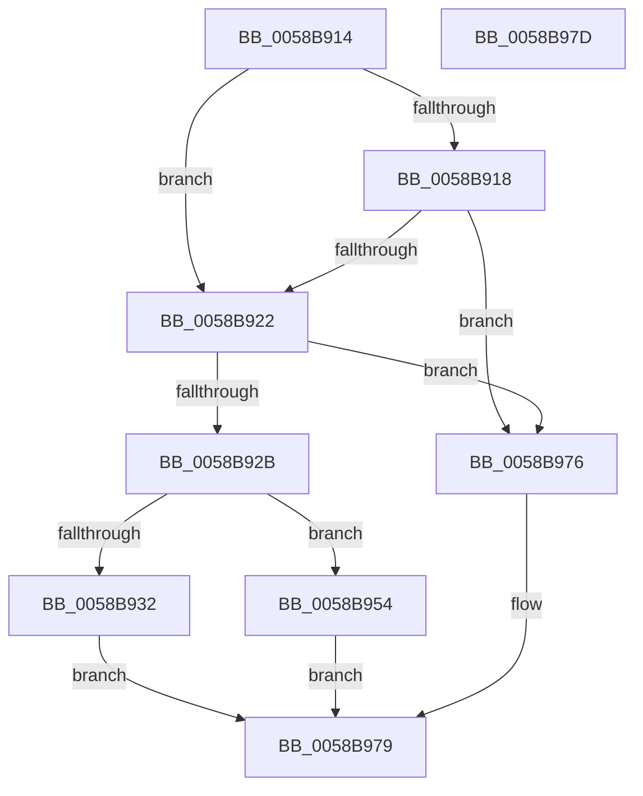

# HvlpAddCrashdumpAreaPages

- RVA: `0x0058B914`–`0x0058B97E` (길이 `106` bytes)
- VA: `0x000000014058B914`
- 실행 섹션: `.text`
- PDB 이름 있음: `예`; PDB Function 태그: `예`
- unwind 정보 RVA: `0x000DB714`
- 디코드: `28`개 명령, `106/106` bytes 표시
- 미해석 바이트: `0` (있으면 어셈블리에 `.byte`로 보존)

> 이 문서는 커널 이미지의 기계어와 PDB 기호를 분석해 생성했습니다. 4번과 5번은 함수 원형과 자료형을 바이너리 사용 방식에서 추정한 C 해석이며 원본 소스 복구 결과는 아닙니다.

## 1. Dependencies

- 직접 호출 지점: **0**; 고유 호출 대상: **0**
- 직접 호출자로 확인된 함수: **1**
- RIP 상대 이미지 참조: **6**

### Outgoing calls
- 직접 디코드된 call 명령이 없습니다.

### Direct callers
- [HvlAddSecurePagesCallbackRoutine](HvlAddSecurePagesCallbackRoutine_function_0058B0C8.md) at `0x0058B1A4`
- [HvlAddSecurePagesCallbackRoutine](HvlAddSecurePagesCallbackRoutine_function_0058B0C8.md) at `0x0058B1C6`

### Static image references
- `0x0058B918` → RVA `0x00FC6A90` (`ALMOSTRO`; read)
- `0x0058B922` → RVA `0x00E667E8` (`.data`; read)
- `0x0058B932` → RVA `0x00F8EDA8` (`.data`; read)
- `0x0058B941` → RVA `0x00F8EDB0` (`.data`; read)
- `0x0058B954` → RVA `0x00F8ED90` (`.data`; read)
- `0x0058B963` → RVA `0x00F8ED98` (`.data`; read)

## 2. Other-region calls and transfers

- 다른 실행 섹션으로 향하는 call: **0**
- 별도 외부 분기/꼬리 이동을 확인하지 못했습니다.

## 3. Assembly (complete function range)

```asm
0058B914  84 D2                           test dl, dl
0058B916  74 0A                           je 0x14058b922
0058B918  8B 05 72 B1 A3 00               mov eax, dword ptr [rip + 0xa3b172]
0058B91E  A8 02                           test al, 2
0058B920  74 54                           je 0x14058b976
0058B922  80 3D BF AE 8D 00 00            cmp byte ptr [rip + 0x8daebf], 0
0058B929  74 4B                           je 0x14058b976
0058B92B  41 B0 01                        mov r8b, 1
0058B92E  84 D2                           test dl, dl
0058B930  74 22                           je 0x14058b954
0058B932  48 8B 05 6F 34 A0 00            mov rax, qword ptr [rip + 0xa0346f]
0058B939  48 C1 E8 0C                     shr rax, 0xc
0058B93D  48 89 41 10                     mov qword ptr [rcx + 0x10], rax
0058B941  8B 05 69 34 A0 00               mov eax, dword ptr [rip + 0xa03469]
0058B947  81 49 08 22 00 00 80            or dword ptr [rcx + 8], 0x80000022
0058B94E  48 89 41 18                     mov qword ptr [rcx + 0x18], rax
0058B952  EB 25                           jmp 0x14058b979
0058B954  48 8B 05 35 34 A0 00            mov rax, qword ptr [rip + 0xa03435]
0058B95B  48 C1 E8 0C                     shr rax, 0xc
0058B95F  48 89 41 10                     mov qword ptr [rcx + 0x10], rax
0058B963  8B 05 2F 34 A0 00               mov eax, dword ptr [rip + 0xa0342f]
0058B969  81 49 08 02 00 00 80            or dword ptr [rcx + 8], 0x80000002
0058B970  48 89 41 18                     mov qword ptr [rcx + 0x18], rax
0058B974  EB 03                           jmp 0x14058b979
0058B976  45 32 C0                        xor r8b, r8b
0058B979  41 8A C0                        mov al, r8b
0058B97C  C3                              ret
0058B97D  CC                              int3
```

## 4. C-style interpretation (structured pseudocode)

```c
__int64 __fastcall HvlpAddCrashdumpAreaPages(__int64 a1, unsigned __int8 a2)
{
    __int64 result;

    if (a2 == 0) goto loc_0058B922;
    if ((((unsigned __int8)((unsigned int)(*(unsigned int *)(v_rip + 10727794)))) & (2)) == 0) goto loc_0058B976;
loc_0058B922:
    if ((*(unsigned __int8 *)(v_rip + 9285311)) == 0) goto loc_0058B976;
    if (a2 == 0) goto loc_0058B954;
    result = (*(unsigned __int64 *)(v_rip + 10499183)) >> (12);
    *(unsigned __int64 *)(a1 + 16) = result;
    *(unsigned __int64 *)(a1 + 24) = (unsigned int)(*(unsigned int *)(v_rip + 10499177));
    goto loc_0058B979;
loc_0058B954:
    result = (*(unsigned __int64 *)(v_rip + 10499125)) >> (12);
    *(unsigned __int64 *)(a1 + 16) = result;
    *(unsigned __int64 *)(a1 + 24) = (unsigned int)(*(unsigned int *)(v_rip + 10499119));
    goto loc_0058B979;
loc_0058B976:
    a3 = 0;
loc_0058B979:
    return 0;
}
```

## 5. (Beta) C Style

```c
int64_t HvlpAddCrashdumpAreaPages(void *Arg1, uint8_t Arg2)
{
    uint8_t *arg1 = (uint8_t *)Arg1;

    int64_t result;

    if (Arg2 == 0) goto loc_0058B922;
    if ((((uint8_t)((uint32_t)(*(uint32_t *)(v_rip + 0xA3B172)))) & (2)) == 0) goto loc_0058B976;
loc_0058B922:
    if ((*(uint8_t *)(v_rip + 0x8DAEBF)) == 0) goto loc_0058B976;
    if (Arg2 == 0) goto loc_0058B954;
    result = (*(uint64_t *)(v_rip + 0xA0346F)) >> (12);
    *(uint64_t *)(arg1 + 0x10) = result;
    *(uint64_t *)(arg1 + 0x18) = (uint32_t)(*(uint32_t *)(v_rip + 0xA03469));
    goto loc_0058B979;
loc_0058B954:
    result = (*(uint64_t *)(v_rip + 0xA03435)) >> (12);
    *(uint64_t *)(arg1 + 0x10) = result;
    *(uint64_t *)(arg1 + 0x18) = (uint32_t)(*(uint32_t *)(v_rip + 0xA0342F));
    goto loc_0058B979;
loc_0058B976:
    a3 = 0;
loc_0058B979:
    return 0;
}
```

### 관측된 메모리 오프셋

구조체 형식이 확인되지 않은 접근은 인자 기준의 오프셋으로만 기록했습니다.

| 기준 인자 | 오프셋 표현 | 폭 (bit) | 접근 |
|---|---:|---:|---|
| `Arg1` | `+ 0x8` | `32` | `R/W` |
| `Arg1` | `+ 0x10` | `64` | `W` |
| `Arg1` | `+ 0x18` | `64` | `W` |

## 6. Execution-region graph

[열기: 2D/3D 그래프와 함수 탐색 컨트롤 패널](../../../control-panel.html?section=text&rva=0x0058B914&view=graph)

- 2D 그래프는 위에서 아래로 흐르고, 3D 그래프는 빈 공간을 드래그해 회전합니다. Shift+드래그는 이동, 휠은 확대·축소, 함수 노드 선택은 대상 보고서 이동입니다.

### Static fallback


