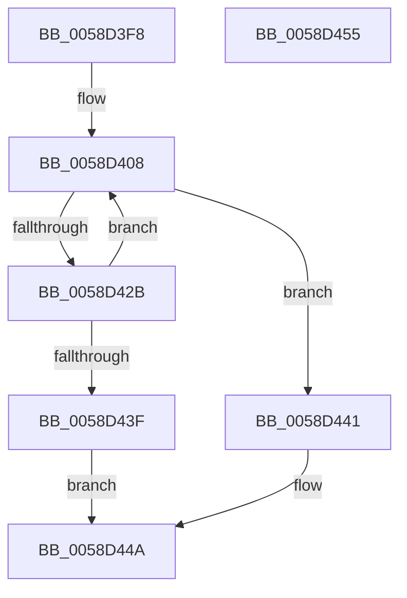

# HvlpAllocateOverlayPages

- RVA: `0x0058D3F8`–`0x0058D456` (길이 `94` bytes)
- VA: `0x000000014058D3F8`
- 실행 섹션: `.text`
- PDB 이름 있음: `예`; PDB Function 태그: `아니요`
- unwind 정보 RVA: `0x000C6858`
- 디코드: `27`개 명령, `94/94` bytes 표시
- 미해석 바이트: `0` (있으면 어셈블리에 `.byte`로 보존)

> 이 문서는 커널 이미지의 기계어와 PDB 기호를 분석해 생성했습니다. 4번과 5번은 함수 원형과 자료형을 바이너리 사용 방식에서 추정한 C 해석이며 원본 소스 복구 결과는 아닙니다.

## 1. Dependencies

- 직접 호출 지점: **2**; 고유 호출 대상: **1**
- 직접 호출자로 확인된 함수: **2**
- RIP 상대 이미지 참조: **0**

### Outgoing calls
- `0x0058D435` → [MmAllocateContiguousNodeMemory](../3E/MmAllocateContiguousNodeMemory_function_003E9E40.md) (function, `0x003E9E40`)
- `0x0058D445` → [MmAllocateContiguousNodeMemory](../3E/MmAllocateContiguousNodeMemory_function_003E9E40.md) (function, `0x003E9E40`)

### Direct callers
- [HvlSetupPhysicalFaultNotificationQueue](HvlSetupPhysicalFaultNotificationQueue_function_00584CE0.md) at `0x00584D20`
- [HvlInitializeProcessor](../../page/71/HvlInitializeProcessor_function_0071804C.md) at `0x00718128`
- [HvlInitializeProcessor](../../page/71/HvlInitializeProcessor_function_0071804C.md) at `0x007181AA`

### Static image references
- 디코드된 RIP-relative 메모리 참조가 없습니다.

## 2. Other-region calls and transfers

- 다른 실행 섹션으로 향하는 call: **0**
- 별도 외부 분기/꼬리 이동을 확인하지 못했습니다.

## 3. Assembly (complete function range)

```asm
0058D3F8  48 89 74 24 08                  mov qword ptr [rsp + 8], rsi
0058D3FD  57                              push rdi
0058D3FE  48 83 EC 30                     sub rsp, 0x30
0058D402  33 F6                           xor esi, esi
0058D404  48 83 CF FF                     or rdi, 0xffffffffffffffff
0058D408  8B C6                           mov eax, esi
0058D40A  C7 44 24 28 00 00 00 80         mov dword ptr [rsp + 0x28], 0x80000000
0058D412  FF C6                           inc esi
0058D414  C7 44 24 20 04 00 00 00         mov dword ptr [rsp + 0x20], 4
0058D41C  45 33 C9                        xor r9d, r9d
0058D41F  33 D2                           xor edx, edx
0058D421  B9 00 10 00 00                  mov ecx, 0x1000
0058D426  83 F8 04                        cmp eax, 4
0058D429  73 16                           jae 0x14058d441
0058D42B  48 81 C7 00 00 00 40            add rdi, 0x40000000
0058D432  4C 8B C7                        mov r8, rdi
0058D435  E8 06 CA E5 FF                  call 0x1403e9e40
0058D43A  48 85 C0                        test rax, rax
0058D43D  74 C9                           je 0x14058d408
0058D43F  EB 09                           jmp 0x14058d44a
0058D441  49 83 C8 FF                     or r8, 0xffffffffffffffff
0058D445  E8 F6 C9 E5 FF                  call 0x1403e9e40
0058D44A  48 8B 74 24 40                  mov rsi, qword ptr [rsp + 0x40]
0058D44F  48 83 C4 30                     add rsp, 0x30
0058D453  5F                              pop rdi
0058D454  C3                              ret
0058D455  CC                              int3
```

## 4. C-style interpretation (structured pseudocode)

```c
__int64 __fastcall HvlpAllocateOverlayPages(__int64 a1, int a2, __int64 a3, int a4)
{
    __int64 result;
    __int64 v_rdi;
    __int64 v_rsi;
    __int64 v_rsp;
    unsigned int v_stack_m10;
    unsigned int v_stack_m18;
    unsigned __int64 v_stack_p8;

    v_stack_p8 = v_rsi;
    v_rsp = (v_rsp) - (48);
    v_rsi = 0;
    v_rdi = (v_rdi) | (-1);
loc_0058D408:
    v_stack_m10 = 0x80000000ULL;
    v_rsi = (unsigned int)((v_rsi) + 1);
    v_stack_m18 = 4;
    a4 = 0;
    a2 = 0;
    if (0 >= 4) goto loc_0058D441;
    v_rdi = (v_rdi) + (0x40000000ULL);
    result = MmAllocateContiguousNodeMemory((unsigned int)(0x1000ULL), a2, v_rdi, a4);
    if (result == 0) goto loc_0058D408;
    goto loc_0058D44A;
loc_0058D441:
    a3 = (v_rdi) | (-1);
    result = MmAllocateContiguousNodeMemory((unsigned int)(0x1000ULL), a2, a3, a4);
loc_0058D44A:
    v_rsp = (v_rsp) + (48);
    return result;
}
```

## 5. (Beta) C Style

```c
int64_t HvlpAllocateOverlayPages(int64_t Arg1, int32_t Arg2, int64_t Arg3, int32_t Arg4)
{
    int64_t result;
    int64_t local_rdi;
    int64_t local_rsi;
    int64_t local_rsp;
    uint32_t v_stack_m10;
    uint32_t v_stack_m18;
    uint64_t v_stack_p8;

    v_stack_p8 = local_rsi;
    local_rsp = (local_rsp) - (48);
    local_rsi = 0;
    local_rdi = (local_rdi) | (-1);
loc_0058D408:
    v_stack_m10 = 0x80000000ULL;
    local_rsi = (uint32_t)((local_rsi) + 1);
    v_stack_m18 = 4;
    Arg4 = 0;
    Arg2 = 0;
    if (0 >= 4) goto loc_0058D441;
    local_rdi = (local_rdi) + (0x40000000ULL);
    result = MmAllocateContiguousNodeMemory((uint32_t)(0x1000ULL), Arg2, local_rdi, Arg4);
    if (result == 0) goto loc_0058D408;
    goto loc_0058D44A;
loc_0058D441:
    Arg3 = (local_rdi) | (-1);
    result = MmAllocateContiguousNodeMemory((uint32_t)(0x1000ULL), Arg2, Arg3, Arg4);
loc_0058D44A:
    local_rsp = (local_rsp) + (48);
    return result;
}
```

## 6. Execution-region graph

[열기: 2D/3D 그래프와 함수 탐색 컨트롤 패널](../../../control-panel.html?section=text&rva=0x0058D3F8&view=graph)

- 2D 그래프는 위에서 아래로 흐르고, 3D 그래프는 빈 공간을 드래그해 회전합니다. Shift+드래그는 이동, 휠은 확대·축소, 함수 노드 선택은 대상 보고서 이동입니다.

### Static fallback


