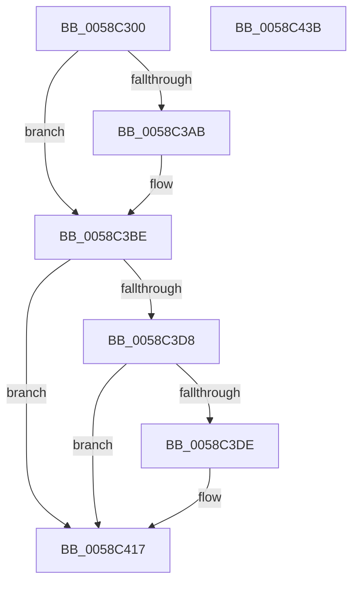

# HvlpCheckTscSync

- RVA: `0x0058C300`–`0x0058C43C` (길이 `316` bytes)
- VA: `0x000000014058C300`
- 실행 섹션: `.text`
- PDB 이름 있음: `예`; PDB Function 태그: `아니요`
- unwind 정보 RVA: `0x000C6988`
- 디코드: `70`개 명령, `316/316` bytes 표시
- 미해석 바이트: `0` (있으면 어셈블리에 `.byte`로 보존)

> 이 문서는 커널 이미지의 기계어와 PDB 기호를 분석해 생성했습니다. 4번과 5번은 함수 원형과 자료형을 바이너리 사용 방식에서 추정한 C 해석이며 원본 소스 복구 결과는 아닙니다.

## 1. Dependencies

- 직접 호출 지점: **7**; 고유 호출 대상: **5**
- 직접 호출자로 확인된 함수: **2**
- RIP 상대 이미지 참조: **2**

### Outgoing calls
- `0x0058C366` → [HvlpAcquireHypercallPage](../47/HvlpAcquireHypercallPage_function_00471410.md) (function, `0x00471410`)
- `0x0058C382` → [HvlpAcquireHypercallPage](../47/HvlpAcquireHypercallPage_function_00471410.md) (function, `0x00471410`)
- `0x0058C39F` → [HvcallInitiateHypercall](../31/HvcallInitiateHypercall_function_00313630.md) (function, `0x00313630`)
- `0x0058C3C3` → [HvlpReleaseHypercallPage](../31/HvlpReleaseHypercallPage_function_00313480.md) (function, `0x00313480`)
- `0x0058C3CD` → [HvlpReleaseHypercallPage](../31/HvlpReleaseHypercallPage_function_00313480.md) (function, `0x00313480`)
- `0x0058C412` → [HvlpWriteEventLog](HvlpWriteEventLog_function_0058C9E4.md) (function, `0x0058C9E4`)
- `0x0058C421` → [_security_check_cookie](../6A/_security_check_cookie_function_006AC640.md) (function, `0x006AC640`)

### Direct callers
- [HvlpPowerStateCallback](../4C/HvlpPowerStateCallback_function_004CFDD0.md) at `0x004CFDE5`
- [HvlPhase2Initialize](HvlPhase2Initialize_function_00583EA0.md) at `0x00584041`

### Static image references
- `0x0058C31A` → RVA `0x00E0A740` (`.data`; read)
- `0x0058C40B` → RVA `0x00026938` (`.rdata`; read)

## 2. Other-region calls and transfers

- 다른 실행 섹션으로 향하는 call: **0**
- 별도 외부 분기/꼬리 이동을 확인하지 못했습니다.

## 3. Assembly (complete function range)

```asm
0058C300  48 89 5C 24 08                  mov qword ptr [rsp + 8], rbx
0058C305  48 89 7C 24 10                  mov qword ptr [rsp + 0x10], rdi
0058C30A  55                              push rbp
0058C30B  48 8D AC 24 30 F8 FF FF         lea rbp, [rsp - 0x7d0]
0058C313  48 81 EC D0 08 00 00            sub rsp, 0x8d0
0058C31A  48 8B 05 1F E4 87 00            mov rax, qword ptr [rip + 0x87e41f]
0058C321  48 33 C4                        xor rax, rsp
0058C324  48 89 85 C8 07 00 00            mov qword ptr [rbp + 0x7c8], rax
0058C32B  33 C0                           xor eax, eax
0058C32D  4C 8D 45 98                     lea r8, [rbp - 0x68]
0058C331  0F 57 C0                        xorps xmm0, xmm0
0058C334  48 89 44 24 50                  mov qword ptr [rsp + 0x50], rax
0058C339  48 8D 4C 24 40                  lea rcx, [rsp + 0x40]
0058C33E  89 44 24 58                     mov dword ptr [rsp + 0x58], eax
0058C342  0F 11 44 24 40                  movups xmmword ptr [rsp + 0x40], xmm0
0058C347  44 8D 48 10                     lea r9d, [rax + 0x10]
0058C34B  48 89 44 24 30                  mov qword ptr [rsp + 0x30], rax
0058C350  8D 50 01                        lea edx, [rax + 1]
0058C353  89 44 24 38                     mov dword ptr [rsp + 0x38], eax
0058C357  0F 11 44 24 20                  movups xmmword ptr [rsp + 0x20], xmm0
0058C35C  48 89 44 24 70                  mov qword ptr [rsp + 0x70], rax
0058C361  0F 11 44 24 60                  movups xmmword ptr [rsp + 0x60], xmm0
0058C366  E8 A5 50 EE FF                  call 0x140471410
0058C36B  41 B9 08 04 00 00               mov r9d, 0x408
0058C371  4C 8D 45 B8                     lea r8, [rbp - 0x48]
0058C375  BA 02 00 00 00                  mov edx, 2
0058C37A  48 8D 4C 24 20                  lea rcx, [rsp + 0x20]
0058C37F  48 8B D8                        mov rbx, rax
0058C382  E8 89 50 EE FF                  call 0x140471410
0058C387  4C 8B 44 24 38                  mov r8, qword ptr [rsp + 0x38]
0058C38C  B9 7B 00 00 00                  mov ecx, 0x7b
0058C391  48 8B 54 24 58                  mov rdx, qword ptr [rsp + 0x58]
0058C396  48 8B F8                        mov rdi, rax
0058C399  C7 03 0E 00 00 00               mov dword ptr [rbx], 0xe
0058C39F  E8 8C 72 D8 FF                  call 0x140313630
0058C3A4  33 DB                           xor ebx, ebx
0058C3A6  66 85 C0                        test ax, ax
0058C3A9  75 13                           jne 0x14058c3be
0058C3AB  0F 10 07                        movups xmm0, xmmword ptr [rdi]
0058C3AE  0F 11 44 24 60                  movups xmmword ptr [rsp + 0x60], xmm0
0058C3B3  F2 0F 10 4F 10                  movsd xmm1, qword ptr [rdi + 0x10]
0058C3B8  F2 0F 11 4C 24 70               movsd qword ptr [rsp + 0x70], xmm1
0058C3BE  48 8D 4C 24 20                  lea rcx, [rsp + 0x20]
0058C3C3  E8 B8 70 D8 FF                  call 0x140313480
0058C3C8  48 8D 4C 24 40                  lea rcx, [rsp + 0x40]
0058C3CD  E8 AE 70 D8 FF                  call 0x140313480
0058C3D2  38 5C 24 61                     cmp byte ptr [rsp + 0x61], bl
0058C3D6  74 3F                           je 0x14058c417
0058C3D8  38 5C 24 60                     cmp byte ptr [rsp + 0x60], bl
0058C3DC  74 39                           je 0x14058c417
0058C3DE  48 8D 44 24 68                  lea rax, [rsp + 0x68]
0058C3E3  48 C7 45 80 08 00 00 00         mov qword ptr [rbp - 0x80], 8
0058C3EB  48 89 44 24 78                  mov qword ptr [rsp + 0x78], rax
0058C3F0  4C 8D 44 24 78                  lea r8, [rsp + 0x78]
0058C3F5  48 8D 44 24 70                  lea rax, [rsp + 0x70]
0058C3FA  48 C7 45 90 08 00 00 00         mov qword ptr [rbp - 0x70], 8
0058C402  BA 02 00 00 00                  mov edx, 2
0058C407  48 89 45 88                     mov qword ptr [rbp - 0x78], rax
0058C40B  48 8D 0D 26 A5 A9 FF            lea rcx, [rip - 0x565ada]
0058C412  E8 CD 05 00 00                  call 0x14058c9e4
0058C417  48 8B 8D C8 07 00 00            mov rcx, qword ptr [rbp + 0x7c8]
0058C41E  48 33 CC                        xor rcx, rsp
0058C421  E8 1A 02 12 00                  call 0x1406ac640
0058C426  4C 8D 9C 24 D0 08 00 00         lea r11, [rsp + 0x8d0]
0058C42E  49 8B 5B 10                     mov rbx, qword ptr [r11 + 0x10]
0058C432  49 8B 7B 18                     mov rdi, qword ptr [r11 + 0x18]
0058C436  49 8B E3                        mov rsp, r11
0058C439  5D                              pop rbp
0058C43A  C3                              ret
0058C43B  CC                              int3
```

## 4. C-style interpretation (structured pseudocode)

```c
__int64 __fastcall HvlpCheckTscSync(void)
{
    __int64 result;
    __int64 v_rbx;
    __int64 v_rsp;
    unsigned __int64 v_stack_m10;
    unsigned __int64 v_stack_m7D8;
    unsigned __int64 v_stack_m8;
    unsigned __int64 v_stack_m820;
    unsigned __int64 v_stack_m840;
    unsigned __int64 v_stack_m848;
    unsigned __int64 v_stack_m850;
    unsigned __int64 v_stack_m858;
    unsigned __int64 v_stack_m860;
    unsigned __int64 v_stack_m868;
    unsigned __int64 v_stack_m870;
    unsigned __int8 v_stack_m877;
    unsigned __int64 v_stack_m878;
    unsigned int v_stack_m880;
    unsigned __int64 v_stack_m888;
    unsigned __int64 v_stack_m898;
    unsigned int v_stack_m8A0;
    unsigned __int64 v_stack_m8A8;
    unsigned __int64 v_stack_m8B8;
    unsigned __int64 v_stack_p10;
    unsigned __int64 v_stack_p8;

    v_stack_p8 = v_rbx;
    v_stack_p10 = v_rdi;
    v_rsp = (v_rsp) - (0x8D0ULL);
    result = (*(unsigned __int64 *)(v_rip + 8905759)) ^ (v_rsp);
    v_stack_m10 = result;
    result = 0;
    v_stack_m888 = 0;
    v_stack_m880 = 0;
    v_stack_m898 = v_xmm0;
    v_stack_m8A8 = 0;
    v_stack_m8A0 = 0;
    v_stack_m8B8 = v_xmm0;
    v_stack_m868 = 0;
    v_stack_m878 = v_xmm0;
    result = HvlpAcquireHypercallPage(v_stack_m898, result + 1, v_stack_m840, result + 16);
    result = HvlpAcquireHypercallPage(v_stack_m8B8, 2, v_stack_m820, (unsigned int)(0x408ULL));
    *(unsigned int *)(result) = 14;
    result = HvcallInitiateHypercall(123, v_stack_m880, v_stack_m8A0, (unsigned int)(0x408ULL));
    v_rbx = 0;
    if ((unsigned __int16)(result) == 0) {
        v_stack_m878 = v_xmm0;
        v_stack_m868 = v_xmm1;
    }
    result = HvlpReleaseHypercallPage(v_stack_m8B8, v_stack_m880, v_stack_m8A0, (unsigned int)(0x408ULL));
    result = HvlpReleaseHypercallPage(v_stack_m898, v_stack_m880, v_stack_m8A0, (unsigned int)(0x408ULL));
    if (v_stack_m877 == 0) goto loc_0058C417;
    if (v_stack_m878 != 0) {
        result = v_stack_m870;
        v_stack_m858 = 8;
        v_stack_m860 = result;
        a3 = v_stack_m860;
        result = v_stack_m868;
        v_stack_m848 = 8;
        a2 = 2;
        v_stack_m850 = result;
        a1 = v_rip - 5659354;
        result = HvlpWriteEventLog(a1, a2, a3, (unsigned int)(0x408ULL));
    }
    a1 = (v_stack_m10) ^ (v_rsp);
    result = _security_check_cookie(a1, a2, a3, (unsigned int)(0x408ULL));
    return result;
}
```

## 5. (Beta) C Style

```c
void HvlpCheckTscSync(void)
{
    int64_t result;
    int64_t local_rbx;
    int64_t local_rsp;
    uint64_t v_stack_m10;
    uint64_t v_stack_m7D8;
    uint64_t v_stack_m8;
    uint64_t v_stack_m820;
    uint64_t v_stack_m840;
    uint64_t v_stack_m848;
    uint64_t v_stack_m850;
    uint64_t v_stack_m858;
    uint64_t v_stack_m860;
    uint64_t v_stack_m868;
    uint64_t v_stack_m870;
    uint8_t v_stack_m877;
    uint64_t v_stack_m878;
    uint32_t v_stack_m880;
    uint64_t v_stack_m888;
    uint64_t v_stack_m898;
    uint32_t v_stack_m8A0;
    uint64_t v_stack_m8A8;
    uint64_t v_stack_m8B8;
    uint64_t v_stack_p10;
    uint64_t v_stack_p8;

    v_stack_p8 = local_rbx;
    v_stack_p10 = local_rdi;
    local_rsp = (local_rsp) - (0x8D0ULL);
    result = (*(uint64_t *)(v_rip + 0x87E41F)) ^ (local_rsp);
    v_stack_m10 = result;
    result = 0;
    v_stack_m888 = 0;
    v_stack_m880 = 0;
    v_stack_m898 = v_xmm0;
    v_stack_m8A8 = 0;
    v_stack_m8A0 = 0;
    v_stack_m8B8 = v_xmm0;
    v_stack_m868 = 0;
    v_stack_m878 = v_xmm0;
    result = HvlpAcquireHypercallPage(v_stack_m898, result + 1, v_stack_m840, result + 16);
    result = HvlpAcquireHypercallPage(v_stack_m8B8, 2, v_stack_m820, (uint32_t)(0x408ULL));
    *(uint32_t *)(result) = 14;
    result = HvcallInitiateHypercall(123, v_stack_m880, v_stack_m8A0, (uint32_t)(0x408ULL));
    local_rbx = 0;
    if ((uint16_t)(result) == 0) {
        v_stack_m878 = v_xmm0;
        v_stack_m868 = v_xmm1;
    }
    result = HvlpReleaseHypercallPage(v_stack_m8B8, v_stack_m880, v_stack_m8A0, (uint32_t)(0x408ULL));
    result = HvlpReleaseHypercallPage(v_stack_m898, v_stack_m880, v_stack_m8A0, (uint32_t)(0x408ULL));
    if (v_stack_m877 == 0) goto loc_0058C417;
    if (v_stack_m878 != 0) {
        result = v_stack_m870;
        v_stack_m858 = 8;
        v_stack_m860 = result;
        a3 = v_stack_m860;
        result = v_stack_m868;
        v_stack_m848 = 8;
        a2 = 2;
        v_stack_m850 = result;
        a1 = v_rip - 5659354;
        result = HvlpWriteEventLog(a1, a2, a3, (uint32_t)(0x408ULL));
    }
    a1 = (v_stack_m10) ^ (local_rsp);
    result = _security_check_cookie(a1, a2, a3, (uint32_t)(0x408ULL));
    return result;
}
```

## 6. Execution-region graph

[열기: 2D/3D 그래프와 함수 탐색 컨트롤 패널](../../../control-panel.html?section=text&rva=0x0058C300&view=graph)

- 2D 그래프는 위에서 아래로 흐르고, 3D 그래프는 빈 공간을 드래그해 회전합니다. Shift+드래그는 이동, 휠은 확대·축소, 함수 노드 선택은 대상 보고서 이동입니다.

### Static fallback


