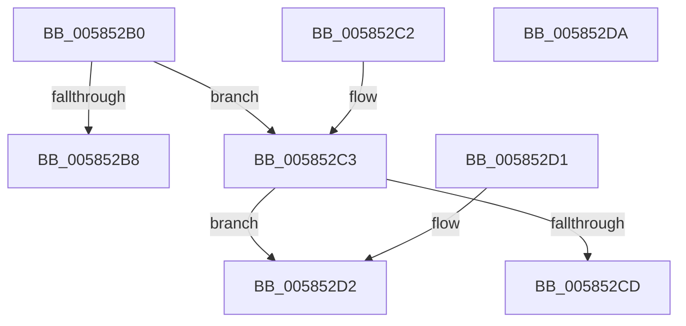

# HvlpCompareActiveLpcbs

- RVA: `0x005852B0`–`0x005852DB` (길이 `43` bytes)
- VA: `0x00000001405852B0`
- 실행 섹션: `.text`
- PDB 이름 있음: `예`; PDB Function 태그: `아니요`
- unwind 정보 RVA: `0x000DB714`
- 디코드: `21`개 명령, `43/43` bytes 표시
- 미해석 바이트: `0` (있으면 어셈블리에 `.byte`로 보존)

> 이 문서는 커널 이미지의 기계어와 PDB 기호를 분석해 생성했습니다. 4번과 5번은 함수 원형과 자료형을 바이너리 사용 방식에서 추정한 C 해석이며 원본 소스 복구 결과는 아닙니다.

## 1. Dependencies

- 직접 호출 지점: **0**; 고유 호출 대상: **0**
- 직접 호출자로 확인된 함수: **0**
- RIP 상대 이미지 참조: **0**

### Outgoing calls
- 직접 디코드된 call 명령이 없습니다.

### Direct callers
- 이 함수 시작 RVA로 연결되는 직접 call은 확인되지 않았습니다. 간접 호출은 완전히 역산할 수 없습니다.

### Static image references
- 디코드된 RIP-relative 메모리 참조가 없습니다.

## 2. Other-region calls and transfers

- 다른 실행 섹션으로 향하는 call: **0**
- 별도 외부 분기/꼬리 이동을 확인하지 못했습니다.

## 3. Assembly (complete function range)

```asm
005852B0  8A 41 62                        mov al, byte ptr [rcx + 0x62]
005852B3  3A 42 62                        cmp al, byte ptr [rdx + 0x62]
005852B6  74 0B                           je 0x1405852c3
005852B8  F6 D8                           neg al
005852BA  1B C0                           sbb eax, eax
005852BC  83 E0 FE                        and eax, 0xfffffffe
005852BF  FF C0                           inc eax
005852C1  C3                              ret
005852C2  CC                              int3
005852C3  8B 49 04                        mov ecx, dword ptr [rcx + 4]
005852C6  8B 52 04                        mov edx, dword ptr [rdx + 4]
005852C9  3B CA                           cmp ecx, edx
005852CB  73 05                           jae 0x1405852d2
005852CD  83 C8 FF                        or eax, 0xffffffff
005852D0  C3                              ret
005852D1  CC                              int3
005852D2  33 C0                           xor eax, eax
005852D4  3B CA                           cmp ecx, edx
005852D6  0F 97 C0                        seta al
005852D9  C3                              ret
005852DA  CC                              int3
```

## 4. C-style interpretation (structured pseudocode)

```c
__int64 __fastcall HvlpCompareActiveLpcbs(__int64 a1, __int64 a2)
{
    __int64 result;

    if (((unsigned __int8)(*(unsigned __int8 *)(a1 + 98))) == (*(unsigned __int8 *)(a2 + 98))) goto loc_005852C3;
    result = (unsigned __int8)(-(*(unsigned __int8 *)(a1 + 98)));
    result = (unsigned int)((result) & (0xFFFFFFFEULL));
    result = (unsigned int)((result) + 1);
    return result;
loc_005852C3:
    if (((unsigned int)((unsigned int)(*(unsigned int *)(a1 + 4)))) >= ((unsigned int)((unsigned int)(*(unsigned int *)(a2 + 4))))) goto loc_005852D2;
    result = (unsigned int)((result) | (0xFFFFFFFFULL));
    return result;
loc_005852D2:
    result = 0;
    result = (((unsigned int)((unsigned int)(*(unsigned int *)(a1 + 4)))) > ((unsigned int)((unsigned int)(*(unsigned int *)(a2 + 4))))) ? 1 : 0;
    return result;
}
```

## 5. (Beta) C Style

```c
int64_t HvlpCompareActiveLpcbs(void *Arg1, void *Arg2)
{
    uint8_t *arg1 = (uint8_t *)Arg1;
    uint8_t *arg2 = (uint8_t *)Arg2;

    int64_t result;

    if (((uint8_t)(*(uint8_t *)(arg1 + 0x62))) == (*(uint8_t *)(arg2 + 0x62))) goto loc_005852C3;
    result = (uint8_t)(-(*(uint8_t *)(arg1 + 0x62)));
    result = (uint32_t)((result) & (0xFFFFFFFEULL));
    result = (uint32_t)((result) + 1);
    return result;
loc_005852C3:
    if (((uint32_t)((uint32_t)(*(uint32_t *)(arg1 + 0x4)))) >= ((uint32_t)((uint32_t)(*(uint32_t *)(arg2 + 0x4))))) goto loc_005852D2;
    result = (uint32_t)((result) | (0xFFFFFFFFULL));
    return result;
loc_005852D2:
    result = 0;
    result = (((uint32_t)((uint32_t)(*(uint32_t *)(arg1 + 0x4)))) > ((uint32_t)((uint32_t)(*(uint32_t *)(arg2 + 0x4))))) ? 1 : 0;
    return result;
}
```

### 관측된 메모리 오프셋

구조체 형식이 확인되지 않은 접근은 인자 기준의 오프셋으로만 기록했습니다.

| 기준 인자 | 오프셋 표현 | 폭 (bit) | 접근 |
|---|---:|---:|---|
| `Arg1` | `+ 0x4` | `32` | `R` |
| `Arg1` | `+ 0x62` | `8` | `R` |
| `Arg2` | `+ 0x4` | `32` | `R` |
| `Arg2` | `+ 0x62` | `8` | `R` |

## 6. Execution-region graph

[열기: 2D/3D 그래프와 함수 탐색 컨트롤 패널](../../../control-panel.html?section=text&rva=0x005852B0&view=graph)

- 2D 그래프는 위에서 아래로 흐르고, 3D 그래프는 빈 공간을 드래그해 회전합니다. Shift+드래그는 이동, 휠은 확대·축소, 함수 노드 선택은 대상 보고서 이동입니다.

### Static fallback


