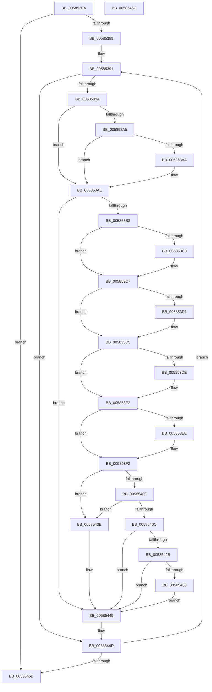

# HvlpComputeLpComparisonMetrics

- RVA: `0x005852E4`–`0x0058546D` (길이 `393` bytes)
- VA: `0x00000001405852E4`
- 실행 섹션: `.text`
- PDB 이름 있음: `예`; PDB Function 태그: `아니요`
- unwind 정보 RVA: `0x000C65F0`
- 디코드: `112`개 명령, `393/393` bytes 표시
- 미해석 바이트: `0` (있으면 어셈블리에 `.byte`로 보존)

> 이 문서는 커널 이미지의 기계어와 PDB 기호를 분석해 생성했습니다. 4번과 5번은 함수 원형과 자료형을 바이너리 사용 방식에서 추정한 C 해석이며 원본 소스 복구 결과는 아닙니다.

## 1. Dependencies

- 직접 호출 지점: **1**; 고유 호출 대상: **1**
- 직접 호출자로 확인된 함수: **2**
- RIP 상대 이미지 참조: **1**

### Outgoing calls
- `0x00585414` → [guard_dispatch_icall](../6B/guard_dispatch_icall_function_006BAAD0.md) (function, `0x006BAAD0`)

### Direct callers
- [HvlpSelectLpSet](HvlpSelectLpSet_function_00585D30.md) at `0x00586043`
- [HvlpSelectVpSet](HvlpSelectVpSet_function_0058616C.md) at `0x005861F1`
- [HvlpSelectVpSet](HvlpSelectVpSet_function_0058616C.md) at `0x00586658`
- [HvlpSelectVpSet](HvlpSelectVpSet_function_0058616C.md) at `0x005866F8`

### Static image references
- `0x00585400` → RVA `0x00FC7090` (`ALMOSTRO`; read)

## 2. Other-region calls and transfers

- 다른 실행 섹션으로 향하는 call: **0**
- 별도 외부 분기/꼬리 이동을 확인하지 못했습니다.

## 3. Assembly (complete function range)

```asm
005852E4  48 8B C4                        mov rax, rsp
005852E7  89 48 08                        mov dword ptr [rax + 8], ecx
005852EA  53                              push rbx
005852EB  55                              push rbp
005852EC  56                              push rsi
005852ED  57                              push rdi
005852EE  41 54                           push r12
005852F0  41 55                           push r13
005852F2  41 56                           push r14
005852F4  41 57                           push r15
005852F6  48 83 EC 28                     sub rsp, 0x28
005852FA  8B F1                           mov esi, ecx
005852FC  45 8B F0                        mov r14d, r8d
005852FF  45 33 C0                        xor r8d, r8d
00585302  48 8B DA                        mov rbx, rdx
00585305  44 89 40 20                     mov dword ptr [rax + 0x20], r8d
00585309  41 8B E8                        mov ebp, r8d
0058530C  4B 8D 3C B6                     lea rdi, [r14 + r14*4]
00585310  83 4C FA 14 FF                  or dword ptr [rdx + rdi*8 + 0x14], 0xffffffff
00585315  44 89 44 FA 10                  mov dword ptr [rdx + rdi*8 + 0x10], r8d
0058531A  4C 89 44 FA 18                  mov qword ptr [rdx + rdi*8 + 0x18], r8
0058531F  4C 89 44 FA 20                  mov qword ptr [rdx + rdi*8 + 0x20], r8
00585324  65 48 8B 0C 25 20 00 00 00      mov rcx, qword ptr gs:[0x20]
0058532D  65 48 8B 04 25 20 00 00 00      mov rax, qword ptr gs:[0x20]
00585336  44 8B B8 A0 00 00 00            mov r15d, dword ptr [rax + 0xa0]
0058533D  44 0F AF B9 A4 00 00 00         imul r15d, dword ptr [rcx + 0xa4]
00585345  65 48 8B 04 25 20 00 00 00      mov rax, qword ptr gs:[0x20]
0058534E  44 8B A0 A4 00 00 00            mov r12d, dword ptr [rax + 0xa4]
00585355  41 FF CF                        dec r15d
00585358  8B 44 FA 04                     mov eax, dword ptr [rdx + rdi*8 + 4]
0058535C  41 FF CC                        dec r12d
0058535F  44 8B E8                        mov r13d, eax
00585362  8B C8                           mov ecx, eax
00585364  C1 E8 04                        shr eax, 4
00585367  41 F7 D7                        not r15d
0058536A  41 F7 D4                        not r12d
0058536D  0F B7 D0                        movzx edx, ax
00585370  41 23 CC                        and ecx, r12d
00585373  89 54 24 78                     mov dword ptr [rsp + 0x78], edx
00585377  45 23 EF                        and r13d, r15d
0058537A  89 8C 24 80 00 00 00            mov dword ptr [rsp + 0x80], ecx
00585381  85 F6                           test esi, esi
00585383  0F 84 D2 00 00 00               je 0x14058545b
00585389  8B 44 24 70                     mov eax, dword ptr [rsp + 0x70]
0058538D  48 8D 73 04                     lea rsi, [rbx + 4]
00585391  41 3B EE                        cmp ebp, r14d
00585394  0F 84 B3 00 00 00               je 0x14058544d
0058539A  0F B7 44 FB 08                  movzx eax, word ptr [rbx + rdi*8 + 8]
0058539F  66 39 46 04                     cmp word ptr [rsi + 4], ax
005853A3  75 09                           jne 0x1405853ae
005853A5  41 3B EE                        cmp ebp, r14d
005853A8  73 04                           jae 0x1405853ae
005853AA  FF 44 FB 24                     inc dword ptr [rbx + rdi*8 + 0x24]
005853AE  44 38 46 FD                     cmp byte ptr [rsi - 3], r8b
005853B2  0F 84 91 00 00 00               je 0x140585449
005853B8  0F B7 44 FB 0C                  movzx eax, word ptr [rbx + rdi*8 + 0xc]
005853BD  66 39 46 08                     cmp word ptr [rsi + 8], ax
005853C1  75 04                           jne 0x1405853c7
005853C3  FF 44 FB 10                     inc dword ptr [rbx + rdi*8 + 0x10]
005853C7  41 8B C7                        mov eax, r15d
005853CA  23 06                           and eax, dword ptr [rsi]
005853CC  41 3B C5                        cmp eax, r13d
005853CF  75 04                           jne 0x1405853d5
005853D1  FF 44 FB 18                     inc dword ptr [rbx + rdi*8 + 0x18]
005853D5  41 8B C4                        mov eax, r12d
005853D8  23 06                           and eax, dword ptr [rsi]
005853DA  3B C1                           cmp eax, ecx
005853DC  75 04                           jne 0x1405853e2
005853DE  FF 44 FB 1C                     inc dword ptr [rbx + rdi*8 + 0x1c]
005853E2  8B 06                           mov eax, dword ptr [rsi]
005853E4  C1 E8 04                        shr eax, 4
005853E7  0F B7 C0                        movzx eax, ax
005853EA  3B C2                           cmp eax, edx
005853EC  75 04                           jne 0x1405853f2
005853EE  FF 44 FB 20                     inc dword ptr [rbx + rdi*8 + 0x20]
005853F2  0F B7 56 06                     movzx edx, word ptr [rsi + 6]
005853F6  0F B7 4C FB 0A                  movzx ecx, word ptr [rbx + rdi*8 + 0xa]
005853FB  66 3B D1                        cmp dx, cx
005853FE  74 3E                           je 0x14058543e
00585400  48 8B 05 89 1C A4 00            mov rax, qword ptr [rip + 0xa41c89]
00585407  48 85 C0                        test rax, rax
0058540A  74 32                           je 0x14058543e
0058540C  4C 8D 84 24 88 00 00 00         lea r8, [rsp + 0x88]
00585414  E8 B7 56 13 00                  call 0x1406baad0
00585419  8B 8C 24 80 00 00 00            mov ecx, dword ptr [rsp + 0x80]
00585420  45 33 C0                        xor r8d, r8d
00585423  8B 54 24 78                     mov edx, dword ptr [rsp + 0x78]
00585427  85 C0                           test eax, eax
00585429  78 1E                           js 0x140585449
0058542B  8B 84 24 88 00 00 00            mov eax, dword ptr [rsp + 0x88]
00585432  3B 44 FB 14                     cmp eax, dword ptr [rbx + rdi*8 + 0x14]
00585436  73 11                           jae 0x140585449
00585438  89 44 FB 14                     mov dword ptr [rbx + rdi*8 + 0x14], eax
0058543C  EB 0B                           jmp 0x140585449
0058543E  8B 8C 24 80 00 00 00            mov ecx, dword ptr [rsp + 0x80]
00585445  8B 54 24 78                     mov edx, dword ptr [rsp + 0x78]
00585449  8B 44 24 70                     mov eax, dword ptr [rsp + 0x70]
0058544D  FF C5                           inc ebp
0058544F  48 83 C6 28                     add rsi, 0x28
00585453  3B E8                           cmp ebp, eax
00585455  0F 82 36 FF FF FF               jb 0x140585391
0058545B  48 83 C4 28                     add rsp, 0x28
0058545F  41 5F                           pop r15
00585461  41 5E                           pop r14
00585463  41 5D                           pop r13
00585465  41 5C                           pop r12
00585467  5F                              pop rdi
00585468  5E                              pop rsi
00585469  5D                              pop rbp
0058546A  5B                              pop rbx
0058546B  C3                              ret
0058546C  CC                              int3
```

## 4. C-style interpretation (structured pseudocode)

```c
__int64 __fastcall HvlpComputeLpComparisonMetrics(int a1, __int64 a2, int a3)
{
    __int64 result;
    __int64 v_r12;
    __int64 v_r13;
    __int64 v_r15;
    __int64 v_rbp;
    __int64 v_rsi;
    __int64 v_rsp;
    unsigned int v_stack_p10;
    unsigned int v_stack_p18;
    unsigned __int64 v_stack_p20;
    unsigned int v_stack_p8;

    *(unsigned int *)(v_rsp + 8) = a1;
    v_rsp = (v_rsp) - (40);
    a3 = 0;
    *(unsigned int *)(v_rsp + 32) = 0;
    *(unsigned int *)(a2 + (unsigned int)(a3) + (unsigned int)(a3) * 4 * 8 + 16) = 0;
    *(unsigned __int64 *)(a2 + (unsigned int)(a3) + (unsigned int)(a3) * 4 * 8 + 24) = 0;
    *(unsigned __int64 *)(a2 + (unsigned int)(a3) + (unsigned int)(a3) * 4 * 8 + 32) = 0;
    v_r15 = (unsigned int)(((unsigned int)(*(unsigned int *)(*(unsigned __int64 *)(gs_base + (0 + 32)) + 160))) * (*(unsigned int *)(*(unsigned __int64 *)(gs_base + (0 + 32)) + 164)));
    v_r15 = (unsigned int)((v_r15) - 1);
    v_r12 = (unsigned int)(((unsigned int)(*(unsigned int *)(*(unsigned __int64 *)(gs_base + (0 + 32)) + 164))) - 1);
    result = (unsigned int)(((unsigned int)(*(unsigned int *)(a2 + (unsigned int)(a3) + (unsigned int)(a3) * 4 * 8 + 4))) >> (4));
    v_r15 = (unsigned int)(~(v_r15));
    v_r12 = (unsigned int)(~(v_r12));
    a1 = (unsigned int)(((unsigned int)((unsigned int)((unsigned int)(*(unsigned int *)(a2 + (unsigned int)(a3) + (unsigned int)(a3) * 4 * 8 + 4))))) & ((unsigned int)(v_r12)));
    v_stack_p10 = (unsigned int)((unsigned __int16)(result));
    v_r13 = (unsigned int)(((unsigned int)((unsigned int)((unsigned int)(*(unsigned int *)(a2 + (unsigned int)(a3) + (unsigned int)(a3) * 4 * 8 + 4))))) & ((unsigned int)(v_r15)));
    v_stack_p18 = a1;
    if ((unsigned int)((unsigned int)(a1)) == 0) goto loc_0058545B;
loc_00585391:
    if (0 == ((unsigned int)((unsigned int)(a3)))) goto loc_0058544D;
    if ((*(unsigned __int16 *)(a2 + 4 + 4)) != ((unsigned __int16)(*(unsigned __int16 *)(a2 + (unsigned int)(a3) + (unsigned int)(a3) * 4 * 8 + 8)))) goto loc_005853AE;
    if (0 < ((unsigned int)((unsigned int)(a3)))) {
    }
    if ((*(unsigned __int8 *)(a2 + 4 - 3)) == 0) goto loc_00585449;
    if ((*(unsigned __int16 *)(a2 + 4 + 8)) == ((unsigned __int16)(*(unsigned __int16 *)(a2 + (unsigned int)(a3) + (unsigned int)(a3) * 4 * 8 + 12)))) {
    }
    result = (unsigned int)(((unsigned int)((unsigned int)(v_r15))) & (*(unsigned int *)(a2 + 4)));
    if (((unsigned int)(result)) == ((unsigned int)(v_r13))) {
    }
    result = (unsigned int)(((unsigned int)((unsigned int)(v_r12))) & (*(unsigned int *)(a2 + 4)));
    if (((unsigned int)(result)) == a1) {
    }
    result = (unsigned int)(((unsigned int)(*(unsigned int *)(a2 + 4))) >> (4));
    if (((unsigned int)((unsigned __int16)(result))) == ((unsigned int)((unsigned __int16)(result)))) {
    }
    if (((unsigned __int16)(*(unsigned __int16 *)(a2 + 4 + 6))) == ((unsigned __int16)(*(unsigned __int16 *)(a2 + (unsigned int)(a3) + (unsigned int)(a3) * 4 * 8 + 10)))) goto loc_0058543E;
    if (*(unsigned __int64 *)(v_rip + 10755209) == 0) goto loc_0058543E;
    result = guard_dispatch_icall(*(unsigned __int16 *)(a2 + (unsigned int)(a3) + (unsigned int)(a3) * 4 * 8 + 10), *(unsigned __int16 *)(a2 + 4 + 6), v_stack_p20, a4);
    a3 = 0;
    if (sign_flag) goto loc_00585449;
    if (((unsigned int)((unsigned int)(v_stack_p20))) >= (*(unsigned int *)(a2 + (unsigned int)(a3) + (unsigned int)(a3) * 4 * 8 + 20))) goto loc_00585449;
    *(unsigned int *)(a2 + (unsigned int)(a3) + (unsigned int)(a3) * 4 * 8 + 20) = (unsigned int)((unsigned int)(v_stack_p20));
    goto loc_00585449;
loc_0058543E:
loc_00585449:
loc_0058544D:
    v_rbp = (unsigned int)((0) + 1);
    v_rsi = (a2 + 4) + (40);
    if (((unsigned int)(v_rbp)) < ((unsigned int)((unsigned int)(v_stack_p8)))) goto loc_00585391;
loc_0058545B:
    v_rsp = (v_rsp) + (40);
    return (unsigned int)(v_stack_p8);
}
```

## 5. (Beta) C Style

```c
int64_t HvlpComputeLpComparisonMetrics(int32_t Arg1, void *Arg2, void *Arg3)
{
    uint8_t *arg2 = (uint8_t *)Arg2;
    uint8_t *arg3 = (uint8_t *)Arg3;

    int64_t result;
    int64_t local_r12;
    int64_t local_r13;
    int64_t local_r15;
    int64_t local_rbp;
    int64_t local_rsi;
    int64_t local_rsp;
    uint32_t v_stack_p10;
    uint32_t v_stack_p18;
    uint64_t v_stack_p20;
    uint32_t v_stack_p8;

    *(uint32_t *)(local_rsp + 0x8) = Arg1;
    local_rsp = (local_rsp) - (40);
    Arg3 = 0;
    *(uint32_t *)(local_rsp + 0x20) = 0;
    *(uint32_t *)(arg2 + (uint32_t)(arg3) + (uint32_t)(arg3) * 4 * 8 + 0x10) = 0;
    *(uint64_t *)(arg2 + (uint32_t)(arg3) + (uint32_t)(arg3) * 4 * 8 + 0x18) = 0;
    *(uint64_t *)(arg2 + (uint32_t)(arg3) + (uint32_t)(arg3) * 4 * 8 + 0x20) = 0;
    local_r15 = (uint32_t)(((uint32_t)(*(uint32_t *)(*(uint64_t *)(gs_base + (0 + 0x20)) + 0xA0))) * (*(uint32_t *)(*(uint64_t *)(gs_base + (0 + 0x20)) + 0xA4)));
    local_r15 = (uint32_t)((local_r15) - 1);
    local_r12 = (uint32_t)(((uint32_t)(*(uint32_t *)(*(uint64_t *)(gs_base + (0 + 0x20)) + 0xA4))) - 1);
    result = (uint32_t)(((uint32_t)(*(uint32_t *)(arg2 + (uint32_t)(arg3) + (uint32_t)(arg3) * 4 * 8 + 0x4))) >> (4));
    local_r15 = (uint32_t)(~(local_r15));
    local_r12 = (uint32_t)(~(local_r12));
    Arg1 = (uint32_t)(((uint32_t)((uint32_t)((uint32_t)(*(uint32_t *)(arg2 + (uint32_t)(arg3) + (uint32_t)(arg3) * 4 * 8 + 0x4))))) & ((uint32_t)(local_r12)));
    v_stack_p10 = (uint32_t)((uint16_t)(result));
    local_r13 = (uint32_t)(((uint32_t)((uint32_t)((uint32_t)(*(uint32_t *)(arg2 + (uint32_t)(arg3) + (uint32_t)(arg3) * 4 * 8 + 0x4))))) & ((uint32_t)(local_r15)));
    v_stack_p18 = Arg1;
    if ((uint32_t)((uint32_t)(Arg1)) == 0) goto loc_0058545B;
loc_00585391:
    if (0 == ((uint32_t)((uint32_t)(Arg3)))) goto loc_0058544D;
    if ((*(uint16_t *)(arg2 + 0x4 + 0x4)) != ((uint16_t)(*(uint16_t *)(arg2 + (uint32_t)(arg3) + (uint32_t)(arg3) * 4 * 8 + 0x8)))) goto loc_005853AE;
    if (0 < ((uint32_t)((uint32_t)(Arg3)))) {
    }
    if ((*(uint8_t *)(arg2 + 0x4 - 0x3)) == 0) goto loc_00585449;
    if ((*(uint16_t *)(arg2 + 0x4 + 0x8)) == ((uint16_t)(*(uint16_t *)(arg2 + (uint32_t)(arg3) + (uint32_t)(arg3) * 4 * 8 + 0xC)))) {
    }
    result = (uint32_t)(((uint32_t)((uint32_t)(local_r15))) & (*(uint32_t *)(arg2 + 0x4)));
    if (((uint32_t)(result)) == ((uint32_t)(local_r13))) {
    }
    result = (uint32_t)(((uint32_t)((uint32_t)(local_r12))) & (*(uint32_t *)(arg2 + 0x4)));
    if (((uint32_t)(result)) == Arg1) {
    }
    result = (uint32_t)(((uint32_t)(*(uint32_t *)(arg2 + 0x4))) >> (4));
    if (((uint32_t)((uint16_t)(result))) == ((uint32_t)((uint16_t)(result)))) {
    }
    if (((uint16_t)(*(uint16_t *)(arg2 + 0x4 + 0x6))) == ((uint16_t)(*(uint16_t *)(arg2 + (uint32_t)(arg3) + (uint32_t)(arg3) * 4 * 8 + 0xA)))) goto loc_0058543E;
    if (*(uint64_t *)(v_rip + 0xA41C89) == 0) goto loc_0058543E;
    result = guard_dispatch_icall(*(uint16_t *)(arg2 + (uint32_t)(arg3) + (uint32_t)(arg3) * 4 * 8 + 0xA), *(uint16_t *)(arg2 + 0x4 + 0x6), v_stack_p20, a4);
    Arg3 = 0;
    if (sign_flag) goto loc_00585449;
    if (((uint32_t)((uint32_t)(v_stack_p20))) >= (*(uint32_t *)(arg2 + (uint32_t)(arg3) + (uint32_t)(arg3) * 4 * 8 + 0x14))) goto loc_00585449;
    *(uint32_t *)(arg2 + (uint32_t)(arg3) + (uint32_t)(arg3) * 4 * 8 + 0x14) = (uint32_t)((uint32_t)(v_stack_p20));
    goto loc_00585449;
loc_0058543E:
loc_00585449:
loc_0058544D:
    local_rbp = (uint32_t)((0) + 1);
    local_rsi = (Arg2 + 4) + (40);
    if (((uint32_t)(local_rbp)) < ((uint32_t)((uint32_t)(v_stack_p8)))) goto loc_00585391;
loc_0058545B:
    local_rsp = (local_rsp) + (40);
    return (uint32_t)(v_stack_p8);
}
```

### 관측된 메모리 오프셋

구조체 형식이 확인되지 않은 접근은 인자 기준의 오프셋으로만 기록했습니다.

| 기준 인자 | 오프셋 표현 | 폭 (bit) | 접근 |
|---|---:|---:|---|
| `Arg2` | `- 0x3` | `8` | `R` |
| `Arg2` | `+ 0x0` | `32` | `R` |
| `Arg2` | `+ 0x4` | `16` | `R` |
| `Arg2` | `+ 0x4` | `64` | `R` |
| `Arg2` | `+ 0x4 + rdi*8` | `32` | `R` |
| `Arg2` | `+ 0x6` | `16` | `R` |
| `Arg2` | `+ 0x8` | `16` | `R` |
| `Arg2` | `+ 0x8 + rdi*8` | `16` | `R` |
| `Arg2` | `+ 0xA + rdi*8` | `16` | `R` |
| `Arg2` | `+ 0xC + rdi*8` | `16` | `R` |
| `Arg2` | `+ 0x10 + rdi*8` | `32` | `R/W` |
| `Arg2` | `+ 0x10 + rdi*8` | `32` | `W` |
| `Arg2` | `+ 0x14 + rdi*8` | `32` | `R` |
| `Arg2` | `+ 0x14 + rdi*8` | `32` | `R/W` |
| `Arg2` | `+ 0x14 + rdi*8` | `32` | `W` |
| `Arg2` | `+ 0x18 + rdi*8` | `32` | `R/W` |
| `Arg2` | `+ 0x18 + rdi*8` | `64` | `W` |
| `Arg2` | `+ 0x1C + rdi*8` | `32` | `R/W` |
| `Arg2` | `+ 0x20 + rdi*8` | `32` | `R/W` |
| `Arg2` | `+ 0x20 + rdi*8` | `64` | `W` |
| `Arg2` | `+ 0x24 + rdi*8` | `32` | `R/W` |
| `Arg3` | `+ 0x0 + r14*4` | `64` | `R` |

## 6. Execution-region graph

[열기: 2D/3D 그래프와 함수 탐색 컨트롤 패널](../../../control-panel.html?section=text&rva=0x005852E4&view=graph)

- 2D 그래프는 위에서 아래로 흐르고, 3D 그래프는 빈 공간을 드래그해 회전합니다. Shift+드래그는 이동, 휠은 확대·축소, 함수 노드 선택은 대상 보고서 이동입니다.

### Static fallback


