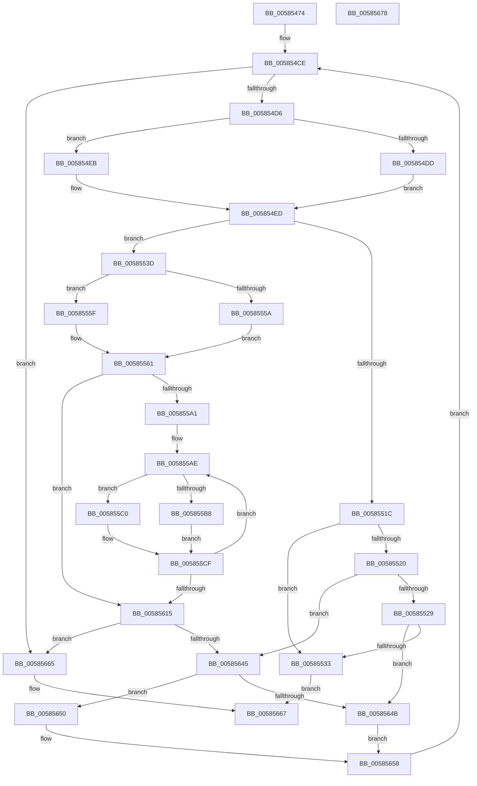

# HvlpDepositPages

- RVA: `0x00585474`–`0x00585679` (길이 `517` bytes)
- VA: `0x0000000140585474`
- 실행 섹션: `.text`
- PDB 이름 있음: `예`; PDB Function 태그: `아니요`
- unwind 정보 RVA: `0x000C6648`
- 디코드: `145`개 명령, `517/517` bytes 표시
- 미해석 바이트: `0` (있으면 어셈블리에 `.byte`로 보존)

> 이 문서는 커널 이미지의 기계어와 PDB 기호를 분석해 생성했습니다. 4번과 5번은 함수 원형과 자료형을 바이너리 사용 방식에서 추정한 C 해석이며 원본 소스 복구 결과는 아닙니다.

## 1. Dependencies

- 직접 호출 지점: **6**; 고유 호출 대상: **6**
- 직접 호출자로 확인된 함수: **5**
- RIP 상대 이미지 참조: **2**

### Outgoing calls
- `0x0058550F` → [MmAllocateNodePagesForMdlEx](../3E/MmAllocateNodePagesForMdlEx_function_003EA920.md) (function, `0x003EA920`)
- `0x00585573` → [HvlpAcquireHypercallPage](../47/HvlpAcquireHypercallPage_function_00471410.md) (function, `0x00471410`)
- `0x005855F1` → [memcpy](../6C/memcpy_function_006C6840.md) (function, `0x006C6840`)
- `0x00585603` → [HvcallInitiateHypercall](../31/HvcallInitiateHypercall_function_00313630.md) (function, `0x00313630`)
- `0x0058561A` → [HvlpReleaseHypercallPage](../31/HvlpReleaseHypercallPage_function_00313480.md) (function, `0x00313480`)
- `0x00585624` → [ExFreePoolWithTag](../../poolcode/B8/ExFreePoolWithTag_function_00B82870.md) (function, `0x00B82870`)

### Direct callers
- [HvlpHandleInsufficientMemory](HvlpHandleInsufficientMemory_function_00584514.md) at `0x00584548`
- [HvlpStartLogicalProcessor](HvlpStartLogicalProcessor_function_00586988.md) at `0x005869FC`
- [HvlpAddRemovePhysicalMemory](../6A/HvlpAddRemovePhysicalMemory_function_006A7A98.md) at `0x006A7BD7`
- [sub_006F88AE](../6F/Unknown_function_006F88AE.md) at `0x006F8BBC`
- [HvlpCreateRootVirtualProcessor](../../page/71/HvlpCreateRootVirtualProcessor_function_00718280.md) at `0x007182E1`

### Static image references
- `0x005854AA` → RVA `0x00FCF6C0` (`CACHEALI`; read)
- `0x0058557D` → RVA `0x00FC6F80` (`ALMOSTRO`; read)

## 2. Other-region calls and transfers

- 다른 실행 섹션으로 향하는 call: **1**
  - `0x00585624` → [ExFreePoolWithTag](../../poolcode/B8/ExFreePoolWithTag_function_00B82870.md) (`.text` → `POOLCODE`)
- 별도 외부 분기/꼬리 이동을 확인하지 못했습니다.

## 3. Assembly (complete function range)

```asm
00585474  44 88 4C 24 20                  mov byte ptr [rsp + 0x20], r9b
00585479  44 88 44 24 18                  mov byte ptr [rsp + 0x18], r8b
0058547E  53                              push rbx
0058547F  55                              push rbp
00585480  56                              push rsi
00585481  57                              push rdi
00585482  41 54                           push r12
00585484  41 55                           push r13
00585486  41 56                           push r14
00585488  41 57                           push r15
0058548A  48 83 EC 78                     sub rsp, 0x78
0058548E  33 C0                           xor eax, eax
00585490  BE 80 00 00 00                  mov esi, 0x80
00585495  48 89 44 24 58                  mov qword ptr [rsp + 0x58], rax
0058549A  0F 57 C0                        xorps xmm0, xmm0
0058549D  89 44 24 60                     mov dword ptr [rsp + 0x60], eax
005854A1  45 8A E1                        mov r12b, r9b
005854A4  0F B7 C1                        movzx eax, cx
005854A7  45 8A F0                        mov r14b, r8b
005854AA  48 8D 0D 0F A2 A4 00            lea rcx, [rip + 0xa4a20f]
005854B1  BB 00 00 20 00                  mov ebx, 0x200000
005854B6  0F 11 44 24 48                  movups xmmword ptr [rsp + 0x48], xmm0
005854BB  8D 7E F1                        lea edi, [rsi - 0xf]
005854BE  48 8B 04 C1                     mov rax, qword ptr [rcx + rax*8]
005854C2  0F B7 40 02                     movzx eax, word ptr [rax + 2]
005854C6  66 89 84 24 C0 00 00 00         mov word ptr [rsp + 0xc0], ax
005854CE  85 F6                           test esi, esi
005854D0  0F 84 8F 01 00 00               je 0x140585665
005854D6  8B EF                           mov ebp, edi
005854D8  83 E5 20                        and ebp, 0x20
005854DB  74 0E                           je 0x1405854eb
005854DD  8D 8E FF 01 00 00               lea ecx, [rsi + 0x1ff]
005854E3  81 E1 00 FE FF FF               and ecx, 0xfffffe00
005854E9  EB 02                           jmp 0x1405854ed
005854EB  8B CE                           mov ecx, esi
005854ED  C1 E1 0C                        shl ecx, 0xc
005854F0  4C 8B C3                        mov r8, rbx
005854F3  0F B7 C0                        movzx eax, ax
005854F6  48 83 CA FF                     or rdx, 0xffffffffffffffff
005854FA  44 8B C9                        mov r9d, ecx
005854FD  33 C9                           xor ecx, ecx
005854FF  89 7C 24 30                     mov dword ptr [rsp + 0x30], edi
00585503  89 44 24 28                     mov dword ptr [rsp + 0x28], eax
00585507  C7 44 24 20 01 00 00 00         mov dword ptr [rsp + 0x20], 1
0058550F  E8 0C 54 E6 FF                  call 0x1403ea920
00585514  4C 8B F8                        mov r15, rax
00585517  48 85 C0                        test rax, rax
0058551A  75 21                           jne 0x14058553d
0058551C  85 ED                           test ebp, ebp
0058551E  74 13                           je 0x140585533
00585520  45 84 F6                        test r14b, r14b
00585523  0F 84 1C 01 00 00               je 0x140585645
00585529  40 F6 C7 40                     test dil, 0x40
0058552D  0F 85 18 01 00 00               jne 0x14058564b
00585533  B8 17 00 00 C0                  mov eax, 0xc0000017
00585538  E9 2A 01 00 00                  jmp 0x140585667
0058553D  8B 40 28                        mov eax, dword ptr [rax + 0x28]
00585540  41 BE 00 00 00 00               mov r14d, 0
00585546  A9 FF 0F 00 00                  test eax, 0xfff
0058554B  41 0F 95 C6                     setne r14b
0058554F  C1 E8 0C                        shr eax, 0xc
00585552  44 03 F0                        add r14d, eax
00585555  41 3B F6                        cmp esi, r14d
00585558  72 05                           jb 0x14058555f
0058555A  41 2B F6                        sub esi, r14d
0058555D  EB 02                           jmp 0x140585561
0058555F  33 F6                           xor esi, esi
00585561  41 B9 08 00 00 00               mov r9d, 8
00585567  48 8D 4C 24 48                  lea rcx, [rsp + 0x48]
0058556C  45 33 C0                        xor r8d, r8d
0058556F  41 8D 51 F9                     lea edx, [r9 - 7]
00585573  E8 98 BE EE FF                  call 0x140471410
00585578  41 8A CC                        mov cl, r12b
0058557B  F6 D9                           neg cl
0058557D  48 8B 0D FC 19 A4 00            mov rcx, qword ptr [rip + 0xa419fc]
00585584  48 1B D2                        sbb rdx, rdx
00585587  48 89 08                        mov qword ptr [rax], rcx
0058558A  81 E2 B7 00 00 00               and edx, 0xb7
00585590  45 33 E4                        xor r12d, r12d
00585593  48 83 C2 48                     add rdx, 0x48
00585597  48 89 54 24 40                  mov qword ptr [rsp + 0x40], rdx
0058559C  45 85 F6                        test r14d, r14d
0058559F  74 74                           je 0x140585615
005855A1  8B 6C 24 44                     mov ebp, dword ptr [rsp + 0x44]
005855A5  4C 8D 68 08                     lea r13, [rax + 8]
005855A9  B8 FF 01 00 00                  mov eax, 0x1ff
005855AE  41 8B CE                        mov ecx, r14d
005855B1  41 2B CC                        sub ecx, r12d
005855B4  3B C8                           cmp ecx, eax
005855B6  72 08                           jb 0x1405855c0
005855B8  81 E5 FF F1 FF FF               and ebp, 0xfffff1ff
005855BE  EB 0F                           jmp 0x1405855cf
005855C0  81 E1 FF 0F 00 00               and ecx, 0xfff
005855C6  8B C5                           mov eax, ebp
005855C8  25 00 F0 FF FF                  and eax, 0xfffff000
005855CD  8B E9                           mov ebp, ecx
005855CF  0B E8                           or ebp, eax
005855D1  49 8B CD                        mov rcx, r13
005855D4  44 8B C5                        mov r8d, ebp
005855D7  41 8B C4                        mov eax, r12d
005855DA  48 83 C0 06                     add rax, 6
005855DE  89 6C 24 44                     mov dword ptr [rsp + 0x44], ebp
005855E2  41 81 E0 FF 0F 00 00            and r8d, 0xfff
005855E9  49 C1 E0 03                     shl r8, 3
005855ED  49 8D 14 C7                     lea rdx, [r15 + rax*8]
005855F1  E8 4A 12 14 00                  call 0x1406c6840
005855F6  48 8B 54 24 60                  mov rdx, qword ptr [rsp + 0x60]
005855FB  45 33 C0                        xor r8d, r8d
005855FE  48 8B 4C 24 40                  mov rcx, qword ptr [rsp + 0x40]
00585603  E8 28 E0 D8 FF                  call 0x140313630
00585608  B8 FF 01 00 00                  mov eax, 0x1ff
0058560D  44 03 E0                        add r12d, eax
00585610  45 3B E6                        cmp r12d, r14d
00585613  72 99                           jb 0x1405855ae
00585615  48 8D 4C 24 48                  lea rcx, [rsp + 0x48]
0058561A  E8 61 DE D8 FF                  call 0x140313480
0058561F  33 D2                           xor edx, edx
00585621  49 8B CF                        mov rcx, r15
00585624  E8 47 D2 5F 00                  call 0x140b82870
00585629  44 8A B4 24 D0 00 00 00         mov r14b, byte ptr [rsp + 0xd0]
00585631  0F B7 84 24 C0 00 00 00         movzx eax, word ptr [rsp + 0xc0]
00585639  44 8A A4 24 D8 00 00 00         mov r12b, byte ptr [rsp + 0xd8]
00585641  85 F6                           test esi, esi
00585643  74 20                           je 0x140585665
00585645  40 F6 C7 40                     test dil, 0x40
00585649  74 05                           je 0x140585650
0058564B  83 E7 BF                        and edi, 0xffffffbf
0058564E  EB 08                           jmp 0x140585658
00585650  83 E7 DF                        and edi, 0xffffffdf
00585653  83 CF 04                        or edi, 4
00585656  33 DB                           xor ebx, ebx
00585658  0F B7 84 24 C0 00 00 00         movzx eax, word ptr [rsp + 0xc0]
00585660  E9 69 FE FF FF                  jmp 0x1405854ce
00585665  33 C0                           xor eax, eax
00585667  48 83 C4 78                     add rsp, 0x78
0058566B  41 5F                           pop r15
0058566D  41 5E                           pop r14
0058566F  41 5D                           pop r13
00585671  41 5C                           pop r12
00585673  5F                              pop rdi
00585674  5E                              pop rsi
00585675  5D                              pop rbp
00585676  5B                              pop rbx
00585677  C3                              ret
00585678  CC                              int3
```

## 4. C-style interpretation (structured pseudocode)

```c
__int64 __fastcall HvlpDepositPages(unsigned __int16 a1, __int64 a2, unsigned __int8 a3, unsigned __int8 a4)
{
    __int64 result;
    __int64 v_r12;
    __int64 v_r14;
    __int64 v_rbp;
    __int64 v_rbx;
    __int64 v_rdi;
    __int64 v_rsi;
    __int64 v_rsp;
    unsigned int v_stack_m58;
    unsigned __int64 v_stack_m60;
    unsigned __int64 v_stack_m70;
    unsigned int v_stack_m74;
    unsigned __int64 v_stack_m78;
    unsigned int v_stack_m88;
    unsigned int v_stack_m90;
    unsigned int v_stack_m98;
    unsigned __int8 v_stack_p18;
    unsigned __int8 v_stack_p20;
    unsigned __int16 v_stack_p8;

    v_stack_p20 = a4;
    v_stack_p18 = a3;
    v_rsp = (v_rsp) - (120);
    result = 0;
    v_stack_m60 = 0;
    v_stack_m58 = 0;
    v_stack_m70 = v_xmm0;
    v_stack_p8 = (unsigned __int16)(*(unsigned __int16 *)(*(unsigned __int64 *)(v_rip + 10789391 + a1 * 8) + 2));
loc_005854CE:
    if (128 == 0) goto loc_00585665;
    v_rbp = (unsigned int)(((unsigned int)((unsigned int)(128 - 15))) & (32));
    if (condition_is_equal) goto loc_005854EB;
    a1 = (unsigned int)((128 + 511) & (0xFFFFFE00ULL));
    goto loc_005854ED;
loc_005854EB:
loc_005854ED:
    a1 = (unsigned int)((128) << (12));
    a2 = (a2) | (-1);
    a1 = 0;
    v_stack_m88 = (unsigned int)(128 - 15);
    v_stack_m90 = (unsigned int)((unsigned __int16)(*(unsigned __int16 *)(*(unsigned __int64 *)(v_rip + 10789391 + a1 * 8) + 2)));
    v_stack_m98 = 1;
    result = MmAllocateNodePagesForMdlEx(a1, a2, (unsigned int)(0x200000ULL), (unsigned int)(a1));
    if (result != 0) goto loc_0058553D;
    if ((unsigned int)(v_rbp) == 0) goto loc_00585533;
    if (a3 == 0) goto loc_00585645;
    if ((((unsigned __int8)(128 - 15)) & (64)) != 0) goto loc_0058564B;
loc_00585533:
    goto loc_00585667;
loc_0058553D:
    v_r14 = ((((unsigned int)((unsigned int)(*(unsigned int *)((unsigned int)(0xC0000017ULL) + 40)))) & (0xFFFULL)) != 0) ? 1 : 0;
    result = (unsigned int)(((unsigned int)(*(unsigned int *)((unsigned int)(0xC0000017ULL) + 40))) >> (12));
    v_r14 = (unsigned int)((v_r14) + ((unsigned int)(result)));
    if (128 < ((unsigned int)(v_r14))) goto loc_0058555F;
    v_rsi = (unsigned int)((128) - ((unsigned int)(v_r14)));
    goto loc_00585561;
loc_0058555F:
    v_rsi = 0;
loc_00585561:
    a3 = 0;
    result = HvlpAcquireHypercallPage(v_stack_m70, 8 - 7, a3, 8);
    a1 = (unsigned __int8)(-(a4));
    *(unsigned __int64 *)(result) = *(unsigned __int64 *)(v_rip + 10754556);
    a2 = (unsigned int)((8 - 7) & (183));
    v_r12 = 0;
    a2 = (a2) + (72);
    v_stack_m78 = a2;
    if ((unsigned int)(v_r14) == 0) goto loc_00585615;
loc_005855AE:
    a1 = (unsigned int)(((unsigned int)((unsigned int)(v_r14))) - (0));
    if (a1 < 511) goto loc_005855C0;
    v_rbp = (unsigned int)(((unsigned int)(v_stack_m74)) & (0xFFFFF1FFULL));
    goto loc_005855CF;
loc_005855C0:
    a1 = (unsigned int)((a1) & (0xFFFULL));
    result = (unsigned int)(((unsigned int)((unsigned int)(v_rbp))) & (0xFFFFF000ULL));
loc_005855CF:
    v_rbp = (unsigned int)(((unsigned int)(a1)) | ((unsigned int)(result)));
    result = (0) + (6);
    v_stack_m74 = (unsigned int)(v_rbp);
    a3 = (unsigned int)(((unsigned int)((unsigned int)(v_rbp))) & (0xFFFULL));
    a3 = (a3) << (3);
    result = memcpy(result + 8, result + result * 8, a3, 8);
    a3 = 0;
    result = HvcallInitiateHypercall(v_stack_m78, v_stack_m58, a3, 8);
    v_r12 = (unsigned int)((v_r12) + (511));
    if (((unsigned int)(v_r12)) < ((unsigned int)(v_r14))) goto loc_005855AE;
loc_00585615:
    result = HvlpReleaseHypercallPage(v_stack_m70, v_stack_m58, a3, 8);
    a2 = 0;
    result = ExFreePoolWithTag(result, a2, a3, 8);
    if (0 == 0) goto loc_00585665;
loc_00585645:
    if ((((unsigned __int8)(128 - 15)) & (64)) == 0) goto loc_00585650;
loc_0058564B:
    v_rdi = (unsigned int)((128 - 15) & (0xFFFFFFBFULL));
    goto loc_00585658;
loc_00585650:
    v_rdi = (unsigned int)((v_rdi) & (0xFFFFFFDFULL));
    v_rdi = (unsigned int)((v_rdi) | (4));
    v_rbx = 0;
loc_00585658:
    goto loc_005854CE;
loc_00585665:
    result = 0;
loc_00585667:
    v_rsp = (v_rsp) + (120);
    return result;
}
```

## 5. (Beta) C Style

```c
int64_t HvlpDepositPages(uint16_t Arg1, int64_t Arg2, uint8_t Arg3, uint8_t Arg4)
{
    int64_t result;
    int64_t local_r12;
    int64_t local_r14;
    int64_t local_rbp;
    int64_t local_rbx;
    int64_t local_rdi;
    int64_t local_rsi;
    int64_t local_rsp;
    uint32_t v_stack_m58;
    uint64_t v_stack_m60;
    uint64_t v_stack_m70;
    uint32_t v_stack_m74;
    uint64_t v_stack_m78;
    uint32_t v_stack_m88;
    uint32_t v_stack_m90;
    uint32_t v_stack_m98;
    uint8_t v_stack_p18;
    uint8_t v_stack_p20;
    uint16_t v_stack_p8;

    v_stack_p20 = Arg4;
    v_stack_p18 = Arg3;
    local_rsp = (local_rsp) - (120);
    result = 0;
    v_stack_m60 = 0;
    v_stack_m58 = 0;
    v_stack_m70 = v_xmm0;
    v_stack_p8 = (uint16_t)(*(uint16_t *)(*(uint64_t *)(v_rip + 0xA4A20F + Arg1 * 8) + 0x2));
loc_005854CE:
    if (128 == 0) goto loc_00585665;
    local_rbp = (uint32_t)(((uint32_t)((uint32_t)(128 - 15))) & (32));
    if (condition_is_equal) goto loc_005854EB;
    Arg1 = (uint32_t)((128 + 511) & (0xFFFFFE00ULL));
    goto loc_005854ED;
loc_005854EB:
loc_005854ED:
    Arg1 = (uint32_t)((128) << (12));
    Arg2 = (Arg2) | (-1);
    Arg1 = 0;
    v_stack_m88 = (uint32_t)(128 - 15);
    v_stack_m90 = (uint32_t)((uint16_t)(*(uint16_t *)(*(uint64_t *)(v_rip + 0xA4A20F + Arg1 * 8) + 0x2)));
    v_stack_m98 = 1;
    result = MmAllocateNodePagesForMdlEx(Arg1, Arg2, (uint32_t)(0x200000ULL), (uint32_t)(Arg1));
    if (result != 0) goto loc_0058553D;
    if ((uint32_t)(local_rbp) == 0) goto loc_00585533;
    if (Arg3 == 0) goto loc_00585645;
    if ((((uint8_t)(128 - 15)) & (64)) != 0) goto loc_0058564B;
loc_00585533:
    goto loc_00585667;
loc_0058553D:
    local_r14 = ((((uint32_t)((uint32_t)(*(uint32_t *)((uint32_t)(0xC0000017ULL) + 0x28)))) & (0xFFFULL)) != 0) ? 1 : 0;
    result = (uint32_t)(((uint32_t)(*(uint32_t *)((uint32_t)(0xC0000017ULL) + 0x28))) >> (12));
    local_r14 = (uint32_t)((local_r14) + ((uint32_t)(result)));
    if (128 < ((uint32_t)(local_r14))) goto loc_0058555F;
    local_rsi = (uint32_t)((128) - ((uint32_t)(local_r14)));
    goto loc_00585561;
loc_0058555F:
    local_rsi = 0;
loc_00585561:
    Arg3 = 0;
    result = HvlpAcquireHypercallPage(v_stack_m70, 8 - 7, Arg3, 8);
    Arg1 = (uint8_t)(-(Arg4));
    *(uint64_t *)(result) = *(uint64_t *)(v_rip + 0xA419FC);
    Arg2 = (uint32_t)((8 - 7) & (183));
    local_r12 = 0;
    Arg2 = (Arg2) + (72);
    v_stack_m78 = Arg2;
    if ((uint32_t)(local_r14) == 0) goto loc_00585615;
loc_005855AE:
    Arg1 = (uint32_t)(((uint32_t)((uint32_t)(local_r14))) - (0));
    if (Arg1 < 511) goto loc_005855C0;
    local_rbp = (uint32_t)(((uint32_t)(v_stack_m74)) & (0xFFFFF1FFULL));
    goto loc_005855CF;
loc_005855C0:
    Arg1 = (uint32_t)((Arg1) & (0xFFFULL));
    result = (uint32_t)(((uint32_t)((uint32_t)(local_rbp))) & (0xFFFFF000ULL));
loc_005855CF:
    local_rbp = (uint32_t)(((uint32_t)(Arg1)) | ((uint32_t)(result)));
    result = (0) + (6);
    v_stack_m74 = (uint32_t)(local_rbp);
    Arg3 = (uint32_t)(((uint32_t)((uint32_t)(local_rbp))) & (0xFFFULL));
    Arg3 = (Arg3) << (3);
    result = memcpy(result + 8, result + result * 8, Arg3, 8);
    Arg3 = 0;
    result = HvcallInitiateHypercall(v_stack_m78, v_stack_m58, Arg3, 8);
    local_r12 = (uint32_t)((local_r12) + (511));
    if (((uint32_t)(local_r12)) < ((uint32_t)(local_r14))) goto loc_005855AE;
loc_00585615:
    result = HvlpReleaseHypercallPage(v_stack_m70, v_stack_m58, Arg3, 8);
    Arg2 = 0;
    result = ExFreePoolWithTag(result, Arg2, Arg3, 8);
    if (0 == 0) goto loc_00585665;
loc_00585645:
    if ((((uint8_t)(128 - 15)) & (64)) == 0) goto loc_00585650;
loc_0058564B:
    local_rdi = (uint32_t)((128 - 15) & (0xFFFFFFBFULL));
    goto loc_00585658;
loc_00585650:
    local_rdi = (uint32_t)((local_rdi) & (0xFFFFFFDFULL));
    local_rdi = (uint32_t)((local_rdi) | (4));
    local_rbx = 0;
loc_00585658:
    goto loc_005854CE;
loc_00585665:
    result = 0;
loc_00585667:
    local_rsp = (local_rsp) + (120);
    return result;
}
```

## 6. Execution-region graph

[열기: 2D/3D 그래프와 함수 탐색 컨트롤 패널](../../../control-panel.html?section=text&rva=0x00585474&view=graph)

- 2D 그래프는 위에서 아래로 흐르고, 3D 그래프는 빈 공간을 드래그해 회전합니다. Shift+드래그는 이동, 휠은 확대·축소, 함수 노드 선택은 대상 보고서 이동입니다.

### Static fallback


