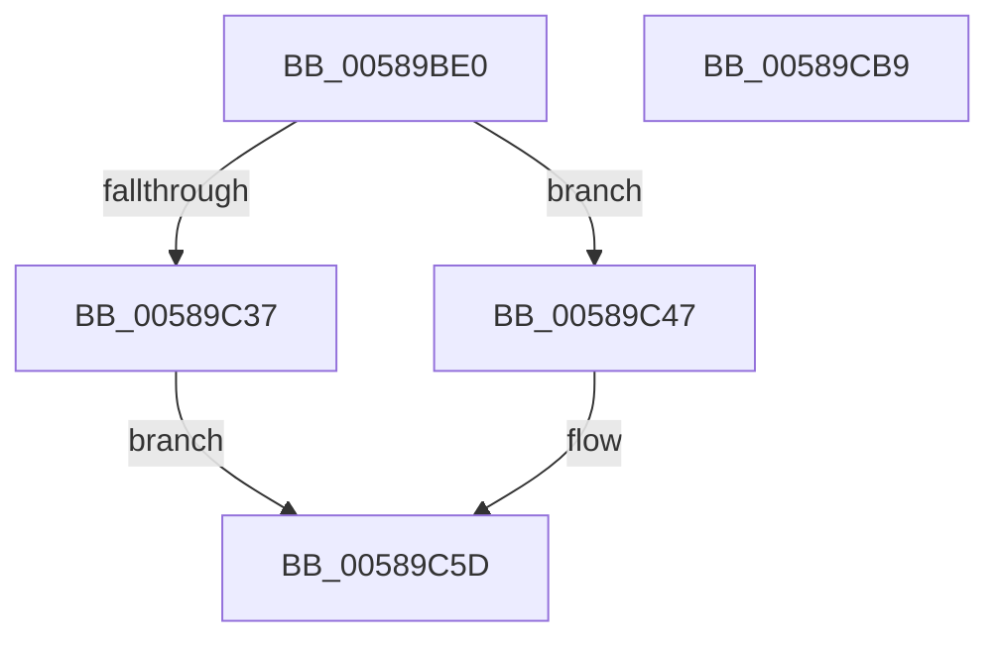

# HvlpDmaFastFlushDeviceDomainVaList

- RVA: `0x00589BE0`–`0x00589CBA` (길이 `218` bytes)
- VA: `0x0000000140589BE0`
- 실행 섹션: `.text`
- PDB 이름 있음: `예`; PDB Function 태그: `아니요`
- unwind 정보 RVA: `0x000C6764`
- 디코드: `52`개 명령, `218/218` bytes 표시
- 미해석 바이트: `0` (있으면 어셈블리에 `.byte`로 보존)

> 이 문서는 커널 이미지의 기계어와 PDB 기호를 분석해 생성했습니다. 4번과 5번은 함수 원형과 자료형을 바이너리 사용 방식에서 추정한 C 해석이며 원본 소스 복구 결과는 아닙니다.

## 1. Dependencies

- 직접 호출 지점: **5**; 고유 호출 대상: **5**
- 직접 호출자로 확인된 함수: **1**
- RIP 상대 이미지 참조: **1**

### Outgoing calls
- `0x00589C40` → [HvlpCopyFlushVaList](../31/HvlpCopyFlushVaList_function_00313CC0.md) (function, `0x00313CC0`)
- `0x00589C53` → [memcpy](../6C/memcpy_function_006C6840.md) (function, `0x006C6840`)
- `0x00589C8B` → [HvcallFastExtended](../31/HvcallFastExtended_function_003130E0.md) (function, `0x003130E0`)
- `0x00589C93` → [HvlpHvToNtStatus](../30/HvlpHvToNtStatus_function_00307BD8.md) (function, `0x00307BD8`)
- `0x00589CA3` → [_security_check_cookie](../6A/_security_check_cookie_function_006AC640.md) (function, `0x006AC640`)

### Direct callers
- [HvlDmaFlushDeviceDomainVaList](HvlDmaFlushDeviceDomainVaList_function_00587A00.md) at `0x00587A22`

### Static image references
- `0x00589BEF` → RVA `0x00E0A740` (`.data`; read)

## 2. Other-region calls and transfers

- 다른 실행 섹션으로 향하는 call: **0**
- 별도 외부 분기/꼬리 이동을 확인하지 못했습니다.

## 3. Assembly (complete function range)

```asm
00589BE0  4C 8B DC                        mov r11, rsp
00589BE3  49 89 5B 08                     mov qword ptr [r11 + 8], rbx
00589BE7  57                              push rdi
00589BE8  48 81 EC C0 00 00 00            sub rsp, 0xc0
00589BEF  48 8B 05 4A 0B 88 00            mov rax, qword ptr [rip + 0x880b4a]
00589BF6  48 33 C4                        xor rax, rsp
00589BF9  48 89 84 24 B0 00 00 00         mov qword ptr [rsp + 0xb0], rax
00589C01  49 83 63 80 00                  and qword ptr [r11 - 0x80], 0
00589C06  33 C0                           xor eax, eax
00589C08  49 83 63 90 00                  and qword ptr [r11 - 0x70], 0
00589C0D  83 E0 F1                        and eax, 0xfffffff1
00589C10  48 83 4C 24 40 FF               or qword ptr [rsp + 0x40], 0xffffffffffffffff
00589C16  83 C8 01                        or eax, 1
00589C19  8B DA                           mov ebx, edx
00589C1B  4D 8B D0                        mov r10, r8
00589C1E  89 44 24 50                     mov dword ptr [rsp + 0x50], eax
00589C22  49 8B D0                        mov rdx, r8
00589C25  8B 01                           mov eax, dword ptr [rcx]
00589C27  89 44 24 54                     mov dword ptr [rsp + 0x54], eax
00589C2B  8D 3C DD 20 00 00 00            lea edi, [rbx*8 + 0x20]
00589C32  45 84 C9                        test r9b, r9b
00589C35  75 10                           jne 0x140589c47
00589C37  4D 8D 4B 98                     lea r9, [r11 - 0x68]
00589C3B  45 33 C0                        xor r8d, r8d
00589C3E  8B CB                           mov ecx, ebx
00589C40  E8 7B A0 D8 FF                  call 0x140313cc0
00589C45  EB 16                           jmp 0x140589c5d
00589C47  4C 8B C3                        mov r8, rbx
00589C4A  48 8D 4C 24 60                  lea rcx, [rsp + 0x60]
00589C4F  49 C1 E0 03                     shl r8, 3
00589C53  E8 E8 CB 13 00                  call 0x1406c6840
00589C58  83 4C 24 58 01                  or dword ptr [rsp + 0x58], 1
00589C5D  83 64 24 20 00                  and dword ptr [rsp + 0x20], 0
00589C62  48 8D 54 24 40                  lea rdx, [rsp + 0x40]
00589C67  48 C7 44 24 30 D1 00 00 00      mov qword ptr [rsp + 0x30], 0xd1
00589C70  81 E3 FF 0F 00 00               and ebx, 0xfff
00589C76  0F BA 6C 24 30 10               bts dword ptr [rsp + 0x30], 0x10
00589C7C  45 33 C9                        xor r9d, r9d
00589C7F  89 5C 24 34                     mov dword ptr [rsp + 0x34], ebx
00589C83  44 8B C7                        mov r8d, edi
00589C86  48 8B 4C 24 30                  mov rcx, qword ptr [rsp + 0x30]
00589C8B  E8 50 94 D8 FF                  call 0x1403130e0
00589C90  48 8B C8                        mov rcx, rax
00589C93  E8 40 DF D7 FF                  call 0x140307bd8
00589C98  48 8B 8C 24 B0 00 00 00         mov rcx, qword ptr [rsp + 0xb0]
00589CA0  48 33 CC                        xor rcx, rsp
00589CA3  E8 98 29 12 00                  call 0x1406ac640
00589CA8  48 8B 9C 24 D0 00 00 00         mov rbx, qword ptr [rsp + 0xd0]
00589CB0  48 81 C4 C0 00 00 00            add rsp, 0xc0
00589CB7  5F                              pop rdi
00589CB8  C3                              ret
00589CB9  CC                              int3
```

## 4. C-style interpretation (structured pseudocode)

```c
__int64 __fastcall HvlpDmaFastFlushDeviceDomainVaList(__int64 a1, int a2, __int64 a3, unsigned __int8 a4)
{
    __int64 result;
    __int64 v_rbx;
    __int64 v_rsp;
    unsigned __int64 v_stack_m18;
    unsigned __int64 v_stack_m68;
    unsigned int v_stack_m70;
    unsigned int v_stack_m74;
    unsigned int v_stack_m78;
    unsigned __int64 v_stack_m88;
    unsigned int v_stack_m94;
    unsigned __int64 v_stack_m98;
    unsigned int v_stack_mA8;
    unsigned __int64 v_stack_p8;

    *(unsigned __int64 *)(v_rsp + 8) = v_rbx;
    v_rsp = (v_rsp) - (192);
    result = (*(unsigned __int64 *)(v_rip + 8915786)) ^ (v_rsp);
    v_stack_m18 = result;
    result = 0;
    result = (unsigned int)((result) & (0xFFFFFFF1ULL));
    result = (unsigned int)((result) | (1));
    v_stack_m78 = (unsigned int)(result);
    v_stack_m74 = (unsigned int)((unsigned int)(*(unsigned int *)(a1)));
    if (a4 != 0) goto loc_00589C47;
    a3 = 0;
    result = HvlpCopyFlushVaList((unsigned int)((unsigned int)((unsigned int)(a2))), a3, a3, v_rsp - 104);
    goto loc_00589C5D;
loc_00589C47:
    a3 = ((unsigned int)(a2)) << (3);
    result = memcpy(v_stack_m68, a3, a3, v_rsp - 104);
loc_00589C5D:
    v_stack_m98 = 209;
    v_rbx = (unsigned int)(((unsigned int)(a2)) & (0xFFFULL));
    a4 = 0;
    v_stack_m94 = (unsigned int)(v_rbx);
    result = HvcallFastExtended(v_stack_m98, v_stack_m88, (unsigned int)((unsigned int)((unsigned int)(a2) * 8 + 32)), a4);
    result = HvlpHvToNtStatus(result, v_stack_m88, (unsigned int)((unsigned int)((unsigned int)(a2) * 8 + 32)), a4);
    a1 = (v_stack_m18) ^ (v_rsp);
    result = _security_check_cookie(a1, v_stack_m88, (unsigned int)((unsigned int)((unsigned int)(a2) * 8 + 32)), a4);
    v_rsp = (v_rsp) + (192);
    return result;
}
```

## 5. (Beta) C Style

```c
int64_t HvlpDmaFastFlushDeviceDomainVaList(void *Arg1, int32_t Arg2, int64_t Arg3, uint8_t Arg4)
{
    uint8_t *arg1 = (uint8_t *)Arg1;

    int64_t result;
    int64_t local_rbx;
    int64_t local_rsp;
    uint64_t v_stack_m18;
    uint64_t v_stack_m68;
    uint32_t v_stack_m70;
    uint32_t v_stack_m74;
    uint32_t v_stack_m78;
    uint64_t v_stack_m88;
    uint32_t v_stack_m94;
    uint64_t v_stack_m98;
    uint32_t v_stack_mA8;
    uint64_t v_stack_p8;

    *(uint64_t *)(local_rsp + 0x8) = local_rbx;
    local_rsp = (local_rsp) - (192);
    result = (*(uint64_t *)(v_rip + 0x880B4A)) ^ (local_rsp);
    v_stack_m18 = result;
    result = 0;
    result = (uint32_t)((result) & (0xFFFFFFF1ULL));
    result = (uint32_t)((result) | (1));
    v_stack_m78 = (uint32_t)(result);
    v_stack_m74 = (uint32_t)((uint32_t)(*(uint32_t *)(arg1)));
    if (Arg4 != 0) goto loc_00589C47;
    Arg3 = 0;
    result = HvlpCopyFlushVaList((uint32_t)((uint32_t)((uint32_t)(Arg2))), Arg3, Arg3, local_rsp - 104);
    goto loc_00589C5D;
loc_00589C47:
    Arg3 = ((uint32_t)(Arg2)) << (3);
    result = memcpy(v_stack_m68, Arg3, Arg3, local_rsp - 104);
loc_00589C5D:
    v_stack_m98 = 209;
    local_rbx = (uint32_t)(((uint32_t)(Arg2)) & (0xFFFULL));
    Arg4 = 0;
    v_stack_m94 = (uint32_t)(local_rbx);
    result = HvcallFastExtended(v_stack_m98, v_stack_m88, (uint32_t)((uint32_t)((uint32_t)(Arg2) * 8 + 32)), Arg4);
    result = HvlpHvToNtStatus(result, v_stack_m88, (uint32_t)((uint32_t)((uint32_t)(Arg2) * 8 + 32)), Arg4);
    Arg1 = (v_stack_m18) ^ (local_rsp);
    result = _security_check_cookie(Arg1, v_stack_m88, (uint32_t)((uint32_t)((uint32_t)(Arg2) * 8 + 32)), Arg4);
    local_rsp = (local_rsp) + (192);
    return result;
}
```

### 관측된 메모리 오프셋

구조체 형식이 확인되지 않은 접근은 인자 기준의 오프셋으로만 기록했습니다.

| 기준 인자 | 오프셋 표현 | 폭 (bit) | 접근 |
|---|---:|---:|---|
| `Arg1` | `+ 0x0` | `32` | `R` |

## 6. Execution-region graph

[열기: 2D/3D 그래프와 함수 탐색 컨트롤 패널](../../../control-panel.html?section=text&rva=0x00589BE0&view=graph)

- 2D 그래프는 위에서 아래로 흐르고, 3D 그래프는 빈 공간을 드래그해 회전합니다. Shift+드래그는 이동, 휠은 확대·축소, 함수 노드 선택은 대상 보고서 이동입니다.

### Static fallback


