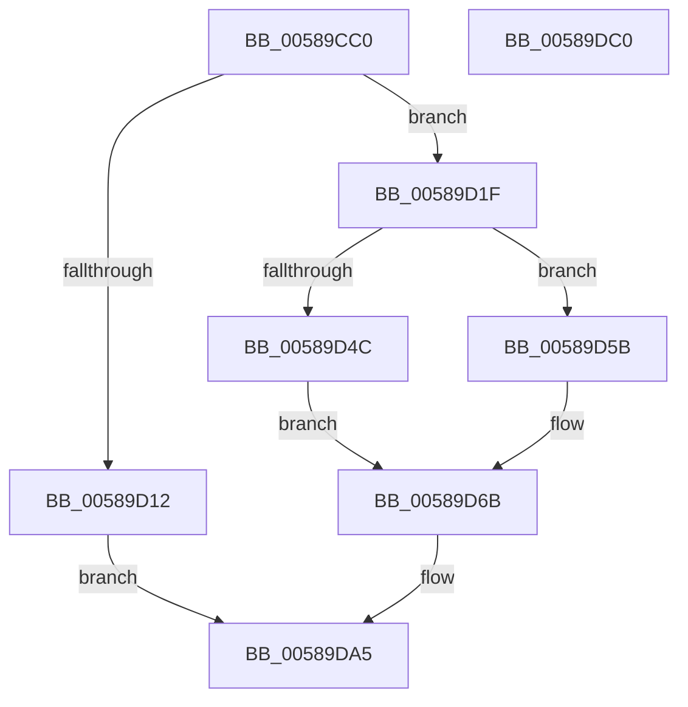

# HvlpDmaSlowFlushDeviceDomainVaList

- RVA: `0x00589CC0`–`0x00589DC1` (길이 `257` bytes)
- VA: `0x0000000140589CC0`
- 실행 섹션: `.text`
- PDB 이름 있음: `예`; PDB Function 태그: `아니요`
- unwind 정보 RVA: `0x00091ECC`
- 디코드: `71`개 명령, `257/257` bytes 표시
- 미해석 바이트: `0` (있으면 어셈블리에 `.byte`로 보존)

> 이 문서는 커널 이미지의 기계어와 PDB 기호를 분석해 생성했습니다. 4번과 5번은 함수 원형과 자료형을 바이너리 사용 방식에서 추정한 C 해석이며 원본 소스 복구 결과는 아닙니다.

## 1. Dependencies

- 직접 호출 지점: **7**; 고유 호출 대상: **7**
- 직접 호출자로 확인된 함수: **1**
- RIP 상대 이미지 참조: **0**

### Outgoing calls
- `0x00589D03` → [HvlpAcquireHypercallPage](../47/HvlpAcquireHypercallPage_function_00471410.md) (function, `0x00471410`)
- `0x00589D15` → [HvlDmaFlushDeviceDomain](HvlDmaFlushDeviceDomain_function_00587970.md) (function, `0x00587970`)
- `0x00589D54` → [HvlpCopyFlushVaList](../31/HvlpCopyFlushVaList_function_00313CC0.md) (function, `0x00313CC0`)
- `0x00589D62` → [memcpy](../6C/memcpy_function_006C6840.md) (function, `0x006C6840`)
- `0x00589D8B` → [HvcallInitiateHypercall](../31/HvcallInitiateHypercall_function_00313630.md) (function, `0x00313630`)
- `0x00589D98` → [HvlpReleaseHypercallPage](../31/HvlpReleaseHypercallPage_function_00313480.md) (function, `0x00313480`)
- `0x00589DA0` → [HvlpHvToNtStatus](../30/HvlpHvToNtStatus_function_00307BD8.md) (function, `0x00307BD8`)

### Direct callers
- [HvlDmaFlushDeviceDomainVaList](HvlDmaFlushDeviceDomainVaList_function_00587A00.md) at `0x00587A29`

### Static image references
- 디코드된 RIP-relative 메모리 참조가 없습니다.

## 2. Other-region calls and transfers

- 다른 실행 섹션으로 향하는 call: **0**
- 별도 외부 분기/꼬리 이동을 확인하지 못했습니다.

## 3. Assembly (complete function range)

```asm
00589CC0  4C 8B DC                        mov r11, rsp
00589CC3  49 89 5B 08                     mov qword ptr [r11 + 8], rbx
00589CC7  49 89 6B 10                     mov qword ptr [r11 + 0x10], rbp
00589CCB  49 89 73 18                     mov qword ptr [r11 + 0x18], rsi
00589CCF  49 89 7B 20                     mov qword ptr [r11 + 0x20], rdi
00589CD3  41 56                           push r14
00589CD5  48 83 EC 50                     sub rsp, 0x50
00589CD9  33 C0                           xor eax, eax
00589CDB  8B FA                           mov edi, edx
00589CDD  0F 57 C0                        xorps xmm0, xmm0
00589CE0  45 8A F1                        mov r14b, r9b
00589CE3  49 8B E8                        mov rbp, r8
00589CE6  48 8B F1                        mov rsi, rcx
00589CE9  0F 11 44 24 28                  movups xmmword ptr [rsp + 0x28], xmm0
00589CEE  49 89 43 E0                     mov qword ptr [r11 - 0x20], rax
00589CF2  8D 50 05                        lea edx, [rax + 5]
00589CF5  45 33 C9                        xor r9d, r9d
00589CF8  89 44 24 40                     mov dword ptr [rsp + 0x40], eax
00589CFC  45 33 C0                        xor r8d, r8d
00589CFF  49 8D 4B D0                     lea rcx, [r11 - 0x30]
00589D03  E8 08 77 EE FF                  call 0x140471410
00589D08  33 D2                           xor edx, edx
00589D0A  48 8B D8                        mov rbx, rax
00589D0D  48 85 C0                        test rax, rax
00589D10  75 0D                           jne 0x140589d1f
00589D12  48 8B CE                        mov rcx, rsi
00589D15  E8 56 DC FF FF                  call 0x140587970
00589D1A  E9 86 00 00 00                  jmp 0x140589da5
00589D1F  48 89 50 08                     mov qword ptr [rax + 8], rdx
00589D23  48 8D 4B 20                     lea rcx, [rbx + 0x20]
00589D27  48 89 50 10                     mov qword ptr [rax + 0x10], rdx
00589D2B  48 89 50 18                     mov qword ptr [rax + 0x18], rdx
00589D2F  48 8B D5                        mov rdx, rbp
00589D32  48 83 08 FF                     or qword ptr [rax], 0xffffffffffffffff
00589D36  8B 40 10                        mov eax, dword ptr [rax + 0x10]
00589D39  83 E0 F1                        and eax, 0xfffffff1
00589D3C  83 C8 01                        or eax, 1
00589D3F  89 43 10                        mov dword ptr [rbx + 0x10], eax
00589D42  8B 06                           mov eax, dword ptr [rsi]
00589D44  89 43 14                        mov dword ptr [rbx + 0x14], eax
00589D47  45 84 F6                        test r14b, r14b
00589D4A  75 0F                           jne 0x140589d5b
00589D4C  4C 8B C9                        mov r9, rcx
00589D4F  45 33 C0                        xor r8d, r8d
00589D52  8B CF                           mov ecx, edi
00589D54  E8 67 9F D8 FF                  call 0x140313cc0
00589D59  EB 10                           jmp 0x140589d6b
00589D5B  4C 8B C7                        mov r8, rdi
00589D5E  49 C1 E0 03                     shl r8, 3
00589D62  E8 D9 CA 13 00                  call 0x1406c6840
00589D67  83 4B 18 01                     or dword ptr [rbx + 0x18], 1
00589D6B  48 8B 54 24 40                  mov rdx, qword ptr [rsp + 0x40]
00589D70  81 E7 FF 0F 00 00               and edi, 0xfff
00589D76  48 C7 44 24 20 D1 00 00 00      mov qword ptr [rsp + 0x20], 0xd1
00589D7F  45 33 C0                        xor r8d, r8d
00589D82  89 7C 24 24                     mov dword ptr [rsp + 0x24], edi
00589D86  48 8B 4C 24 20                  mov rcx, qword ptr [rsp + 0x20]
00589D8B  E8 A0 98 D8 FF                  call 0x140313630
00589D90  48 8D 4C 24 28                  lea rcx, [rsp + 0x28]
00589D95  48 8B D8                        mov rbx, rax
00589D98  E8 E3 96 D8 FF                  call 0x140313480
00589D9D  0F B7 CB                        movzx ecx, bx
00589DA0  E8 33 DE D7 FF                  call 0x140307bd8
00589DA5  48 8B 5C 24 60                  mov rbx, qword ptr [rsp + 0x60]
00589DAA  48 8B 6C 24 68                  mov rbp, qword ptr [rsp + 0x68]
00589DAF  48 8B 74 24 70                  mov rsi, qword ptr [rsp + 0x70]
00589DB4  48 8B 7C 24 78                  mov rdi, qword ptr [rsp + 0x78]
00589DB9  48 83 C4 50                     add rsp, 0x50
00589DBD  41 5E                           pop r14
00589DBF  C3                              ret
00589DC0  CC                              int3
```

## 4. C-style interpretation (structured pseudocode)

```c
__int64 __fastcall HvlpDmaSlowFlushDeviceDomainVaList(__int64 a1, int a2, __int64 a3, int a4)
{
    __int64 result;
    __int64 v_rdi;
    __int64 v_rsp;
    unsigned int v_stack_m18;
    unsigned __int64 v_stack_m30;
    unsigned int v_stack_m34;
    unsigned __int64 v_stack_m38;
    unsigned __int64 v_stack_p10;
    unsigned __int64 v_stack_p18;
    unsigned __int64 v_stack_p20;
    unsigned __int64 v_stack_p8;

    *(unsigned __int64 *)(v_rsp + 8) = v_rbx;
    *(unsigned __int64 *)(v_rsp + 16) = v_rbp;
    *(unsigned __int64 *)(v_rsp + 24) = v_rsi;
    *(unsigned __int64 *)(v_rsp + 32) = v_rdi;
    v_rsp = (v_rsp) - (80);
    result = 0;
    v_stack_m30 = v_xmm0;
    *(unsigned __int64 *)(v_rsp - 32) = 0;
    a4 = 0;
    v_stack_m18 = 0;
    a3 = 0;
    result = HvlpAcquireHypercallPage(v_rsp - 48, result + 5, a3, a4);
    a2 = 0;
    if (result != 0) goto loc_00589D1F;
    result = HvlDmaFlushDeviceDomain(a1, a2, a3, a4);
    goto loc_00589DA5;
loc_00589D1F:
    *(unsigned __int64 *)(result + 8) = 0;
    *(unsigned __int64 *)(result + 16) = 0;
    *(unsigned __int64 *)(result + 24) = 0;
    result = (unsigned int)(((unsigned int)(*(unsigned int *)(result + 16))) & (0xFFFFFFF1ULL));
    result = (unsigned int)((result) | (1));
    *(unsigned int *)(result + 16) = (unsigned int)(result);
    *(unsigned int *)(result + 20) = (unsigned int)((unsigned int)(*(unsigned int *)(a1)));
    if ((unsigned __int8)((unsigned __int8)(a4)) != 0) goto loc_00589D5B;
    a3 = 0;
    result = HvlpCopyFlushVaList((unsigned int)((unsigned int)((unsigned int)(a2))), 0, a3, result + 32);
    goto loc_00589D6B;
loc_00589D5B:
    a3 = ((unsigned int)(a2)) << (3);
    result = memcpy((unsigned int)((unsigned int)((unsigned int)(a2))), 0, a3, result + 32);
loc_00589D6B:
    v_rdi = (unsigned int)(((unsigned int)(a2)) & (0xFFFULL));
    v_stack_m38 = 209;
    a3 = 0;
    v_stack_m34 = (unsigned int)(v_rdi);
    result = HvcallInitiateHypercall(v_stack_m38, v_stack_m18, a3, result + 32);
    result = HvlpReleaseHypercallPage(v_stack_m30, v_stack_m18, a3, result + 32);
    result = HvlpHvToNtStatus((unsigned __int16)(result), v_stack_m18, a3, result + 32);
loc_00589DA5:
    v_rsp = (v_rsp) + (80);
    return result;
}
```

## 5. (Beta) C Style

```c
int64_t HvlpDmaSlowFlushDeviceDomainVaList(void *Arg1, int32_t Arg2, int64_t Arg3, int32_t Arg4)
{
    uint8_t *arg1 = (uint8_t *)Arg1;

    int64_t result;
    int64_t local_rdi;
    int64_t local_rsp;
    uint32_t v_stack_m18;
    uint64_t v_stack_m30;
    uint32_t v_stack_m34;
    uint64_t v_stack_m38;
    uint64_t v_stack_p10;
    uint64_t v_stack_p18;
    uint64_t v_stack_p20;
    uint64_t v_stack_p8;

    *(uint64_t *)(local_rsp + 0x8) = local_rbx;
    *(uint64_t *)(local_rsp + 0x10) = local_rbp;
    *(uint64_t *)(local_rsp + 0x18) = local_rsi;
    *(uint64_t *)(local_rsp + 0x20) = local_rdi;
    local_rsp = (local_rsp) - (80);
    result = 0;
    v_stack_m30 = v_xmm0;
    *(uint64_t *)(local_rsp - 0x20) = 0;
    Arg4 = 0;
    v_stack_m18 = 0;
    Arg3 = 0;
    result = HvlpAcquireHypercallPage(local_rsp - 48, result + 5, Arg3, Arg4);
    Arg2 = 0;
    if (result != 0) goto loc_00589D1F;
    result = HvlDmaFlushDeviceDomain(Arg1, Arg2, Arg3, Arg4);
    goto loc_00589DA5;
loc_00589D1F:
    *(uint64_t *)(result + 0x8) = 0;
    *(uint64_t *)(result + 0x10) = 0;
    *(uint64_t *)(result + 0x18) = 0;
    result = (uint32_t)(((uint32_t)(*(uint32_t *)(result + 0x10))) & (0xFFFFFFF1ULL));
    result = (uint32_t)((result) | (1));
    *(uint32_t *)(result + 0x10) = (uint32_t)(result);
    *(uint32_t *)(result + 0x14) = (uint32_t)((uint32_t)(*(uint32_t *)(arg1)));
    if ((uint8_t)((uint8_t)(Arg4)) != 0) goto loc_00589D5B;
    Arg3 = 0;
    result = HvlpCopyFlushVaList((uint32_t)((uint32_t)((uint32_t)(Arg2))), 0, Arg3, result + 32);
    goto loc_00589D6B;
loc_00589D5B:
    Arg3 = ((uint32_t)(Arg2)) << (3);
    result = memcpy((uint32_t)((uint32_t)((uint32_t)(Arg2))), 0, Arg3, result + 32);
loc_00589D6B:
    local_rdi = (uint32_t)(((uint32_t)(Arg2)) & (0xFFFULL));
    v_stack_m38 = 209;
    Arg3 = 0;
    v_stack_m34 = (uint32_t)(local_rdi);
    result = HvcallInitiateHypercall(v_stack_m38, v_stack_m18, Arg3, result + 32);
    result = HvlpReleaseHypercallPage(v_stack_m30, v_stack_m18, Arg3, result + 32);
    result = HvlpHvToNtStatus((uint16_t)(result), v_stack_m18, Arg3, result + 32);
loc_00589DA5:
    local_rsp = (local_rsp) + (80);
    return result;
}
```

### 관측된 메모리 오프셋

구조체 형식이 확인되지 않은 접근은 인자 기준의 오프셋으로만 기록했습니다.

| 기준 인자 | 오프셋 표현 | 폭 (bit) | 접근 |
|---|---:|---:|---|
| `Arg1` | `+ 0x0` | `32` | `R` |

## 6. Execution-region graph

[열기: 2D/3D 그래프와 함수 탐색 컨트롤 패널](../../../control-panel.html?section=text&rva=0x00589CC0&view=graph)

- 2D 그래프는 위에서 아래로 흐르고, 3D 그래프는 빈 공간을 드래그해 회전합니다. Shift+드래그는 이동, 휠은 확대·축소, 함수 노드 선택은 대상 보고서 이동입니다.

### Static fallback


