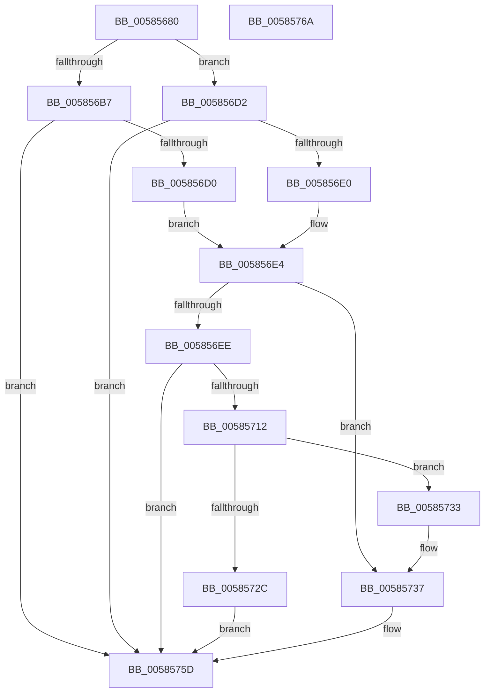

# HvlpEnableNextLogicalProcessor

- RVA: `0x00585680`–`0x0058576B` (길이 `235` bytes)
- VA: `0x0000000140585680`
- 실행 섹션: `.text`
- PDB 이름 있음: `예`; PDB Function 태그: `예`
- unwind 정보 RVA: `0x000C660C`
- 디코드: `66`개 명령, `235/235` bytes 표시
- 미해석 바이트: `0` (있으면 어셈블리에 `.byte`로 보존)

> 이 문서는 커널 이미지의 기계어와 PDB 기호를 분석해 생성했습니다. 4번과 5번은 함수 원형과 자료형을 바이너리 사용 방식에서 추정한 C 해석이며 원본 소스 복구 결과는 아닙니다.

## 1. Dependencies

- 직접 호출 지점: **4**; 고유 호출 대상: **4**
- 직접 호출자로 확인된 함수: **1**
- RIP 상대 이미지 참조: **4**

### Outgoing calls
- `0x005856C3` → [HvlpStartLogicalProcessor](HvlpStartLogicalProcessor_function_00586988.md) (function, `0x00586988`)
- `0x005856D7` → [HvlpGetVpIndexFromApicId](HvlpGetVpIndexFromApicId_function_00585880.md) (function, `0x00585880`)
- `0x00585709` → [HvlpMapStatisticsPage](HvlpMapStatisticsPage_function_00585B68.md) (function, `0x00585B68`)
- `0x00585722` → [MmMapIoSpaceEx](../32/MmMapIoSpaceEx_function_00327830.md) (function, `0x00327830`)

### Direct callers
- [HvlStartBootLogicalProcessors](HvlStartBootLogicalProcessors_function_00584E18.md) at `0x0058504F`

### Static image references
- `0x0058568C` → RVA `0x00FC6BA0` (`ALMOSTRO`; read)
- `0x0058569F` → RVA `0x00FC6AD8` (`ALMOSTRO`; read)
- `0x005856AC` → RVA `0x00FC6C40` (`ALMOSTRO`; read)
- `0x00585737` → RVA `0x00FCF6C0` (`CACHEALI`; read)

## 2. Other-region calls and transfers

- 다른 실행 섹션으로 향하는 call: **0**
- 별도 외부 분기/꼬리 이동을 확인하지 못했습니다.

## 3. Assembly (complete function range)

```asm
00585680  48 89 5C 24 08                  mov qword ptr [rsp + 8], rbx
00585685  55                              push rbp
00585686  56                              push rsi
00585687  57                              push rdi
00585688  48 83 EC 30                     sub rsp, 0x30
0058568C  8B 3D 0E 15 A4 00               mov edi, dword ptr [rip + 0xa4150e]
00585692  8B F1                           mov esi, ecx
00585694  83 64 24 60 00                  and dword ptr [rsp + 0x60], 0
00585699  48 83 64 24 68 00               and qword ptr [rsp + 0x68], 0
0058569F  8B 05 33 14 A4 00               mov eax, dword ptr [rip + 0xa41433]
005856A5  48 6B DF 68                     imul rbx, rdi, 0x68
005856A9  0F B7 EA                        movzx ebp, dx
005856AC  48 03 1D 8D 15 A4 00            add rbx, qword ptr [rip + 0xa4158d]
005856B3  A8 20                           test al, 0x20
005856B5  74 1B                           je 0x1405856d2
005856B7  8B D1                           mov edx, ecx
005856B9  4C 8D 4B 28                     lea r9, [rbx + 0x28]
005856BD  8B CF                           mov ecx, edi
005856BF  44 0F B7 C5                     movzx r8d, bp
005856C3  E8 C0 12 00 00                  call 0x140586988
005856C8  85 C0                           test eax, eax
005856CA  0F 88 8D 00 00 00               js 0x14058575d
005856D0  EB 12                           jmp 0x1405856e4
005856D2  48 8D 54 24 60                  lea rdx, [rsp + 0x60]
005856D7  E8 A4 01 00 00                  call 0x140585880
005856DC  85 C0                           test eax, eax
005856DE  78 7D                           js 0x14058575d
005856E0  8B 7C 24 60                     mov edi, dword ptr [rsp + 0x60]
005856E4  8B 05 EE 13 A4 00               mov eax, dword ptr [rip + 0xa413ee]
005856EA  A8 10                           test al, 0x10
005856EC  74 49                           je 0x140585737
005856EE  0F 57 C0                        xorps xmm0, xmm0
005856F1  4C 8D 44 24 68                  lea r8, [rsp + 0x68]
005856F6  0F 11 44 24 20                  movups xmmword ptr [rsp + 0x20], xmm0
005856FB  48 8D 54 24 20                  lea rdx, [rsp + 0x20]
00585700  89 7C 24 20                     mov dword ptr [rsp + 0x20], edi
00585704  B9 02 00 00 00                  mov ecx, 2
00585709  E8 5A 04 00 00                  call 0x140585b68
0058570E  85 C0                           test eax, eax
00585710  78 4B                           js 0x14058575d
00585712  48 8B 4C 24 68                  mov rcx, qword ptr [rsp + 0x68]
00585717  BA 00 10 00 00                  mov edx, 0x1000
0058571C  41 B8 02 00 00 00               mov r8d, 2
00585722  E8 09 21 DA FF                  call 0x140327830
00585727  48 85 C0                        test rax, rax
0058572A  75 07                           jne 0x140585733
0058572C  B8 9A 00 00 C0                  mov eax, 0xc000009a
00585731  EB 2A                           jmp 0x14058575d
00585733  48 89 43 18                     mov qword ptr [rbx + 0x18], rax
00585737  48 8D 0D 82 9F A4 00            lea rcx, [rip + 0xa49f82]
0058573E  89 7B 04                        mov dword ptr [rbx + 4], edi
00585741  48 8B 04 E9                     mov rax, qword ptr [rcx + rbp*8]
00585745  89 73 08                        mov dword ptr [rbx + 8], esi
00585748  66 89 6B 02                     mov word ptr [rbx + 2], bp
0058574C  0F B7 48 02                     movzx ecx, word ptr [rax + 2]
00585750  83 4B 14 FF                     or dword ptr [rbx + 0x14], 0xffffffff
00585754  33 C0                           xor eax, eax
00585756  66 89 4B 60                     mov word ptr [rbx + 0x60], cx
0058575A  C6 03 01                        mov byte ptr [rbx], 1
0058575D  48 8B 5C 24 50                  mov rbx, qword ptr [rsp + 0x50]
00585762  48 83 C4 30                     add rsp, 0x30
00585766  5F                              pop rdi
00585767  5E                              pop rsi
00585768  5D                              pop rbp
00585769  C3                              ret
0058576A  CC                              int3
```

## 4. C-style interpretation (structured pseudocode)

```c
__int64 __fastcall HvlpEnableNextLogicalProcessor(int a1, unsigned __int16 a2)
{
    __int64 result;
    __int64 v_rbx;
    __int64 v_rsp;
    unsigned __int64 v_stack_m28;
    unsigned int v_stack_p18;
    unsigned __int64 v_stack_p20;
    unsigned __int64 v_stack_p8;

    v_stack_p8 = v_rbx;
    v_rsp = (v_rsp) - (48);
    v_rbx = (v_rbx) * ((unsigned int)(*(unsigned int *)(v_rip + 10753294)));
    v_rbx = (v_rbx) + (*(unsigned __int64 *)(v_rip + 10753421));
    if ((((unsigned __int8)((unsigned int)(*(unsigned int *)(v_rip + 10753075)))) & (32)) == 0) goto loc_005856D2;
    result = HvlpStartLogicalProcessor((unsigned int)((unsigned int)((unsigned int)(*(unsigned int *)(v_rip + 10753294)))), (unsigned int)(a1), a2, v_rbx + 40);
    if (sign_flag) goto loc_0058575D;
    goto loc_005856E4;
loc_005856D2:
    result = HvlpGetVpIndexFromApicId((unsigned int)((unsigned int)((unsigned int)(*(unsigned int *)(v_rip + 10753294)))), v_stack_p18, a2, v_rbx + 40);
    if (sign_flag) goto loc_0058575D;
loc_005856E4:
    if ((((unsigned __int8)((unsigned int)(*(unsigned int *)(v_rip + 10753006)))) & (16)) == 0) goto loc_00585737;
    v_stack_m28 = v_xmm0;
    v_stack_m28 = (unsigned int)((unsigned int)(v_stack_p18));
    result = HvlpMapStatisticsPage(2, v_stack_m28, v_stack_p20, v_rbx + 40);
    if (sign_flag) goto loc_0058575D;
    result = MmMapIoSpaceEx(v_stack_p20, (unsigned int)(0x1000ULL), 2, v_rbx + 40);
    if (result != 0) goto loc_00585733;
    goto loc_0058575D;
loc_00585733:
    *(unsigned __int64 *)(v_rbx + 24) = (unsigned int)(0xC000009AULL);
loc_00585737:
    *(unsigned int *)(v_rbx + 4) = (unsigned int)((unsigned int)(v_stack_p18));
    *(unsigned int *)(v_rbx + 8) = (unsigned int)((unsigned int)(a1));
    *(unsigned __int16 *)(v_rbx + 2) = a2;
    result = 0;
    *(unsigned __int16 *)(v_rbx + 96) = (unsigned __int16)(*(unsigned __int16 *)(*(unsigned __int64 *)(v_rip + 10788738 + a2 * 8) + 2));
    *(unsigned __int8 *)(v_rbx) = 1;
loc_0058575D:
    v_rsp = (v_rsp) + (48);
    return result;
}
```

## 5. (Beta) C Style

```c
int64_t HvlpEnableNextLogicalProcessor(int32_t Arg1, uint16_t Arg2)
{
    int64_t result;
    int64_t local_rbx;
    int64_t local_rsp;
    uint64_t v_stack_m28;
    uint32_t v_stack_p18;
    uint64_t v_stack_p20;
    uint64_t v_stack_p8;

    v_stack_p8 = local_rbx;
    local_rsp = (local_rsp) - (48);
    local_rbx = (local_rbx) * ((uint32_t)(*(uint32_t *)(v_rip + 0xA4150E)));
    local_rbx = (local_rbx) + (*(uint64_t *)(v_rip + 0xA4158D));
    if ((((uint8_t)((uint32_t)(*(uint32_t *)(v_rip + 0xA41433)))) & (32)) == 0) goto loc_005856D2;
    result = HvlpStartLogicalProcessor((uint32_t)((uint32_t)((uint32_t)(*(uint32_t *)(v_rip + 0xA4150E)))), (uint32_t)(Arg1), Arg2, local_rbx + 40);
    if (sign_flag) goto loc_0058575D;
    goto loc_005856E4;
loc_005856D2:
    result = HvlpGetVpIndexFromApicId((uint32_t)((uint32_t)((uint32_t)(*(uint32_t *)(v_rip + 0xA4150E)))), v_stack_p18, Arg2, local_rbx + 40);
    if (sign_flag) goto loc_0058575D;
loc_005856E4:
    if ((((uint8_t)((uint32_t)(*(uint32_t *)(v_rip + 0xA413EE)))) & (16)) == 0) goto loc_00585737;
    v_stack_m28 = v_xmm0;
    v_stack_m28 = (uint32_t)((uint32_t)(v_stack_p18));
    result = HvlpMapStatisticsPage(2, v_stack_m28, v_stack_p20, local_rbx + 40);
    if (sign_flag) goto loc_0058575D;
    result = MmMapIoSpaceEx(v_stack_p20, (uint32_t)(0x1000ULL), 2, local_rbx + 40);
    if (result != 0) goto loc_00585733;
    goto loc_0058575D;
loc_00585733:
    *(uint64_t *)(local_rbx + 0x18) = (uint32_t)(0xC000009AULL);
loc_00585737:
    *(uint32_t *)(local_rbx + 0x4) = (uint32_t)((uint32_t)(v_stack_p18));
    *(uint32_t *)(local_rbx + 0x8) = (uint32_t)((uint32_t)(Arg1));
    *(uint16_t *)(local_rbx + 0x2) = Arg2;
    result = 0;
    *(uint16_t *)(local_rbx + 0x60) = (uint16_t)(*(uint16_t *)(*(uint64_t *)(v_rip + 0xA49F82 + Arg2 * 8) + 0x2));
    *(uint8_t *)(local_rbx) = 1;
loc_0058575D:
    local_rsp = (local_rsp) + (48);
    return result;
}
```

## 6. Execution-region graph

[열기: 2D/3D 그래프와 함수 탐색 컨트롤 패널](../../../control-panel.html?section=text&rva=0x00585680&view=graph)

- 2D 그래프는 위에서 아래로 흐르고, 3D 그래프는 빈 공간을 드래그해 회전합니다. Shift+드래그는 이동, 휠은 확대·축소, 함수 노드 선택은 대상 보고서 이동입니다.

### Static fallback


