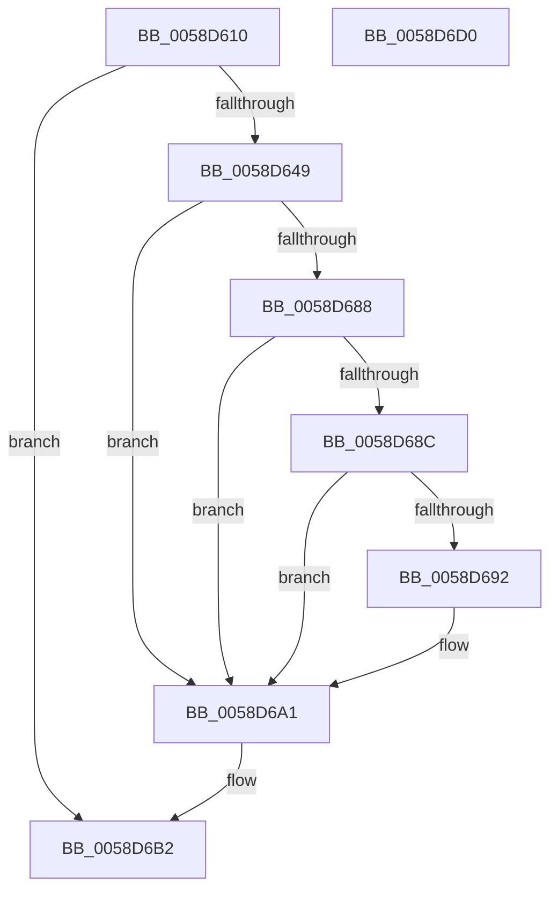

# HvlpEndSecurePageListIteration

- RVA: `0x0058D610`–`0x0058D6D1` (길이 `193` bytes)
- VA: `0x000000014058D610`
- 실행 섹션: `.text`
- PDB 이름 있음: `예`; PDB Function 태그: `아니요`
- unwind 정보 RVA: `0x000BA674`
- 디코드: `59`개 명령, `193/193` bytes 표시
- 미해석 바이트: `0` (있으면 어셈블리에 `.byte`로 보존)

> 이 문서는 커널 이미지의 기계어와 PDB 기호를 분석해 생성했습니다. 4번과 5번은 함수 원형과 자료형을 바이너리 사용 방식에서 추정한 C 해석이며 원본 소스 복구 결과는 아닙니다.

## 1. Dependencies

- 직접 호출 지점: **5**; 고유 호출 대상: **5**
- 직접 호출자로 확인된 함수: **4**
- RIP 상대 이미지 참조: **1**

### Outgoing calls
- `0x0058D63B` → [HvlpGetPageListIterator](HvlpGetPageListIterator_function_0058D790.md) (function, `0x0058D790`)
- `0x0058D654` → [memset](../6C/memset_function_006C6C40.md) (function, `0x006C6C40`)
- `0x0058D674` → [VslpEnterIumSecureMode](../23/VslpEnterIumSecureMode_function_00235E50.md) (function, `0x00235E50`)
- `0x0058D69C` → [memcpy](../6C/memcpy_function_006C6840.md) (function, `0x006C6840`)
- `0x0058D6BD` → [_security_check_cookie](../6A/_security_check_cookie_function_006AC640.md) (function, `0x006AC640`)

### Direct callers
- [HvlDiscardSecurePagesFromHibernation](HvlDiscardSecurePagesFromHibernation_function_0058A444.md) at `0x0058A4F9`
- [HvlIterateSecurePagesForHibernation](HvlIterateSecurePagesForHibernation_function_0058A520.md) at `0x0058A5BF`
- [HvlAddSecurePagesCallbackRoutine](HvlAddSecurePagesCallbackRoutine_function_0058B0C8.md) at `0x0058B11B`
- [HvlAddSecurePagesCallbackRoutine](HvlAddSecurePagesCallbackRoutine_function_0058B0C8.md) at `0x0058B2B9`
- [HvlpGetEncryptedDataFromSecureKernel](HvlpGetEncryptedDataFromSecureKernel_function_0058BB98.md) at `0x0058BC0C`
- [HvlpGetEncryptedDataFromSecureKernel](HvlpGetEncryptedDataFromSecureKernel_function_0058BB98.md) at `0x0058BC92`

### Static image references
- `0x0058D61E` → RVA `0x00E0A740` (`.data`; read)

## 2. Other-region calls and transfers

- 다른 실행 섹션으로 향하는 call: **0**
- 별도 외부 분기/꼬리 이동을 확인하지 못했습니다.

## 3. Assembly (complete function range)

```asm
0058D610  40 53                           push rbx
0058D612  55                              push rbp
0058D613  56                              push rsi
0058D614  57                              push rdi
0058D615  41 56                           push r14
0058D617  48 81 EC A0 00 00 00            sub rsp, 0xa0
0058D61E  48 8B 05 1B D1 87 00            mov rax, qword ptr [rip + 0x87d11b]
0058D625  48 33 C4                        xor rax, rsp
0058D628  48 89 84 24 90 00 00 00         mov qword ptr [rsp + 0x90], rax
0058D630  49 8B F8                        mov rdi, r8
0058D633  48 8B F2                        mov rsi, rdx
0058D636  8B E9                           mov ebp, ecx
0058D638  45 33 F6                        xor r14d, r14d
0058D63B  E8 50 01 00 00                  call 0x14058d790
0058D640  48 8B D8                        mov rbx, rax
0058D643  44 38 70 02                     cmp byte ptr [rax + 2], r14b
0058D647  74 69                           je 0x14058d6b2
0058D649  33 D2                           xor edx, edx
0058D64B  45 8D 46 68                     lea r8d, [r14 + 0x68]
0058D64F  48 8D 4C 24 20                  lea rcx, [rsp + 0x20]
0058D654  E8 E7 95 13 00                  call 0x1406c6c40
0058D659  41 8B C6                        mov eax, r14d
0058D65C  4C 8D 4C 24 20                  lea r9, [rsp + 0x20]
0058D661  85 ED                           test ebp, ebp
0058D663  66 BA 01 08                     mov dx, 0x801
0058D667  B1 02                           mov cl, 2
0058D669  0F 94 C0                        sete al
0058D66C  45 33 C0                        xor r8d, r8d
0058D66F  48 89 44 24 28                  mov qword ptr [rsp + 0x28], rax
0058D674  E8 D7 87 CA FF                  call 0x140235e50
0058D679  85 C0                           test eax, eax
0058D67B  41 8B D6                        mov edx, r14d
0058D67E  0F 49 54 24 30                  cmovns edx, dword ptr [rsp + 0x30]
0058D683  48 85 FF                        test rdi, rdi
0058D686  74 19                           je 0x14058d6a1
0058D688  3B 17                           cmp edx, dword ptr [rdi]
0058D68A  77 15                           ja 0x14058d6a1
0058D68C  89 17                           mov dword ptr [rdi], edx
0058D68E  85 D2                           test edx, edx
0058D690  74 0F                           je 0x14058d6a1
0058D692  44 8B C2                        mov r8d, edx
0058D695  48 8B CE                        mov rcx, rsi
0058D698  48 8B 53 08                     mov rdx, qword ptr [rbx + 8]
0058D69C  E8 9F 91 13 00                  call 0x1406c6840
0058D6A1  4C 89 73 08                     mov qword ptr [rbx + 8], r14
0058D6A5  66 44 89 33                     mov word ptr [rbx], r14w
0058D6A9  66 44 89 73 03                  mov word ptr [rbx + 3], r14w
0058D6AE  44 88 73 02                     mov byte ptr [rbx + 2], r14b
0058D6B2  48 8B 8C 24 90 00 00 00         mov rcx, qword ptr [rsp + 0x90]
0058D6BA  48 33 CC                        xor rcx, rsp
0058D6BD  E8 7E EF 11 00                  call 0x1406ac640
0058D6C2  48 81 C4 A0 00 00 00            add rsp, 0xa0
0058D6C9  41 5E                           pop r14
0058D6CB  5F                              pop rdi
0058D6CC  5E                              pop rsi
0058D6CD  5D                              pop rbp
0058D6CE  5B                              pop rbx
0058D6CF  C3                              ret
0058D6D0  CC                              int3
```

## 4. C-style interpretation (structured pseudocode)

```c
__int64 __fastcall HvlpEndSecurePageListIteration(int a1, __int64 a2, __int64 a3)
{
    __int64 result;
    __int64 v_r14;
    __int64 v_rsp;
    unsigned __int64 v_stack_m38;
    unsigned int v_stack_m98;
    unsigned __int64 v_stack_mA0;
    unsigned __int64 v_stack_mA8;

    v_rsp = (v_rsp) - (160);
    result = (*(unsigned __int64 *)(v_rip + 8900891)) ^ (v_rsp);
    v_stack_m38 = result;
    v_r14 = 0;
    result = HvlpGetPageListIterator(a1, a2, a3, a4);
    if ((*(unsigned __int8 *)(result + 2)) == 0) goto loc_0058D6B2;
    a2 = 0;
    result = memset(v_stack_mA8, a2, v_r14 + 104, a4);
    result = ((unsigned int)((unsigned int)(a1)) == 0) ? 1 : 0;
    a3 = 0;
    v_stack_mA0 = result;
    result = VslpEnterIumSecureMode(2, 0x801ULL, a3, v_stack_mA8);
    a2 = 0;
    if (!sign_flag) { a2 = v_stack_m98; }
    if (0 == 0) goto loc_0058D6A1;
    if (((unsigned int)(a2)) > (*(unsigned int *)(a3))) goto loc_0058D6A1;
    *(unsigned int *)(a3) = (unsigned int)(a2);
    if ((unsigned int)(a2) != 0) {
        a3 = (unsigned int)(a2);
        a1 = a2;
        a2 = *(unsigned __int64 *)(result + 8);
        result = memcpy(a1, a2, a3, v_stack_mA8);
    }
    *(unsigned __int64 *)(result + 8) = 0;
    *(unsigned __int16 *)(result) = 0;
    *(unsigned __int16 *)(result + 3) = 0;
    *(unsigned __int8 *)(result + 2) = 0;
loc_0058D6B2:
    a1 = (v_stack_m38) ^ (v_rsp);
    result = _security_check_cookie(a1, a2, a3, v_stack_mA8);
    v_rsp = (v_rsp) + (160);
    return result;
}
```

## 5. (Beta) C Style

```c
int64_t HvlpEndSecurePageListIteration(int32_t Arg1, int64_t Arg2, int64_t Arg3)
{
    int64_t result;
    int64_t local_r14;
    int64_t local_rsp;
    uint64_t v_stack_m38;
    uint32_t v_stack_m98;
    uint64_t v_stack_mA0;
    uint64_t v_stack_mA8;

    local_rsp = (local_rsp) - (160);
    result = (*(uint64_t *)(v_rip + 0x87D11B)) ^ (local_rsp);
    v_stack_m38 = result;
    local_r14 = 0;
    result = HvlpGetPageListIterator(Arg1, Arg2, Arg3, a4);
    if ((*(uint8_t *)(result + 0x2)) == 0) goto loc_0058D6B2;
    Arg2 = 0;
    result = memset(v_stack_mA8, Arg2, local_r14 + 104, a4);
    result = ((uint32_t)((uint32_t)(Arg1)) == 0) ? 1 : 0;
    Arg3 = 0;
    v_stack_mA0 = result;
    result = VslpEnterIumSecureMode(2, 0x801ULL, Arg3, v_stack_mA8);
    Arg2 = 0;
    if (!sign_flag) { Arg2 = v_stack_m98; }
    if (0 == 0) goto loc_0058D6A1;
    if (((uint32_t)(Arg2)) > (*(uint32_t *)(Arg3))) goto loc_0058D6A1;
    *(uint32_t *)(Arg3) = (uint32_t)(Arg2);
    if ((uint32_t)(Arg2) != 0) {
        Arg3 = (uint32_t)(Arg2);
        Arg1 = Arg2;
        Arg2 = *(uint64_t *)(result + 0x8);
        result = memcpy(Arg1, Arg2, Arg3, v_stack_mA8);
    }
    *(uint64_t *)(result + 0x8) = 0;
    *(uint16_t *)(result) = 0;
    *(uint16_t *)(result + 0x3) = 0;
    *(uint8_t *)(result + 0x2) = 0;
loc_0058D6B2:
    Arg1 = (v_stack_m38) ^ (local_rsp);
    result = _security_check_cookie(Arg1, Arg2, Arg3, v_stack_mA8);
    local_rsp = (local_rsp) + (160);
    return result;
}
```

## 6. Execution-region graph

[열기: 2D/3D 그래프와 함수 탐색 컨트롤 패널](../../../control-panel.html?section=text&rva=0x0058D610&view=graph)

- 2D 그래프는 위에서 아래로 흐르고, 3D 그래프는 빈 공간을 드래그해 회전합니다. Shift+드래그는 이동, 휠은 확대·축소, 함수 노드 선택은 대상 보고서 이동입니다.

### Static fallback


