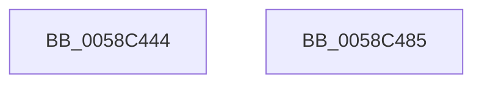

# HvlpEtwRegister

- RVA: `0x0058C444`–`0x0058C486` (길이 `66` bytes)
- VA: `0x000000014058C444`
- 실행 섹션: `.text`
- PDB 이름 있음: `예`; PDB Function 태그: `아니요`
- unwind 정보 RVA: `0x0005C788`
- 디코드: `14`개 명령, `66/66` bytes 표시
- 미해석 바이트: `0` (있으면 어셈블리에 `.byte`로 보존)

> 이 문서는 커널 이미지의 기계어와 PDB 기호를 분석해 생성했습니다. 4번과 5번은 함수 원형과 자료형을 바이너리 사용 방식에서 추정한 C 해석이며 원본 소스 복구 결과는 아닙니다.

## 1. Dependencies

- 직접 호출 지점: **2**; 고유 호출 대상: **2**
- 직접 호출자로 확인된 함수: **1**
- RIP 상대 이미지 참조: **3**

### Outgoing calls
- `0x0058C45B` → [EtwRegister](../../page/92/EtwRegister_function_00920960.md) (function, `0x00920960`)
- `0x0058C47B` → [EtwSetInformation](../../page/7B/EtwSetInformation_function_007B9070.md) (function, `0x007B9070`)

### Direct callers
- [HvlPhase2Initialize](HvlPhase2Initialize_function_00583EA0.md) at `0x00583F2D`
- [HvlPhase2Initialize](HvlPhase2Initialize_function_00583EA0.md) at `0x00584003`

### Static image references
- `0x0058C448` → RVA `0x00E65E38` (`.data`; read)
- `0x0058C454` → RVA `0x000269F8` (`.rdata`; read)
- `0x0058C460` → RVA `0x0001BF90` (`.rdata`; read)

## 2. Other-region calls and transfers

- 다른 실행 섹션으로 향하는 call: **2**
  - `0x0058C45B` → [EtwRegister](../../page/92/EtwRegister_function_00920960.md) (`.text` → `PAGE`)
  - `0x0058C47B` → [EtwSetInformation](../../page/7B/EtwSetInformation_function_007B9070.md) (`.text` → `PAGE`)
- 별도 외부 분기/꼬리 이동을 확인하지 못했습니다.

## 3. Assembly (complete function range)

```asm
0058C444  48 83 EC 28                     sub rsp, 0x28
0058C448  4C 8D 0D E9 99 8D 00            lea r9, [rip + 0x8d99e9]
0058C44F  45 33 C0                        xor r8d, r8d
0058C452  33 D2                           xor edx, edx
0058C454  48 8D 0D 9D A5 A9 FF            lea rcx, [rip - 0x565a63]
0058C45B  E8 00 45 39 00                  call 0x140920960
0058C460  44 0F B7 0D 28 FB A8 FF         movzx r9d, word ptr [rip - 0x5704d8]
0058C468  4C 8D 05 21 FB A8 FF            lea r8, [rip - 0x5704df]
0058C46F  48 8B 0D C2 99 8D 00            mov rcx, qword ptr [rip + 0x8d99c2]
0058C476  BA 02 00 00 00                  mov edx, 2
0058C47B  E8 F0 CB 22 00                  call 0x1407b9070
0058C480  48 83 C4 28                     add rsp, 0x28
0058C484  C3                              ret
0058C485  CC                              int3
```

## 4. C-style interpretation (structured pseudocode)

```c
__int64 __fastcall HvlpEtwRegister(__int64 a1, int a2, int a3)
{
    __int64 result;
    __int64 v_rsp;

    v_rsp = (v_rsp) - (40);
    a3 = 0;
    a2 = 0;
    result = EtwRegister(v_rip - 5659235, a2, a3, v_rip + 9279977);
    result = EtwSetInformation(*(unsigned __int64 *)(v_rip + 9279938), 2, v_rip - 5702879, *(unsigned __int16 *)(v_rip - 5702872));
    v_rsp = (v_rsp) + (40);
    return result;
}
```

## 5. (Beta) C Style

```c
int64_t HvlpEtwRegister(int64_t Arg1, int32_t Arg2, int32_t Arg3)
{
    int64_t result;
    int64_t local_rsp;

    local_rsp = (local_rsp) - (40);
    Arg3 = 0;
    Arg2 = 0;
    result = EtwRegister(v_rip - 5659235, Arg2, Arg3, v_rip + 9279977);
    result = EtwSetInformation(*(uint64_t *)(v_rip + 0x8D99C2), 2, v_rip - 5702879, *(uint16_t *)(v_rip - 0x5704D8));
    local_rsp = (local_rsp) + (40);
    return result;
}
```

## 6. Execution-region graph

[열기: 2D/3D 그래프와 함수 탐색 컨트롤 패널](../../../control-panel.html?section=text&rva=0x0058C444&view=graph)

- 2D 그래프는 위에서 아래로 흐르고, 3D 그래프는 빈 공간을 드래그해 회전합니다. Shift+드래그는 이동, 휠은 확대·축소, 함수 노드 선택은 대상 보고서 이동입니다.

### Static fallback


