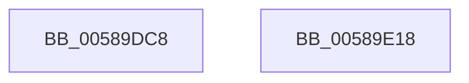

# HvlpFastAcknowledgePageRequest

- RVA: `0x00589DC8`–`0x00589E19` (길이 `81` bytes)
- VA: `0x0000000140589DC8`
- 실행 섹션: `.text`
- PDB 이름 있음: `예`; PDB Function 태그: `아니요`
- unwind 정보 RVA: `0x00064C80`
- 디코드: `22`개 명령, `81/81` bytes 표시
- 미해석 바이트: `0` (있으면 어셈블리에 `.byte`로 보존)

> 이 문서는 커널 이미지의 기계어와 PDB 기호를 분석해 생성했습니다. 4번과 5번은 함수 원형과 자료형을 바이너리 사용 방식에서 추정한 C 해석이며 원본 소스 복구 결과는 아닙니다.

## 1. Dependencies

- 직접 호출 지점: **1**; 고유 호출 대상: **1**
- 직접 호출자로 확인된 함수: **2**
- RIP 상대 이미지 참조: **0**

### Outgoing calls
- `0x00589DFE` → [HvcallFastExtended](../31/HvcallFastExtended_function_003130E0.md) (function, `0x003130E0`)

### Direct callers
- [HvlAcknowledgePageRequest](HvlAcknowledgePageRequest_function_005870A0.md) at `0x00587130`
- [HvlpSlowAcknowledgePageRequest](HvlpSlowAcknowledgePageRequest_function_00589E20.md) at `0x00589E73`

### Static image references
- 디코드된 RIP-relative 메모리 참조가 없습니다.

## 2. Other-region calls and transfers

- 다른 실행 섹션으로 향하는 call: **0**
- 별도 외부 분기/꼬리 이동을 확인하지 못했습니다.

## 3. Assembly (complete function range)

```asm
00589DC8  40 53                           push rbx
00589DCA  48 83 EC 30                     sub rsp, 0x30
00589DCE  83 64 24 20 00                  and dword ptr [rsp + 0x20], 0
00589DD3  8B C1                           mov eax, ecx
00589DD5  48 C7 44 24 50 A6 00 00 00      mov qword ptr [rsp + 0x50], 0xa6
00589DDE  25 FF 0F 00 00                  and eax, 0xfff
00589DE3  0F BA 6C 24 50 10               bts dword ptr [rsp + 0x50], 0x10
00589DE9  49 8B D8                        mov rbx, r8
00589DEC  C1 E1 05                        shl ecx, 5
00589DEF  45 33 C9                        xor r9d, r9d
00589DF2  89 44 24 54                     mov dword ptr [rsp + 0x54], eax
00589DF6  44 8B C1                        mov r8d, ecx
00589DF9  48 8B 4C 24 50                  mov rcx, qword ptr [rsp + 0x50]
00589DFE  E8 DD 92 D8 FF                  call 0x1403130e0
00589E03  48 8B C8                        mov rcx, rax
00589E06  48 C1 E9 20                     shr rcx, 0x20
00589E0A  81 E1 FF 0F 00 00               and ecx, 0xfff
00589E10  89 0B                           mov dword ptr [rbx], ecx
00589E12  48 83 C4 30                     add rsp, 0x30
00589E16  5B                              pop rbx
00589E17  C3                              ret
00589E18  CC                              int3
```

## 4. C-style interpretation (structured pseudocode)

```c
__int64 __fastcall HvlpFastAcknowledgePageRequest(int a1, __int64 a2, __int64 a3, int a4)
{
    __int64 result;
    __int64 v_rsp;
    unsigned int v_stack_m18;
    unsigned __int64 v_stack_p18;
    unsigned int v_stack_p1C;

    v_rsp = (v_rsp) - (48);
    v_stack_p18 = 166;
    result = (unsigned int)(((unsigned int)(a1)) & (0xFFFULL));
    a1 = (unsigned int)((a1) << (5));
    a4 = 0;
    v_stack_p1C = (unsigned int)(result);
    result = HvcallFastExtended(v_stack_p18, a2, (unsigned int)(a1), a4);
    a1 = (result) >> (32);
    a1 = (unsigned int)((a1) & (0xFFFULL));
    *(unsigned int *)(a3) = a1;
    v_rsp = (v_rsp) + (48);
    return result;
}
```

## 5. (Beta) C Style

```c
int64_t HvlpFastAcknowledgePageRequest(int32_t Arg1, int64_t Arg2, void *Arg3, int32_t Arg4)
{
    uint8_t *arg3 = (uint8_t *)Arg3;

    int64_t result;
    int64_t local_rsp;
    uint32_t v_stack_m18;
    uint64_t v_stack_p18;
    uint32_t v_stack_p1C;

    local_rsp = (local_rsp) - (48);
    v_stack_p18 = 166;
    result = (uint32_t)(((uint32_t)(Arg1)) & (0xFFFULL));
    Arg1 = (uint32_t)((Arg1) << (5));
    Arg4 = 0;
    v_stack_p1C = (uint32_t)(result);
    result = HvcallFastExtended(v_stack_p18, Arg2, (uint32_t)(Arg1), Arg4);
    Arg1 = (result) >> (32);
    Arg1 = (uint32_t)((Arg1) & (0xFFFULL));
    *(uint32_t *)(arg3) = Arg1;
    local_rsp = (local_rsp) + (48);
    return result;
}
```

### 관측된 메모리 오프셋

구조체 형식이 확인되지 않은 접근은 인자 기준의 오프셋으로만 기록했습니다.

| 기준 인자 | 오프셋 표현 | 폭 (bit) | 접근 |
|---|---:|---:|---|
| `Arg3` | `+ 0x0` | `32` | `W` |

## 6. Execution-region graph

[열기: 2D/3D 그래프와 함수 탐색 컨트롤 패널](../../../control-panel.html?section=text&rva=0x00589DC8&view=graph)

- 2D 그래프는 위에서 아래로 흐르고, 3D 그래프는 빈 공간을 드래그해 회전합니다. Shift+드래그는 이동, 휠은 확대·축소, 함수 노드 선택은 대상 보고서 이동입니다.

### Static fallback


