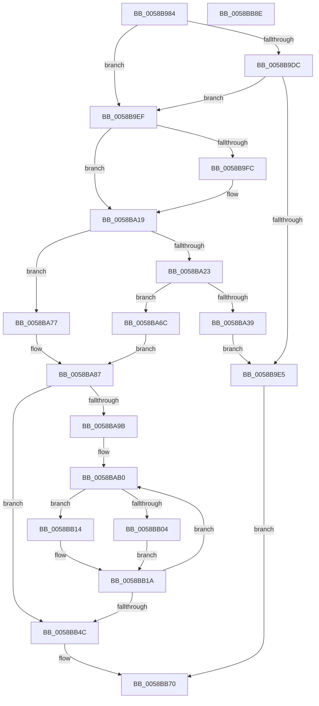

# HvlpGetEncryptedDataFromHypervisor

- RVA: `0x0058B984`–`0x0058BB8F` (길이 `523` bytes)
- VA: `0x000000014058B984`
- 실행 섹션: `.text`
- PDB 이름 있음: `예`; PDB Function 태그: `아니요`
- unwind 정보 RVA: `0x000C397C`
- 디코드: `130`개 명령, `523/523` bytes 표시
- 미해석 바이트: `0` (있으면 어셈블리에 `.byte`로 보존)

> 이 문서는 커널 이미지의 기계어와 PDB 기호를 분석해 생성했습니다. 4번과 5번은 함수 원형과 자료형을 바이너리 사용 방식에서 추정한 C 해석이며 원본 소스 복구 결과는 아닙니다.

## 1. Dependencies

- 직접 호출 지점: **4**; 고유 호출 대상: **4**
- 직접 호출자로 확인된 함수: **1**
- RIP 상대 이미지 참조: **10**

### Outgoing calls
- `0x0058B9FF` → [HvlpStartPageListIteration](HvlpStartPageListIteration_function_0058D8E4.md) (function, `0x0058D8E4`)
- `0x0058BA30` → [HvlpGetPageList](HvlpGetPageList_function_0058D6D8.md) (function, `0x0058D6D8`)
- `0x0058BA3C` → [HvlpGetPageListIterator](HvlpGetPageListIterator_function_0058D790.md) (function, `0x0058D790`)
- `0x0058BB24` → [memcpy](../6C/memcpy_function_006C6840.md) (function, `0x006C6840`)

### Direct callers
- [HvlGetEncryptedData](HvlGetEncryptedData_function_0058B6D0.md) at `0x0058B710`

### Static image references
- `0x0058B9C3` → RVA `0x00F8ECAD` (`.data`; read)
- `0x0058B9CB` → RVA `0x00FC6AD8` (`ALMOSTRO`; read)
- `0x0058B9DC` → RVA `0x00FC6A84` (`ALMOSTRO`; read)
- `0x0058B9F3` → RVA `0x00F8EDC0` (`.data`; read)
- `0x0058BA04` → RVA `0x00F8EDC8` (`.data`; write)
- `0x0058BA0B` → RVA `0x00F8EDD0` (`.data`; write)
- `0x0058BA12` → RVA `0x00F8EDC0` (`.data`; write)
- `0x0058BA19` → RVA `0x00F8EDD0` (`.data`; read)
- `0x0058BA77` → RVA `0x00F8EDC8` (`.data`; read)
- `0x0058BAD7` → RVA `0x00F8EDB8` (`.data`; read)

## 2. Other-region calls and transfers

- 다른 실행 섹션으로 향하는 call: **0**
- 별도 외부 분기/꼬리 이동을 확인하지 못했습니다.

## 3. Assembly (complete function range)

```asm
0058B984  48 8B C4                        mov rax, rsp
0058B987  48 89 58 10                     mov qword ptr [rax + 0x10], rbx
0058B98B  48 89 68 18                     mov qword ptr [rax + 0x18], rbp
0058B98F  48 89 70 20                     mov qword ptr [rax + 0x20], rsi
0058B993  48 89 48 08                     mov qword ptr [rax + 8], rcx
0058B997  57                              push rdi
0058B998  41 54                           push r12
0058B99A  41 55                           push r13
0058B99C  41 56                           push r14
0058B99E  41 57                           push r15
0058B9A0  48 83 EC 40                     sub rsp, 0x40
0058B9A4  45 33 F6                        xor r14d, r14d
0058B9A7  4C 8B EA                        mov r13, rdx
0058B9AA  4C 89 70 B8                     mov qword ptr [rax - 0x48], r14
0058B9AE  4D 8B E1                        mov r12, r9
0058B9B1  44 89 70 08                     mov dword ptr [rax + 8], r14d
0058B9B5  41 8B F0                        mov esi, r8d
0058B9B8  48 8B 84 24 90 00 00 00         mov rax, qword ptr [rsp + 0x90]
0058B9C0  44 89 30                        mov dword ptr [rax], r14d
0058B9C3  8A 05 E4 32 A0 00               mov al, byte ptr [rip + 0xa032e4]
0058B9C9  F6 D8                           neg al
0058B9CB  8B 05 07 B1 A3 00               mov eax, dword ptr [rip + 0xa3b107]
0058B9D1  1B D2                           sbb edx, edx
0058B9D3  F7 D2                           not edx
0058B9D5  83 E2 02                        and edx, 2
0058B9D8  A8 04                           test al, 4
0058B9DA  75 13                           jne 0x14058b9ef
0058B9DC  44 38 35 A1 B0 A3 00            cmp byte ptr [rip + 0xa3b0a1], r14b
0058B9E3  75 0A                           jne 0x14058b9ef
0058B9E5  B8 25 02 00 C0                  mov eax, 0xc0000225
0058B9EA  E9 81 01 00 00                  jmp 0x14058bb70
0058B9EF  48 83 CF FF                     or rdi, 0xffffffffffffffff
0058B9F3  44 38 35 C6 33 A0 00            cmp byte ptr [rip + 0xa033c6], r14b
0058B9FA  75 1D                           jne 0x14058ba19
0058B9FC  8D 4F 02                        lea ecx, [rdi + 2]
0058B9FF  E8 E0 1E 00 00                  call 0x14058d8e4
0058BA04  48 89 3D BD 33 A0 00            mov qword ptr [rip + 0xa033bd], rdi
0058BA0B  44 89 35 BE 33 A0 00            mov dword ptr [rip + 0xa033be], r14d
0058BA12  C6 05 A7 33 A0 00 01            mov byte ptr [rip + 0xa033a7], 1
0058BA19  8B 1D B1 33 A0 00               mov ebx, dword ptr [rip + 0xa033b1]
0058BA1F  85 DB                           test ebx, ebx
0058BA21  75 54                           jne 0x14058ba77
0058BA23  4C 8D 44 24 70                  lea r8, [rsp + 0x70]
0058BA28  48 8D 54 24 20                  lea rdx, [rsp + 0x20]
0058BA2D  8D 4B 01                        lea ecx, [rbx + 1]
0058BA30  E8 A3 1C 00 00                  call 0x14058d6d8
0058BA35  85 C0                           test eax, eax
0058BA37  75 33                           jne 0x14058ba6c
0058BA39  8D 4B 01                        lea ecx, [rbx + 1]
0058BA3C  E8 4F 1D 00 00                  call 0x14058d790
0058BA41  4C 89 70 08                     mov qword ptr [rax + 8], r14
0058BA45  66 44 89 30                     mov word ptr [rax], r14w
0058BA49  66 44 89 70 03                  mov word ptr [rax + 3], r14w
0058BA4E  44 88 70 02                     mov byte ptr [rax + 2], r14b
0058BA52  44 88 35 67 33 A0 00            mov byte ptr [rip + 0xa03367], r14b
0058BA59  48 89 3D 68 33 A0 00            mov qword ptr [rip + 0xa03368], rdi
0058BA60  44 89 35 69 33 A0 00            mov dword ptr [rip + 0xa03369], r14d
0058BA67  E9 79 FF FF FF                  jmp 0x14058b9e5
0058BA6C  48 8B 6C 24 20                  mov rbp, qword ptr [rsp + 0x20]
0058BA71  8B 5C 24 70                     mov ebx, dword ptr [rsp + 0x70]
0058BA75  EB 10                           jmp 0x14058ba87
0058BA77  48 8B 2D 4A 33 A0 00            mov rbp, qword ptr [rip + 0xa0334a]
0058BA7E  48 89 6C 24 20                  mov qword ptr [rsp + 0x20], rbp
0058BA83  89 5C 24 70                     mov dword ptr [rsp + 0x70], ebx
0058BA87  C1 EE 0C                        shr esi, 0xc
0058BA8A  8B FB                           mov edi, ebx
0058BA8C  3B F3                           cmp esi, ebx
0058BA8E  0F 42 FE                        cmovb edi, esi
0058BA91  8B F7                           mov esi, edi
0058BA93  85 FF                           test edi, edi
0058BA95  0F 84 B1 00 00 00               je 0x14058bb4c
0058BA9B  4C 8B F5                        mov r14, rbp
0058BA9E  48 89 74 24 28                  mov qword ptr [rsp + 0x28], rsi
0058BAA3  49 C1 E6 0C                     shl r14, 0xc
0058BAA7  4C 8B FD                        mov r15, rbp
0058BAAA  41 B8 00 10 00 00               mov r8d, 0x1000
0058BAB0  48 B9 00 F0 FF FF FF FF 0F 00   movabs rcx, 0xffffffffff000
0058BABA  49 8B C6                        mov rax, r14
0058BABD  48 23 C1                        and rax, rcx
0058BAC0  48 BA FF FF FF FF 0F 00 00 00   movabs rdx, 0xfffffffff
0058BACA  48 B9 01 00 00 00 00 00 00 80   movabs rcx, 0x8000000000000001
0058BAD4  48 33 C1                        xor rax, rcx
0058BAD7  48 8B 0D DA 32 A0 00            mov rcx, qword ptr [rip + 0xa032da]
0058BADE  48 C1 E9 0C                     shr rcx, 0xc
0058BAE2  48 23 CA                        and rcx, rdx
0058BAE5  48 89 44 24 30                  mov qword ptr [rsp + 0x30], rax
0058BAEA  48 BA 00 00 00 00 80 F6 FF FF   movabs rdx, 0xfffff68000000000
0058BAF4  48 89 04 CA                     mov qword ptr [rdx + rcx*8], rax
0058BAF8  0F 20 E1                        mov rcx, cr4
0058BAFB  48 F7 C1 80 00 02 00            test rcx, 0x20080
0058BB02  74 10                           je 0x14058bb14
0058BB04  48 8B C1                        mov rax, rcx
0058BB07  48 0F BA F8 07                  btc rax, 7
0058BB0C  0F 22 E0                        mov cr4, rax
0058BB0F  0F 22 E1                        mov cr4, rcx
0058BB12  EB 06                           jmp 0x14058bb1a
0058BB14  0F 20 D8                        mov rax, cr3
0058BB17  0F 22 D8                        mov cr3, rax
0058BB1A  48 8B 15 97 32 A0 00            mov rdx, qword ptr [rip + 0xa03297]
0058BB21  49 8B CD                        mov rcx, r13
0058BB24  E8 17 AD 13 00                  call 0x1406c6840
0058BB29  41 B8 00 10 00 00               mov r8d, 0x1000
0058BB2F  4D 89 3C 24                     mov qword ptr [r12], r15
0058BB33  4D 03 E8                        add r13, r8
0058BB36  4D 03 F0                        add r14, r8
0058BB39  49 83 C4 08                     add r12, 8
0058BB3D  49 FF C7                        inc r15
0058BB40  48 83 6C 24 28 01               sub qword ptr [rsp + 0x28], 1
0058BB46  0F 85 64 FF FF FF               jne 0x14058bab0
0058BB4C  48 8B 8C 24 90 00 00 00         mov rcx, qword ptr [rsp + 0x90]
0058BB54  8B C7                           mov eax, edi
0058BB56  C1 E0 0C                        shl eax, 0xc
0058BB59  2B DF                           sub ebx, edi
0058BB5B  89 01                           mov dword ptr [rcx], eax
0058BB5D  48 8D 04 2F                     lea rax, [rdi + rbp]
0058BB61  48 89 05 60 32 A0 00            mov qword ptr [rip + 0xa03260], rax
0058BB68  33 C0                           xor eax, eax
0058BB6A  89 1D 60 32 A0 00               mov dword ptr [rip + 0xa03260], ebx
0058BB70  4C 8D 5C 24 40                  lea r11, [rsp + 0x40]
0058BB75  49 8B 5B 38                     mov rbx, qword ptr [r11 + 0x38]
0058BB79  49 8B 6B 40                     mov rbp, qword ptr [r11 + 0x40]
0058BB7D  49 8B 73 48                     mov rsi, qword ptr [r11 + 0x48]
0058BB81  49 8B E3                        mov rsp, r11
0058BB84  41 5F                           pop r15
0058BB86  41 5E                           pop r14
0058BB88  41 5D                           pop r13
0058BB8A  41 5C                           pop r12
0058BB8C  5F                              pop rdi
0058BB8D  C3                              ret
0058BB8E  CC                              int3
```

## 4. C-style interpretation (structured pseudocode)

```c
__int64 __fastcall HvlpGetEncryptedDataFromHypervisor(__int64 a1, __int64 a2, int a3, __int64 a4, __int64 a5)
{
    __int64 result;
    __int64 v_r12;
    __int64 v_r13;
    __int64 v_r14;
    __int64 v_r15;
    __int64 v_rbx;
    __int64 v_rdi;
    __int64 v_rsi;
    __int64 v_rsp;
    unsigned __int64 v_stack_m28;
    unsigned __int64 v_stack_m38;
    unsigned __int64 v_stack_m40;
    unsigned __int64 v_stack_m48;
    unsigned __int64 v_stack_p8;

    *(unsigned __int64 *)(v_rsp + 16) = v_rbx;
    *(unsigned __int64 *)(v_rsp + 24) = v_rbp;
    *(unsigned __int64 *)(v_rsp + 32) = v_rsi;
    *(unsigned __int64 *)(v_rsp + 8) = a1;
    v_rsp = (v_rsp) - (64);
    v_r14 = 0;
    *(unsigned __int64 *)(v_rsp - 72) = 0;
    *(unsigned int *)(v_rsp + 8) = 0;
    *(unsigned int *)(a5) = 0;
    result = (unsigned __int8)(-(*(unsigned __int8 *)(v_rip + 10498788)));
    a2 = (unsigned int)(~(a2));
    a2 = (unsigned int)((a2) & (2));
    if ((((unsigned __int8)((unsigned int)(*(unsigned int *)(v_rip + 10727687)))) & (4)) != 0) goto loc_0058B9EF;
    if ((*(unsigned __int8 *)(v_rip + 10727585)) != 0) goto loc_0058B9EF;
loc_0058B9E5:
    goto loc_0058BB70;
loc_0058B9EF:
    v_rdi = (v_rdi) | (-1);
    result = (unsigned int)(0xC0000225ULL);
    if ((*(unsigned __int8 *)(v_rip + 10499014)) == 0) {
        a1 = v_rdi + 2;
        result = HvlpStartPageListIteration(a1, a2, a3, a4);
        *(unsigned __int64 *)(v_rip + 10499005) = v_rdi;
        *(unsigned int *)(v_rip + 10499006) = 0;
        *(unsigned __int8 *)(v_rip + 10498983) = 1;
    }
    if ((unsigned int)((unsigned int)(*(unsigned int *)(v_rip + 10498993))) != 0) goto loc_0058BA77;
    result = HvlpGetPageList((unsigned int)(*(unsigned int *)(v_rip + 10498993)) + 1, v_stack_m48, v_stack_p8, a4);
    if ((unsigned int)(result) != 0) goto loc_0058BA6C;
    result = HvlpGetPageListIterator((unsigned int)(*(unsigned int *)(v_rip + 10498993)) + 1, v_stack_m48, v_stack_p8, a4);
    *(unsigned __int64 *)(result + 8) = 0;
    *(unsigned __int16 *)(result) = 0;
    *(unsigned __int16 *)(result + 3) = 0;
    *(unsigned __int8 *)(result + 2) = 0;
    *(unsigned __int8 *)(v_rip + 10498919) = 0;
    *(unsigned __int64 *)(v_rip + 10498920) = v_rdi;
    *(unsigned int *)(v_rip + 10498921) = 0;
    goto loc_0058B9E5;
loc_0058BA6C:
    goto loc_0058BA87;
loc_0058BA77:
    v_stack_m48 = *(unsigned __int64 *)(v_rip + 10498890);
    v_stack_p8 = (unsigned int)((unsigned int)(v_stack_p8));
loc_0058BA87:
    v_rsi = (unsigned int)(((unsigned int)(a3)) >> (12));
    v_rdi = (unsigned int)((unsigned int)((unsigned int)(v_stack_p8)));
    if (((unsigned int)(v_rsi)) < ((unsigned int)((unsigned int)(v_stack_p8)))) { v_rdi = (unsigned int)(v_rsi); }
    if ((unsigned int)(v_rdi) == 0) goto loc_0058BB4C;
    v_stack_m40 = (unsigned int)((unsigned int)(v_rdi));
    v_r14 = (*(unsigned __int64 *)(v_rip + 10498890)) << (12);
loc_0058BAB0:
    result = (v_r14) & ((unsigned int)(*(unsigned int *)(v_rip + 10498993)) + 1);
    result = (result) ^ ((unsigned int)(*(unsigned int *)(v_rip + 10498993)) + 1);
    a1 = (*(unsigned __int64 *)(v_rip + 10498778)) >> (12);
    a1 = (a1) & (v_stack_m48);
    v_stack_m38 = result;
    *(unsigned __int64 *)(v_stack_m48 + a1 * 8) = result;
    if (((v_cr4) & (0x20080ULL)) == 0) goto loc_0058BB14;
    goto loc_0058BB1A;
loc_0058BB14:
loc_0058BB1A:
    result = memcpy(a2, *(unsigned __int64 *)(v_rip + 10498711), (unsigned int)(0x1000ULL), a4);
    *(unsigned __int64 *)(a4) = *(unsigned __int64 *)(v_rip + 10498890);
    v_r13 = (a2) + ((unsigned int)(0x1000ULL));
    v_r14 = (v_r14) + ((unsigned int)(0x1000ULL));
    v_r12 = (a4) + (8);
    v_r15 = (*(unsigned __int64 *)(v_rip + 10498890)) + 1;
    if (condition_is_not_equal) goto loc_0058BAB0;
loc_0058BB4C:
    result = (unsigned int)(((unsigned int)((unsigned int)(v_rdi))) << (12));
    v_rbx = (unsigned int)(((unsigned int)(v_stack_p8)) - ((unsigned int)(v_rdi)));
    *(unsigned int *)(a5) = (unsigned int)(result);
    *(unsigned __int64 *)(v_rip + 10498656) = v_rdi + *(unsigned __int64 *)(v_rip + 10498890) * 1;
    result = 0;
    *(unsigned int *)(v_rip + 10498656) = (unsigned int)(v_rbx);
loc_0058BB70:
    return result;
}
```

## 5. (Beta) C Style

```c
int64_t HvlpGetEncryptedDataFromHypervisor(int64_t Arg1, int64_t Arg2, int32_t Arg3, void *Arg4, void *Arg5)
{
    uint8_t *arg4 = (uint8_t *)Arg4;
    uint8_t *arg5 = (uint8_t *)Arg5;

    int64_t result;
    int64_t local_r12;
    int64_t local_r13;
    int64_t local_r14;
    int64_t local_r15;
    int64_t local_rbx;
    int64_t local_rdi;
    int64_t local_rsi;
    int64_t local_rsp;
    uint64_t v_stack_m28;
    uint64_t v_stack_m38;
    uint64_t v_stack_m40;
    uint64_t v_stack_m48;
    uint64_t v_stack_p8;

    *(uint64_t *)(local_rsp + 0x10) = local_rbx;
    *(uint64_t *)(local_rsp + 0x18) = local_rbp;
    *(uint64_t *)(local_rsp + 0x20) = local_rsi;
    *(uint64_t *)(local_rsp + 0x8) = Arg1;
    local_rsp = (local_rsp) - (64);
    local_r14 = 0;
    *(uint64_t *)(local_rsp - 0x48) = 0;
    *(uint32_t *)(local_rsp + 0x8) = 0;
    *(uint32_t *)(arg5) = 0;
    result = (uint8_t)(-(*(uint8_t *)(v_rip + 0xA032E4)));
    Arg2 = (uint32_t)(~(Arg2));
    Arg2 = (uint32_t)((Arg2) & (2));
    if ((((uint8_t)((uint32_t)(*(uint32_t *)(v_rip + 0xA3B107)))) & (4)) != 0) goto loc_0058B9EF;
    if ((*(uint8_t *)(v_rip + 0xA3B0A1)) != 0) goto loc_0058B9EF;
loc_0058B9E5:
    goto loc_0058BB70;
loc_0058B9EF:
    local_rdi = (local_rdi) | (-1);
    result = (uint32_t)(0xC0000225ULL);
    if ((*(uint8_t *)(v_rip + 0xA033C6)) == 0) {
        Arg1 = local_rdi + 2;
        result = HvlpStartPageListIteration(Arg1, Arg2, Arg3, Arg4);
        *(uint64_t *)(v_rip + 0xA033BD) = local_rdi;
        *(uint32_t *)(v_rip + 0xA033BE) = 0;
        *(uint8_t *)(v_rip + 0xA033A7) = 1;
    }
    if ((uint32_t)((uint32_t)(*(uint32_t *)(v_rip + 0xA033B1))) != 0) goto loc_0058BA77;
    result = HvlpGetPageList((uint32_t)(*(uint32_t *)(v_rip + 0xA033B1)) + 1, v_stack_m48, v_stack_p8, Arg4);
    if ((uint32_t)(result) != 0) goto loc_0058BA6C;
    result = HvlpGetPageListIterator((uint32_t)(*(uint32_t *)(v_rip + 0xA033B1)) + 1, v_stack_m48, v_stack_p8, Arg4);
    *(uint64_t *)(result + 0x8) = 0;
    *(uint16_t *)(result) = 0;
    *(uint16_t *)(result + 0x3) = 0;
    *(uint8_t *)(result + 0x2) = 0;
    *(uint8_t *)(v_rip + 0xA03367) = 0;
    *(uint64_t *)(v_rip + 0xA03368) = local_rdi;
    *(uint32_t *)(v_rip + 0xA03369) = 0;
    goto loc_0058B9E5;
loc_0058BA6C:
    goto loc_0058BA87;
loc_0058BA77:
    v_stack_m48 = *(uint64_t *)(v_rip + 0xA0334A);
    v_stack_p8 = (uint32_t)((uint32_t)(v_stack_p8));
loc_0058BA87:
    local_rsi = (uint32_t)(((uint32_t)(Arg3)) >> (12));
    local_rdi = (uint32_t)((uint32_t)((uint32_t)(v_stack_p8)));
    if (((uint32_t)(local_rsi)) < ((uint32_t)((uint32_t)(v_stack_p8)))) { local_rdi = (uint32_t)(local_rsi); }
    if ((uint32_t)(local_rdi) == 0) goto loc_0058BB4C;
    v_stack_m40 = (uint32_t)((uint32_t)(local_rdi));
    local_r14 = (*(uint64_t *)(v_rip + 0xA0334A)) << (12);
loc_0058BAB0:
    result = (local_r14) & ((uint32_t)(*(uint32_t *)(v_rip + 0xA033B1)) + 1);
    result = (result) ^ ((uint32_t)(*(uint32_t *)(v_rip + 0xA033B1)) + 1);
    Arg1 = (*(uint64_t *)(v_rip + 0xA032DA)) >> (12);
    Arg1 = (Arg1) & (v_stack_m48);
    v_stack_m38 = result;
    *(uint64_t *)(v_stack_m48 + Arg1 * 8) = result;
    if (((v_cr4) & (0x20080ULL)) == 0) goto loc_0058BB14;
    goto loc_0058BB1A;
loc_0058BB14:
loc_0058BB1A:
    result = memcpy(Arg2, *(uint64_t *)(v_rip + 0xA03297), (uint32_t)(0x1000ULL), Arg4);
    *(uint64_t *)(arg4) = *(uint64_t *)(v_rip + 0xA0334A);
    local_r13 = (Arg2) + ((uint32_t)(0x1000ULL));
    local_r14 = (local_r14) + ((uint32_t)(0x1000ULL));
    local_r12 = (Arg4) + (8);
    local_r15 = (*(uint64_t *)(v_rip + 0xA0334A)) + 1;
    if (condition_is_not_equal) goto loc_0058BAB0;
loc_0058BB4C:
    result = (uint32_t)(((uint32_t)((uint32_t)(local_rdi))) << (12));
    local_rbx = (uint32_t)(((uint32_t)(v_stack_p8)) - ((uint32_t)(local_rdi)));
    *(uint32_t *)(arg5) = (uint32_t)(result);
    *(uint64_t *)(v_rip + 0xA03260) = local_rdi + *(uint64_t *)(v_rip + 0xA0334A) * 1;
    result = 0;
    *(uint32_t *)(v_rip + 0xA03260) = (uint32_t)(local_rbx);
loc_0058BB70:
    return result;
}
```

### 관측된 메모리 오프셋

구조체 형식이 확인되지 않은 접근은 인자 기준의 오프셋으로만 기록했습니다.

| 기준 인자 | 오프셋 표현 | 폭 (bit) | 접근 |
|---|---:|---:|---|
| `Arg4` | `+ 0x0` | `64` | `W` |
| `Arg5` | `+ 0x0` | `32` | `W` |

## 6. Execution-region graph

[열기: 2D/3D 그래프와 함수 탐색 컨트롤 패널](../../../control-panel.html?section=text&rva=0x0058B984&view=graph)

- 2D 그래프는 위에서 아래로 흐르고, 3D 그래프는 빈 공간을 드래그해 회전합니다. Shift+드래그는 이동, 휠은 확대·축소, 함수 노드 선택은 대상 보고서 이동입니다.

### Static fallback


