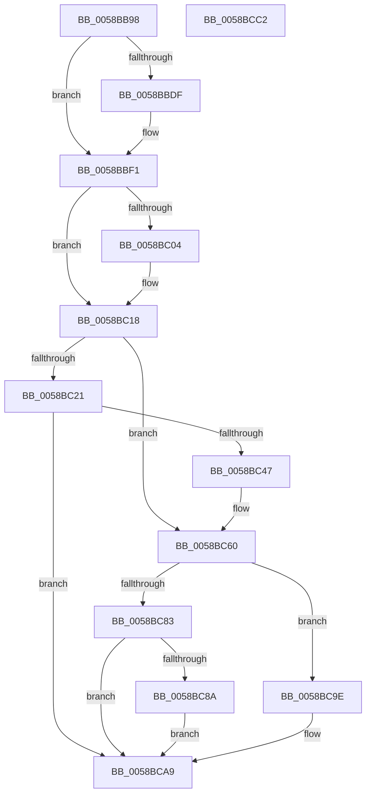

# HvlpGetEncryptedDataFromSecureKernel

- RVA: `0x0058BB98`–`0x0058BCC3` (길이 `299` bytes)
- VA: `0x000000014058BB98`
- 실행 섹션: `.text`
- PDB 이름 있음: `예`; PDB Function 태그: `아니요`
- unwind 정보 RVA: `0x00093E28`
- 디코드: `82`개 명령, `299/299` bytes 표시
- 미해석 바이트: `0` (있으면 어셈블리에 `.byte`로 보존)

> 이 문서는 커널 이미지의 기계어와 PDB 기호를 분석해 생성했습니다. 4번과 5번은 함수 원형과 자료형을 바이너리 사용 방식에서 추정한 C 해석이며 원본 소스 복구 결과는 아닙니다.

## 1. Dependencies

- 직접 호출 지점: **4**; 고유 호출 대상: **3**
- 직접 호출자로 확인된 함수: **1**
- RIP 상대 이미지 참조: **8**

### Outgoing calls
- `0x0058BC0C` → [HvlpEndSecurePageListIteration](HvlpEndSecurePageListIteration_function_0058D610.md) (function, `0x0058D610`)
- `0x0058BC3E` → [HvlpStartSecurePageListIteration](HvlpStartSecurePageListIteration_function_0058D908.md) (function, `0x0058D908`)
- `0x0058BC7A` → [VslGetSecurePageList](VslGetSecurePageList_function_0058E504.md) (function, `0x0058E504`)
- `0x0058BC92` → [HvlpEndSecurePageListIteration](HvlpEndSecurePageListIteration_function_0058D610.md) (function, `0x0058D610`)

### Direct callers
- [HvlGetEncryptedData](HvlGetEncryptedData_function_0058B6D0.md) at `0x0058B6F5`

### Static image references
- `0x0058BBBF` → RVA `0x00F8ECAE` (`.data`; read)
- `0x0058BBCD` → RVA `0x00FC6A90` (`ALMOSTRO`; read)
- `0x0058BBDF` → RVA `0x00F8ECAD` (`.data`; read)
- `0x0058BBFC` → RVA `0x00F8EDC3` (`.data`; read)
- `0x0058BC11` → RVA `0x00F8EDC0` (`.data`; write)
- `0x0058BC18` → RVA `0x00F8EDC0` (`.data`; read)
- `0x0058BC4C` → RVA `0x00F8EDE8` (`.data`; write)
- `0x0058BC5A` → RVA `0x00F8EDC3` (`.data`; write)

## 2. Other-region calls and transfers

- 다른 실행 섹션으로 향하는 call: **0**
- 별도 외부 분기/꼬리 이동을 확인하지 못했습니다.

## 3. Assembly (complete function range)

```asm
0058BB98  48 8B C4                        mov rax, rsp
0058BB9B  48 89 58 08                     mov qword ptr [rax + 8], rbx
0058BB9F  48 89 68 10                     mov qword ptr [rax + 0x10], rbp
0058BBA3  48 89 70 18                     mov qword ptr [rax + 0x18], rsi
0058BBA7  57                              push rdi
0058BBA8  41 56                           push r14
0058BBAA  41 57                           push r15
0058BBAC  48 83 EC 40                     sub rsp, 0x40
0058BBB0  48 83 60 E0 00                  and qword ptr [rax - 0x20], 0
0058BBB5  49 8B E9                        mov rbp, r9
0058BBB8  83 60 D8 00                     and dword ptr [rax - 0x28], 0
0058BBBC  45 8B F0                        mov r14d, r8d
0058BBBF  8A 05 E9 30 A0 00               mov al, byte ptr [rip + 0xa030e9]
0058BBC5  4C 8B FA                        mov r15, rdx
0058BBC8  F6 D8                           neg al
0058BBCA  48 8B F1                        mov rsi, rcx
0058BBCD  8B 05 BD AE A3 00               mov eax, dword ptr [rip + 0xa3aebd]
0058BBD3  1A DB                           sbb bl, bl
0058BBD5  80 E3 F1                        and bl, 0xf1
0058BBD8  80 C3 10                        add bl, 0x10
0058BBDB  A8 02                           test al, 2
0058BBDD  74 12                           je 0x14058bbf1
0058BBDF  8A 05 C8 30 A0 00               mov al, byte ptr [rip + 0xa030c8]
0058BBE5  F6 D8                           neg al
0058BBE7  1A C9                           sbb cl, cl
0058BBE9  80 E1 FA                        and cl, 0xfa
0058BBEC  80 C1 08                        add cl, 8
0058BBEF  0A D9                           or bl, cl
0058BBF1  48 8B BC 24 80 00 00 00         mov rdi, qword ptr [rsp + 0x80]
0058BBF9  83 27 00                        and dword ptr [rdi], 0
0058BBFC  38 1D C1 31 A0 00               cmp byte ptr [rip + 0xa031c1], bl
0058BC02  74 14                           je 0x14058bc18
0058BC04  33 D2                           xor edx, edx
0058BC06  45 33 C0                        xor r8d, r8d
0058BC09  8D 4A 01                        lea ecx, [rdx + 1]
0058BC0C  E8 FF 19 00 00                  call 0x14058d610
0058BC11  C6 05 A8 31 A0 00 00            mov byte ptr [rip + 0xa031a8], 0
0058BC18  80 3D A1 31 A0 00 00            cmp byte ptr [rip + 0xa031a1], 0
0058BC1F  75 3F                           jne 0x14058bc60
0058BC21  48 8D 44 24 38                  lea rax, [rsp + 0x38]
0058BC26  0F B6 D3                        movzx edx, bl
0058BC29  48 89 44 24 28                  mov qword ptr [rsp + 0x28], rax
0058BC2E  4C 8B CD                        mov r9, rbp
0058BC31  4D 8B C7                        mov r8, r15
0058BC34  44 89 74 24 20                  mov dword ptr [rsp + 0x20], r14d
0058BC39  B9 01 00 00 00                  mov ecx, 1
0058BC3E  E8 C5 1C 00 00                  call 0x14058d908
0058BC43  85 C0                           test eax, eax
0058BC45  78 62                           js 0x14058bca9
0058BC47  48 8B 44 24 38                  mov rax, qword ptr [rsp + 0x38]
0058BC4C  48 89 05 95 31 A0 00            mov qword ptr [rip + 0xa03195], rax
0058BC53  C6 05 66 31 A0 00 01            mov byte ptr [rip + 0xa03166], 1
0058BC5A  88 1D 63 31 A0 00               mov byte ptr [rip + 0xa03163], bl
0058BC60  4C 8D 8C 24 80 00 00 00         lea r9, [rsp + 0x80]
0058BC68  C6 84 24 80 00 00 00 00         mov byte ptr [rsp + 0x80], 0
0058BC70  4C 8D 44 24 30                  lea r8, [rsp + 0x30]
0058BC75  48 8B D6                        mov rdx, rsi
0058BC78  33 C9                           xor ecx, ecx
0058BC7A  E8 85 28 00 00                  call 0x14058e504
0058BC7F  85 C0                           test eax, eax
0058BC81  79 1B                           jns 0x14058bc9e
0058BC83  3D 1A 00 00 80                  cmp eax, 0x8000001a
0058BC88  75 1F                           jne 0x14058bca9
0058BC8A  33 D2                           xor edx, edx
0058BC8C  45 33 C0                        xor r8d, r8d
0058BC8F  8D 4A 01                        lea ecx, [rdx + 1]
0058BC92  E8 79 19 00 00                  call 0x14058d610
0058BC97  B8 25 02 00 C0                  mov eax, 0xc0000225
0058BC9C  EB 0B                           jmp 0x14058bca9
0058BC9E  8B 44 24 30                     mov eax, dword ptr [rsp + 0x30]
0058BCA2  C1 E0 0C                        shl eax, 0xc
0058BCA5  89 07                           mov dword ptr [rdi], eax
0058BCA7  33 C0                           xor eax, eax
0058BCA9  48 8B 5C 24 60                  mov rbx, qword ptr [rsp + 0x60]
0058BCAE  48 8B 6C 24 68                  mov rbp, qword ptr [rsp + 0x68]
0058BCB3  48 8B 74 24 70                  mov rsi, qword ptr [rsp + 0x70]
0058BCB8  48 83 C4 40                     add rsp, 0x40
0058BCBC  41 5F                           pop r15
0058BCBE  41 5E                           pop r14
0058BCC0  5F                              pop rdi
0058BCC1  C3                              ret
0058BCC2  CC                              int3
```

## 4. C-style interpretation (structured pseudocode)

```c
__int64 __fastcall HvlpGetEncryptedDataFromSecureKernel(__int64 a1, __int64 a2, int a3, __int64 a4, __int64 a5)
{
    __int64 result;
    __int64 v_rbx;
    __int64 v_rsp;
    unsigned __int64 v_stack_m20;
    unsigned __int64 v_stack_m28;
    unsigned __int64 v_stack_m30;
    unsigned int v_stack_m38;
    unsigned __int64 v_stack_p10;
    unsigned __int64 v_stack_p18;
    unsigned __int8 v_stack_p28;
    unsigned __int64 v_stack_p8;

    *(unsigned __int64 *)(v_rsp + 8) = v_rbx;
    *(unsigned __int64 *)(v_rsp + 16) = v_rbp;
    *(unsigned __int64 *)(v_rsp + 24) = v_rsi;
    v_rsp = (v_rsp) - (64);
    result = (unsigned __int8)(-(*(unsigned __int8 *)(v_rip + 10498281)));
    v_rbx = (unsigned __int8)((v_rbx) & (241));
    v_rbx = (unsigned __int8)((v_rbx) + (16));
    result = (unsigned int)(*(unsigned int *)(v_rip + 10727101));
    if ((((unsigned __int8)((unsigned int)(*(unsigned int *)(v_rip + 10727101)))) & (2)) != 0) {
        result = *(unsigned __int8 *)(v_rip + 10498248);
        result = (unsigned __int8)(-(result));
        a1 = (unsigned __int8)((a1) & (250));
        a1 = (unsigned __int8)((a1) + (8));
        v_rbx = (unsigned __int8)((v_rbx) | ((unsigned __int8)(a1)));
    }
    if ((*(unsigned __int8 *)(v_rip + 10498497)) != ((unsigned __int8)(v_rbx))) {
        a2 = 0;
        a3 = 0;
        a1 = a2 + 1;
        result = HvlpEndSecurePageListIteration(a1, a2, a3, a4);
        *(unsigned __int8 *)(v_rip + 10498472) = 0;
    }
    if ((*(unsigned __int8 *)(v_rip + 10498465)) != 0) goto loc_0058BC60;
    v_stack_m30 = v_stack_m20;
    v_stack_m38 = (unsigned int)((unsigned int)(a3));
    result = HvlpStartSecurePageListIteration(1, (unsigned __int8)(v_rbx), 0, a4);
    if (sign_flag) goto loc_0058BCA9;
    *(unsigned __int64 *)(v_rip + 10498453) = v_stack_m20;
    *(unsigned __int8 *)(v_rip + 10498406) = 1;
    *(unsigned __int8 *)(v_rip + 10498403) = (unsigned __int8)(v_rbx);
loc_0058BC60:
    v_stack_p28 = 0;
    a1 = 0;
    result = VslGetSecurePageList(a1, a1, v_stack_m28, a5);
    if (!sign_flag) goto loc_0058BC9E;
    if (((unsigned int)(result)) != 0x8000001AULL) goto loc_0058BCA9;
    a2 = 0;
    a3 = 0;
    result = HvlpEndSecurePageListIteration(a2 + 1, a2, a3, a5);
    goto loc_0058BCA9;
loc_0058BC9E:
    result = (unsigned int)(((unsigned int)(v_stack_m28)) << (12));
    *(unsigned int *)(a5) = (unsigned int)(result);
    result = 0;
loc_0058BCA9:
    v_rsp = (v_rsp) + (64);
    return result;
}
```

## 5. (Beta) C Style

```c
int64_t HvlpGetEncryptedDataFromSecureKernel(int64_t Arg1, int64_t Arg2, int32_t Arg3, int64_t Arg4, void *Arg5)
{
    uint8_t *arg5 = (uint8_t *)Arg5;

    int64_t result;
    int64_t local_rbx;
    int64_t local_rsp;
    uint64_t v_stack_m20;
    uint64_t v_stack_m28;
    uint64_t v_stack_m30;
    uint32_t v_stack_m38;
    uint64_t v_stack_p10;
    uint64_t v_stack_p18;
    uint8_t v_stack_p28;
    uint64_t v_stack_p8;

    *(uint64_t *)(local_rsp + 0x8) = local_rbx;
    *(uint64_t *)(local_rsp + 0x10) = local_rbp;
    *(uint64_t *)(local_rsp + 0x18) = local_rsi;
    local_rsp = (local_rsp) - (64);
    result = (uint8_t)(-(*(uint8_t *)(v_rip + 0xA030E9)));
    local_rbx = (uint8_t)((local_rbx) & (241));
    local_rbx = (uint8_t)((local_rbx) + (16));
    result = (uint32_t)(*(uint32_t *)(v_rip + 0xA3AEBD));
    if ((((uint8_t)((uint32_t)(*(uint32_t *)(v_rip + 0xA3AEBD)))) & (2)) != 0) {
        result = *(uint8_t *)(v_rip + 0xA030C8);
        result = (uint8_t)(-(result));
        Arg1 = (uint8_t)((Arg1) & (250));
        Arg1 = (uint8_t)((Arg1) + (8));
        local_rbx = (uint8_t)((local_rbx) | ((uint8_t)(Arg1)));
    }
    if ((*(uint8_t *)(v_rip + 0xA031C1)) != ((uint8_t)(local_rbx))) {
        Arg2 = 0;
        Arg3 = 0;
        Arg1 = Arg2 + 1;
        result = HvlpEndSecurePageListIteration(Arg1, Arg2, Arg3, Arg4);
        *(uint8_t *)(v_rip + 0xA031A8) = 0;
    }
    if ((*(uint8_t *)(v_rip + 0xA031A1)) != 0) goto loc_0058BC60;
    v_stack_m30 = v_stack_m20;
    v_stack_m38 = (uint32_t)((uint32_t)(Arg3));
    result = HvlpStartSecurePageListIteration(1, (uint8_t)(local_rbx), 0, Arg4);
    if (sign_flag) goto loc_0058BCA9;
    *(uint64_t *)(v_rip + 0xA03195) = v_stack_m20;
    *(uint8_t *)(v_rip + 0xA03166) = 1;
    *(uint8_t *)(v_rip + 0xA03163) = (uint8_t)(local_rbx);
loc_0058BC60:
    v_stack_p28 = 0;
    Arg1 = 0;
    result = VslGetSecurePageList(Arg1, Arg1, v_stack_m28, Arg5);
    if (!sign_flag) goto loc_0058BC9E;
    if (((uint32_t)(result)) != 0x8000001AULL) goto loc_0058BCA9;
    Arg2 = 0;
    Arg3 = 0;
    result = HvlpEndSecurePageListIteration(Arg2 + 1, Arg2, Arg3, Arg5);
    goto loc_0058BCA9;
loc_0058BC9E:
    result = (uint32_t)(((uint32_t)(v_stack_m28)) << (12));
    *(uint32_t *)(arg5) = (uint32_t)(result);
    result = 0;
loc_0058BCA9:
    local_rsp = (local_rsp) + (64);
    return result;
}
```

### 관측된 메모리 오프셋

구조체 형식이 확인되지 않은 접근은 인자 기준의 오프셋으로만 기록했습니다.

| 기준 인자 | 오프셋 표현 | 폭 (bit) | 접근 |
|---|---:|---:|---|
| `Arg5` | `+ 0x0` | `32` | `R/W` |
| `Arg5` | `+ 0x0` | `32` | `W` |

## 6. Execution-region graph

[열기: 2D/3D 그래프와 함수 탐색 컨트롤 패널](../../../control-panel.html?section=text&rva=0x0058BB98&view=graph)

- 2D 그래프는 위에서 아래로 흐르고, 3D 그래프는 빈 공간을 드래그해 회전합니다. Shift+드래그는 이동, 휠은 확대·축소, 함수 노드 선택은 대상 보고서 이동입니다.

### Static fallback


