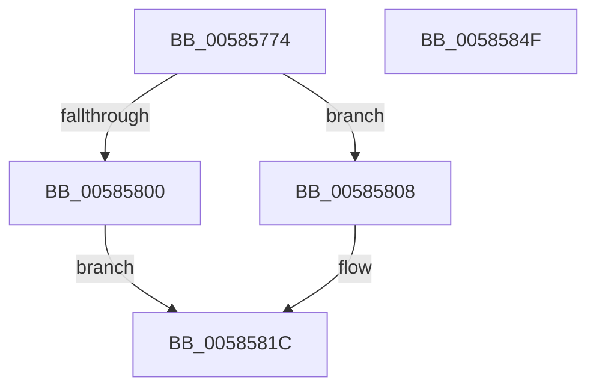

# HvlpGetLogicalProcessorProperty

- RVA: `0x00585774`–`0x00585850` (길이 `220` bytes)
- VA: `0x0000000140585774`
- 실행 섹션: `.text`
- PDB 이름 있음: `예`; PDB Function 태그: `아니요`
- unwind 정보 RVA: `0x00092598`
- 디코드: `64`개 명령, `220/220` bytes 표시
- 미해석 바이트: `0` (있으면 어셈블리에 `.byte`로 보존)

> 이 문서는 커널 이미지의 기계어와 PDB 기호를 분석해 생성했습니다. 4번과 5번은 함수 원형과 자료형을 바이너리 사용 방식에서 추정한 C 해석이며 원본 소스 복구 결과는 아닙니다.

## 1. Dependencies

- 직접 호출 지점: **5**; 고유 호출 대상: **3**
- 직접 호출자로 확인된 함수: **2**
- RIP 상대 이미지 참조: **0**

### Outgoing calls
- `0x005857C6` → [HvlpAcquireHypercallPage](../47/HvlpAcquireHypercallPage_function_00471410.md) (function, `0x00471410`)
- `0x005857DD` → [HvlpAcquireHypercallPage](../47/HvlpAcquireHypercallPage_function_00471410.md) (function, `0x00471410`)
- `0x005857F6` → [HvcallInitiateHypercall](../31/HvcallInitiateHypercall_function_00313630.md) (function, `0x00313630`)
- `0x00585820` → [HvlpReleaseHypercallPage](../31/HvlpReleaseHypercallPage_function_00313480.md) (function, `0x00313480`)
- `0x00585829` → [HvlpReleaseHypercallPage](../31/HvlpReleaseHypercallPage_function_00313480.md) (function, `0x00313480`)

### Direct callers
- [HvlLpGetLogicalProcessorHwId](HvlLpGetLogicalProcessorHwId_function_00588840.md) at `0x00588860`
- [HvlLpGetMachineCheckContext](HvlLpGetMachineCheckContext_function_00588890.md) at `0x005888BA`

### Static image references
- 디코드된 RIP-relative 메모리 참조가 없습니다.

## 2. Other-region calls and transfers

- 다른 실행 섹션으로 향하는 call: **0**
- 별도 외부 분기/꼬리 이동을 확인하지 못했습니다.

## 3. Assembly (complete function range)

```asm
00585774  48 8B C4                        mov rax, rsp
00585777  48 89 58 08                     mov qword ptr [rax + 8], rbx
0058577B  48 89 70 10                     mov qword ptr [rax + 0x10], rsi
0058577F  48 89 78 18                     mov qword ptr [rax + 0x18], rdi
00585783  4C 89 60 20                     mov qword ptr [rax + 0x20], r12
00585787  55                              push rbp
00585788  41 56                           push r14
0058578A  41 57                           push r15
0058578C  48 8B EC                        mov rbp, rsp
0058578F  48 83 EC 60                     sub rsp, 0x60
00585793  33 C0                           xor eax, eax
00585795  0F 57 C0                        xorps xmm0, xmm0
00585798  4D 8B F8                        mov r15, r8
0058579B  48 89 45 F0                     mov qword ptr [rbp - 0x10], rax
0058579F  8B F2                           mov esi, edx
005857A1  89 45 F8                        mov dword ptr [rbp - 8], eax
005857A4  8B F9                           mov edi, ecx
005857A6  48 89 45 D0                     mov qword ptr [rbp - 0x30], rax
005857AA  44 8D 48 08                     lea r9d, [rax + 8]
005857AE  89 45 D8                        mov dword ptr [rbp - 0x28], eax
005857B1  8D 50 01                        lea edx, [rax + 1]
005857B4  45 33 C0                        xor r8d, r8d
005857B7  48 8D 4D E0                     lea rcx, [rbp - 0x20]
005857BB  45 33 F6                        xor r14d, r14d
005857BE  0F 11 45 E0                     movups xmmword ptr [rbp - 0x20], xmm0
005857C2  0F 11 45 C0                     movups xmmword ptr [rbp - 0x40], xmm0
005857C6  E8 45 BC EE FF                  call 0x140471410
005857CB  45 8D 4E 20                     lea r9d, [r14 + 0x20]
005857CF  45 33 C0                        xor r8d, r8d
005857D2  41 8D 56 02                     lea edx, [r14 + 2]
005857D6  48 8B D8                        mov rbx, rax
005857D9  48 8D 4D C0                     lea rcx, [rbp - 0x40]
005857DD  E8 2E BC EE FF                  call 0x140471410
005857E2  4C 8B 45 D8                     mov r8, qword ptr [rbp - 0x28]
005857E6  41 8D 4E 7A                     lea ecx, [r14 + 0x7a]
005857EA  48 8B 55 F8                     mov rdx, qword ptr [rbp - 8]
005857EE  4C 8B E0                        mov r12, rax
005857F1  89 3B                           mov dword ptr [rbx], edi
005857F3  89 73 04                        mov dword ptr [rbx + 4], esi
005857F6  E8 35 DE D8 FF                  call 0x140313630
005857FB  66 85 C0                        test ax, ax
005857FE  74 08                           je 0x140585808
00585800  41 BE 01 00 00 C0               mov r14d, 0xc0000001
00585806  EB 14                           jmp 0x14058581c
00585808  41 0F 10 04 24                  movups xmm0, xmmword ptr [r12]
0058580D  41 0F 10 4C 24 10               movups xmm1, xmmword ptr [r12 + 0x10]
00585813  41 0F 11 07                     movups xmmword ptr [r15], xmm0
00585817  41 0F 11 4F 10                  movups xmmword ptr [r15 + 0x10], xmm1
0058581C  48 8D 4D C0                     lea rcx, [rbp - 0x40]
00585820  E8 5B DC D8 FF                  call 0x140313480
00585825  48 8D 4D E0                     lea rcx, [rbp - 0x20]
00585829  E8 52 DC D8 FF                  call 0x140313480
0058582E  4C 8D 5C 24 60                  lea r11, [rsp + 0x60]
00585833  41 8B C6                        mov eax, r14d
00585836  49 8B 5B 20                     mov rbx, qword ptr [r11 + 0x20]
0058583A  49 8B 73 28                     mov rsi, qword ptr [r11 + 0x28]
0058583E  49 8B 7B 30                     mov rdi, qword ptr [r11 + 0x30]
00585842  4D 8B 63 38                     mov r12, qword ptr [r11 + 0x38]
00585846  49 8B E3                        mov rsp, r11
00585849  41 5F                           pop r15
0058584B  41 5E                           pop r14
0058584D  5D                              pop rbp
0058584E  C3                              ret
0058584F  CC                              int3
```

## 4. C-style interpretation (structured pseudocode)

```c
__int64 __fastcall HvlpGetLogicalProcessorProperty(int a1, int a2, __int64 a3)
{
    __int64 result;
    __int64 v_r14;
    __int64 v_rsp;
    unsigned __int64 v_stack_m18;
    unsigned int v_stack_m20;
    unsigned __int64 v_stack_m28;
    unsigned __int64 v_stack_m38;
    unsigned int v_stack_m40;
    unsigned __int64 v_stack_m48;
    unsigned __int64 v_stack_m58;

    *(unsigned __int64 *)(v_rsp + 8) = v_rbx;
    *(unsigned __int64 *)(v_rsp + 16) = v_rsi;
    *(unsigned __int64 *)(v_rsp + 24) = v_rdi;
    *(unsigned __int64 *)(v_rsp + 32) = v_r12;
    v_rsp = (v_rsp) - (96);
    result = 0;
    v_stack_m28 = 0;
    v_stack_m20 = 0;
    v_stack_m48 = 0;
    v_stack_m40 = 0;
    a3 = 0;
    v_r14 = 0;
    v_stack_m38 = v_xmm0;
    v_stack_m58 = v_xmm0;
    result = HvlpAcquireHypercallPage(v_stack_m38, result + 1, a3, result + 8);
    a3 = 0;
    result = HvlpAcquireHypercallPage(v_stack_m58, v_r14 + 2, a3, v_r14 + 32);
    *(unsigned int *)(result) = (unsigned int)((unsigned int)(a1));
    *(unsigned int *)(result + 4) = (unsigned int)((unsigned int)(a2));
    result = HvcallInitiateHypercall(v_r14 + 122, v_stack_m20, v_stack_m40, v_r14 + 32);
    if ((unsigned __int16)(result) == 0) goto loc_00585808;
    goto loc_0058581C;
loc_00585808:
    *(unsigned __int64 *)(a3) = v_xmm0;
    *(unsigned __int64 *)(a3 + 16) = v_xmm1;
loc_0058581C:
    result = HvlpReleaseHypercallPage(v_stack_m58, v_stack_m20, v_stack_m40, v_r14 + 32);
    result = HvlpReleaseHypercallPage(v_stack_m38, v_stack_m20, v_stack_m40, v_r14 + 32);
    return (unsigned int)((unsigned int)((unsigned int)(0xC0000001ULL)));
}
```

## 5. (Beta) C Style

```c
int64_t HvlpGetLogicalProcessorProperty(int32_t Arg1, int32_t Arg2, void *Arg3)
{
    uint8_t *arg3 = (uint8_t *)Arg3;

    int64_t result;
    int64_t local_r14;
    int64_t local_rsp;
    uint64_t v_stack_m18;
    uint32_t v_stack_m20;
    uint64_t v_stack_m28;
    uint64_t v_stack_m38;
    uint32_t v_stack_m40;
    uint64_t v_stack_m48;
    uint64_t v_stack_m58;

    *(uint64_t *)(local_rsp + 0x8) = local_rbx;
    *(uint64_t *)(local_rsp + 0x10) = local_rsi;
    *(uint64_t *)(local_rsp + 0x18) = local_rdi;
    *(uint64_t *)(local_rsp + 0x20) = local_r12;
    local_rsp = (local_rsp) - (96);
    result = 0;
    v_stack_m28 = 0;
    v_stack_m20 = 0;
    v_stack_m48 = 0;
    v_stack_m40 = 0;
    Arg3 = 0;
    local_r14 = 0;
    v_stack_m38 = v_xmm0;
    v_stack_m58 = v_xmm0;
    result = HvlpAcquireHypercallPage(v_stack_m38, result + 1, Arg3, result + 8);
    Arg3 = 0;
    result = HvlpAcquireHypercallPage(v_stack_m58, local_r14 + 2, Arg3, local_r14 + 32);
    *(uint32_t *)(result) = (uint32_t)((uint32_t)(Arg1));
    *(uint32_t *)(result + 0x4) = (uint32_t)((uint32_t)(Arg2));
    result = HvcallInitiateHypercall(local_r14 + 122, v_stack_m20, v_stack_m40, local_r14 + 32);
    if ((uint16_t)(result) == 0) goto loc_00585808;
    goto loc_0058581C;
loc_00585808:
    *(uint64_t *)(arg3) = v_xmm0;
    *(uint64_t *)(arg3 + 0x10) = v_xmm1;
loc_0058581C:
    result = HvlpReleaseHypercallPage(v_stack_m58, v_stack_m20, v_stack_m40, local_r14 + 32);
    result = HvlpReleaseHypercallPage(v_stack_m38, v_stack_m20, v_stack_m40, local_r14 + 32);
    return (uint32_t)((uint32_t)((uint32_t)(0xC0000001ULL)));
}
```

### 관측된 메모리 오프셋

구조체 형식이 확인되지 않은 접근은 인자 기준의 오프셋으로만 기록했습니다.

| 기준 인자 | 오프셋 표현 | 폭 (bit) | 접근 |
|---|---:|---:|---|
| `Arg3` | `+ 0x0` | `128` | `R` |
| `Arg3` | `+ 0x10` | `128` | `R` |

## 6. Execution-region graph

[열기: 2D/3D 그래프와 함수 탐색 컨트롤 패널](../../../control-panel.html?section=text&rva=0x00585774&view=graph)

- 2D 그래프는 위에서 아래로 흐르고, 3D 그래프는 빈 공간을 드래그해 회전합니다. Shift+드래그는 이동, 휠은 확대·축소, 함수 노드 선택은 대상 보고서 이동입니다.

### Static fallback


