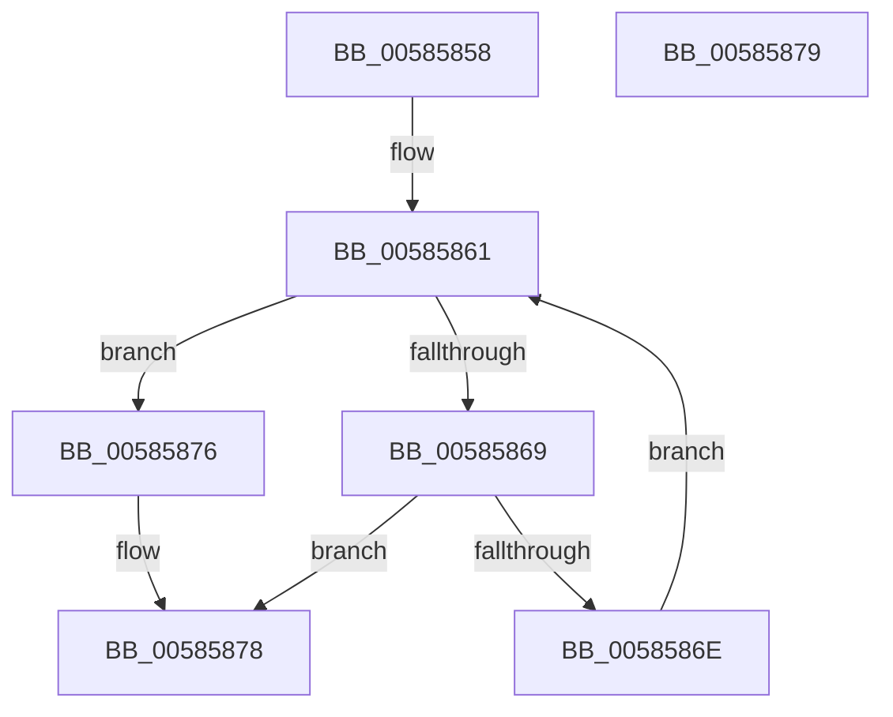

# HvlpGetLpcbByApicId

- RVA: `0x00585858`–`0x0058587A` (길이 `34` bytes)
- VA: `0x0000000140585858`
- 실행 섹션: `.text`
- PDB 이름 있음: `예`; PDB Function 태그: `예`
- unwind 정보 RVA: `0x000DB714`
- 디코드: `12`개 명령, `34/34` bytes 표시
- 미해석 바이트: `0` (있으면 어셈블리에 `.byte`로 보존)

> 이 문서는 커널 이미지의 기계어와 PDB 기호를 분석해 생성했습니다. 4번과 5번은 함수 원형과 자료형을 바이너리 사용 방식에서 추정한 C 해석이며 원본 소스 복구 결과는 아닙니다.

## 1. Dependencies

- 직접 호출 지점: **0**; 고유 호출 대상: **0**
- 직접 호출자로 확인된 함수: **4**
- RIP 상대 이미지 참조: **2**

### Outgoing calls
- 직접 디코드된 call 명령이 없습니다.

### Direct callers
- [HvlGetLpIndexFromApicId](HvlGetLpIndexFromApicId_function_00584640.md) at `0x0058464E`
- [HvlStartBootLogicalProcessors](HvlStartBootLogicalProcessors_function_00584E18.md) at `0x005850A0`
- [KiQueryProcessorNode](../5B/KiQueryProcessorNode_function_005BCC70.md) at `0x005BCD9E`
- [HvlInitializeProcessor](../../page/71/HvlInitializeProcessor_function_0071804C.md) at `0x0071808D`

### Static image references
- `0x00585858` → RVA `0x00FC6C40` (`ALMOSTRO`; read)
- `0x00585861` → RVA `0x00FC6BA0` (`ALMOSTRO`; read)

## 2. Other-region calls and transfers

- 다른 실행 섹션으로 향하는 call: **0**
- 별도 외부 분기/꼬리 이동을 확인하지 못했습니다.

## 3. Assembly (complete function range)

```asm
00585858  48 8B 05 E1 13 A4 00            mov rax, qword ptr [rip + 0xa413e1]
0058585F  33 D2                           xor edx, edx
00585861  3B 15 39 13 A4 00               cmp edx, dword ptr [rip + 0xa41339]
00585867  73 0D                           jae 0x140585876
00585869  39 48 08                        cmp dword ptr [rax + 8], ecx
0058586C  74 0A                           je 0x140585878
0058586E  FF C2                           inc edx
00585870  48 83 C0 68                     add rax, 0x68
00585874  EB EB                           jmp 0x140585861
00585876  33 C0                           xor eax, eax
00585878  C3                              ret
00585879  CC                              int3
```

## 4. C-style interpretation (structured pseudocode)

```c
__int64 __fastcall HvlpGetLpcbByApicId(int a1, int a2)
{
    __int64 result;

    a2 = 0;
loc_00585861:
    if (0 >= (*(unsigned int *)(v_rip + 10752825))) goto loc_00585876;
    if ((*(unsigned int *)(*(unsigned __int64 *)(v_rip + 10752993) + 8)) == a1) goto loc_00585878;
    a2 = (unsigned int)((a2) + 1);
    result = (*(unsigned __int64 *)(v_rip + 10752993)) + (104);
    goto loc_00585861;
loc_00585876:
    result = 0;
loc_00585878:
    return result;
}
```

## 5. (Beta) C Style

```c
int64_t HvlpGetLpcbByApicId(int32_t Arg1, int32_t Arg2)
{
    int64_t result;

    Arg2 = 0;
loc_00585861:
    if (0 >= (*(uint32_t *)(v_rip + 0xA41339))) goto loc_00585876;
    if ((*(uint32_t *)(*(uint64_t *)(v_rip + 0xA413E1) + 0x8)) == Arg1) goto loc_00585878;
    Arg2 = (uint32_t)((Arg2) + 1);
    result = (*(uint64_t *)(v_rip + 0xA413E1)) + (104);
    goto loc_00585861;
loc_00585876:
    result = 0;
loc_00585878:
    return result;
}
```

## 6. Execution-region graph

[열기: 2D/3D 그래프와 함수 탐색 컨트롤 패널](../../../control-panel.html?section=text&rva=0x00585858&view=graph)

- 2D 그래프는 위에서 아래로 흐르고, 3D 그래프는 빈 공간을 드래그해 회전합니다. Shift+드래그는 이동, 휠은 확대·축소, 함수 노드 선택은 대상 보고서 이동입니다.

### Static fallback


