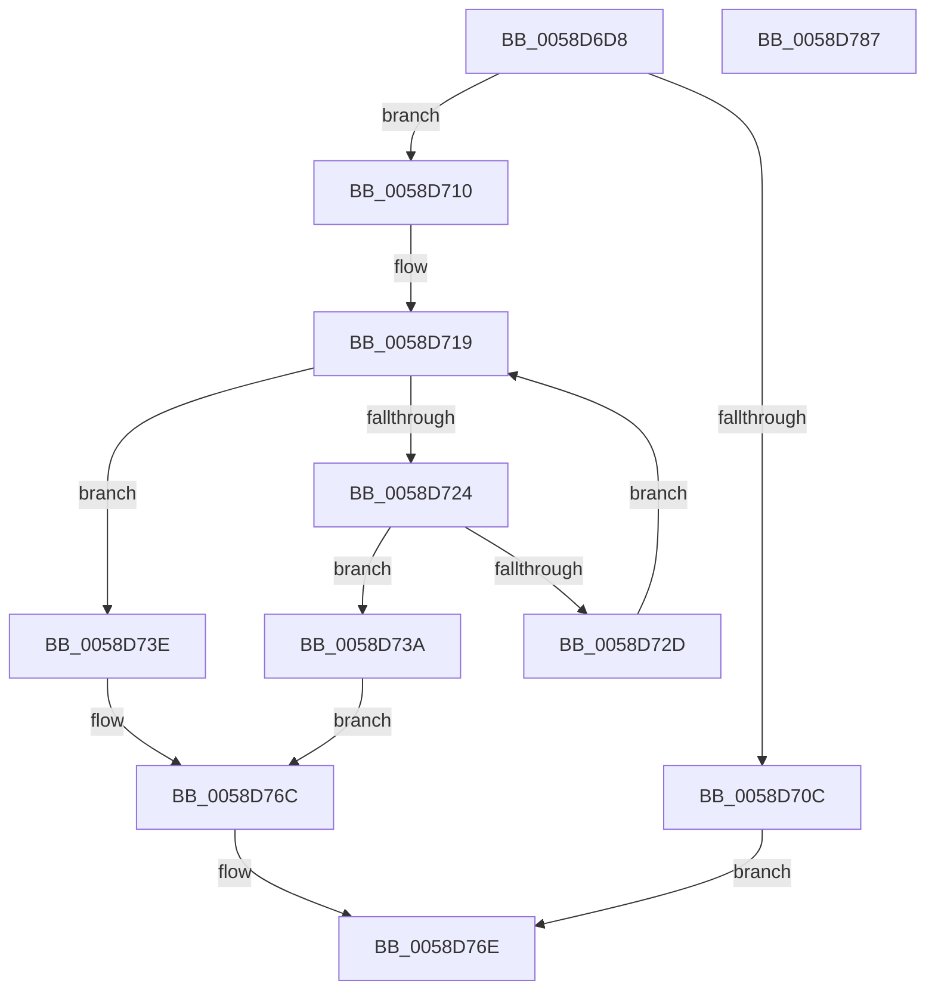

# HvlpGetPageList

- RVA: `0x0058D6D8`–`0x0058D788` (길이 `176` bytes)
- VA: `0x000000014058D6D8`
- 실행 섹션: `.text`
- PDB 이름 있음: `예`; PDB Function 태그: `아니요`
- unwind 정보 RVA: `0x00060300`
- 디코드: `53`개 명령, `176/176` bytes 표시
- 미해석 바이트: `0` (있으면 어셈블리에 `.byte`로 보존)

> 이 문서는 커널 이미지의 기계어와 PDB 기호를 분석해 생성했습니다. 4번과 5번은 함수 원형과 자료형을 바이너리 사용 방식에서 추정한 C 해석이며 원본 소스 복구 결과는 아닙니다.

## 1. Dependencies

- 직접 호출 지점: **2**; 고유 호출 대상: **2**
- 직접 호출자로 확인된 함수: **3**
- RIP 상대 이미지 참조: **0**

### Outgoing calls
- `0x0058D6FE` → [HvlpGetPageListIterator](HvlpGetPageListIterator_function_0058D790.md) (function, `0x0058D790`)
- `0x0058D730` → [HvlpInvokeGetPageListHypercall](HvlpInvokeGetPageListHypercall_function_0058D7AC.md) (function, `0x0058D7AC`)

### Direct callers
- [HvlpMarkHypervisorPagesForHibernation](HvlpMarkHypervisorPagesForHibernation_function_0058AE08.md) at `0x0058AE32`
- [HvlAddPagesCallbackRoutine](HvlAddPagesCallbackRoutine_function_0058AF50.md) at `0x0058B003`
- [HvlpGetEncryptedDataFromHypervisor](HvlpGetEncryptedDataFromHypervisor_function_0058B984.md) at `0x0058BA30`

### Static image references
- 디코드된 RIP-relative 메모리 참조가 없습니다.

## 2. Other-region calls and transfers

- 다른 실행 섹션으로 향하는 call: **0**
- 별도 외부 분기/꼬리 이동을 확인하지 못했습니다.

## 3. Assembly (complete function range)

```asm
0058D6D8  48 89 5C 24 08                  mov qword ptr [rsp + 8], rbx
0058D6DD  48 89 6C 24 10                  mov qword ptr [rsp + 0x10], rbp
0058D6E2  48 89 74 24 18                  mov qword ptr [rsp + 0x18], rsi
0058D6E7  57                              push rdi
0058D6E8  41 56                           push r14
0058D6EA  41 57                           push r15
0058D6EC  48 83 EC 20                     sub rsp, 0x20
0058D6F0  33 ED                           xor ebp, ebp
0058D6F2  4D 8B F0                        mov r14, r8
0058D6F5  48 89 2A                        mov qword ptr [rdx], rbp
0058D6F8  4C 8B FA                        mov r15, rdx
0058D6FB  41 89 28                        mov dword ptr [r8], ebp
0058D6FE  E8 8D 00 00 00                  call 0x14058d790
0058D703  48 8B D8                        mov rbx, rax
0058D706  40 38 68 02                     cmp byte ptr [rax + 2], bpl
0058D70A  75 04                           jne 0x14058d710
0058D70C  33 C0                           xor eax, eax
0058D70E  EB 5E                           jmp 0x14058d76e
0058D710  48 8B 70 08                     mov rsi, qword ptr [rax + 8]
0058D714  BF 05 01 00 00                  mov edi, 0x105
0058D719  44 0F B7 03                     movzx r8d, word ptr [rbx]
0058D71D  66 44 3B 46 08                  cmp r8w, word ptr [rsi + 8]
0058D722  72 1A                           jb 0x14058d73e
0058D724  48 8B 16                        mov rdx, qword ptr [rsi]
0058D727  48 83 FA FF                     cmp rdx, -1
0058D72B  74 0D                           je 0x14058d73a
0058D72D  48 8B CB                        mov rcx, rbx
0058D730  E8 77 00 00 00                  call 0x14058d7ac
0058D735  66 89 2B                        mov word ptr [rbx], bp
0058D738  EB DF                           jmp 0x14058d719
0058D73A  8B FD                           mov edi, ebp
0058D73C  EB 2E                           jmp 0x14058d76c
0058D73E  4A 8B 54 C6 10                  mov rdx, qword ptr [rsi + r8*8 + 0x10]
0058D743  48 B8 FF FF FF FF FF 00 00 00   movabs rax, 0xffffffffff
0058D74D  48 8B CA                        mov rcx, rdx
0058D750  48 C1 EA 28                     shr rdx, 0x28
0058D754  48 23 C8                        and rcx, rax
0058D757  B8 01 00 00 00                  mov eax, 1
0058D75C  03 D0                           add edx, eax
0058D75E  49 89 0F                        mov qword ptr [r15], rcx
0058D761  66 44 03 C0                     add r8w, ax
0058D765  41 89 16                        mov dword ptr [r14], edx
0058D768  66 44 89 03                     mov word ptr [rbx], r8w
0058D76C  8B C7                           mov eax, edi
0058D76E  48 8B 5C 24 40                  mov rbx, qword ptr [rsp + 0x40]
0058D773  48 8B 6C 24 48                  mov rbp, qword ptr [rsp + 0x48]
0058D778  48 8B 74 24 50                  mov rsi, qword ptr [rsp + 0x50]
0058D77D  48 83 C4 20                     add rsp, 0x20
0058D781  41 5F                           pop r15
0058D783  41 5E                           pop r14
0058D785  5F                              pop rdi
0058D786  C3                              ret
0058D787  CC                              int3
```

## 4. C-style interpretation (structured pseudocode)

```c
__int64 __fastcall HvlpGetPageList(__int64 a1, __int64 a2, __int64 a3)
{
    __int64 result;
    __int64 v_rbp;
    __int64 v_rsp;
    unsigned __int64 v_stack_p10;
    unsigned __int64 v_stack_p18;
    unsigned __int64 v_stack_p8;

    v_stack_p8 = v_rbx;
    v_stack_p10 = v_rbp;
    v_stack_p18 = v_rsi;
    v_rsp = (v_rsp) - (32);
    v_rbp = 0;
    *(unsigned __int64 *)(a2) = 0;
    *(unsigned int *)(a3) = 0;
    result = HvlpGetPageListIterator(a1, a2, a3, a4);
    if ((*(unsigned __int8 *)(result + 2)) != 0) goto loc_0058D710;
    result = 0;
    goto loc_0058D76E;
loc_0058D710:
loc_0058D719:
    if (((unsigned __int16)(*(unsigned __int16 *)(result))) < (*(unsigned __int16 *)(*(unsigned __int64 *)(result + 8) + 8))) goto loc_0058D73E;
    if ((*(unsigned __int64 *)(*(unsigned __int64 *)(result + 8))) == -1) goto loc_0058D73A;
    result = HvlpInvokeGetPageListHypercall(0, *(unsigned __int64 *)(*(unsigned __int64 *)(result + 8)), *(unsigned __int16 *)(result), a4);
    *(unsigned __int16 *)(result) = 0;
    goto loc_0058D719;
loc_0058D73A:
    goto loc_0058D76C;
loc_0058D73E:
    a2 = (*(unsigned __int64 *)(*(unsigned __int64 *)(result + 8) + *(unsigned __int16 *)(result) * 8 + 16)) >> (40);
    a1 = (*(unsigned __int64 *)(*(unsigned __int64 *)(result + 8) + *(unsigned __int16 *)(result) * 8 + 16)) & (result);
    a2 = (unsigned int)((a2) + (1));
    *(unsigned __int64 *)(a2) = a1;
    a3 = (unsigned __int16)((*(unsigned __int16 *)(result)) + (1));
    *(unsigned int *)(a3) = (unsigned int)(a2);
    *(unsigned __int16 *)(result) = (unsigned __int16)(a3);
loc_0058D76C:
loc_0058D76E:
    v_rsp = (v_rsp) + (32);
    return 0;
}
```

## 5. (Beta) C Style

```c
int64_t HvlpGetPageList(int64_t Arg1, void *Arg2, void *Arg3)
{
    uint8_t *arg2 = (uint8_t *)Arg2;
    uint8_t *arg3 = (uint8_t *)Arg3;

    int64_t result;
    int64_t local_rbp;
    int64_t local_rsp;
    uint64_t v_stack_p10;
    uint64_t v_stack_p18;
    uint64_t v_stack_p8;

    v_stack_p8 = local_rbx;
    v_stack_p10 = local_rbp;
    v_stack_p18 = local_rsi;
    local_rsp = (local_rsp) - (32);
    local_rbp = 0;
    *(uint64_t *)(arg2) = 0;
    *(uint32_t *)(arg3) = 0;
    result = HvlpGetPageListIterator(Arg1, Arg2, Arg3, a4);
    if ((*(uint8_t *)(result + 0x2)) != 0) goto loc_0058D710;
    result = 0;
    goto loc_0058D76E;
loc_0058D710:
loc_0058D719:
    if (((uint16_t)(*(uint16_t *)(result))) < (*(uint16_t *)(*(uint64_t *)(result + 0x8) + 0x8))) goto loc_0058D73E;
    if ((*(uint64_t *)(*(uint64_t *)(result + 0x8))) == -1) goto loc_0058D73A;
    result = HvlpInvokeGetPageListHypercall(0, *(uint64_t *)(*(uint64_t *)(result + 0x8)), *(uint16_t *)(result), a4);
    *(uint16_t *)(result) = 0;
    goto loc_0058D719;
loc_0058D73A:
    goto loc_0058D76C;
loc_0058D73E:
    Arg2 = (*(uint64_t *)(*(uint64_t *)(result + 0x8) + *(uint16_t *)(result) * 8 + 0x10)) >> (40);
    Arg1 = (*(uint64_t *)(*(uint64_t *)(result + 0x8) + *(uint16_t *)(result) * 8 + 0x10)) & (result);
    Arg2 = (uint32_t)((Arg2) + (1));
    *(uint64_t *)(arg2) = Arg1;
    Arg3 = (uint16_t)((*(uint16_t *)(result)) + (1));
    *(uint32_t *)(arg3) = (uint32_t)(Arg2);
    *(uint16_t *)(result) = (uint16_t)(Arg3);
loc_0058D76C:
loc_0058D76E:
    local_rsp = (local_rsp) + (32);
    return 0;
}
```

### 관측된 메모리 오프셋

구조체 형식이 확인되지 않은 접근은 인자 기준의 오프셋으로만 기록했습니다.

| 기준 인자 | 오프셋 표현 | 폭 (bit) | 접근 |
|---|---:|---:|---|
| `Arg2` | `+ 0x0` | `64` | `W` |
| `Arg3` | `+ 0x0` | `32` | `W` |

## 6. Execution-region graph

[열기: 2D/3D 그래프와 함수 탐색 컨트롤 패널](../../../control-panel.html?section=text&rva=0x0058D6D8&view=graph)

- 2D 그래프는 위에서 아래로 흐르고, 3D 그래프는 빈 공간을 드래그해 회전합니다. Shift+드래그는 이동, 휠은 확대·축소, 함수 노드 선택은 대상 보고서 이동입니다.

### Static fallback


