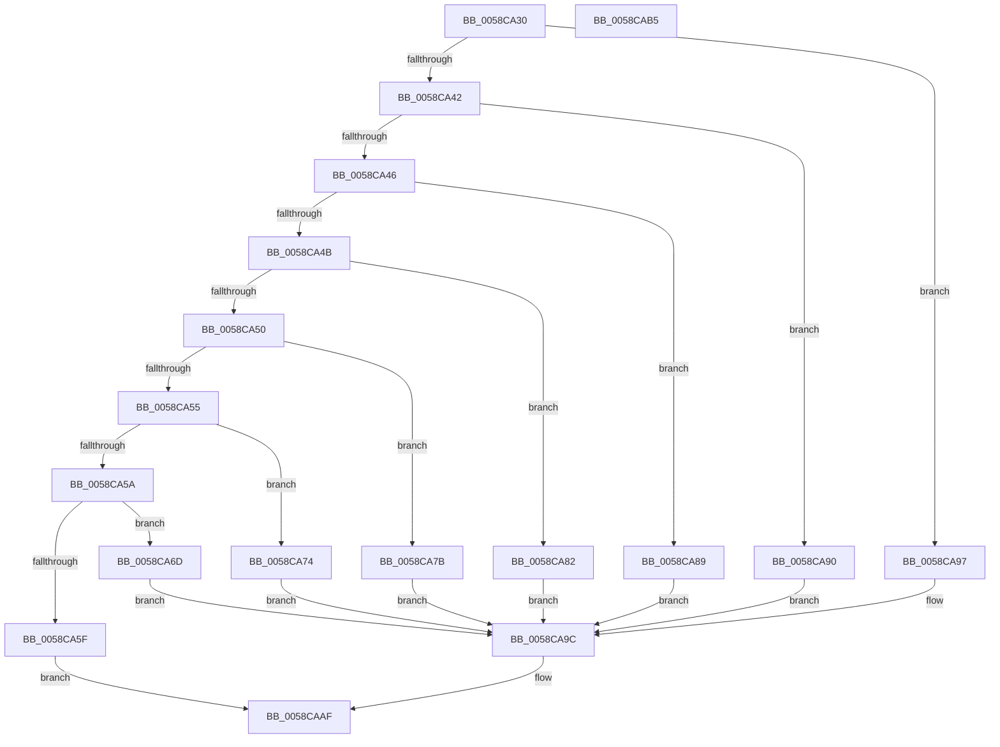

# HvlpGetRegister128

- RVA: `0x0058CA30`–`0x0058CAB6` (길이 `134` bytes)
- VA: `0x000000014058CA30`
- 실행 섹션: `.text`
- PDB 이름 있음: `예`; PDB Function 태그: `아니요`
- unwind 정보 RVA: `0x0005CF00`
- 디코드: `44`개 명령, `134/134` bytes 표시
- 미해석 바이트: `0` (있으면 어셈블리에 `.byte`로 보존)

> 이 문서는 커널 이미지의 기계어와 PDB 기호를 분석해 생성했습니다. 4번과 5번은 함수 원형과 자료형을 바이너리 사용 방식에서 추정한 C 해석이며 원본 소스 복구 결과는 아닙니다.

## 1. Dependencies

- 직접 호출 지점: **1**; 고유 호출 대상: **1**
- 직접 호출자로 확인된 함수: **2**
- RIP 상대 이미지 참조: **1**

### Outgoing calls
- `0x0058CA66` → [RtlRaiseException](../5E/RtlRaiseException_function_005E6B00.md) (function, `0x005E6B00`)

### Direct callers
- [HvlGetSystemPasidCapabilities](HvlGetSystemPasidCapabilities_function_00588520.md) at `0x005885E7`
- [HvlpDetermineEnlightenments](HvlpDetermineEnlightenments_function_0058CC9C.md) at `0x0058CF0A`

### Static image references
- `0x0058CA5F` → RVA `0x00E0A8C0` (`.data`; read)

## 2. Other-region calls and transfers

- 다른 실행 섹션으로 향하는 call: **0**
- 별도 외부 분기/꼬리 이동을 확인하지 못했습니다.

## 3. Assembly (complete function range)

```asm
0058CA30  40 53                           push rbx
0058CA32  48 83 EC 20                     sub rsp, 0x20
0058CA36  B8 00 01 00 00                  mov eax, 0x100
0058CA3B  4C 8B C2                        mov r8, rdx
0058CA3E  2B C8                           sub ecx, eax
0058CA40  74 55                           je 0x14058ca97
0058CA42  2B C8                           sub ecx, eax
0058CA44  74 4A                           je 0x14058ca90
0058CA46  83 E9 01                        sub ecx, 1
0058CA49  74 3E                           je 0x14058ca89
0058CA4B  83 E9 01                        sub ecx, 1
0058CA4E  74 32                           je 0x14058ca82
0058CA50  83 E9 01                        sub ecx, 1
0058CA53  74 26                           je 0x14058ca7b
0058CA55  83 E9 01                        sub ecx, 1
0058CA58  74 1A                           je 0x14058ca74
0058CA5A  83 F9 01                        cmp ecx, 1
0058CA5D  74 0E                           je 0x14058ca6d
0058CA5F  48 8D 0D 5A DE 87 00            lea rcx, [rip + 0x87de5a]
0058CA66  E8 95 A0 05 00                  call 0x1405e6b00
0058CA6B  EB 42                           jmp 0x14058caaf
0058CA6D  B8 08 00 00 40                  mov eax, 0x40000008
0058CA72  EB 28                           jmp 0x14058ca9c
0058CA74  B8 07 00 00 40                  mov eax, 0x40000007
0058CA79  EB 21                           jmp 0x14058ca9c
0058CA7B  B8 06 00 00 40                  mov eax, 0x40000006
0058CA80  EB 1A                           jmp 0x14058ca9c
0058CA82  B8 05 00 00 40                  mov eax, 0x40000005
0058CA87  EB 13                           jmp 0x14058ca9c
0058CA89  B8 04 00 00 40                  mov eax, 0x40000004
0058CA8E  EB 0C                           jmp 0x14058ca9c
0058CA90  B8 03 00 00 40                  mov eax, 0x40000003
0058CA95  EB 05                           jmp 0x14058ca9c
0058CA97  B8 02 00 00 40                  mov eax, 0x40000002
0058CA9C  33 C9                           xor ecx, ecx
0058CA9E  0F A2                           cpuid
0058CAA0  41 89 00                        mov dword ptr [r8], eax
0058CAA3  41 89 58 04                     mov dword ptr [r8 + 4], ebx
0058CAA7  41 89 48 08                     mov dword ptr [r8 + 8], ecx
0058CAAB  41 89 50 0C                     mov dword ptr [r8 + 0xc], edx
0058CAAF  48 83 C4 20                     add rsp, 0x20
0058CAB3  5B                              pop rbx
0058CAB4  C3                              ret
0058CAB5  CC                              int3
```

## 4. C-style interpretation (structured pseudocode)

```c
__int64 __fastcall HvlpGetRegister128(int a1, __int64 a2)
{
    __int64 result;
    __int64 v_rsp;

    v_rsp = (v_rsp) - (32);
    a1 = (unsigned int)((a1) - (256));
    if (condition_is_equal) goto loc_0058CA97;
    a1 = (unsigned int)((a1) - (256));
    if (condition_is_equal) goto loc_0058CA90;
    a1 = (unsigned int)((a1) - (1));
    if (condition_is_equal) goto loc_0058CA89;
    a1 = (unsigned int)((a1) - (1));
    if (condition_is_equal) goto loc_0058CA82;
    a1 = (unsigned int)((a1) - (1));
    if (condition_is_equal) goto loc_0058CA7B;
    a1 = (unsigned int)((a1) - (1));
    if (condition_is_equal) goto loc_0058CA74;
    if (a1 == 1) goto loc_0058CA6D;
    result = RtlRaiseException(v_rip + 8904282, a2, a2, a4);
    goto loc_0058CAAF;
loc_0058CA6D:
    goto loc_0058CA9C;
loc_0058CA74:
    goto loc_0058CA9C;
loc_0058CA7B:
    goto loc_0058CA9C;
loc_0058CA82:
    goto loc_0058CA9C;
loc_0058CA89:
    goto loc_0058CA9C;
loc_0058CA90:
    goto loc_0058CA9C;
loc_0058CA97:
loc_0058CA9C:
    a1 = 0;
    *(unsigned int *)(a2) = (unsigned int)((unsigned int)(0x40000002ULL));
    *(unsigned int *)(a2 + 4) = (unsigned int)(v_rbx);
    *(unsigned int *)(a2 + 8) = 0;
    *(unsigned int *)(a2 + 12) = (unsigned int)(a2);
loc_0058CAAF:
    v_rsp = (v_rsp) + (32);
    return (unsigned int)(0x40000002ULL);
}
```

## 5. (Beta) C Style

```c
int64_t HvlpGetRegister128(int32_t Arg1, void *Arg2)
{
    uint8_t *arg2 = (uint8_t *)Arg2;

    int64_t result;
    int64_t local_rsp;

    local_rsp = (local_rsp) - (32);
    Arg1 = (uint32_t)((Arg1) - (256));
    if (condition_is_equal) goto loc_0058CA97;
    Arg1 = (uint32_t)((Arg1) - (256));
    if (condition_is_equal) goto loc_0058CA90;
    Arg1 = (uint32_t)((Arg1) - (1));
    if (condition_is_equal) goto loc_0058CA89;
    Arg1 = (uint32_t)((Arg1) - (1));
    if (condition_is_equal) goto loc_0058CA82;
    Arg1 = (uint32_t)((Arg1) - (1));
    if (condition_is_equal) goto loc_0058CA7B;
    Arg1 = (uint32_t)((Arg1) - (1));
    if (condition_is_equal) goto loc_0058CA74;
    if (Arg1 == 1) goto loc_0058CA6D;
    result = RtlRaiseException(v_rip + 8904282, Arg2, Arg2, a4);
    goto loc_0058CAAF;
loc_0058CA6D:
    goto loc_0058CA9C;
loc_0058CA74:
    goto loc_0058CA9C;
loc_0058CA7B:
    goto loc_0058CA9C;
loc_0058CA82:
    goto loc_0058CA9C;
loc_0058CA89:
    goto loc_0058CA9C;
loc_0058CA90:
    goto loc_0058CA9C;
loc_0058CA97:
loc_0058CA9C:
    Arg1 = 0;
    *(uint32_t *)(arg2) = (uint32_t)((uint32_t)(0x40000002ULL));
    *(uint32_t *)(arg2 + 0x4) = (uint32_t)(local_rbx);
    *(uint32_t *)(arg2 + 0x8) = 0;
    *(uint32_t *)(arg2 + 0xC) = (uint32_t)(Arg2);
loc_0058CAAF:
    local_rsp = (local_rsp) + (32);
    return (uint32_t)(0x40000002ULL);
}
```

### 관측된 메모리 오프셋

구조체 형식이 확인되지 않은 접근은 인자 기준의 오프셋으로만 기록했습니다.

| 기준 인자 | 오프셋 표현 | 폭 (bit) | 접근 |
|---|---:|---:|---|
| `Arg2` | `+ 0x0` | `32` | `W` |
| `Arg2` | `+ 0x4` | `32` | `W` |
| `Arg2` | `+ 0x8` | `32` | `W` |
| `Arg2` | `+ 0xC` | `32` | `W` |

## 6. Execution-region graph

[열기: 2D/3D 그래프와 함수 탐색 컨트롤 패널](../../../control-panel.html?section=text&rva=0x0058CA30&view=graph)

- 2D 그래프는 위에서 아래로 흐르고, 3D 그래프는 빈 공간을 드래그해 회전합니다. Shift+드래그는 이동, 휠은 확대·축소, 함수 노드 선택은 대상 보고서 이동입니다.

### Static fallback


