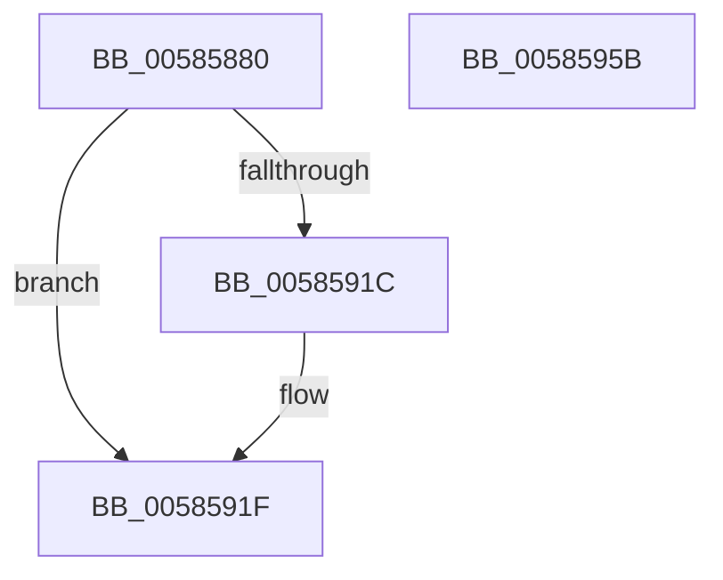

# HvlpGetVpIndexFromApicId

- RVA: `0x00585880`–`0x0058595C` (길이 `220` bytes)
- VA: `0x0000000140585880`
- 실행 섹션: `.text`
- PDB 이름 있음: `예`; PDB Function 태그: `아니요`
- unwind 정보 RVA: `0x000C64D8`
- 디코드: `62`개 명령, `220/220` bytes 표시
- 미해석 바이트: `0` (있으면 어셈블리에 `.byte`로 보존)

> 이 문서는 커널 이미지의 기계어와 PDB 기호를 분석해 생성했습니다. 4번과 5번은 함수 원형과 자료형을 바이너리 사용 방식에서 추정한 C 해석이며 원본 소스 복구 결과는 아닙니다.

## 1. Dependencies

- 직접 호출 지점: **5**; 고유 호출 대상: **3**
- 직접 호출자로 확인된 함수: **2**
- RIP 상대 이미지 참조: **0**

### Outgoing calls
- `0x005858D1` → [HvlpAcquireHypercallPage](../47/HvlpAcquireHypercallPage_function_00471410.md) (function, `0x00471410`)
- `0x005858EA` → [HvlpAcquireHypercallPage](../47/HvlpAcquireHypercallPage_function_00471410.md) (function, `0x00471410`)
- `0x00585912` → [HvcallInitiateHypercall](../31/HvcallInitiateHypercall_function_00313630.md) (function, `0x00313630`)
- `0x00585931` → [HvlpReleaseHypercallPage](../31/HvlpReleaseHypercallPage_function_00313480.md) (function, `0x00313480`)
- `0x0058593A` → [HvlpReleaseHypercallPage](../31/HvlpReleaseHypercallPage_function_00313480.md) (function, `0x00313480`)

### Direct callers
- [HvlpEnableNextLogicalProcessor](HvlpEnableNextLogicalProcessor_function_00585680.md) at `0x005856D7`
- [HvlHalGetVpIndexFromApicId](HvlHalGetVpIndexFromApicId_function_005886E0.md) at `0x005886F3`

### Static image references
- 디코드된 RIP-relative 메모리 참조가 없습니다.

## 2. Other-region calls and transfers

- 다른 실행 섹션으로 향하는 call: **0**
- 별도 외부 분기/꼬리 이동을 확인하지 못했습니다.

## 3. Assembly (complete function range)

```asm
00585880  48 89 5C 24 08                  mov qword ptr [rsp + 8], rbx
00585885  48 89 74 24 10                  mov qword ptr [rsp + 0x10], rsi
0058588A  48 89 7C 24 20                  mov qword ptr [rsp + 0x20], rdi
0058588F  55                              push rbp
00585890  41 56                           push r14
00585892  41 57                           push r15
00585894  48 8B EC                        mov rbp, rsp
00585897  48 83 EC 60                     sub rsp, 0x60
0058589B  33 C0                           xor eax, eax
0058589D  48 C7 45 30 9A 00 00 00         mov qword ptr [rbp + 0x30], 0x9a
005858A5  0F 57 C0                        xorps xmm0, xmm0
005858A8  48 89 45 F0                     mov qword ptr [rbp - 0x10], rax
005858AC  4C 8B FA                        mov r15, rdx
005858AF  89 45 F8                        mov dword ptr [rbp - 8], eax
005858B2  8B F9                           mov edi, ecx
005858B4  48 89 45 D0                     mov qword ptr [rbp - 0x30], rax
005858B8  44 8D 48 10                     lea r9d, [rax + 0x10]
005858BC  89 45 D8                        mov dword ptr [rbp - 0x28], eax
005858BF  8D 50 01                        lea edx, [rax + 1]
005858C2  45 33 C0                        xor r8d, r8d
005858C5  48 8D 4D E0                     lea rcx, [rbp - 0x20]
005858C9  0F 11 45 E0                     movups xmmword ptr [rbp - 0x20], xmm0
005858CD  0F 11 45 C0                     movups xmmword ptr [rbp - 0x40], xmm0
005858D1  E8 3A BB EE FF                  call 0x140471410
005858D6  41 B9 04 00 00 00               mov r9d, 4
005858DC  48 8D 4D C0                     lea rcx, [rbp - 0x40]
005858E0  45 33 C0                        xor r8d, r8d
005858E3  48 8B D8                        mov rbx, rax
005858E6  41 8D 51 FE                     lea edx, [r9 - 2]
005858EA  E8 21 BB EE FF                  call 0x140471410
005858EF  4C 8B 45 D8                     mov r8, qword ptr [rbp - 0x28]
005858F3  33 F6                           xor esi, esi
005858F5  48 8B 55 F8                     mov rdx, qword ptr [rbp - 8]
005858F9  4C 8B F0                        mov r14, rax
005858FC  48 83 0B FF                     or qword ptr [rbx], 0xffffffffffffffff
00585900  C7 45 34 01 00 00 00            mov dword ptr [rbp + 0x34], 1
00585907  48 8B 4D 30                     mov rcx, qword ptr [rbp + 0x30]
0058590B  48 89 73 08                     mov qword ptr [rbx + 8], rsi
0058590F  89 7B 10                        mov dword ptr [rbx + 0x10], edi
00585912  E8 19 DD D8 FF                  call 0x140313630
00585917  66 85 C0                        test ax, ax
0058591A  75 03                           jne 0x14058591f
0058591C  41 8B 36                        mov esi, dword ptr [r14]
0058591F  66 F7 D8                        neg ax
00585922  41 89 37                        mov dword ptr [r15], esi
00585925  48 8D 4D C0                     lea rcx, [rbp - 0x40]
00585929  1B DB                           sbb ebx, ebx
0058592B  81 E3 01 00 00 C0               and ebx, 0xc0000001
00585931  E8 4A DB D8 FF                  call 0x140313480
00585936  48 8D 4D E0                     lea rcx, [rbp - 0x20]
0058593A  E8 41 DB D8 FF                  call 0x140313480
0058593F  4C 8D 5C 24 60                  lea r11, [rsp + 0x60]
00585944  8B C3                           mov eax, ebx
00585946  49 8B 5B 20                     mov rbx, qword ptr [r11 + 0x20]
0058594A  49 8B 73 28                     mov rsi, qword ptr [r11 + 0x28]
0058594E  49 8B 7B 38                     mov rdi, qword ptr [r11 + 0x38]
00585952  49 8B E3                        mov rsp, r11
00585955  41 5F                           pop r15
00585957  41 5E                           pop r14
00585959  5D                              pop rbp
0058595A  C3                              ret
0058595B  CC                              int3
```

## 4. C-style interpretation (structured pseudocode)

```c
__int64 __fastcall HvlpGetVpIndexFromApicId(int a1, __int64 a2, int a3)
{
    __int64 result;
    __int64 v_rbx;
    __int64 v_rsi;
    __int64 v_rsp;
    unsigned __int64 v_stack_m18;
    unsigned int v_stack_m20;
    unsigned __int64 v_stack_m28;
    unsigned __int64 v_stack_m38;
    unsigned int v_stack_m40;
    unsigned __int64 v_stack_m48;
    unsigned __int64 v_stack_m58;
    unsigned __int64 v_stack_p10;
    unsigned __int64 v_stack_p18;
    unsigned int v_stack_p1C;
    unsigned __int64 v_stack_p20;
    unsigned __int64 v_stack_p8;

    v_stack_p8 = v_rbx;
    v_stack_p10 = v_rsi;
    v_stack_p20 = v_rdi;
    v_rsp = (v_rsp) - (96);
    result = 0;
    v_stack_p18 = 154;
    v_stack_m28 = 0;
    v_stack_m20 = 0;
    v_stack_m48 = 0;
    v_stack_m40 = 0;
    a3 = 0;
    v_stack_m38 = v_xmm0;
    v_stack_m58 = v_xmm0;
    result = HvlpAcquireHypercallPage(v_stack_m38, result + 1, a3, result + 16);
    a3 = 0;
    result = HvlpAcquireHypercallPage(v_stack_m58, 4 - 2, a3, 4);
    v_rsi = 0;
    v_stack_p1C = 1;
    *(unsigned __int64 *)(result + 8) = 0;
    *(unsigned int *)(result + 16) = (unsigned int)((unsigned int)(a1));
    result = HvcallInitiateHypercall(v_stack_p18, v_stack_m20, v_stack_m40, 4);
    if ((unsigned __int16)(result) == 0) {
        v_rsi = *(unsigned int *)(result);
    }
    result = (unsigned __int16)(-(result));
    *(unsigned int *)(a2) = (unsigned int)(v_rsi);
    v_rbx = (unsigned int)((result) & (0xC0000001ULL));
    result = HvlpReleaseHypercallPage(v_stack_m58, v_stack_m20, v_stack_m40, 4);
    result = HvlpReleaseHypercallPage(v_stack_m38, v_stack_m20, v_stack_m40, 4);
    return (unsigned int)((unsigned int)(v_rbx));
}
```

## 5. (Beta) C Style

```c
int64_t HvlpGetVpIndexFromApicId(int32_t Arg1, void *Arg2, int32_t Arg3)
{
    uint8_t *arg2 = (uint8_t *)Arg2;

    int64_t result;
    int64_t local_rbx;
    int64_t local_rsi;
    int64_t local_rsp;
    uint64_t v_stack_m18;
    uint32_t v_stack_m20;
    uint64_t v_stack_m28;
    uint64_t v_stack_m38;
    uint32_t v_stack_m40;
    uint64_t v_stack_m48;
    uint64_t v_stack_m58;
    uint64_t v_stack_p10;
    uint64_t v_stack_p18;
    uint32_t v_stack_p1C;
    uint64_t v_stack_p20;
    uint64_t v_stack_p8;

    v_stack_p8 = local_rbx;
    v_stack_p10 = local_rsi;
    v_stack_p20 = local_rdi;
    local_rsp = (local_rsp) - (96);
    result = 0;
    v_stack_p18 = 154;
    v_stack_m28 = 0;
    v_stack_m20 = 0;
    v_stack_m48 = 0;
    v_stack_m40 = 0;
    Arg3 = 0;
    v_stack_m38 = v_xmm0;
    v_stack_m58 = v_xmm0;
    result = HvlpAcquireHypercallPage(v_stack_m38, result + 1, Arg3, result + 16);
    Arg3 = 0;
    result = HvlpAcquireHypercallPage(v_stack_m58, 4 - 2, Arg3, 4);
    local_rsi = 0;
    v_stack_p1C = 1;
    *(uint64_t *)(result + 0x8) = 0;
    *(uint32_t *)(result + 0x10) = (uint32_t)((uint32_t)(Arg1));
    result = HvcallInitiateHypercall(v_stack_p18, v_stack_m20, v_stack_m40, 4);
    if ((uint16_t)(result) == 0) {
        local_rsi = *(uint32_t *)(result);
    }
    result = (uint16_t)(-(result));
    *(uint32_t *)(arg2) = (uint32_t)(local_rsi);
    local_rbx = (uint32_t)((result) & (0xC0000001ULL));
    result = HvlpReleaseHypercallPage(v_stack_m58, v_stack_m20, v_stack_m40, 4);
    result = HvlpReleaseHypercallPage(v_stack_m38, v_stack_m20, v_stack_m40, 4);
    return (uint32_t)((uint32_t)(local_rbx));
}
```

### 관측된 메모리 오프셋

구조체 형식이 확인되지 않은 접근은 인자 기준의 오프셋으로만 기록했습니다.

| 기준 인자 | 오프셋 표현 | 폭 (bit) | 접근 |
|---|---:|---:|---|
| `Arg2` | `+ 0x0` | `32` | `W` |

## 6. Execution-region graph

[열기: 2D/3D 그래프와 함수 탐색 컨트롤 패널](../../../control-panel.html?section=text&rva=0x00585880&view=graph)

- 2D 그래프는 위에서 아래로 흐르고, 3D 그래프는 빈 공간을 드래그해 회전합니다. Shift+드래그는 이동, 휠은 확대·축소, 함수 노드 선택은 대상 보고서 이동입니다.

### Static fallback


