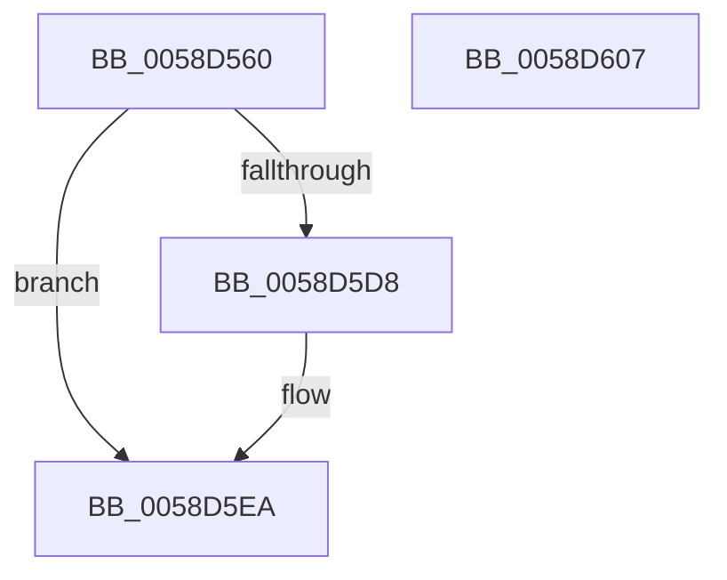

# HvlpGetVtlCallVa

- RVA: `0x0058D560`–`0x0058D608` (길이 `168` bytes)
- VA: `0x000000014058D560`
- 실행 섹션: `.text`
- PDB 이름 있음: `예`; PDB Function 태그: `아니요`
- unwind 정보 RVA: `0x00080C0C`
- 디코드: `34`개 명령, `168/168` bytes 표시
- 미해석 바이트: `0` (있으면 어셈블리에 `.byte`로 보존)

> 이 문서는 커널 이미지의 기계어와 PDB 기호를 분석해 생성했습니다. 4번과 5번은 함수 원형과 자료형을 바이너리 사용 방식에서 추정한 C 해석이며 원본 소스 복구 결과는 아닙니다.

## 1. Dependencies

- 직접 호출 지점: **2**; 고유 호출 대상: **2**
- 직접 호출자로 확인된 함수: **1**
- RIP 상대 이미지 참조: **3**

### Outgoing calls
- `0x0058D5CE` → [HvcallFastExtended](../31/HvcallFastExtended_function_003130E0.md) (function, `0x003130E0`)
- `0x0058D5F9` → [_security_check_cookie](../6A/_security_check_cookie_function_006AC640.md) (function, `0x006AC640`)

### Direct callers
- [HvlEnableVsmCalls](../../init/C2/HvlEnableVsmCalls_function_00C29AB0.md) at `0x00C29AD0`

### Static image references
- `0x0058D569` → RVA `0x00E0A740` (`.data`; read)
- `0x0058D5E3` → RVA `0x01201850` (`CFGRO`; read)
- `0x0058D5EA` → RVA `0x01201860` (`CFGRO`; write)

## 2. Other-region calls and transfers

- 다른 실행 섹션으로 향하는 call: **0**
- 별도 외부 분기/꼬리 이동을 확인하지 못했습니다.

## 3. Assembly (complete function range)

```asm
0058D560  40 53                           push rbx
0058D562  48 81 EC 80 00 00 00            sub rsp, 0x80
0058D569  48 8B 05 D0 D1 87 00            mov rax, qword ptr [rip + 0x87d1d0]
0058D570  48 33 C4                        xor rax, rsp
0058D573  48 89 44 24 70                  mov qword ptr [rsp + 0x70], rax
0058D578  48 83 4C 24 50 FF               or qword ptr [rsp + 0x50], 0xffffffffffffffff
0058D57E  4C 8D 4C 24 40                  lea r9, [rsp + 0x40]
0058D583  48 C7 44 24 30 50 00 00 00      mov qword ptr [rsp + 0x30], 0x50
0058D58C  48 8D 54 24 50                  lea rdx, [rsp + 0x50]
0058D591  0F BA 6C 24 30 10               bts dword ptr [rsp + 0x30], 0x10
0058D597  33 DB                           xor ebx, ebx
0058D599  0F 57 C0                        xorps xmm0, xmm0
0058D59C  C7 44 24 34 01 00 00 00         mov dword ptr [rsp + 0x34], 1
0058D5A4  48 8B 4C 24 30                  mov rcx, qword ptr [rsp + 0x30]
0058D5A9  0F 11 44 24 40                  movups xmmword ptr [rsp + 0x40], xmm0
0058D5AE  44 8D 43 14                     lea r8d, [rbx + 0x14]
0058D5B2  89 5C 24 5C                     mov dword ptr [rsp + 0x5c], ebx
0058D5B6  C7 44 24 58 FE FF FF FF         mov dword ptr [rsp + 0x58], 0xfffffffe
0058D5BE  C7 44 24 60 02 00 0D 00         mov dword ptr [rsp + 0x60], 0xd0002
0058D5C6  C7 44 24 20 10 00 00 00         mov dword ptr [rsp + 0x20], 0x10
0058D5CE  E8 0D 5B D8 FF                  call 0x1403130e0
0058D5D3  66 85 C0                        test ax, ax
0058D5D6  75 12                           jne 0x14058d5ea
0058D5D8  48 8B 5C 24 40                  mov rbx, qword ptr [rsp + 0x40]
0058D5DD  81 E3 FF 0F 00 00               and ebx, 0xfff
0058D5E3  48 03 1D 66 42 C7 00            add rbx, qword ptr [rip + 0xc74266]
0058D5EA  48 89 1D 6F 42 C7 00            mov qword ptr [rip + 0xc7426f], rbx
0058D5F1  48 8B 4C 24 70                  mov rcx, qword ptr [rsp + 0x70]
0058D5F6  48 33 CC                        xor rcx, rsp
0058D5F9  E8 42 F0 11 00                  call 0x1406ac640
0058D5FE  48 81 C4 80 00 00 00            add rsp, 0x80
0058D605  5B                              pop rbx
0058D606  C3                              ret
0058D607  CC                              int3
```

## 4. C-style interpretation (structured pseudocode)

```c
__int64 __fastcall HvlpGetVtlCallVa(void)
{
    __int64 result;
    __int64 v_rbx;
    __int64 v_rsp;
    unsigned __int64 v_stack_m18;
    unsigned int v_stack_m28;
    unsigned int v_stack_m2C;
    unsigned int v_stack_m30;
    unsigned __int64 v_stack_m38;
    unsigned __int64 v_stack_m48;
    unsigned int v_stack_m54;
    unsigned __int64 v_stack_m58;
    unsigned int v_stack_m68;

    v_rsp = (v_rsp) - (128);
    result = (*(unsigned __int64 *)(v_rip + 8901072)) ^ (v_rsp);
    v_stack_m18 = result;
    v_stack_m58 = 80;
    v_rbx = 0;
    v_stack_m54 = 1;
    v_stack_m48 = v_xmm0;
    v_stack_m2C = 0;
    v_stack_m30 = 0xFFFFFFFEULL;
    v_stack_m28 = 0xD0002ULL;
    v_stack_m68 = 16;
    result = HvcallFastExtended(v_stack_m58, v_stack_m38, v_rbx + 20, v_stack_m48);
    if ((unsigned __int16)(result) == 0) {
        v_rbx = v_stack_m48;
        v_rbx = (unsigned int)((v_rbx) & (0xFFFULL));
        v_rbx = (v_rbx) + (*(unsigned __int64 *)(v_rip + 13058662));
    }
    *(unsigned __int64 *)(v_rip + 13058671) = v_rbx;
    a1 = (v_stack_m18) ^ (v_rsp);
    result = _security_check_cookie(a1, v_stack_m38, v_rbx + 20, v_stack_m48);
    v_rsp = (v_rsp) + (128);
    return result;
}
```

## 5. (Beta) C Style

```c
void HvlpGetVtlCallVa(void)
{
    int64_t result;
    int64_t local_rbx;
    int64_t local_rsp;
    uint64_t v_stack_m18;
    uint32_t v_stack_m28;
    uint32_t v_stack_m2C;
    uint32_t v_stack_m30;
    uint64_t v_stack_m38;
    uint64_t v_stack_m48;
    uint32_t v_stack_m54;
    uint64_t v_stack_m58;
    uint32_t v_stack_m68;

    local_rsp = (local_rsp) - (128);
    result = (*(uint64_t *)(v_rip + 0x87D1D0)) ^ (local_rsp);
    v_stack_m18 = result;
    v_stack_m58 = 80;
    local_rbx = 0;
    v_stack_m54 = 1;
    v_stack_m48 = v_xmm0;
    v_stack_m2C = 0;
    v_stack_m30 = 0xFFFFFFFEULL;
    v_stack_m28 = 0xD0002ULL;
    v_stack_m68 = 16;
    result = HvcallFastExtended(v_stack_m58, v_stack_m38, local_rbx + 20, v_stack_m48);
    if ((uint16_t)(result) == 0) {
        local_rbx = v_stack_m48;
        local_rbx = (uint32_t)((local_rbx) & (0xFFFULL));
        local_rbx = (local_rbx) + (*(uint64_t *)(v_rip + 0xC74266));
    }
    *(uint64_t *)(v_rip + 0xC7426F) = local_rbx;
    a1 = (v_stack_m18) ^ (local_rsp);
    result = _security_check_cookie(a1, v_stack_m38, local_rbx + 20, v_stack_m48);
    local_rsp = (local_rsp) + (128);
    return result;
}
```

## 6. Execution-region graph

[열기: 2D/3D 그래프와 함수 탐색 컨트롤 패널](../../../control-panel.html?section=text&rva=0x0058D560&view=graph)

- 2D 그래프는 위에서 아래로 흐르고, 3D 그래프는 빈 공간을 드래그해 회전합니다. Shift+드래그는 이동, 휠은 확대·축소, 함수 노드 선택은 대상 보고서 이동입니다.

### Static fallback


