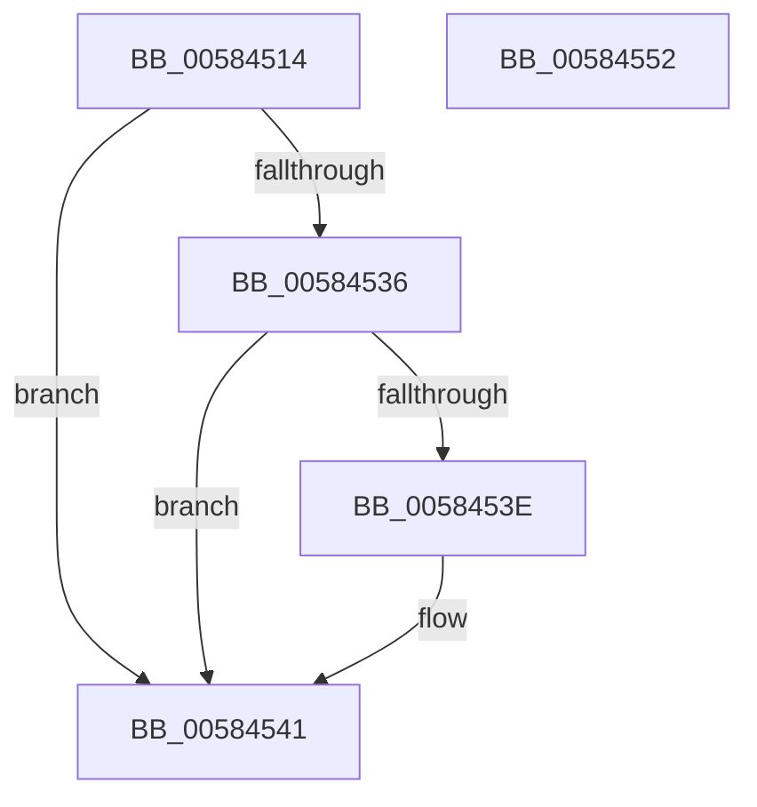

# HvlpHandleInsufficientMemory

- RVA: `0x00584514`–`0x00584553` (길이 `63` bytes)
- VA: `0x0000000140584514`
- 실행 섹션: `.text`
- PDB 이름 있음: `예`; PDB Function 태그: `아니요`
- unwind 정보 RVA: `0x0005C788`
- 디코드: `19`개 명령, `63/63` bytes 표시
- 미해석 바이트: `0` (있으면 어셈블리에 `.byte`로 보존)

> 이 문서는 커널 이미지의 기계어와 PDB 기호를 분석해 생성했습니다. 4번과 5번은 함수 원형과 자료형을 바이너리 사용 방식에서 추정한 C 해석이며 원본 소스 복구 결과는 아닙니다.

## 1. Dependencies

- 직접 호출 지점: **1**; 고유 호출 대상: **1**
- 직접 호출자로 확인된 함수: **18**
- RIP 상대 이미지 참조: **0**

### Outgoing calls
- `0x00584548` → [HvlpDepositPages](HvlpDepositPages_function_00585474.md) (function, `0x00585474`)

### Direct callers
- [HvlDmaMapDeviceLogicalRange](../30/HvlDmaMapDeviceLogicalRange_function_003077D0.md) at `0x00307B6C`
- [HvlDmaMapDeviceSparsePages](../47/HvlDmaMapDeviceSparsePages_function_0047A390.md) at `0x0047A674`
- [HvlpSetPowerProperty](../4C/HvlpSetPowerProperty_function_004C9124.md) at `0x004C9315`
- [HvlAttachPasidSpace](HvlAttachPasidSpace_function_00587140.md) at `0x005871B1`
- [HvlAttachPrQueue](HvlAttachPrQueue_function_005871F0.md) at `0x00587261`
- [HvlCreatePasidSpace](HvlCreatePasidSpace_function_00587300.md) at `0x00587384`
- [HvlCreatePrQueue](HvlCreatePrQueue_function_005873C0.md) at `0x00587473`
- [HvlDmaAllocateDeviceDomain](HvlDmaAllocateDeviceDomain_function_00587630.md) at `0x005876D2`
- [HvlDmaAttachDeviceDomain](HvlDmaAttachDeviceDomain_function_00587700.md) at `0x0058778C`
- [HvlDmaReserveDeviceDomainAttachment](HvlDmaReserveDeviceDomainAttachment_function_00587C90.md) at `0x00587D15`
- [HvlEnablePasid](HvlEnablePasid_function_00587DA0.md) at `0x00587E11`
- [HvlMapDeviceInterrupt](HvlMapDeviceInterrupt_function_00588A90.md) at `0x00588CA4`
- [HvlRegisterDeviceId](HvlRegisterDeviceId_function_005891C0.md) at `0x0058930E`
- [HvlSetDeviceCapabilities](HvlSetDeviceCapabilities_function_005894C0.md) at `0x00589526`
- [HvlSetHpetConfig](HvlSetHpetConfig_function_00589560.md) at `0x0058962F`
- [HvlSetPasidAddressSpace](HvlSetPasidAddressSpace_function_00589790.md) at `0x00589800`
- [HvlMapDmaRanges](HvlMapDmaRanges_function_0058A110.md) at `0x0058A1C8`
- [HvlpDynamicUpdateMicrocode](../../page/71/HvlpDynamicUpdateMicrocode_function_007185E8.md) at `0x00718691`

### Static image references
- 디코드된 RIP-relative 메모리 참조가 없습니다.

## 2. Other-region calls and transfers

- 다른 실행 섹션으로 향하는 call: **0**
- 별도 외부 분기/꼬리 이동을 확인하지 못했습니다.

## 3. Assembly (complete function range)

```asm
00584514  48 83 EC 28                     sub rsp, 0x28
00584518  BA 81 00 00 00                  mov edx, 0x81
0058451D  0F B7 C1                        movzx eax, cx
00584520  66 2B C2                        sub ax, dx
00584523  66 41 B8 01 00                  mov r8w, 1
00584528  66 41 3B C0                     cmp ax, r8w
0058452C  41 0F 96 C1                     setbe r9b
00584530  66 83 F9 75                     cmp cx, 0x75
00584534  74 0B                           je 0x140584541
00584536  8D 42 01                        lea eax, [rdx + 1]
00584539  66 3B C8                        cmp cx, ax
0058453C  74 03                           je 0x140584541
0058453E  45 32 C0                        xor r8b, r8b
00584541  33 C9                           xor ecx, ecx
00584543  BA 80 00 00 00                  mov edx, 0x80
00584548  E8 27 0F 00 00                  call 0x140585474
0058454D  48 83 C4 28                     add rsp, 0x28
00584551  C3                              ret
00584552  CC                              int3
```

## 4. C-style interpretation (structured pseudocode)

```c
__int64 __fastcall HvlpHandleInsufficientMemory(int a1)
{
    __int64 result;
    __int64 v_rsp;

    v_rsp = (v_rsp) - (40);
    result = (unsigned __int16)(((unsigned __int16)(a1)) - (129));
    a4 = (((unsigned __int16)(result)) <= 1) ? 1 : 0;
    if (((unsigned __int16)(a1)) == 117) goto loc_00584541;
    if (((unsigned __int16)(a1)) != ((unsigned __int16)(129 + 1))) {
        a3 = 0;
    }
    a1 = 0;
    result = HvlpDepositPages(a1, 128, a3, a4);
    v_rsp = (v_rsp) + (40);
    return result;
}
```

## 5. (Beta) C Style

```c
int64_t HvlpHandleInsufficientMemory(int32_t Arg1)
{
    int64_t result;
    int64_t local_rsp;

    local_rsp = (local_rsp) - (40);
    result = (uint16_t)(((uint16_t)(Arg1)) - (129));
    a4 = (((uint16_t)(result)) <= 1) ? 1 : 0;
    if (((uint16_t)(Arg1)) == 117) goto loc_00584541;
    if (((uint16_t)(Arg1)) != ((uint16_t)(129 + 1))) {
        a3 = 0;
    }
    Arg1 = 0;
    result = HvlpDepositPages(Arg1, 128, a3, a4);
    local_rsp = (local_rsp) + (40);
    return result;
}
```

## 6. Execution-region graph

[열기: 2D/3D 그래프와 함수 탐색 컨트롤 패널](../../../control-panel.html?section=text&rva=0x00584514&view=graph)

- 2D 그래프는 위에서 아래로 흐르고, 3D 그래프는 빈 공간을 드래그해 회전합니다. Shift+드래그는 이동, 휠은 확대·축소, 함수 노드 선택은 대상 보고서 이동입니다.

### Static fallback


