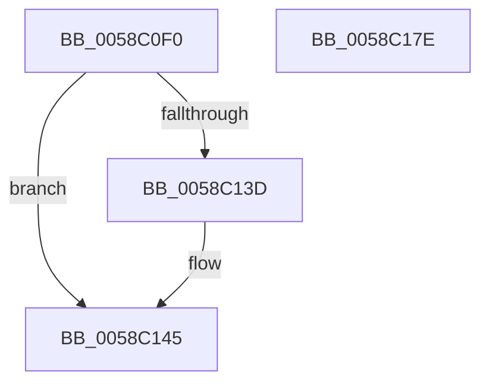

# HvlpHandleIommuFaultMessage

- RVA: `0x0058C0F0`–`0x0058C17F` (길이 `143` bytes)
- VA: `0x000000014058C0F0`
- 실행 섹션: `.text`
- PDB 이름 있음: `예`; PDB Function 태그: `아니요`
- unwind 정보 RVA: `0x0008A308`
- 디코드: `44`개 명령, `143/143` bytes 표시
- 미해석 바이트: `0` (있으면 어셈블리에 `.byte`로 보존)

> 이 문서는 커널 이미지의 기계어와 PDB 기호를 분석해 생성했습니다. 4번과 5번은 함수 원형과 자료형을 바이너리 사용 방식에서 추정한 C 해석이며 원본 소스 복구 결과는 아닙니다.

## 1. Dependencies

- 직접 호출 지점: **1**; 고유 호출 대상: **1**
- 직접 호출자로 확인된 함수: **1**
- RIP 상대 이미지 참조: **1**

### Outgoing calls
- `0x0058C173` → [guard_dispatch_icall](../6B/guard_dispatch_icall_function_006BAAD0.md) (function, `0x006BAAD0`)

### Direct callers
- [HvlSharedIsr](../44/HvlSharedIsr_function_0044B020.md) at `0x0044B0EE`

### Static image references
- `0x0058C164` → RVA `0x00E00C90` (`.data`; read)

## 2. Other-region calls and transfers

- 다른 실행 섹션으로 향하는 call: **0**
- 별도 외부 분기/꼬리 이동을 확인하지 못했습니다.

## 3. Assembly (complete function range)

```asm
0058C0F0  40 55                           push rbp
0058C0F2  48 8B EC                        mov rbp, rsp
0058C0F5  48 83 EC 60                     sub rsp, 0x60
0058C0F9  8B 51 08                        mov edx, dword ptr [rcx + 8]
0058C0FC  33 C0                           xor eax, eax
0058C0FE  48 89 45 F0                     mov qword ptr [rbp - 0x10], rax
0058C102  0F 57 C0                        xorps xmm0, xmm0
0058C105  8A C2                           mov al, dl
0058C107  4C 8B C1                        mov r8, rcx
0058C10A  C0 E8 02                        shr al, 2
0058C10D  83 E2 01                        and edx, 1
0058C110  24 01                           and al, 1
0058C112  0F 11 45 C0                     movups xmmword ptr [rbp - 0x40], xmm0
0058C116  88 45 C4                        mov byte ptr [rbp - 0x3c], al
0058C119  0F 11 45 D0                     movups xmmword ptr [rbp - 0x30], xmm0
0058C11D  C7 45 C0 02 00 00 00            mov dword ptr [rbp - 0x40], 2
0058C124  0F 11 45 E0                     movups xmmword ptr [rbp - 0x20], xmm0
0058C128  66 0F 73 D8 08                  psrldq xmm0, 8
0058C12D  66 0F 7E C0                     movd eax, xmm0
0058C131  83 E0 FE                        and eax, 0xfffffffe
0058C134  0B C2                           or eax, edx
0058C136  89 45 D8                        mov dword ptr [rbp - 0x28], eax
0058C139  85 D2                           test edx, edx
0058C13B  74 08                           je 0x14058c145
0058C13D  48 8B 41 20                     mov rax, qword ptr [rcx + 0x20]
0058C141  48 89 45 D0                     mov qword ptr [rbp - 0x30], rax
0058C145  8B 01                           mov eax, dword ptr [rcx]
0058C147  48 8D 55 C0                     lea rdx, [rbp - 0x40]
0058C14B  F7 D8                           neg eax
0058C14D  41 0F B7 40 1A                  movzx eax, word ptr [r8 + 0x1a]
0058C152  1B C9                           sbb ecx, ecx
0058C154  89 45 E8                        mov dword ptr [rbp - 0x18], eax
0058C157  49 8B 40 28                     mov rax, qword ptr [r8 + 0x28]
0058C15B  F7 D9                           neg ecx
0058C15D  83 C1 06                        add ecx, 6
0058C160  48 89 45 E0                     mov qword ptr [rbp - 0x20], rax
0058C164  48 8B 05 25 4B 87 00            mov rax, qword ptr [rip + 0x874b25]
0058C16B  89 4D DC                        mov dword ptr [rbp - 0x24], ecx
0058C16E  41 0F B7 48 18                  movzx ecx, word ptr [r8 + 0x18]
0058C173  E8 58 E9 12 00                  call 0x1406baad0
0058C178  48 83 C4 60                     add rsp, 0x60
0058C17C  5D                              pop rbp
0058C17D  C3                              ret
0058C17E  CC                              int3
```

## 4. C-style interpretation (structured pseudocode)

```c
__int64 __fastcall HvlpHandleIommuFaultMessage(__int64 a1)
{
    __int64 result;
    __int64 v_rsp;
    unsigned __int64 v_stack_m18;
    unsigned int v_stack_m20;
    unsigned __int64 v_stack_m28;
    unsigned int v_stack_m2C;
    unsigned int v_stack_m30;
    unsigned __int64 v_stack_m38;
    unsigned __int8 v_stack_m44;
    unsigned __int64 v_stack_m48;

    v_rsp = (v_rsp) - (96);
    result = 0;
    v_stack_m18 = 0;
    result = (unsigned __int8)(((unsigned __int8)((unsigned int)(*(unsigned int *)(a1 + 8)))) >> (2));
    a2 = (unsigned int)(((unsigned int)(*(unsigned int *)(a1 + 8))) & (1));
    result = (unsigned __int8)((result) & (1));
    v_stack_m48 = v_xmm0;
    v_stack_m44 = (unsigned __int8)(result);
    v_stack_m38 = v_xmm0;
    v_stack_m48 = 2;
    v_stack_m28 = v_xmm0;
    result = (unsigned int)((result) & (0xFFFFFFFEULL));
    result = (unsigned int)((result) | ((unsigned int)(a2)));
    v_stack_m30 = (unsigned int)(result);
    if ((unsigned int)(a2) != 0) {
        result = *(unsigned __int64 *)(a1 + 32);
        v_stack_m38 = result;
    }
    result = (unsigned int)(-((unsigned int)(*(unsigned int *)(a1))));
    v_stack_m20 = (unsigned int)(*(unsigned __int16 *)(a1 + 26));
    a1 = (unsigned int)(-(a1));
    a1 = (unsigned int)((a1) + (6));
    v_stack_m28 = *(unsigned __int64 *)(a1 + 40);
    v_stack_m2C = (unsigned int)(a1);
    result = guard_dispatch_icall(*(unsigned __int16 *)(a1 + 24), v_stack_m48, a1, a4);
    v_rsp = (v_rsp) + (96);
    return result;
}
```

## 5. (Beta) C Style

```c
int64_t HvlpHandleIommuFaultMessage(void *Arg1)
{
    uint8_t *arg1 = (uint8_t *)Arg1;

    int64_t result;
    int64_t local_rsp;
    uint64_t v_stack_m18;
    uint32_t v_stack_m20;
    uint64_t v_stack_m28;
    uint32_t v_stack_m2C;
    uint32_t v_stack_m30;
    uint64_t v_stack_m38;
    uint8_t v_stack_m44;
    uint64_t v_stack_m48;

    local_rsp = (local_rsp) - (96);
    result = 0;
    v_stack_m18 = 0;
    result = (uint8_t)(((uint8_t)((uint32_t)(*(uint32_t *)(arg1 + 0x8)))) >> (2));
    a2 = (uint32_t)(((uint32_t)(*(uint32_t *)(arg1 + 0x8))) & (1));
    result = (uint8_t)((result) & (1));
    v_stack_m48 = v_xmm0;
    v_stack_m44 = (uint8_t)(result);
    v_stack_m38 = v_xmm0;
    v_stack_m48 = 2;
    v_stack_m28 = v_xmm0;
    result = (uint32_t)((result) & (0xFFFFFFFEULL));
    result = (uint32_t)((result) | ((uint32_t)(a2)));
    v_stack_m30 = (uint32_t)(result);
    if ((uint32_t)(a2) != 0) {
        result = *(uint64_t *)(arg1 + 0x20);
        v_stack_m38 = result;
    }
    result = (uint32_t)(-((uint32_t)(*(uint32_t *)(arg1))));
    v_stack_m20 = (uint32_t)(*(uint16_t *)(arg1 + 0x1A));
    Arg1 = (uint32_t)(-(Arg1));
    Arg1 = (uint32_t)((Arg1) + (6));
    v_stack_m28 = *(uint64_t *)(arg1 + 0x28);
    v_stack_m2C = (uint32_t)(Arg1);
    result = guard_dispatch_icall(*(uint16_t *)(arg1 + 0x18), v_stack_m48, Arg1, a4);
    local_rsp = (local_rsp) + (96);
    return result;
}
```

### 관측된 메모리 오프셋

구조체 형식이 확인되지 않은 접근은 인자 기준의 오프셋으로만 기록했습니다.

| 기준 인자 | 오프셋 표현 | 폭 (bit) | 접근 |
|---|---:|---:|---|
| `Arg1` | `+ 0x0` | `32` | `R` |
| `Arg1` | `+ 0x8` | `32` | `R` |
| `Arg1` | `+ 0x18` | `16` | `R` |
| `Arg1` | `+ 0x1A` | `16` | `R` |
| `Arg1` | `+ 0x20` | `64` | `R` |
| `Arg1` | `+ 0x28` | `64` | `R` |

## 6. Execution-region graph

[열기: 2D/3D 그래프와 함수 탐색 컨트롤 패널](../../../control-panel.html?section=text&rva=0x0058C0F0&view=graph)

- 2D 그래프는 위에서 아래로 흐르고, 3D 그래프는 빈 공간을 드래그해 회전합니다. Shift+드래그는 이동, 휠은 확대·축소, 함수 노드 선택은 대상 보고서 이동입니다.

### Static fallback


