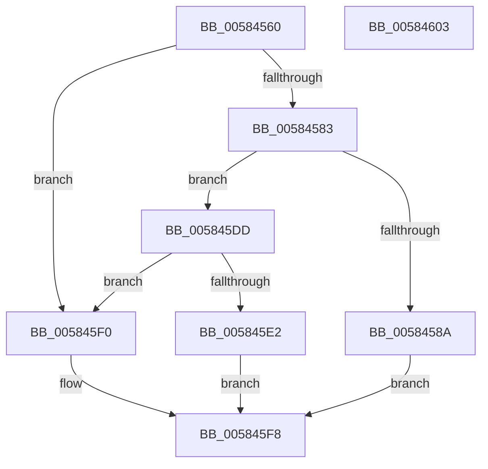

# HvlpHvIdentityInfoCallback

- RVA: `0x00584560`–`0x00584604` (길이 `164` bytes)
- VA: `0x0000000140584560`
- 실행 섹션: `.text`
- PDB 이름 있음: `예`; PDB Function 태그: `아니요`
- unwind 정보 RVA: `0x0005CAAC`
- 디코드: `41`개 명령, `164/164` bytes 표시
- 미해석 바이트: `0` (있으면 어셈블리에 `.byte`로 보존)

> 이 문서는 커널 이미지의 기계어와 PDB 기호를 분석해 생성했습니다. 4번과 5번은 함수 원형과 자료형을 바이너리 사용 방식에서 추정한 C 해석이며 원본 소스 복구 결과는 아닙니다.

## 1. Dependencies

- 직접 호출 지점: **3**; 고유 호출 대상: **3**
- 직접 호출자로 확인된 함수: **0**
- RIP 상대 이미지 참조: **4**

### Outgoing calls
- `0x0058459E` → [HviGetHypervisorVendorAndMaxFunction](../4A/HviGetHypervisorVendorAndMaxFunction_function_004ADB6C.md) (function, `0x004ADB6C`)
- `0x005845A7` → [HviGetHypervisorInterface](../66/HviGetHypervisorInterface_function_00666678.md) (function, `0x00666678`)
- `0x005845B0` → [HviGetHypervisorVersion](../66/HviGetHypervisorVersion_function_006666C0.md) (function, `0x006666C0`)

### Direct callers
- 이 함수 시작 RVA로 연결되는 직접 call은 확인되지 않았습니다. 간접 호출은 완전히 역산할 수 없습니다.

### Static image references
- `0x0058456A` → RVA `0x00025E68` (`.rdata`; read)
- `0x005845B5` → RVA `0x00FC6A90` (`ALMOSTRO`; read)
- `0x005845BE` → RVA `0x00FC6AD8` (`ALMOSTRO`; read)
- `0x005845C7` → RVA `0x00FC6C98` (`ALMOSTRO`; read)

## 2. Other-region calls and transfers

- 다른 실행 섹션으로 향하는 call: **0**
- 별도 외부 분기/꼬리 이동을 확인하지 못했습니다.

## 3. Assembly (complete function range)

```asm
00584560  48 89 5C 24 08                  mov qword ptr [rsp + 8], rbx
00584565  57                              push rdi
00584566  48 83 EC 20                     sub rsp, 0x20
0058456A  0F 10 05 F7 18 AA FF            movups xmm0, xmmword ptr [rip - 0x55e709]
00584571  49 8B 40 20                     mov rax, qword ptr [r8 + 0x20]
00584575  49 8B F8                        mov rdi, r8
00584578  F3 41 0F 7F 40 10               movdqu xmmword ptr [r8 + 0x10], xmm0
0058457E  48 85 C0                        test rax, rax
00584581  74 6D                           je 0x1405845f0
00584583  41 83 78 08 44                  cmp dword ptr [r8 + 8], 0x44
00584588  72 53                           jb 0x1405845dd
0058458A  49 8B 18                        mov rbx, qword ptr [r8]
0058458D  48 8D 4B 08                     lea rcx, [rbx + 8]
00584591  C7 03 44 49 56 48               mov dword ptr [rbx], 0x48564944
00584597  C7 43 04 44 00 00 00            mov dword ptr [rbx + 4], 0x44
0058459E  E8 C9 95 F2 FF                  call 0x1404adb6c
005845A3  48 8D 4B 18                     lea rcx, [rbx + 0x18]
005845A7  E8 CC 20 0E 00                  call 0x140666678
005845AC  48 8D 4B 28                     lea rcx, [rbx + 0x28]
005845B0  E8 0B 21 0E 00                  call 0x1406666c0
005845B5  8B 05 D5 24 A4 00               mov eax, dword ptr [rip + 0xa424d5]
005845BB  89 43 38                        mov dword ptr [rbx + 0x38], eax
005845BE  8B 05 14 25 A4 00               mov eax, dword ptr [rip + 0xa42514]
005845C4  89 43 3C                        mov dword ptr [rbx + 0x3c], eax
005845C7  8B 05 CB 26 A4 00               mov eax, dword ptr [rip + 0xa426cb]
005845CD  89 43 40                        mov dword ptr [rbx + 0x40], eax
005845D0  48 89 5F 20                     mov qword ptr [rdi + 0x20], rbx
005845D4  C7 47 28 44 00 00 00            mov dword ptr [rdi + 0x28], 0x44
005845DB  EB 1B                           jmp 0x1405845f8
005845DD  48 85 C0                        test rax, rax
005845E0  74 0E                           je 0x1405845f0
005845E2  49 8B 00                        mov rax, qword ptr [r8]
005845E5  41 83 60 28 00                  and dword ptr [r8 + 0x28], 0
005845EA  49 89 40 20                     mov qword ptr [r8 + 0x20], rax
005845EE  EB 08                           jmp 0x1405845f8
005845F0  41 C7 40 28 44 00 00 00         mov dword ptr [r8 + 0x28], 0x44
005845F8  48 8B 5C 24 30                  mov rbx, qword ptr [rsp + 0x30]
005845FD  48 83 C4 20                     add rsp, 0x20
00584601  5F                              pop rdi
00584602  C3                              ret
00584603  CC                              int3
```

## 4. C-style interpretation (structured pseudocode)

```c
__int64 __fastcall HvlpHvIdentityInfoCallback(__int64 a1, __int64 a2, __int64 a3)
{
    __int64 result;
    __int64 v_rsp;
    unsigned __int64 v_stack_p8;

    v_stack_p8 = v_rbx;
    v_rsp = (v_rsp) - (32);
    *(unsigned __int64 *)(a3 + 16) = v_xmm0;
    if (*(unsigned __int64 *)(a3 + 32) == 0) goto loc_005845F0;
    if ((*(unsigned int *)(a3 + 8)) < 68) goto loc_005845DD;
    *(unsigned int *)(*(unsigned __int64 *)(a3)) = 0x48564944ULL;
    *(unsigned int *)(*(unsigned __int64 *)(a3) + 4) = 68;
    result = HviGetHypervisorVendorAndMaxFunction(*(unsigned __int64 *)(a3) + 8, a2, a3, a4);
    result = HviGetHypervisorInterface(*(unsigned __int64 *)(a3) + 24, a2, a3, a4);
    result = HviGetHypervisorVersion(*(unsigned __int64 *)(a3) + 40, a2, a3, a4);
    *(unsigned int *)(*(unsigned __int64 *)(a3) + 56) = (unsigned int)((unsigned int)(*(unsigned int *)(v_rip + 10757333)));
    *(unsigned int *)(*(unsigned __int64 *)(a3) + 60) = (unsigned int)((unsigned int)(*(unsigned int *)(v_rip + 10757396)));
    *(unsigned int *)(*(unsigned __int64 *)(a3) + 64) = (unsigned int)((unsigned int)(*(unsigned int *)(v_rip + 10757835)));
    *(unsigned __int64 *)(a3 + 32) = *(unsigned __int64 *)(a3);
    *(unsigned int *)(a3 + 40) = 68;
    goto loc_005845F8;
loc_005845DD:
    if ((unsigned int)(*(unsigned int *)(v_rip + 10757835)) == 0) goto loc_005845F0;
    *(unsigned __int64 *)(a3 + 32) = *(unsigned __int64 *)(a3);
    goto loc_005845F8;
loc_005845F0:
    *(unsigned int *)(a3 + 40) = 68;
loc_005845F8:
    v_rsp = (v_rsp) + (32);
    return *(unsigned __int64 *)(a3);
}
```

## 5. (Beta) C Style

```c
int64_t HvlpHvIdentityInfoCallback(int64_t Arg1, int64_t Arg2, void *Arg3)
{
    uint8_t *arg3 = (uint8_t *)Arg3;

    int64_t result;
    int64_t local_rsp;
    uint64_t v_stack_p8;

    v_stack_p8 = local_rbx;
    local_rsp = (local_rsp) - (32);
    *(uint64_t *)(arg3 + 0x10) = v_xmm0;
    if (*(uint64_t *)(arg3 + 0x20) == 0) goto loc_005845F0;
    if ((*(uint32_t *)(arg3 + 0x8)) < 68) goto loc_005845DD;
    *(uint32_t *)(*(uint64_t *)(arg3)) = 0x48564944ULL;
    *(uint32_t *)(*(uint64_t *)(arg3) + 0x4) = 68;
    result = HviGetHypervisorVendorAndMaxFunction(*(uint64_t *)(arg3) + 8, Arg2, Arg3, a4);
    result = HviGetHypervisorInterface(*(uint64_t *)(arg3) + 24, Arg2, Arg3, a4);
    result = HviGetHypervisorVersion(*(uint64_t *)(arg3) + 40, Arg2, Arg3, a4);
    *(uint32_t *)(*(uint64_t *)(arg3) + 0x38) = (uint32_t)((uint32_t)(*(uint32_t *)(v_rip + 0xA424D5)));
    *(uint32_t *)(*(uint64_t *)(arg3) + 0x3C) = (uint32_t)((uint32_t)(*(uint32_t *)(v_rip + 0xA42514)));
    *(uint32_t *)(*(uint64_t *)(arg3) + 0x40) = (uint32_t)((uint32_t)(*(uint32_t *)(v_rip + 0xA426CB)));
    *(uint64_t *)(arg3 + 0x20) = *(uint64_t *)(arg3);
    *(uint32_t *)(arg3 + 0x28) = 68;
    goto loc_005845F8;
loc_005845DD:
    if ((uint32_t)(*(uint32_t *)(v_rip + 0xA426CB)) == 0) goto loc_005845F0;
    *(uint64_t *)(arg3 + 0x20) = *(uint64_t *)(arg3);
    goto loc_005845F8;
loc_005845F0:
    *(uint32_t *)(arg3 + 0x28) = 68;
loc_005845F8:
    local_rsp = (local_rsp) + (32);
    return *(uint64_t *)(arg3);
}
```

### 관측된 메모리 오프셋

구조체 형식이 확인되지 않은 접근은 인자 기준의 오프셋으로만 기록했습니다.

| 기준 인자 | 오프셋 표현 | 폭 (bit) | 접근 |
|---|---:|---:|---|
| `Arg3` | `+ 0x0` | `64` | `R` |
| `Arg3` | `+ 0x8` | `32` | `R` |
| `Arg3` | `+ 0x10` | `128` | `W` |
| `Arg3` | `+ 0x20` | `64` | `R` |
| `Arg3` | `+ 0x20` | `64` | `W` |
| `Arg3` | `+ 0x28` | `32` | `R/W` |
| `Arg3` | `+ 0x28` | `32` | `W` |

## 6. Execution-region graph

[열기: 2D/3D 그래프와 함수 탐색 컨트롤 패널](../../../control-panel.html?section=text&rva=0x00584560&view=graph)

- 2D 그래프는 위에서 아래로 흐르고, 3D 그래프는 빈 공간을 드래그해 회전합니다. Shift+드래그는 이동, 휠은 확대·축소, 함수 노드 선택은 대상 보고서 이동입니다.

### Static fallback


