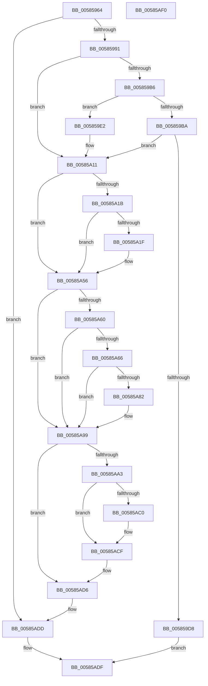

# HvlpInitializeBootProcessor

- RVA: `0x00585964`–`0x00585AF1` (길이 `397` bytes)
- VA: `0x0000000140585964`
- 실행 섹션: `.text`
- PDB 이름 있음: `예`; PDB Function 태그: `아니요`
- unwind 정보 RVA: `0x000BD1CC`
- 디코드: `106`개 명령, `397/397` bytes 표시
- 미해석 바이트: `0` (있으면 어셈블리에 `.byte`로 보존)

> 이 문서는 커널 이미지의 기계어와 PDB 기호를 분석해 생성했습니다. 4번과 5번은 함수 원형과 자료형을 바이너리 사용 방식에서 추정한 C 해석이며 원본 소스 복구 결과는 아닙니다.

## 1. Dependencies

- 직접 호출 지점: **12**; 고유 호출 대상: **8**
- 직접 호출자로 확인된 함수: **1**
- RIP 상대 이미지 참조: **3**

### Outgoing calls
- `0x005859C7` → [HvlpAllocateEarlyPages](HvlpAllocateEarlyPages_function_0058D3DC.md) (function, `0x0058D3DC`)
- `0x005859EB` → [HvlpGetRegister64](../37/HvlpGetRegister64_function_00379050.md) (function, `0x00379050`)
- `0x00585A05` → [HvlpMapEarlyPages](HvlpMapEarlyPages_function_0058D504.md) (function, `0x0058D504`)
- `0x00585A28` → [HvlpGetRegister64](../37/HvlpGetRegister64_function_00379050.md) (function, `0x00379050`)
- `0x00585A30` → [HvlGetLpIndexFromProcessorIndex](../44/HvlGetLpIndexFromProcessorIndex_function_0044FFE0.md) (function, `0x0044FFE0`)
- `0x00585A37` → [HvlpGetLpcbByLpIndex](../44/HvlpGetLpcbByLpIndex_function_0044FFA0.md) (function, `0x0044FFA0`)
- `0x00585A4D` → [HvlpMapEarlyPages](HvlpMapEarlyPages_function_0058D504.md) (function, `0x0058D504`)
- `0x00585A75` → [HvlpAllocateEarlyPages](HvlpAllocateEarlyPages_function_0058D3DC.md) (function, `0x0058D3DC`)
- `0x00585A8D` → [memset](../6C/memset_function_006C6C40.md) (function, `0x006C6C40`)
- `0x00585AB7` → [HvlpMapStatisticsPage](HvlpMapStatisticsPage_function_00585B68.md) (function, `0x00585B68`)
- `0x00585AC7` → [HvlpMapEarlyPages](HvlpMapEarlyPages_function_0058D504.md) (function, `0x0058D504`)
- `0x00585AD8` → [HvlEnlightenProcessor](../4D/HvlEnlightenProcessor_function_004DCD9C.md) (function, `0x004DCD9C`)

### Direct callers
- [HvlPhase0Initialize](../../page/71/HvlPhase0Initialize_function_00717AC8.md) at `0x00717BB0`

### Static image references
- `0x0058597C` → RVA `0x00FC6A97` (`ALMOSTRO`; read)
- `0x0058599E` → RVA `0x00FC6A90` (`ALMOSTRO`; read)
- `0x00585A99` → RVA `0x00FC6AD8` (`ALMOSTRO`; read)

## 2. Other-region calls and transfers

- 다른 실행 섹션으로 향하는 call: **0**
- 별도 외부 분기/꼬리 이동을 확인하지 못했습니다.

## 3. Assembly (complete function range)

```asm
00585964  48 89 5C 24 08                  mov qword ptr [rsp + 8], rbx
00585969  55                              push rbp
0058596A  56                              push rsi
0058596B  57                              push rdi
0058596C  41 54                           push r12
0058596E  41 56                           push r14
00585970  48 8B EC                        mov rbp, rsp
00585973  48 83 EC 40                     sub rsp, 0x40
00585977  33 FF                           xor edi, edi
00585979  4C 8B F1                        mov r14, rcx
0058597C  40 38 3D 14 11 A4 00            cmp byte ptr [rip + 0xa41114], dil
00585983  48 89 7D 40                     mov qword ptr [rbp + 0x40], rdi
00585987  48 89 7D 38                     mov qword ptr [rbp + 0x38], rdi
0058598B  0F 84 4C 01 00 00               je 0x140585add
00585991  65 48 8B 34 25 20 00 00 00      mov rsi, qword ptr gs:[0x20]
0058599A  F0 09 3C 24                     lock or dword ptr [rsp], edi
0058599E  8B 05 EC 10 A4 00               mov eax, dword ptr [rip + 0xa410ec]
005859A4  44 8D 67 04                     lea r12d, [rdi + 4]
005859A8  48 89 7D E0                     mov qword ptr [rbp - 0x20], rdi
005859AC  48 89 7D 48                     mov qword ptr [rbp + 0x48], rdi
005859B0  0F BA E0 13                     bt eax, 0x13
005859B4  73 5B                           jae 0x140585a11
005859B6  A8 02                           test al, 2
005859B8  75 28                           jne 0x1405859e2
005859BA  4C 8D 86 E0 8B 00 00            lea r8, [rsi + 0x8be0]
005859C1  45 8B CC                        mov r9d, r12d
005859C4  8D 57 01                        lea edx, [rdi + 1]
005859C7  E8 10 7A 00 00                  call 0x14058d3dc
005859CC  48 89 86 08 8C 00 00            mov qword ptr [rsi + 0x8c08], rax
005859D3  48 85 C0                        test rax, rax
005859D6  75 39                           jne 0x140585a11
005859D8  B8 9A 00 00 C0                  mov eax, 0xc000009a
005859DD  E9 FD 00 00 00                  jmp 0x140585adf
005859E2  48 8D 55 38                     lea rdx, [rbp + 0x38]
005859E6  B9 13 00 09 00                  mov ecx, 0x90013
005859EB  E8 60 36 DF FF                  call 0x140379050
005859F0  48 8B 4D 38                     mov rcx, qword ptr [rbp + 0x38]
005859F4  45 8B C4                        mov r8d, r12d
005859F7  48 81 E1 00 F0 FF FF            and rcx, 0xfffffffffffff000
005859FE  48 89 8E E0 8B 00 00            mov qword ptr [rsi + 0x8be0], rcx
00585A05  E8 FA 7A 00 00                  call 0x14058d504
00585A0A  48 89 86 08 8C 00 00            mov qword ptr [rsi + 0x8c08], rax
00585A11  8B 05 79 10 A4 00               mov eax, dword ptr [rip + 0xa41079]
00585A17  A8 02                           test al, 2
00585A19  74 3B                           je 0x140585a56
00585A1B  A8 20                           test al, 0x20
00585A1D  74 37                           je 0x140585a56
00585A1F  48 8D 55 40                     lea rdx, [rbp + 0x40]
00585A23  B9 13 00 0A 00                  mov ecx, 0xa0013
00585A28  E8 23 36 DF FF                  call 0x140379050
00585A2D  8B 4E 24                        mov ecx, dword ptr [rsi + 0x24]
00585A30  E8 AB A5 EC FF                  call 0x14044ffe0
00585A35  8B C8                           mov ecx, eax
00585A37  E8 64 A5 EC FF                  call 0x14044ffa0
00585A3C  48 8B 4D 40                     mov rcx, qword ptr [rbp + 0x40]
00585A40  45 8B C4                        mov r8d, r12d
00585A43  48 81 E1 00 F0 FF FF            and rcx, 0xfffffffffffff000
00585A4A  48 8B D8                        mov rbx, rax
00585A4D  E8 B2 7A 00 00                  call 0x14058d504
00585A52  48 89 43 20                     mov qword ptr [rbx + 0x20], rax
00585A56  8B 05 34 10 A4 00               mov eax, dword ptr [rip + 0xa41034]
00585A5C  A8 02                           test al, 2
00585A5E  75 39                           jne 0x140585a99
00585A60  0F BA E0 0F                     bt eax, 0xf
00585A64  73 33                           jae 0x140585a99
00585A66  45 8B CC                        mov r9d, r12d
00585A69  4C 8D 45 E0                     lea r8, [rbp - 0x20]
00585A6D  BA 01 00 00 00                  mov edx, 1
00585A72  49 8B CE                        mov rcx, r14
00585A75  E8 62 79 00 00                  call 0x14058d3dc
00585A7A  48 8B D8                        mov rbx, rax
00585A7D  48 85 C0                        test rax, rax
00585A80  74 17                           je 0x140585a99
00585A82  33 D2                           xor edx, edx
00585A84  41 B8 80 00 00 00               mov r8d, 0x80
00585A8A  48 8B C8                        mov rcx, rax
00585A8D  E8 AE 11 14 00                  call 0x1406c6c40
00585A92  48 89 9E B8 8E 00 00            mov qword ptr [rsi + 0x8eb8], rbx
00585A99  8B 05 39 10 A4 00               mov eax, dword ptr [rip + 0xa41039]
00585A9F  A8 10                           test al, 0x10
00585AA1  74 33                           je 0x140585ad6
00585AA3  0F 57 C0                        xorps xmm0, xmm0
00585AA6  4C 8D 45 48                     lea r8, [rbp + 0x48]
00585AAA  48 8D 55 E8                     lea rdx, [rbp - 0x18]
00585AAE  B9 02 00 00 00                  mov ecx, 2
00585AB3  0F 11 45 E8                     movups xmmword ptr [rbp - 0x18], xmm0
00585AB7  E8 AC 00 00 00                  call 0x140585b68
00585ABC  85 C0                           test eax, eax
00585ABE  78 0F                           js 0x140585acf
00585AC0  48 8B 4D 48                     mov rcx, qword ptr [rbp + 0x48]
00585AC4  45 8B C4                        mov r8d, r12d
00585AC7  E8 38 7A 00 00                  call 0x14058d504
00585ACC  48 8B F8                        mov rdi, rax
00585ACF  48 89 BE D0 8B 00 00            mov qword ptr [rsi + 0x8bd0], rdi
00585AD6  33 C9                           xor ecx, ecx
00585AD8  E8 BF 72 F5 FF                  call 0x1404dcd9c
00585ADD  33 C0                           xor eax, eax
00585ADF  48 8B 5C 24 70                  mov rbx, qword ptr [rsp + 0x70]
00585AE4  48 83 C4 40                     add rsp, 0x40
00585AE8  41 5E                           pop r14
00585AEA  41 5C                           pop r12
00585AEC  5F                              pop rdi
00585AED  5E                              pop rsi
00585AEE  5D                              pop rbp
00585AEF  C3                              ret
00585AF0  CC                              int3
```

## 4. C-style interpretation (structured pseudocode)

```c
__int64 __fastcall HvlpInitializeBootProcessor(__int64 a1)
{
    __int64 result;
    __int64 v_rbx;
    __int64 v_rdi;
    __int64 v_rsp;
    unsigned __int64 v_stack_m40;
    unsigned __int64 v_stack_m48;
    unsigned int v_stack_m68;
    unsigned __int64 v_stack_p10;
    unsigned __int64 v_stack_p18;
    unsigned __int64 v_stack_p20;
    unsigned __int64 v_stack_p8;

    v_stack_p8 = v_rbx;
    v_rsp = (v_rsp) - (64);
    v_rdi = 0;
    v_stack_p18 = 0;
    v_stack_p10 = 0;
    if ((*(unsigned __int8 *)(v_rip + 10752276)) == 0) goto loc_00585ADD;
    v_stack_m48 = 0;
    v_stack_p20 = 0;
    if ((*(unsigned __int8 *)(v_rip + 10752276)) >= 0) goto loc_00585A11;
    if ((((unsigned __int8)((unsigned int)(*(unsigned int *)(v_rip + 10752236)))) & (2)) != 0) goto loc_005859E2;
    result = HvlpAllocateEarlyPages(a1, v_rdi + 1, *(unsigned __int64 *)(gs_base + (0 + 32)) + 35808, (unsigned int)((unsigned int)(v_rdi + 4)));
    *(unsigned __int64 *)(*(unsigned __int64 *)(gs_base + (0 + 32)) + 35848) = result;
    if (result != 0) goto loc_00585A11;
    goto loc_00585ADF;
loc_005859E2:
    result = HvlpGetRegister64((unsigned int)(0x90013ULL), v_stack_p10, *(unsigned __int64 *)(gs_base + (0 + 32)) + 35808, (unsigned int)((unsigned int)(v_rdi + 4)));
    a1 = (v_stack_p10) & (0xFFFFFFFFFFFFF000ULL);
    *(unsigned __int64 *)(*(unsigned __int64 *)(gs_base + (0 + 32)) + 35808) = a1;
    result = HvlpMapEarlyPages(a1, v_stack_p10, (unsigned int)((unsigned int)(v_rdi + 4)), (unsigned int)((unsigned int)(v_rdi + 4)));
    *(unsigned __int64 *)(*(unsigned __int64 *)(gs_base + (0 + 32)) + 35848) = result;
loc_00585A11:
    if ((((unsigned __int8)((unsigned int)(*(unsigned int *)(v_rip + 10752121)))) & (2)) == 0) goto loc_00585A56;
    result = (unsigned int)(*(unsigned int *)(v_rip + 10752121));
    if ((((unsigned __int8)((unsigned int)(*(unsigned int *)(v_rip + 10752121)))) & (32)) != 0) {
        a2 = v_stack_p18;
        a1 = 0xA0013ULL;
        result = HvlpGetRegister64(a1, a2, (unsigned int)((unsigned int)(v_rdi + 4)), (unsigned int)((unsigned int)(v_rdi + 4)));
        a1 = *(unsigned int *)(*(unsigned __int64 *)(gs_base + (0 + 32)) + 36);
        result = HvlGetLpIndexFromProcessorIndex(a1, a2, (unsigned int)((unsigned int)(v_rdi + 4)), (unsigned int)((unsigned int)(v_rdi + 4)));
        a1 = (unsigned int)(result);
        result = HvlpGetLpcbByLpIndex(a1, a2, (unsigned int)((unsigned int)(v_rdi + 4)), (unsigned int)((unsigned int)(v_rdi + 4)));
        a1 = v_stack_p18;
        a3 = (unsigned int)(v_rdi + 4);
        a1 = (a1) & (0xFFFFFFFFFFFFF000ULL);
        v_rbx = result;
        result = HvlpMapEarlyPages(a1, a2, a3, (unsigned int)((unsigned int)(v_rdi + 4)));
        *(unsigned __int64 *)(v_rbx + 32) = result;
    }
    if ((((unsigned __int8)((unsigned int)(*(unsigned int *)(v_rip + 10752052)))) & (2)) != 0) goto loc_00585A99;
    if (condition_is_above_or_equal) goto loc_00585A99;
    result = HvlpAllocateEarlyPages(a1, 1, v_stack_m48, (unsigned int)((unsigned int)(v_rdi + 4)));
    if (result != 0) {
        a2 = 0;
        a3 = 128;
        a1 = result;
        result = memset(a1, a2, a3, (unsigned int)((unsigned int)(v_rdi + 4)));
        *(unsigned __int64 *)(*(unsigned __int64 *)(gs_base + (0 + 32)) + 36536) = result;
    }
    if ((((unsigned __int8)((unsigned int)(*(unsigned int *)(v_rip + 10752057)))) & (16)) == 0) goto loc_00585AD6;
    v_stack_m40 = v_xmm0;
    result = HvlpMapStatisticsPage(2, v_stack_m40, v_stack_p20, (unsigned int)((unsigned int)(v_rdi + 4)));
    if (!(sign_flag)) {
        a1 = v_stack_p20;
        a3 = (unsigned int)(v_rdi + 4);
        result = HvlpMapEarlyPages(a1, v_stack_m40, a3, (unsigned int)((unsigned int)(v_rdi + 4)));
        v_rdi = result;
    }
    *(unsigned __int64 *)(*(unsigned __int64 *)(gs_base + (0 + 32)) + 35792) = v_rdi;
loc_00585AD6:
    a1 = 0;
    result = HvlEnlightenProcessor(a1, v_stack_m40, a3, (unsigned int)((unsigned int)(v_rdi + 4)));
loc_00585ADD:
    result = 0;
loc_00585ADF:
    v_rsp = (v_rsp) + (64);
    return result;
}
```

## 5. (Beta) C Style

```c
int64_t HvlpInitializeBootProcessor(int64_t Arg1)
{
    int64_t result;
    int64_t local_rbx;
    int64_t local_rdi;
    int64_t local_rsp;
    uint64_t v_stack_m40;
    uint64_t v_stack_m48;
    uint32_t v_stack_m68;
    uint64_t v_stack_p10;
    uint64_t v_stack_p18;
    uint64_t v_stack_p20;
    uint64_t v_stack_p8;

    v_stack_p8 = local_rbx;
    local_rsp = (local_rsp) - (64);
    local_rdi = 0;
    v_stack_p18 = 0;
    v_stack_p10 = 0;
    if ((*(uint8_t *)(v_rip + 0xA41114)) == 0) goto loc_00585ADD;
    v_stack_m48 = 0;
    v_stack_p20 = 0;
    if ((*(uint8_t *)(v_rip + 0xA41114)) >= 0) goto loc_00585A11;
    if ((((uint8_t)((uint32_t)(*(uint32_t *)(v_rip + 0xA410EC)))) & (2)) != 0) goto loc_005859E2;
    result = HvlpAllocateEarlyPages(Arg1, local_rdi + 1, *(uint64_t *)(gs_base + (0 + 0x20)) + 35808, (uint32_t)((uint32_t)(local_rdi + 4)));
    *(uint64_t *)(*(uint64_t *)(gs_base + (0 + 0x20)) + 0x8C08) = result;
    if (result != 0) goto loc_00585A11;
    goto loc_00585ADF;
loc_005859E2:
    result = HvlpGetRegister64((uint32_t)(0x90013ULL), v_stack_p10, *(uint64_t *)(gs_base + (0 + 0x20)) + 35808, (uint32_t)((uint32_t)(local_rdi + 4)));
    Arg1 = (v_stack_p10) & (0xFFFFFFFFFFFFF000ULL);
    *(uint64_t *)(*(uint64_t *)(gs_base + (0 + 0x20)) + 0x8BE0) = Arg1;
    result = HvlpMapEarlyPages(Arg1, v_stack_p10, (uint32_t)((uint32_t)(local_rdi + 4)), (uint32_t)((uint32_t)(local_rdi + 4)));
    *(uint64_t *)(*(uint64_t *)(gs_base + (0 + 0x20)) + 0x8C08) = result;
loc_00585A11:
    if ((((uint8_t)((uint32_t)(*(uint32_t *)(v_rip + 0xA41079)))) & (2)) == 0) goto loc_00585A56;
    result = (uint32_t)(*(uint32_t *)(v_rip + 0xA41079));
    if ((((uint8_t)((uint32_t)(*(uint32_t *)(v_rip + 0xA41079)))) & (32)) != 0) {
        a2 = v_stack_p18;
        Arg1 = 0xA0013ULL;
        result = HvlpGetRegister64(Arg1, a2, (uint32_t)((uint32_t)(local_rdi + 4)), (uint32_t)((uint32_t)(local_rdi + 4)));
        Arg1 = *(uint32_t *)(*(uint64_t *)(gs_base + (0 + 0x20)) + 0x24);
        result = HvlGetLpIndexFromProcessorIndex(Arg1, a2, (uint32_t)((uint32_t)(local_rdi + 4)), (uint32_t)((uint32_t)(local_rdi + 4)));
        Arg1 = (uint32_t)(result);
        result = HvlpGetLpcbByLpIndex(Arg1, a2, (uint32_t)((uint32_t)(local_rdi + 4)), (uint32_t)((uint32_t)(local_rdi + 4)));
        Arg1 = v_stack_p18;
        a3 = (uint32_t)(local_rdi + 4);
        Arg1 = (Arg1) & (0xFFFFFFFFFFFFF000ULL);
        local_rbx = result;
        result = HvlpMapEarlyPages(Arg1, a2, a3, (uint32_t)((uint32_t)(local_rdi + 4)));
        *(uint64_t *)(local_rbx + 0x20) = result;
    }
    if ((((uint8_t)((uint32_t)(*(uint32_t *)(v_rip + 0xA41034)))) & (2)) != 0) goto loc_00585A99;
    if (condition_is_above_or_equal) goto loc_00585A99;
    result = HvlpAllocateEarlyPages(Arg1, 1, v_stack_m48, (uint32_t)((uint32_t)(local_rdi + 4)));
    if (result != 0) {
        a2 = 0;
        a3 = 128;
        Arg1 = result;
        result = memset(Arg1, a2, a3, (uint32_t)((uint32_t)(local_rdi + 4)));
        *(uint64_t *)(*(uint64_t *)(gs_base + (0 + 0x20)) + 0x8EB8) = result;
    }
    if ((((uint8_t)((uint32_t)(*(uint32_t *)(v_rip + 0xA41039)))) & (16)) == 0) goto loc_00585AD6;
    v_stack_m40 = v_xmm0;
    result = HvlpMapStatisticsPage(2, v_stack_m40, v_stack_p20, (uint32_t)((uint32_t)(local_rdi + 4)));
    if (!(sign_flag)) {
        Arg1 = v_stack_p20;
        a3 = (uint32_t)(local_rdi + 4);
        result = HvlpMapEarlyPages(Arg1, v_stack_m40, a3, (uint32_t)((uint32_t)(local_rdi + 4)));
        local_rdi = result;
    }
    *(uint64_t *)(*(uint64_t *)(gs_base + (0 + 0x20)) + 0x8BD0) = local_rdi;
loc_00585AD6:
    Arg1 = 0;
    result = HvlEnlightenProcessor(Arg1, v_stack_m40, a3, (uint32_t)((uint32_t)(local_rdi + 4)));
loc_00585ADD:
    result = 0;
loc_00585ADF:
    local_rsp = (local_rsp) + (64);
    return result;
}
```

## 6. Execution-region graph

[열기: 2D/3D 그래프와 함수 탐색 컨트롤 패널](../../../control-panel.html?section=text&rva=0x00585964&view=graph)

- 2D 그래프는 위에서 아래로 흐르고, 3D 그래프는 빈 공간을 드래그해 회전합니다. Shift+드래그는 이동, 휠은 확대·축소, 함수 노드 선택은 대상 보고서 이동입니다.

### Static fallback


