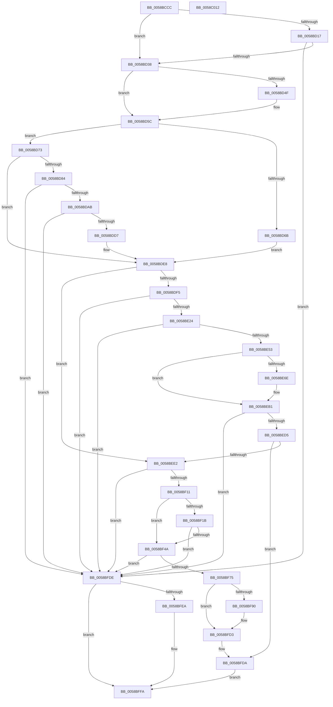

# HvlpInitializeHvCrashdump

- RVA: `0x0058BCCC`–`0x0058C013` (길이 `839` bytes)
- VA: `0x000000014058BCCC`
- 실행 섹션: `.text`
- PDB 이름 있음: `예`; PDB Function 태그: `아니요`
- unwind 정보 RVA: `0x000C6928`
- 디코드: `176`개 명령, `839/839` bytes 표시
- 미해석 바이트: `0` (있으면 어셈블리에 `.byte`로 보존)

> 이 문서는 커널 이미지의 기계어와 PDB 기호를 분석해 생성했습니다. 4번과 5번은 함수 원형과 자료형을 바이너리 사용 방식에서 추정한 C 해석이며 원본 소스 복구 결과는 아닙니다.

## 1. Dependencies

- 직접 호출 지점: **20**; 고유 호출 대상: **10**
- 직접 호출자로 확인된 함수: **1**
- RIP 상대 이미지 참조: **41**

### Outgoing calls
- `0x0058BD23` → [MmMapIoSpaceEx](../32/MmMapIoSpaceEx_function_00327830.md) (function, `0x00327830`)
- `0x0058BD3E` → [MmAllocateIndependentPages](../../page/AA/MmAllocateIndependentPages_function_00AA0CE0.md) (function, `0x00AA0CE0`)
- `0x0058BD57` → [memset](../6C/memset_function_006C6C40.md) (function, `0x006C6C40`)
- `0x0058BD5C` → [Feature_OfflineDumpRedaction__private_IsEnabledDeviceUsageNoInline](Feature_OfflineDumpRedaction__private_IsEnabledDeviceUsageNoInline_function_0058AEF8.md) (function, `0x0058AEF8`)
- `0x0058BD96` → [MmMapIoSpaceEx](../32/MmMapIoSpaceEx_function_00327830.md) (function, `0x00327830`)
- `0x0058BDC2` → [ExAllocatePool2](../../poolcode/B8/ExAllocatePool2_function_00B820F0.md) (function, `0x00B820F0`)
- `0x0058BDE3` → [memset](../6C/memset_function_006C6C40.md) (function, `0x006C6C40`)
- `0x0058BE17` → [KeRegisterBugCheckReasonCallback](../47/KeRegisterBugCheckReasonCallback_function_004720A0.md) (function, `0x004720A0`)
- `0x0058BE46` → [KeRegisterBugCheckReasonCallback](../47/KeRegisterBugCheckReasonCallback_function_004720A0.md) (function, `0x004720A0`)
- `0x0058BE61` → [ExAllocatePool2](../../poolcode/B8/ExAllocatePool2_function_00B820F0.md) (function, `0x00B820F0`)
- `0x0058BE89` → [KeAcquireSpinLockRaiseToDpc](../20/KeAcquireSpinLockRaiseToDpc_function_00208470.md) (function, `0x00208470`)
- `0x0058BEA8` → [KeReleaseSpinLock](../39/KeReleaseSpinLock_function_00392BA0.md) (function, `0x00392BA0`)
- `0x0058BEC0` → [MmAllocateMappingAddress](../../page/A7/MmAllocateMappingAddress_function_00A72690.md) (function, `0x00A72690`)
- `0x0058BF04` → [KeRegisterBugCheckReasonCallback](../47/KeRegisterBugCheckReasonCallback_function_004720A0.md) (function, `0x004720A0`)
- `0x0058BF3D` → [KeRegisterBugCheckReasonCallback](../47/KeRegisterBugCheckReasonCallback_function_004720A0.md) (function, `0x004720A0`)
- `0x0058BF6C` → [KeRegisterBugCheckReasonCallback](../47/KeRegisterBugCheckReasonCallback_function_004720A0.md) (function, `0x004720A0`)
- `0x0058BF83` → [ExAllocatePool2](../../poolcode/B8/ExAllocatePool2_function_00B820F0.md) (function, `0x00B820F0`)
- `0x0058BFAB` → [KeAcquireSpinLockRaiseToDpc](../20/KeAcquireSpinLockRaiseToDpc_function_00208470.md) (function, `0x00208470`)
- `0x0058BFCA` → [KeReleaseSpinLock](../39/KeReleaseSpinLock_function_00392BA0.md) (function, `0x00392BA0`)
- `0x0058BFED` → [MmFreeIndependentPages](../2A/MmFreeIndependentPages_function_002A2510.md) (function, `0x002A2510`)

### Direct callers
- [HvlPhase1Initialize](HvlPhase1Initialize_function_00583D80.md) at `0x00583E8B`

### Static image references
- `0x0058BCF5` → RVA `0x00F8EDB0` (`.data`; write)
- `0x0058BCFF` → RVA `0x00F8EDA8` (`.data`; write)
- `0x0058BD06` → RVA `0x00F8ED98` (`.data`; write)
- `0x0058BD0C` → RVA `0x00F8ED90` (`.data`; write)
- `0x0058BD28` → RVA `0x00F8ED88` (`.data`; write)
- `0x0058BD43` → RVA `0x00F8ECA0` (`.data`; write)
- `0x0058BD6B` → RVA `0x00F8ECAC` (`.data`; write)
- `0x0058BD73` → RVA `0x00F8EDB0` (`.data`; read)
- `0x0058BD84` → RVA `0x00F8EDA8` (`.data`; read)
- `0x0058BD9B` → RVA `0x00F8EDA0` (`.data`; write)
- `0x0058BDB9` → RVA `0x00F8ECB8` (`.data`; write)
- `0x0058BDC7` → RVA `0x00F8ECB0` (`.data`; write)
- `0x0058BDD7` → RVA `0x00F8ECB8` (`.data`; read)
- `0x0058BDE8` → RVA `0x00FC6A84` (`ALMOSTRO`; read)
- `0x0058BDF5` → RVA `0x006C98B0` (` ?? ::FNODOBFM::`string'`; read)
- `0x0058BDFC` → RVA `0x00F8ECF4` (`.data`; write)
- `0x0058BE09` → RVA `0x0058B340` (`HvlBugCheckCallbackRoutine`; read)
- `0x0058BE10` → RVA `0x00F8ECC8` (`.data`; read)
- `0x0058BE24` → RVA `0x006C9910` (` ?? ::FNODOBFM::`string'`; read)
- `0x0058BE2B` → RVA `0x00F8ED24` (`.data`; write)
- `0x0058BE38` → RVA `0x0058AF50` (`HvlAddPagesCallbackRoutine`; read)
- `0x0058BE3F` → RVA `0x00F8ECF8` (`.data`; read)
- `0x0058BE73` → RVA `0x0058B650` (`HvlCrashdumpCallbackRoutine`; read)
- `0x0058BE7A` → RVA `0x00F475B0` (`.data`; read)
- `0x0058BE97` → RVA `0x00F475A8` (`.data`; read)
- `0x0058BEA1` → RVA `0x00F475A8` (`.data`; write)
- `0x0058BEB6` → RVA `0x00F8ECC0` (`.data`; write)
- `0x0058BEC5` → RVA `0x00F8EDB8` (`.data`; write)
- `0x0058BEE2` → RVA `0x006C98F0` (` ?? ::FNODOBFM::`string'`; read)
- `0x0058BEE9` → RVA `0x00F8ED54` (`.data`; write)
- `0x0058BEF6` → RVA `0x0058B830` (`HvlSkBugCheckCallbackRoutine`; read)
- `0x0058BEFD` → RVA `0x00F8ED28` (`.data`; read)
- `0x0058BF11` → RVA `0x00FC6A90` (`ALMOSTRO`; read)
- `0x0058BF2F` → RVA `0x0058B070` (`HvlAddSecureHvPagesCallbackRoutine`; read)
- `0x0058BF4A` → RVA `0x006C98D0` (` ?? ::FNODOBFM::`string'`; read)
- `0x0058BF51` → RVA `0x00F8ED84` (`.data`; write)
- `0x0058BF5E` → RVA `0x0058B2F0` (`HvlAddSecureSkPagesCallbackRoutine`; read)
- `0x0058BF65` → RVA `0x00F8ED58` (`.data`; read)
- `0x0058BF95` → RVA `0x0058B870` (`HvlSkCrashdumpCallbackRoutine`; read)
- `0x0058BFDE` → RVA `0x00F8ECA0` (`.data`; read)
- `0x0058BFF2` → RVA `0x00F8ECA0` (`.data`; read/write)

## 2. Other-region calls and transfers

- 다른 실행 섹션으로 향하는 call: **5**
  - `0x0058BD3E` → [MmAllocateIndependentPages](../../page/AA/MmAllocateIndependentPages_function_00AA0CE0.md) (`.text` → `PAGE`)
  - `0x0058BDC2` → [ExAllocatePool2](../../poolcode/B8/ExAllocatePool2_function_00B820F0.md) (`.text` → `POOLCODE`)
  - `0x0058BE61` → [ExAllocatePool2](../../poolcode/B8/ExAllocatePool2_function_00B820F0.md) (`.text` → `POOLCODE`)
  - `0x0058BEC0` → [MmAllocateMappingAddress](../../page/A7/MmAllocateMappingAddress_function_00A72690.md) (`.text` → `PAGE`)
  - `0x0058BF83` → [ExAllocatePool2](../../poolcode/B8/ExAllocatePool2_function_00B820F0.md) (`.text` → `POOLCODE`)
- 별도 외부 분기/꼬리 이동을 확인하지 못했습니다.

## 3. Assembly (complete function range)

```asm
0058BCCC  48 89 5C 24 08                  mov qword ptr [rsp + 8], rbx
0058BCD1  48 89 7C 24 10                  mov qword ptr [rsp + 0x10], rdi
0058BCD6  4C 89 74 24 18                  mov qword ptr [rsp + 0x18], r14
0058BCDB  41 57                           push r15
0058BCDD  48 83 EC 20                     sub rsp, 0x20
0058BCE1  8B 51 04                        mov edx, dword ptr [rcx + 4]
0058BCE4  BF 01 00 00 C0                  mov edi, 0xc0000001
0058BCE9  8B 01                           mov eax, dword ptr [rcx]
0058BCEB  41 BE 00 10 00 00               mov r14d, 0x1000
0058BCF1  4C 8B 49 10                     mov r9, qword ptr [rcx + 0x10]
0058BCF5  89 05 B5 30 A0 00               mov dword ptr [rip + 0xa030b5], eax
0058BCFB  48 8B 41 08                     mov rax, qword ptr [rcx + 8]
0058BCFF  48 89 05 A2 30 A0 00            mov qword ptr [rip + 0xa030a2], rax
0058BD06  89 15 8C 30 A0 00               mov dword ptr [rip + 0xa0308c], edx
0058BD0C  4C 89 0D 7D 30 A0 00            mov qword ptr [rip + 0xa0307d], r9
0058BD13  85 D2                           test edx, edx
0058BD15  74 21                           je 0x14058bd38
0058BD17  C1 E2 0C                        shl edx, 0xc
0058BD1A  41 B8 02 00 00 00               mov r8d, 2
0058BD20  49 8B C9                        mov rcx, r9
0058BD23  E8 08 BB D9 FF                  call 0x140327830
0058BD28  48 89 05 59 30 A0 00            mov qword ptr [rip + 0xa03059], rax
0058BD2F  48 85 C0                        test rax, rax
0058BD32  0F 84 A6 02 00 00               je 0x14058bfde
0058BD38  83 CA FF                        or edx, 0xffffffff
0058BD3B  49 8B CE                        mov rcx, r14
0058BD3E  E8 9D 4F 51 00                  call 0x140aa0ce0
0058BD43  48 89 05 56 2F A0 00            mov qword ptr [rip + 0xa02f56], rax
0058BD4A  48 85 C0                        test rax, rax
0058BD4D  74 0D                           je 0x14058bd5c
0058BD4F  4D 8B C6                        mov r8, r14
0058BD52  33 D2                           xor edx, edx
0058BD54  48 8B C8                        mov rcx, rax
0058BD57  E8 E4 AE 13 00                  call 0x1406c6c40
0058BD5C  E8 97 F1 FF FF                  call 0x14058aef8
0058BD61  41 BF 40 00 00 00               mov r15d, 0x40
0058BD67  85 C0                           test eax, eax
0058BD69  75 08                           jne 0x14058bd73
0058BD6B  88 05 3B 2F A0 00               mov byte ptr [rip + 0xa02f3b], al
0058BD71  EB 75                           jmp 0x14058bde8
0058BD73  8B 05 37 30 A0 00               mov eax, dword ptr [rip + 0xa03037]
0058BD79  C6 05 2C 2F A0 00 01            mov byte ptr [rip + 0xa02f2c], 1
0058BD80  85 C0                           test eax, eax
0058BD82  74 64                           je 0x14058bde8
0058BD84  48 8B 0D 1D 30 A0 00            mov rcx, qword ptr [rip + 0xa0301d]
0058BD8B  41 B8 02 00 00 00               mov r8d, 2
0058BD91  C1 E0 0C                        shl eax, 0xc
0058BD94  8B D0                           mov edx, eax
0058BD96  E8 95 BA D9 FF                  call 0x140327830
0058BD9B  48 89 05 FE 2F A0 00            mov qword ptr [rip + 0xa02ffe], rax
0058BDA2  48 85 C0                        test rax, rax
0058BDA5  0F 84 33 02 00 00               je 0x14058bfde
0058BDAB  8B 80 2C 03 00 00               mov eax, dword ptr [rax + 0x32c]
0058BDB1  41 B8 48 56 4C 20               mov r8d, 0x204c5648
0058BDB7  8B D0                           mov edx, eax
0058BDB9  89 05 F9 2E A0 00               mov dword ptr [rip + 0xa02ef9], eax
0058BDBF  49 8B CF                        mov rcx, r15
0058BDC2  E8 29 63 5F 00                  call 0x140b820f0
0058BDC7  48 89 05 E2 2E A0 00            mov qword ptr [rip + 0xa02ee2], rax
0058BDCE  48 85 C0                        test rax, rax
0058BDD1  0F 84 07 02 00 00               je 0x14058bfde
0058BDD7  44 8B 05 DA 2E A0 00            mov r8d, dword ptr [rip + 0xa02eda]
0058BDDE  33 D2                           xor edx, edx
0058BDE0  48 8B C8                        mov rcx, rax
0058BDE3  E8 58 AE 13 00                  call 0x1406c6c40
0058BDE8  80 3D 95 AC A3 00 00            cmp byte ptr [rip + 0xa3ac95], 0
0058BDEF  0F 85 ED 00 00 00               jne 0x14058bee2
0058BDF5  4C 8D 0D B4 DA 13 00            lea r9, [rip + 0x13dab4]
0058BDFC  C6 05 F1 2E A0 00 00            mov byte ptr [rip + 0xa02ef1], 0
0058BE03  41 B8 02 00 00 00               mov r8d, 2
0058BE09  48 8D 15 30 F5 FF FF            lea rdx, [rip - 0xad0]
0058BE10  48 8D 0D B1 2E A0 00            lea rcx, [rip + 0xa02eb1]
0058BE17  E8 84 62 EE FF                  call 0x1404720a0
0058BE1C  84 C0                           test al, al
0058BE1E  0F 84 BA 01 00 00               je 0x14058bfde
0058BE24  4C 8D 0D E5 DA 13 00            lea r9, [rip + 0x13dae5]
0058BE2B  C6 05 F2 2E A0 00 00            mov byte ptr [rip + 0xa02ef2], 0
0058BE32  41 B8 04 00 00 00               mov r8d, 4
0058BE38  48 8D 15 11 F1 FF FF            lea rdx, [rip - 0xeef]
0058BE3F  48 8D 0D B2 2E A0 00            lea rcx, [rip + 0xa02eb2]
0058BE46  E8 55 62 EE FF                  call 0x1404720a0
0058BE4B  84 C0                           test al, al
0058BE4D  0F 84 8B 01 00 00               je 0x14058bfde
0058BE53  BA 20 00 00 00                  mov edx, 0x20
0058BE58  41 B8 4B 4E 4D 49               mov r8d, 0x494d4e4b
0058BE5E  49 8B CF                        mov rcx, r15
0058BE61  E8 8A 62 5F 00                  call 0x140b820f0
0058BE66  48 8B D8                        mov rbx, rax
0058BE69  48 85 C0                        test rax, rax
0058BE6C  74 43                           je 0x14058beb1
0058BE6E  48 83 63 10 00                  and qword ptr [rbx + 0x10], 0
0058BE73  48 8D 05 D6 F7 FF FF            lea rax, [rip - 0x82a]
0058BE7A  48 8D 0D 2F B7 9B 00            lea rcx, [rip + 0x9bb72f]
0058BE81  48 89 43 08                     mov qword ptr [rbx + 8], rax
0058BE85  48 89 5B 18                     mov qword ptr [rbx + 0x18], rbx
0058BE89  E8 E2 C5 C7 FF                  call 0x140208470
0058BE8E  8A D0                           mov dl, al
0058BE90  48 8D 0D 19 B7 9B 00            lea rcx, [rip + 0x9bb719]
0058BE97  48 8B 05 0A B7 9B 00            mov rax, qword ptr [rip + 0x9bb70a]
0058BE9E  48 89 03                        mov qword ptr [rbx], rax
0058BEA1  48 89 1D 00 B7 9B 00            mov qword ptr [rip + 0x9bb700], rbx
0058BEA8  E8 F3 6C E0 FF                  call 0x140392ba0
0058BEAD  48 8B 43 18                     mov rax, qword ptr [rbx + 0x18]
0058BEB1  BA 48 56 4C 20                  mov edx, 0x204c5648
0058BEB6  48 89 05 03 2E A0 00            mov qword ptr [rip + 0xa02e03], rax
0058BEBD  49 8B CE                        mov rcx, r14
0058BEC0  E8 CB 67 4E 00                  call 0x140a72690
0058BEC5  48 89 05 EC 2E A0 00            mov qword ptr [rip + 0xa02eec], rax
0058BECC  48 85 C0                        test rax, rax
0058BECF  0F 84 09 01 00 00               je 0x14058bfde
0058BED5  80 3D A8 AB A3 00 00            cmp byte ptr [rip + 0xa3aba8], 0
0058BEDC  0F 84 F8 00 00 00               je 0x14058bfda
0058BEE2  4C 8D 0D 07 DA 13 00            lea r9, [rip + 0x13da07]
0058BEE9  C6 05 64 2E A0 00 00            mov byte ptr [rip + 0xa02e64], 0
0058BEF0  41 B8 02 00 00 00               mov r8d, 2
0058BEF6  48 8D 15 33 F9 FF FF            lea rdx, [rip - 0x6cd]
0058BEFD  48 8D 0D 24 2E A0 00            lea rcx, [rip + 0xa02e24]
0058BF04  E8 97 61 EE FF                  call 0x1404720a0
0058BF09  84 C0                           test al, al
0058BF0B  0F 84 CD 00 00 00               je 0x14058bfde
0058BF11  8B 05 79 AB A3 00               mov eax, dword ptr [rip + 0xa3ab79]
0058BF17  A8 02                           test al, 2
0058BF19  74 2F                           je 0x14058bf4a
0058BF1B  4C 8D 0D EE D9 13 00            lea r9, [rip + 0x13d9ee]
0058BF22  C6 05 FB 2D A0 00 00            mov byte ptr [rip + 0xa02dfb], 0
0058BF29  41 B8 04 00 00 00               mov r8d, 4
0058BF2F  48 8D 15 3A F1 FF FF            lea rdx, [rip - 0xec6]
0058BF36  48 8D 0D BB 2D A0 00            lea rcx, [rip + 0xa02dbb]
0058BF3D  E8 5E 61 EE FF                  call 0x1404720a0
0058BF42  84 C0                           test al, al
0058BF44  0F 84 94 00 00 00               je 0x14058bfde
0058BF4A  4C 8D 0D 7F D9 13 00            lea r9, [rip + 0x13d97f]
0058BF51  C6 05 2C 2E A0 00 00            mov byte ptr [rip + 0xa02e2c], 0
0058BF58  41 B8 04 00 00 00               mov r8d, 4
0058BF5E  48 8D 15 8B F3 FF FF            lea rdx, [rip - 0xc75]
0058BF65  48 8D 0D EC 2D A0 00            lea rcx, [rip + 0xa02dec]
0058BF6C  E8 2F 61 EE FF                  call 0x1404720a0
0058BF71  84 C0                           test al, al
0058BF73  74 69                           je 0x14058bfde
0058BF75  BA 20 00 00 00                  mov edx, 0x20
0058BF7A  41 B8 4B 4E 4D 49               mov r8d, 0x494d4e4b
0058BF80  49 8B CF                        mov rcx, r15
0058BF83  E8 68 61 5F 00                  call 0x140b820f0
0058BF88  48 8B D8                        mov rbx, rax
0058BF8B  48 85 C0                        test rax, rax
0058BF8E  74 43                           je 0x14058bfd3
0058BF90  48 83 63 10 00                  and qword ptr [rbx + 0x10], 0
0058BF95  48 8D 05 D4 F8 FF FF            lea rax, [rip - 0x72c]
0058BF9C  48 8D 0D 0D B6 9B 00            lea rcx, [rip + 0x9bb60d]
0058BFA3  48 89 43 08                     mov qword ptr [rbx + 8], rax
0058BFA7  48 89 5B 18                     mov qword ptr [rbx + 0x18], rbx
0058BFAB  E8 C0 C4 C7 FF                  call 0x140208470
0058BFB0  8A D0                           mov dl, al
0058BFB2  48 8D 0D F7 B5 9B 00            lea rcx, [rip + 0x9bb5f7]
0058BFB9  48 8B 05 E8 B5 9B 00            mov rax, qword ptr [rip + 0x9bb5e8]
0058BFC0  48 89 03                        mov qword ptr [rbx], rax
0058BFC3  48 89 1D DE B5 9B 00            mov qword ptr [rip + 0x9bb5de], rbx
0058BFCA  E8 D1 6B E0 FF                  call 0x140392ba0
0058BFCF  48 8B 43 18                     mov rax, qword ptr [rbx + 0x18]
0058BFD3  48 89 05 E6 2C A0 00            mov qword ptr [rip + 0xa02ce6], rax
0058BFDA  33 FF                           xor edi, edi
0058BFDC  EB 1C                           jmp 0x14058bffa
0058BFDE  48 8B 0D BB 2C A0 00            mov rcx, qword ptr [rip + 0xa02cbb]
0058BFE5  48 85 C9                        test rcx, rcx
0058BFE8  74 10                           je 0x14058bffa
0058BFEA  49 8B D6                        mov rdx, r14
0058BFED  E8 1E 65 D1 FF                  call 0x1402a2510
0058BFF2  48 83 25 A6 2C A0 00 00         and qword ptr [rip + 0xa02ca6], 0
0058BFFA  48 8B 5C 24 30                  mov rbx, qword ptr [rsp + 0x30]
0058BFFF  8B C7                           mov eax, edi
0058C001  48 8B 7C 24 38                  mov rdi, qword ptr [rsp + 0x38]
0058C006  4C 8B 74 24 40                  mov r14, qword ptr [rsp + 0x40]
0058C00B  48 83 C4 20                     add rsp, 0x20
0058C00F  41 5F                           pop r15
0058C011  C3                              ret
0058C012  CC                              int3
```

## 4. C-style interpretation (structured pseudocode)

```c
__int64 __fastcall HvlpInitializeHvCrashdump(__int64 a1)
{
    __int64 result;
    __int64 v_rdi;
    __int64 v_rsp;
    unsigned __int64 v_stack_p10;
    unsigned __int64 v_stack_p18;
    unsigned __int64 v_stack_p8;

    v_stack_p8 = v_rbx;
    v_stack_p10 = v_rdi;
    v_stack_p18 = v_r14;
    v_rsp = (v_rsp) - (32);
    *(unsigned int *)(v_rip + 10498229) = (unsigned int)((unsigned int)(*(unsigned int *)(a1)));
    *(unsigned __int64 *)(v_rip + 10498210) = *(unsigned __int64 *)(a1 + 8);
    *(unsigned int *)(v_rip + 10498188) = (unsigned int)((unsigned int)(*(unsigned int *)(a1 + 4)));
    *(unsigned __int64 *)(v_rip + 10498173) = *(unsigned __int64 *)(a1 + 16);
    if ((unsigned int)((unsigned int)(*(unsigned int *)(a1 + 4))) == 0) goto loc_0058BD38;
    a2 = (unsigned int)(((unsigned int)(*(unsigned int *)(a1 + 4))) << (12));
    result = MmMapIoSpaceEx(*(unsigned __int64 *)(a1 + 16), a2, 2, *(unsigned __int64 *)(a1 + 16));
    *(unsigned __int64 *)(v_rip + 10498137) = result;
    if (result == 0) goto loc_0058BFDE;
loc_0058BD38:
    a2 = (unsigned int)((a2) | (0xFFFFFFFFULL));
    result = MmAllocateIndependentPages((unsigned int)(0x1000ULL), a2, 2, *(unsigned __int64 *)(a1 + 16));
    *(unsigned __int64 *)(v_rip + 10497878) = result;
    if (result != 0) {
        a3 = (unsigned int)(0x1000ULL);
        a2 = 0;
        a1 = result;
        result = memset(a1, a2, a3, *(unsigned __int64 *)(a1 + 16));
    }
    result = Feature_OfflineDumpRedaction__private_IsEnabledDeviceUsageNoInline(a1, a2, a3, *(unsigned __int64 *)(a1 + 16));
    if ((unsigned int)(result) != 0) goto loc_0058BD73;
    *(unsigned __int8 *)(v_rip + 10497851) = (unsigned __int8)(result);
    goto loc_0058BDE8;
loc_0058BD73:
    *(unsigned __int8 *)(v_rip + 10497836) = 1;
    if ((unsigned int)((unsigned int)(*(unsigned int *)(v_rip + 10498103))) == 0) goto loc_0058BDE8;
    result = (unsigned int)(((unsigned int)(*(unsigned int *)(v_rip + 10498103))) << (12));
    result = MmMapIoSpaceEx(*(unsigned __int64 *)(v_rip + 10498077), (unsigned int)((unsigned int)(result)), 2, *(unsigned __int64 *)(a1 + 16));
    *(unsigned __int64 *)(v_rip + 10498046) = result;
    if (result == 0) goto loc_0058BFDE;
    *(unsigned int *)(v_rip + 10497785) = (unsigned int)((unsigned int)(*(unsigned int *)(result + 812)));
    result = ExAllocatePool2(64, (unsigned int)((unsigned int)((unsigned int)(*(unsigned int *)(result + 812)))), (unsigned int)(0x204C5648ULL), *(unsigned __int64 *)(a1 + 16));
    *(unsigned __int64 *)(v_rip + 10497762) = result;
    if (result == 0) goto loc_0058BFDE;
    a2 = 0;
    result = memset(result, a2, (unsigned int)(*(unsigned int *)(v_rip + 10497754)), *(unsigned __int64 *)(a1 + 16));
loc_0058BDE8:
    if ((*(unsigned __int8 *)(v_rip + 10726549)) != 0) goto loc_0058BEE2;
    *(unsigned __int8 *)(v_rip + 10497777) = 0;
    result = KeRegisterBugCheckReasonCallback(v_rip + 10497713, v_rip - 2768, 2, v_rip + 1301172);
    if ((unsigned __int8)(result) == 0) goto loc_0058BFDE;
    *(unsigned __int8 *)(v_rip + 10497778) = 0;
    result = KeRegisterBugCheckReasonCallback(v_rip + 10497714, v_rip - 3823, 4, v_rip + 1301221);
    if ((unsigned __int8)(result) == 0) goto loc_0058BFDE;
    result = ExAllocatePool2(64, 32, (unsigned int)(0x494D4E4BULL), v_rip + 1301221);
    if (result != 0) {
        result = v_rip - 2090;
        a1 = v_rip + 10204975;
        *(unsigned __int64 *)(result + 8) = result;
        *(unsigned __int64 *)(result + 24) = result;
        result = KeAcquireSpinLockRaiseToDpc(a1, 32, (unsigned int)(0x494D4E4BULL), v_rip + 1301221);
        a2 = (unsigned __int8)(result);
        a1 = v_rip + 10204953;
        result = *(unsigned __int64 *)(v_rip + 10204938);
        *(unsigned __int64 *)(result) = result;
        *(unsigned __int64 *)(v_rip + 10204928) = result;
        result = KeReleaseSpinLock(a1, a2, (unsigned int)(0x494D4E4BULL), v_rip + 1301221);
        result = *(unsigned __int64 *)(result + 24);
    }
    *(unsigned __int64 *)(v_rip + 10497539) = result;
    result = MmAllocateMappingAddress((unsigned int)(0x1000ULL), (unsigned int)(0x204C5648ULL), (unsigned int)(0x494D4E4BULL), v_rip + 1301221);
    *(unsigned __int64 *)(v_rip + 10497772) = result;
    if (result == 0) goto loc_0058BFDE;
    if ((*(unsigned __int8 *)(v_rip + 10726312)) == 0) goto loc_0058BFDA;
loc_0058BEE2:
    *(unsigned __int8 *)(v_rip + 10497636) = 0;
    result = KeRegisterBugCheckReasonCallback(v_rip + 10497572, v_rip - 1741, 2, v_rip + 1300999);
    if ((unsigned __int8)(result) == 0) goto loc_0058BFDE;
    if ((((unsigned __int8)((unsigned int)(*(unsigned int *)(v_rip + 10726265)))) & (2)) == 0) goto loc_0058BF4A;
    *(unsigned __int8 *)(v_rip + 10497531) = 0;
    result = KeRegisterBugCheckReasonCallback(v_rip + 10497467, v_rip - 3782, 4, v_rip + 1300974);
    if ((unsigned __int8)(result) == 0) goto loc_0058BFDE;
loc_0058BF4A:
    *(unsigned __int8 *)(v_rip + 10497580) = 0;
    result = KeRegisterBugCheckReasonCallback(v_rip + 10497516, v_rip - 3189, 4, v_rip + 1300863);
    if ((unsigned __int8)(result) == 0) goto loc_0058BFDE;
    result = ExAllocatePool2(64, 32, (unsigned int)(0x494D4E4BULL), v_rip + 1300863);
    if (result != 0) {
        result = v_rip - 1836;
        a1 = v_rip + 10204685;
        *(unsigned __int64 *)(result + 8) = result;
        *(unsigned __int64 *)(result + 24) = result;
        result = KeAcquireSpinLockRaiseToDpc(a1, 32, (unsigned int)(0x494D4E4BULL), v_rip + 1300863);
        a2 = (unsigned __int8)(result);
        a1 = v_rip + 10204663;
        result = *(unsigned __int64 *)(v_rip + 10204648);
        *(unsigned __int64 *)(result) = result;
        *(unsigned __int64 *)(v_rip + 10204638) = result;
        result = KeReleaseSpinLock(a1, a2, (unsigned int)(0x494D4E4BULL), v_rip + 1300863);
        result = *(unsigned __int64 *)(result + 24);
    }
    *(unsigned __int64 *)(v_rip + 10497254) = result;
loc_0058BFDA:
    v_rdi = 0;
    goto loc_0058BFFA;
loc_0058BFDE:
    if (*(unsigned __int64 *)(v_rip + 10497211) != 0) {
        a2 = (unsigned int)(0x1000ULL);
        result = MmFreeIndependentPages(*(unsigned __int64 *)(v_rip + 10497211), a2, (unsigned int)(0x494D4E4BULL), v_rip + 1300863);
    }
    v_rsp = (v_rsp) + (32);
    return 0;
}
```

## 5. (Beta) C Style

```c
int64_t HvlpInitializeHvCrashdump(void *Arg1)
{
    uint8_t *arg1 = (uint8_t *)Arg1;

    int64_t result;
    int64_t local_rdi;
    int64_t local_rsp;
    uint64_t v_stack_p10;
    uint64_t v_stack_p18;
    uint64_t v_stack_p8;

    v_stack_p8 = local_rbx;
    v_stack_p10 = local_rdi;
    v_stack_p18 = local_r14;
    local_rsp = (local_rsp) - (32);
    *(uint32_t *)(v_rip + 0xA030B5) = (uint32_t)((uint32_t)(*(uint32_t *)(arg1)));
    *(uint64_t *)(v_rip + 0xA030A2) = *(uint64_t *)(arg1 + 0x8);
    *(uint32_t *)(v_rip + 0xA0308C) = (uint32_t)((uint32_t)(*(uint32_t *)(arg1 + 0x4)));
    *(uint64_t *)(v_rip + 0xA0307D) = *(uint64_t *)(arg1 + 0x10);
    if ((uint32_t)((uint32_t)(*(uint32_t *)(arg1 + 0x4))) == 0) goto loc_0058BD38;
    a2 = (uint32_t)(((uint32_t)(*(uint32_t *)(arg1 + 0x4))) << (12));
    result = MmMapIoSpaceEx(*(uint64_t *)(arg1 + 0x10), a2, 2, *(uint64_t *)(arg1 + 0x10));
    *(uint64_t *)(v_rip + 0xA03059) = result;
    if (result == 0) goto loc_0058BFDE;
loc_0058BD38:
    a2 = (uint32_t)((a2) | (0xFFFFFFFFULL));
    result = MmAllocateIndependentPages((uint32_t)(0x1000ULL), a2, 2, *(uint64_t *)(arg1 + 0x10));
    *(uint64_t *)(v_rip + 0xA02F56) = result;
    if (result != 0) {
        a3 = (uint32_t)(0x1000ULL);
        a2 = 0;
        Arg1 = result;
        result = memset(Arg1, a2, a3, *(uint64_t *)(arg1 + 0x10));
    }
    result = Feature_OfflineDumpRedaction__private_IsEnabledDeviceUsageNoInline(Arg1, a2, a3, *(uint64_t *)(arg1 + 0x10));
    if ((uint32_t)(result) != 0) goto loc_0058BD73;
    *(uint8_t *)(v_rip + 0xA02F3B) = (uint8_t)(result);
    goto loc_0058BDE8;
loc_0058BD73:
    *(uint8_t *)(v_rip + 0xA02F2C) = 1;
    if ((uint32_t)((uint32_t)(*(uint32_t *)(v_rip + 0xA03037))) == 0) goto loc_0058BDE8;
    result = (uint32_t)(((uint32_t)(*(uint32_t *)(v_rip + 0xA03037))) << (12));
    result = MmMapIoSpaceEx(*(uint64_t *)(v_rip + 0xA0301D), (uint32_t)((uint32_t)(result)), 2, *(uint64_t *)(arg1 + 0x10));
    *(uint64_t *)(v_rip + 0xA02FFE) = result;
    if (result == 0) goto loc_0058BFDE;
    *(uint32_t *)(v_rip + 0xA02EF9) = (uint32_t)((uint32_t)(*(uint32_t *)(result + 0x32C)));
    result = ExAllocatePool2(64, (uint32_t)((uint32_t)((uint32_t)(*(uint32_t *)(result + 0x32C)))), (uint32_t)(0x204C5648ULL), *(uint64_t *)(arg1 + 0x10));
    *(uint64_t *)(v_rip + 0xA02EE2) = result;
    if (result == 0) goto loc_0058BFDE;
    a2 = 0;
    result = memset(result, a2, (uint32_t)(*(uint32_t *)(v_rip + 0xA02EDA)), *(uint64_t *)(arg1 + 0x10));
loc_0058BDE8:
    if ((*(uint8_t *)(v_rip + 0xA3AC95)) != 0) goto loc_0058BEE2;
    *(uint8_t *)(v_rip + 0xA02EF1) = 0;
    result = KeRegisterBugCheckReasonCallback(v_rip + 10497713, v_rip - 2768, 2, v_rip + 1301172);
    if ((uint8_t)(result) == 0) goto loc_0058BFDE;
    *(uint8_t *)(v_rip + 0xA02EF2) = 0;
    result = KeRegisterBugCheckReasonCallback(v_rip + 10497714, v_rip - 3823, 4, v_rip + 1301221);
    if ((uint8_t)(result) == 0) goto loc_0058BFDE;
    result = ExAllocatePool2(64, 32, (uint32_t)(0x494D4E4BULL), v_rip + 1301221);
    if (result != 0) {
        result = v_rip - 2090;
        Arg1 = v_rip + 10204975;
        *(uint64_t *)(result + 0x8) = result;
        *(uint64_t *)(result + 0x18) = result;
        result = KeAcquireSpinLockRaiseToDpc(Arg1, 32, (uint32_t)(0x494D4E4BULL), v_rip + 1301221);
        a2 = (uint8_t)(result);
        Arg1 = v_rip + 10204953;
        result = *(uint64_t *)(v_rip + 0x9BB70A);
        *(uint64_t *)(result) = result;
        *(uint64_t *)(v_rip + 0x9BB700) = result;
        result = KeReleaseSpinLock(Arg1, a2, (uint32_t)(0x494D4E4BULL), v_rip + 1301221);
        result = *(uint64_t *)(result + 0x18);
    }
    *(uint64_t *)(v_rip + 0xA02E03) = result;
    result = MmAllocateMappingAddress((uint32_t)(0x1000ULL), (uint32_t)(0x204C5648ULL), (uint32_t)(0x494D4E4BULL), v_rip + 1301221);
    *(uint64_t *)(v_rip + 0xA02EEC) = result;
    if (result == 0) goto loc_0058BFDE;
    if ((*(uint8_t *)(v_rip + 0xA3ABA8)) == 0) goto loc_0058BFDA;
loc_0058BEE2:
    *(uint8_t *)(v_rip + 0xA02E64) = 0;
    result = KeRegisterBugCheckReasonCallback(v_rip + 10497572, v_rip - 1741, 2, v_rip + 1300999);
    if ((uint8_t)(result) == 0) goto loc_0058BFDE;
    if ((((uint8_t)((uint32_t)(*(uint32_t *)(v_rip + 0xA3AB79)))) & (2)) == 0) goto loc_0058BF4A;
    *(uint8_t *)(v_rip + 0xA02DFB) = 0;
    result = KeRegisterBugCheckReasonCallback(v_rip + 10497467, v_rip - 3782, 4, v_rip + 1300974);
    if ((uint8_t)(result) == 0) goto loc_0058BFDE;
loc_0058BF4A:
    *(uint8_t *)(v_rip + 0xA02E2C) = 0;
    result = KeRegisterBugCheckReasonCallback(v_rip + 10497516, v_rip - 3189, 4, v_rip + 1300863);
    if ((uint8_t)(result) == 0) goto loc_0058BFDE;
    result = ExAllocatePool2(64, 32, (uint32_t)(0x494D4E4BULL), v_rip + 1300863);
    if (result != 0) {
        result = v_rip - 1836;
        Arg1 = v_rip + 10204685;
        *(uint64_t *)(result + 0x8) = result;
        *(uint64_t *)(result + 0x18) = result;
        result = KeAcquireSpinLockRaiseToDpc(Arg1, 32, (uint32_t)(0x494D4E4BULL), v_rip + 1300863);
        a2 = (uint8_t)(result);
        Arg1 = v_rip + 10204663;
        result = *(uint64_t *)(v_rip + 0x9BB5E8);
        *(uint64_t *)(result) = result;
        *(uint64_t *)(v_rip + 0x9BB5DE) = result;
        result = KeReleaseSpinLock(Arg1, a2, (uint32_t)(0x494D4E4BULL), v_rip + 1300863);
        result = *(uint64_t *)(result + 0x18);
    }
    *(uint64_t *)(v_rip + 0xA02CE6) = result;
loc_0058BFDA:
    local_rdi = 0;
    goto loc_0058BFFA;
loc_0058BFDE:
    if (*(uint64_t *)(v_rip + 0xA02CBB) != 0) {
        a2 = (uint32_t)(0x1000ULL);
        result = MmFreeIndependentPages(*(uint64_t *)(v_rip + 0xA02CBB), a2, (uint32_t)(0x494D4E4BULL), v_rip + 1300863);
    }
    local_rsp = (local_rsp) + (32);
    return 0;
}
```

### 관측된 메모리 오프셋

구조체 형식이 확인되지 않은 접근은 인자 기준의 오프셋으로만 기록했습니다.

| 기준 인자 | 오프셋 표현 | 폭 (bit) | 접근 |
|---|---:|---:|---|
| `Arg1` | `+ 0x0` | `32` | `R` |
| `Arg1` | `+ 0x4` | `32` | `R` |
| `Arg1` | `+ 0x8` | `64` | `R` |
| `Arg1` | `+ 0x10` | `64` | `R` |

## 6. Execution-region graph

[열기: 2D/3D 그래프와 함수 탐색 컨트롤 패널](../../../control-panel.html?section=text&rva=0x0058BCCC&view=graph)

- 2D 그래프는 위에서 아래로 흐르고, 3D 그래프는 빈 공간을 드래그해 회전합니다. Shift+드래그는 이동, 휠은 확대·축소, 함수 노드 선택은 대상 보고서 이동입니다.

### Static fallback


