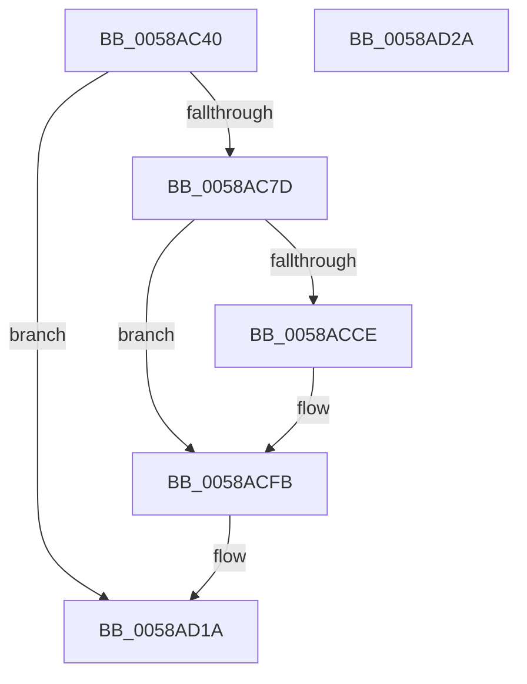

# HvlpInitializePowerStatistics

- RVA: `0x0058AC40`–`0x0058AD2B` (길이 `235` bytes)
- VA: `0x000000014058AC40`
- 실행 섹션: `.text`
- PDB 이름 있음: `예`; PDB Function 태그: `아니요`
- unwind 정보 RVA: `0x000BE5B4`
- 디코드: `58`개 명령, `235/235` bytes 표시
- 미해석 바이트: `0` (있으면 어셈블리에 `.byte`로 보존)

> 이 문서는 커널 이미지의 기계어와 PDB 기호를 분석해 생성했습니다. 4번과 5번은 함수 원형과 자료형을 바이너리 사용 방식에서 추정한 C 해석이며 원본 소스 복구 결과는 아닙니다.

## 1. Dependencies

- 직접 호출 지점: **5**; 고유 호출 대상: **3**
- 직접 호출자로 확인된 함수: **1**
- RIP 상대 이미지 참조: **5**

### Outgoing calls
- `0x0058AC8B` → [HvlpAcquireHypercallPage](../47/HvlpAcquireHypercallPage_function_00471410.md) (function, `0x00471410`)
- `0x0058ACA4` → [HvlpAcquireHypercallPage](../47/HvlpAcquireHypercallPage_function_00471410.md) (function, `0x00471410`)
- `0x0058ACC4` → [HvcallInitiateHypercall](../31/HvcallInitiateHypercall_function_00313630.md) (function, `0x00313630`)
- `0x0058AD0A` → [HvlpReleaseHypercallPage](../31/HvlpReleaseHypercallPage_function_00313480.md) (function, `0x00313480`)
- `0x0058AD13` → [HvlpReleaseHypercallPage](../31/HvlpReleaseHypercallPage_function_00313480.md) (function, `0x00313480`)

### Direct callers
- [HvlPhase1Initialize](HvlPhase1Initialize_function_00583D80.md) at `0x00583E09`

### Static image references
- `0x0058AC57` → RVA `0x00FC6AB8` (`ALMOSTRO`; read)
- `0x0058ACD1` → RVA `0x00E3EDD0` (`.data`; read)
- `0x0058ACDC` → RVA `0x00E3EDE0` (`.data`; read)
- `0x0058ACE7` → RVA `0x00E3EDF0` (`.data`; read)
- `0x0058ACF3` → RVA `0x00E3EE00` (`.data`; write)

## 2. Other-region calls and transfers

- 다른 실행 섹션으로 향하는 call: **0**
- 별도 외부 분기/꼬리 이동을 확인하지 못했습니다.

## 3. Assembly (complete function range)

```asm
0058AC40  48 89 5C 24 08                  mov qword ptr [rsp + 8], rbx
0058AC45  48 89 7C 24 10                  mov qword ptr [rsp + 0x10], rdi
0058AC4A  55                              push rbp
0058AC4B  48 8B EC                        mov rbp, rsp
0058AC4E  48 83 EC 60                     sub rsp, 0x60
0058AC52  33 C0                           xor eax, eax
0058AC54  0F 57 C0                        xorps xmm0, xmm0
0058AC57  F7 05 57 BE A3 00 00 04 00 00   test dword ptr [rip + 0xa3be57], 0x400
0058AC61  0F 11 45 E0                     movups xmmword ptr [rbp - 0x20], xmm0
0058AC65  48 89 45 F0                     mov qword ptr [rbp - 0x10], rax
0058AC69  89 45 F8                        mov dword ptr [rbp - 8], eax
0058AC6C  0F 11 45 C0                     movups xmmword ptr [rbp - 0x40], xmm0
0058AC70  48 89 45 D0                     mov qword ptr [rbp - 0x30], rax
0058AC74  89 45 D8                        mov dword ptr [rbp - 0x28], eax
0058AC77  0F 84 9D 00 00 00               je 0x14058ad1a
0058AC7D  44 8D 48 08                     lea r9d, [rax + 8]
0058AC81  45 33 C0                        xor r8d, r8d
0058AC84  8D 50 01                        lea edx, [rax + 1]
0058AC87  48 8D 4D E0                     lea rcx, [rbp - 0x20]
0058AC8B  E8 80 67 EE FF                  call 0x140471410
0058AC90  45 33 C0                        xor r8d, r8d
0058AC93  48 8D 4D C0                     lea rcx, [rbp - 0x40]
0058AC97  41 B9 08 02 00 00               mov r9d, 0x208
0058AC9D  48 8B D8                        mov rbx, rax
0058ACA0  41 8D 50 02                     lea edx, [r8 + 2]
0058ACA4  E8 67 67 EE FF                  call 0x140471410
0058ACA9  4C 8B 45 D8                     mov r8, qword ptr [rbp - 0x28]
0058ACAD  48 8B F8                        mov rdi, rax
0058ACB0  48 8B 55 F8                     mov rdx, qword ptr [rbp - 8]
0058ACB4  33 C0                           xor eax, eax
0058ACB6  48 89 03                        mov qword ptr [rbx], rax
0058ACB9  B9 9B 00 00 00                  mov ecx, 0x9b
0058ACBE  C7 03 04 00 00 00               mov dword ptr [rbx], 4
0058ACC4  E8 67 89 D8 FF                  call 0x140313630
0058ACC9  66 85 C0                        test ax, ax
0058ACCC  75 2D                           jne 0x14058acfb
0058ACCE  0F 10 07                        movups xmm0, xmmword ptr [rdi]
0058ACD1  0F 11 05 F8 40 8B 00            movups xmmword ptr [rip + 0x8b40f8], xmm0
0058ACD8  0F 10 4F 10                     movups xmm1, xmmword ptr [rdi + 0x10]
0058ACDC  0F 11 0D FD 40 8B 00            movups xmmword ptr [rip + 0x8b40fd], xmm1
0058ACE3  0F 10 47 20                     movups xmm0, xmmword ptr [rdi + 0x20]
0058ACE7  0F 11 05 02 41 8B 00            movups xmmword ptr [rip + 0x8b4102], xmm0
0058ACEE  F2 0F 10 4F 30                  movsd xmm1, qword ptr [rdi + 0x30]
0058ACF3  F2 0F 11 0D 05 41 8B 00         movsd qword ptr [rip + 0x8b4105], xmm1
0058ACFB  66 F7 D8                        neg ax
0058ACFE  48 8D 4D C0                     lea rcx, [rbp - 0x40]
0058AD02  1B DB                           sbb ebx, ebx
0058AD04  81 E3 01 00 00 C0               and ebx, 0xc0000001
0058AD0A  E8 71 87 D8 FF                  call 0x140313480
0058AD0F  48 8D 4D E0                     lea rcx, [rbp - 0x20]
0058AD13  E8 68 87 D8 FF                  call 0x140313480
0058AD18  8B C3                           mov eax, ebx
0058AD1A  48 8B 5C 24 70                  mov rbx, qword ptr [rsp + 0x70]
0058AD1F  48 8B 7C 24 78                  mov rdi, qword ptr [rsp + 0x78]
0058AD24  48 83 C4 60                     add rsp, 0x60
0058AD28  5D                              pop rbp
0058AD29  C3                              ret
0058AD2A  CC                              int3
```

## 4. C-style interpretation (structured pseudocode)

```c
__int64 __fastcall HvlpInitializePowerStatistics(__int64 a1, __int64 a2, int a3)
{
    __int64 result;
    __int64 v_rbx;
    __int64 v_rsp;
    unsigned int v_stack_m10;
    unsigned __int64 v_stack_m18;
    unsigned __int64 v_stack_m28;
    unsigned int v_stack_m30;
    unsigned __int64 v_stack_m38;
    unsigned __int64 v_stack_m48;
    unsigned __int64 v_stack_p10;
    unsigned __int64 v_stack_p8;

    v_stack_p8 = v_rbx;
    v_stack_p10 = v_rdi;
    v_rsp = (v_rsp) - (96);
    result = 0;
    v_stack_m28 = v_xmm0;
    v_stack_m18 = 0;
    v_stack_m10 = 0;
    v_stack_m48 = v_xmm0;
    v_stack_m38 = 0;
    v_stack_m30 = 0;
    if (((*(unsigned int *)(v_rip + 10731095)) & (0x400ULL)) == 0) goto loc_0058AD1A;
    a3 = 0;
    result = HvlpAcquireHypercallPage(v_stack_m28, result + 1, a3, result + 8);
    a3 = 0;
    result = HvlpAcquireHypercallPage(v_stack_m48, a3 + 2, a3, 520);
    result = 0;
    *(unsigned __int64 *)(result) = 0;
    *(unsigned int *)(result) = 4;
    result = HvcallInitiateHypercall(155, v_stack_m10, v_stack_m30, 520);
    if ((unsigned __int16)(result) == 0) {
        *(unsigned __int64 *)(v_rip + 9126136) = v_xmm0;
        *(unsigned __int64 *)(v_rip + 9126141) = v_xmm1;
        *(unsigned __int64 *)(v_rip + 9126146) = v_xmm0;
        *(unsigned __int64 *)(v_rip + 9126149) = v_xmm1;
    }
    result = (unsigned __int16)(-(result));
    v_rbx = (unsigned int)((result) & (0xC0000001ULL));
    result = HvlpReleaseHypercallPage(v_stack_m48, v_stack_m10, v_stack_m30, 520);
    result = HvlpReleaseHypercallPage(v_stack_m28, v_stack_m10, v_stack_m30, 520);
loc_0058AD1A:
    v_rsp = (v_rsp) + (96);
    return (unsigned int)((unsigned int)(v_rbx));
}
```

## 5. (Beta) C Style

```c
int64_t HvlpInitializePowerStatistics(int64_t Arg1, int64_t Arg2, int32_t Arg3)
{
    int64_t result;
    int64_t local_rbx;
    int64_t local_rsp;
    uint32_t v_stack_m10;
    uint64_t v_stack_m18;
    uint64_t v_stack_m28;
    uint32_t v_stack_m30;
    uint64_t v_stack_m38;
    uint64_t v_stack_m48;
    uint64_t v_stack_p10;
    uint64_t v_stack_p8;

    v_stack_p8 = local_rbx;
    v_stack_p10 = local_rdi;
    local_rsp = (local_rsp) - (96);
    result = 0;
    v_stack_m28 = v_xmm0;
    v_stack_m18 = 0;
    v_stack_m10 = 0;
    v_stack_m48 = v_xmm0;
    v_stack_m38 = 0;
    v_stack_m30 = 0;
    if (((*(uint32_t *)(v_rip + 0xA3BE57)) & (0x400ULL)) == 0) goto loc_0058AD1A;
    Arg3 = 0;
    result = HvlpAcquireHypercallPage(v_stack_m28, result + 1, Arg3, result + 8);
    Arg3 = 0;
    result = HvlpAcquireHypercallPage(v_stack_m48, Arg3 + 2, Arg3, 520);
    result = 0;
    *(uint64_t *)(result) = 0;
    *(uint32_t *)(result) = 4;
    result = HvcallInitiateHypercall(155, v_stack_m10, v_stack_m30, 520);
    if ((uint16_t)(result) == 0) {
        *(uint64_t *)(v_rip + 0x8B40F8) = v_xmm0;
        *(uint64_t *)(v_rip + 0x8B40FD) = v_xmm1;
        *(uint64_t *)(v_rip + 0x8B4102) = v_xmm0;
        *(uint64_t *)(v_rip + 0x8B4105) = v_xmm1;
    }
    result = (uint16_t)(-(result));
    local_rbx = (uint32_t)((result) & (0xC0000001ULL));
    result = HvlpReleaseHypercallPage(v_stack_m48, v_stack_m10, v_stack_m30, 520);
    result = HvlpReleaseHypercallPage(v_stack_m28, v_stack_m10, v_stack_m30, 520);
loc_0058AD1A:
    local_rsp = (local_rsp) + (96);
    return (uint32_t)((uint32_t)(local_rbx));
}
```

## 6. Execution-region graph

[열기: 2D/3D 그래프와 함수 탐색 컨트롤 패널](../../../control-panel.html?section=text&rva=0x0058AC40&view=graph)

- 2D 그래프는 위에서 아래로 흐르고, 3D 그래프는 빈 공간을 드래그해 회전합니다. Shift+드래그는 이동, 휠은 확대·축소, 함수 노드 선택은 대상 보고서 이동입니다.

### Static fallback


