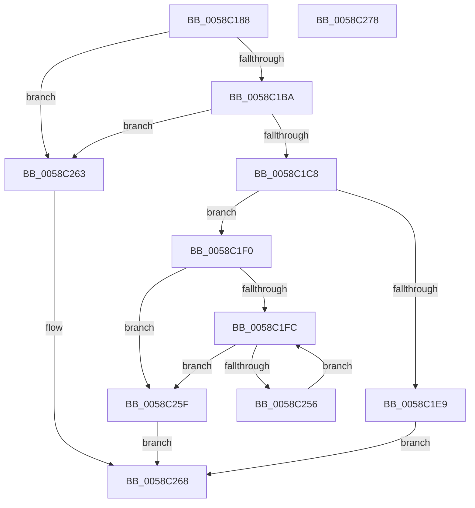

# HvlpInitializeSvmIommuSupport

- RVA: `0x0058C188`–`0x0058C279` (길이 `241` bytes)
- VA: `0x000000014058C188`
- 실행 섹션: `.text`
- PDB 이름 있음: `예`; PDB Function 태그: `아니요`
- unwind 정보 RVA: `0x00086C28`
- 디코드: `62`개 명령, `241/241` bytes 표시
- 미해석 바이트: `0` (있으면 어셈블리에 `.byte`로 보존)

> 이 문서는 커널 이미지의 기계어와 PDB 기호를 분석해 생성했습니다. 4번과 5번은 함수 원형과 자료형을 바이너리 사용 방식에서 추정한 C 해석이며 원본 소스 복구 결과는 아닙니다.

## 1. Dependencies

- 직접 호출 지점: **3**; 고유 호출 대상: **3**
- 직접 호출자로 확인된 함수: **1**
- RIP 상대 이미지 참조: **6**

### Outgoing calls
- `0x0058C1AA` → [HvlGetSystemPasidCapabilities](HvlGetSystemPasidCapabilities_function_00588520.md) (function, `0x00588520`)
- `0x0058C1D5` → [ExAllocatePool2](../../poolcode/B8/ExAllocatePool2_function_00B820F0.md) (function, `0x00B820F0`)
- `0x0058C247` → [ExQueueWorkItem](../2F/ExQueueWorkItem_function_002F9520.md) (function, `0x002F9520`)

### Direct callers
- [HvlPhase2Initialize](HvlPhase2Initialize_function_00583EA0.md) at `0x00583FD4`

### Static image references
- `0x0058C1DA` → RVA `0x00E3EE10` (`.data`; write)
- `0x0058C1F0` → RVA `0x00E3EE08` (`.data`; write)
- `0x0058C202` → RVA `0x0058C280` (`HvlpIommuPrqDpcRoutine`; read)
- `0x0058C216` → RVA `0x0058C2B0` (`HvlpProcessIommuPrq`; read)
- `0x0058C24E` → RVA `0x00E3EE08` (`.data`; read)
- `0x0058C256` → RVA `0x00E3EE10` (`.data`; read)

## 2. Other-region calls and transfers

- 다른 실행 섹션으로 향하는 call: **1**
  - `0x0058C1D5` → [ExAllocatePool2](../../poolcode/B8/ExAllocatePool2_function_00B820F0.md) (`.text` → `POOLCODE`)
- 별도 외부 분기/꼬리 이동을 확인하지 못했습니다.

## 3. Assembly (complete function range)

```asm
0058C188  48 89 5C 24 08                  mov qword ptr [rsp + 8], rbx
0058C18D  48 89 74 24 10                  mov qword ptr [rsp + 0x10], rsi
0058C192  57                              push rdi
0058C193  48 83 EC 40                     sub rsp, 0x40
0058C197  0F 57 C0                        xorps xmm0, xmm0
0058C19A  48 8D 4C 24 20                  lea rcx, [rsp + 0x20]
0058C19F  33 C0                           xor eax, eax
0058C1A1  0F 11 44 24 20                  movups xmmword ptr [rsp + 0x20], xmm0
0058C1A6  89 44 24 30                     mov dword ptr [rsp + 0x30], eax
0058C1AA  E8 71 C3 FF FF                  call 0x140588520
0058C1AF  F6 44 24 20 01                  test byte ptr [rsp + 0x20], 1
0058C1B4  0F 84 A9 00 00 00               je 0x14058c263
0058C1BA  8B 5C 24 2C                     mov ebx, dword ptr [rsp + 0x2c]
0058C1BE  33 F6                           xor esi, esi
0058C1C0  85 DB                           test ebx, ebx
0058C1C2  0F 84 9B 00 00 00               je 0x14058c263
0058C1C8  48 6B D3 68                     imul rdx, rbx, 0x68
0058C1CC  8D 4E 40                        lea ecx, [rsi + 0x40]
0058C1CF  41 B8 48 56 4C 20               mov r8d, 0x204c5648
0058C1D5  E8 16 5F 5F 00                  call 0x140b820f0
0058C1DA  48 89 05 2F 2C 8B 00            mov qword ptr [rip + 0x8b2c2f], rax
0058C1E1  48 8B C8                        mov rcx, rax
0058C1E4  48 85 C0                        test rax, rax
0058C1E7  75 07                           jne 0x14058c1f0
0058C1E9  B8 9A 00 00 C0                  mov eax, 0xc000009a
0058C1EE  EB 78                           jmp 0x14058c268
0058C1F0  89 1D 12 2C 8B 00               mov dword ptr [rip + 0x8b2c12], ebx
0058C1F6  8B FE                           mov edi, esi
0058C1F8  85 DB                           test ebx, ebx
0058C1FA  74 63                           je 0x14058c25f
0058C1FC  8B C7                           mov eax, edi
0058C1FE  48 6B D0 68                     imul rdx, rax, 0x68
0058C202  48 8D 05 77 00 00 00            lea rax, [rip + 0x77]
0058C209  48 03 D1                        add rdx, rcx
0058C20C  89 3A                           mov dword ptr [rdx], edi
0058C20E  48 8D 4A 48                     lea rcx, [rdx + 0x48]
0058C212  48 89 42 20                     mov qword ptr [rdx + 0x20], rax
0058C216  48 8D 05 93 00 00 00            lea rax, [rip + 0x93]
0058C21D  C7 42 08 13 01 00 00            mov dword ptr [rdx + 8], 0x113
0058C224  48 89 52 28                     mov qword ptr [rdx + 0x28], rdx
0058C228  48 89 72 40                     mov qword ptr [rdx + 0x40], rsi
0058C22C  48 89 72 18                     mov qword ptr [rdx + 0x18], rsi
0058C230  48 89 51 18                     mov qword ptr [rcx + 0x18], rdx
0058C234  48 89 41 10                     mov qword ptr [rcx + 0x10], rax
0058C238  48 89 31                        mov qword ptr [rcx], rsi
0058C23B  C7 42 04 03 00 00 00            mov dword ptr [rdx + 4], 3
0058C242  BA 02 00 00 00                  mov edx, 2
0058C247  E8 D4 D2 D6 FF                  call 0x1402f9520
0058C24C  FF C7                           inc edi
0058C24E  3B 3D B4 2B 8B 00               cmp edi, dword ptr [rip + 0x8b2bb4]
0058C254  73 09                           jae 0x14058c25f
0058C256  48 8B 0D B3 2B 8B 00            mov rcx, qword ptr [rip + 0x8b2bb3]
0058C25D  EB 9D                           jmp 0x14058c1fc
0058C25F  33 C0                           xor eax, eax
0058C261  EB 05                           jmp 0x14058c268
0058C263  B8 BB 00 00 C0                  mov eax, 0xc00000bb
0058C268  48 8B 5C 24 50                  mov rbx, qword ptr [rsp + 0x50]
0058C26D  48 8B 74 24 58                  mov rsi, qword ptr [rsp + 0x58]
0058C272  48 83 C4 40                     add rsp, 0x40
0058C276  5F                              pop rdi
0058C277  C3                              ret
0058C278  CC                              int3
```

## 4. C-style interpretation (structured pseudocode)

```c
__int64 __fastcall HvlpInitializeSvmIommuSupport(void)
{
    __int64 result;
    __int64 v_rdi;
    __int64 v_rsi;
    __int64 v_rsp;
    unsigned int v_stack_m18;
    unsigned int v_stack_m1C;
    unsigned __int64 v_stack_m28;
    unsigned __int64 v_stack_p10;
    unsigned __int64 v_stack_p8;

    v_stack_p8 = v_rbx;
    v_stack_p10 = v_rsi;
    v_rsp = (v_rsp) - (64);
    result = 0;
    v_stack_m28 = v_xmm0;
    v_stack_m18 = 0;
    result = HvlGetSystemPasidCapabilities(v_stack_m28, a2, a3, a4);
    if (((v_stack_m28) & (1)) == 0) goto loc_0058C263;
    v_rsi = 0;
    if ((unsigned int)((unsigned int)(v_stack_m1C)) == 0) goto loc_0058C263;
    a2 = (a2) * ((unsigned int)(v_stack_m1C));
    result = ExAllocatePool2(v_rsi + 64, a2, (unsigned int)(0x204C5648ULL), a4);
    *(unsigned __int64 *)(v_rip + 9120815) = result;
    if (result != 0) goto loc_0058C1F0;
    goto loc_0058C268;
loc_0058C1F0:
    *(unsigned int *)(v_rip + 9120786) = (unsigned int)((unsigned int)(v_stack_m1C));
    if ((unsigned int)((unsigned int)(v_stack_m1C)) == 0) goto loc_0058C25F;
loc_0058C1FC:
    a2 = (a2) * (0);
    a2 = (a2) + (result);
    *(unsigned int *)(a2) = 0;
    *(unsigned __int64 *)(a2 + 32) = v_rip + 119;
    *(unsigned int *)(a2 + 8) = 275;
    *(unsigned __int64 *)(a2 + 40) = a2;
    *(unsigned __int64 *)(a2 + 64) = 0;
    *(unsigned __int64 *)(a2 + 24) = 0;
    *(unsigned __int64 *)(a2 + 72 + 24) = a2;
    *(unsigned __int64 *)(a2 + 72 + 16) = v_rip + 147;
    *(unsigned __int64 *)(a2 + 72) = 0;
    *(unsigned int *)(a2 + 4) = 3;
    result = ExQueueWorkItem(a2 + 72, 2, (unsigned int)(0x204C5648ULL), a4);
    v_rdi = (unsigned int)((0) + 1);
    if (((unsigned int)(v_rdi)) >= (*(unsigned int *)(v_rip + 9120692))) goto loc_0058C25F;
    goto loc_0058C1FC;
loc_0058C25F:
    result = 0;
    goto loc_0058C268;
loc_0058C263:
loc_0058C268:
    v_rsp = (v_rsp) + (64);
    return (unsigned int)(0xC00000BBULL);
}
```

## 5. (Beta) C Style

```c
void HvlpInitializeSvmIommuSupport(void)
{
    int64_t result;
    int64_t local_rdi;
    int64_t local_rsi;
    int64_t local_rsp;
    uint32_t v_stack_m18;
    uint32_t v_stack_m1C;
    uint64_t v_stack_m28;
    uint64_t v_stack_p10;
    uint64_t v_stack_p8;

    v_stack_p8 = local_rbx;
    v_stack_p10 = local_rsi;
    local_rsp = (local_rsp) - (64);
    result = 0;
    v_stack_m28 = v_xmm0;
    v_stack_m18 = 0;
    result = HvlGetSystemPasidCapabilities(v_stack_m28, a2, a3, a4);
    if (((v_stack_m28) & (1)) == 0) goto loc_0058C263;
    local_rsi = 0;
    if ((uint32_t)((uint32_t)(v_stack_m1C)) == 0) goto loc_0058C263;
    a2 = (a2) * ((uint32_t)(v_stack_m1C));
    result = ExAllocatePool2(local_rsi + 64, a2, (uint32_t)(0x204C5648ULL), a4);
    *(uint64_t *)(v_rip + 0x8B2C2F) = result;
    if (result != 0) goto loc_0058C1F0;
    goto loc_0058C268;
loc_0058C1F0:
    *(uint32_t *)(v_rip + 0x8B2C12) = (uint32_t)((uint32_t)(v_stack_m1C));
    if ((uint32_t)((uint32_t)(v_stack_m1C)) == 0) goto loc_0058C25F;
loc_0058C1FC:
    a2 = (a2) * (0);
    a2 = (a2) + (result);
    *(uint32_t *)(a2) = 0;
    *(uint64_t *)(a2 + 0x20) = v_rip + 119;
    *(uint32_t *)(a2 + 0x8) = 275;
    *(uint64_t *)(a2 + 0x28) = a2;
    *(uint64_t *)(a2 + 0x40) = 0;
    *(uint64_t *)(a2 + 0x18) = 0;
    *(uint64_t *)(a2 + 0x48 + 0x18) = a2;
    *(uint64_t *)(a2 + 0x48 + 0x10) = v_rip + 147;
    *(uint64_t *)(a2 + 0x48) = 0;
    *(uint32_t *)(a2 + 0x4) = 3;
    result = ExQueueWorkItem(a2 + 72, 2, (uint32_t)(0x204C5648ULL), a4);
    local_rdi = (uint32_t)((0) + 1);
    if (((uint32_t)(local_rdi)) >= (*(uint32_t *)(v_rip + 0x8B2BB4))) goto loc_0058C25F;
    goto loc_0058C1FC;
loc_0058C25F:
    result = 0;
    goto loc_0058C268;
loc_0058C263:
loc_0058C268:
    local_rsp = (local_rsp) + (64);
    return (uint32_t)(0xC00000BBULL);
}
```

## 6. Execution-region graph

[열기: 2D/3D 그래프와 함수 탐색 컨트롤 패널](../../../control-panel.html?section=text&rva=0x0058C188&view=graph)

- 2D 그래프는 위에서 아래로 흐르고, 3D 그래프는 빈 공간을 드래그해 회전합니다. Shift+드래그는 이동, 휠은 확대·축소, 함수 노드 선택은 대상 보고서 이동입니다.

### Static fallback


