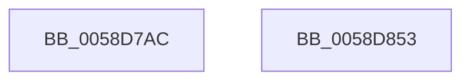

# HvlpInvokeGetPageListHypercall

- RVA: `0x0058D7AC`–`0x0058D854` (길이 `168` bytes)
- VA: `0x000000014058D7AC`
- 실행 섹션: `.text`
- PDB 이름 있음: `예`; PDB Function 태그: `예`
- unwind 정보 RVA: `0x000C6A1C`
- 디코드: `42`개 명령, `168/168` bytes 표시
- 미해석 바이트: `0` (있으면 어셈블리에 `.byte`로 보존)

> 이 문서는 커널 이미지의 기계어와 PDB 기호를 분석해 생성했습니다. 4번과 5번은 함수 원형과 자료형을 바이너리 사용 방식에서 추정한 C 해석이며 원본 소스 복구 결과는 아닙니다.

## 1. Dependencies

- 직접 호출 지점: **4**; 고유 호출 대상: **4**
- 직접 호출자로 확인된 함수: **2**
- RIP 상대 이미지 참조: **1**

### Outgoing calls
- `0x0058D7F1` → [HvlpAcquireHypercallPage](../47/HvlpAcquireHypercallPage_function_00471410.md) (function, `0x00471410`)
- `0x0058D826` → [HvcallInitiateHypercall](../31/HvcallInitiateHypercall_function_00313630.md) (function, `0x00313630`)
- `0x0058D830` → [HvlpReleaseHypercallPage](../31/HvlpReleaseHypercallPage_function_00313480.md) (function, `0x00313480`)
- `0x0058D83D` → [_security_check_cookie](../6A/_security_check_cookie_function_006AC640.md) (function, `0x006AC640`)

### Direct callers
- [HvlpGetPageList](HvlpGetPageList_function_0058D6D8.md) at `0x0058D730`
- [HvlpStartPageListIteration](HvlpStartPageListIteration_function_0058D8E4.md) at `0x0058D8F7`

### Static image references
- `0x0058D7BB` → RVA `0x00E0A740` (`.data`; read)

## 2. Other-region calls and transfers

- 다른 실행 섹션으로 향하는 call: **0**
- 별도 외부 분기/꼬리 이동을 확인하지 못했습니다.

## 3. Assembly (complete function range)

```asm
0058D7AC  4C 8B DC                        mov r11, rsp
0058D7AF  49 89 5B 10                     mov qword ptr [r11 + 0x10], rbx
0058D7B3  57                              push rdi
0058D7B4  48 81 EC 80 00 00 00            sub rsp, 0x80
0058D7BB  48 8B 05 7E CF 87 00            mov rax, qword ptr [rip + 0x87cf7e]
0058D7C2  48 33 C4                        xor rax, rsp
0058D7C5  48 89 44 24 70                  mov qword ptr [rsp + 0x70], rax
0058D7CA  33 C0                           xor eax, eax
0058D7CC  4D 8D 43 B8                     lea r8, [r11 - 0x48]
0058D7D0  0F 57 C0                        xorps xmm0, xmm0
0058D7D3  48 8B DA                        mov rbx, rdx
0058D7D6  48 8B F9                        mov rdi, rcx
0058D7D9  49 8D 4B 98                     lea rcx, [r11 - 0x68]
0058D7DD  0F 11 44 24 20                  movups xmmword ptr [rsp + 0x20], xmm0
0058D7E2  49 89 43 A8                     mov qword ptr [r11 - 0x58], rax
0058D7E6  44 8D 48 18                     lea r9d, [rax + 0x18]
0058D7EA  8D 50 01                        lea edx, [rax + 1]
0058D7ED  89 44 24 38                     mov dword ptr [rsp + 0x38], eax
0058D7F1  E8 1A 3C EE FF                  call 0x140471410
0058D7F6  48 83 48 08 FF                  or qword ptr [rax + 8], 0xffffffffffffffff
0058D7FB  48 C7 40 10 01 00 00 00         mov qword ptr [rax + 0x10], 1
0058D803  48 89 18                        mov qword ptr [rax], rbx
0058D806  8A 4F 04                        mov cl, byte ptr [rdi + 4]
0058D809  F6 D9                           neg cl
0058D80B  B9 97 00 00 00                  mov ecx, 0x97
0058D810  48 1B D2                        sbb rdx, rdx
0058D813  83 E2 02                        and edx, 2
0058D816  48 FF C2                        inc rdx
0058D819  48 89 50 10                     mov qword ptr [rax + 0x10], rdx
0058D81D  4C 8B 47 10                     mov r8, qword ptr [rdi + 0x10]
0058D821  48 8B 54 24 38                  mov rdx, qword ptr [rsp + 0x38]
0058D826  E8 05 5E D8 FF                  call 0x140313630
0058D82B  48 8D 4C 24 20                  lea rcx, [rsp + 0x20]
0058D830  E8 4B 5C D8 FF                  call 0x140313480
0058D835  48 8B 4C 24 70                  mov rcx, qword ptr [rsp + 0x70]
0058D83A  48 33 CC                        xor rcx, rsp
0058D83D  E8 FE ED 11 00                  call 0x1406ac640
0058D842  48 8B 9C 24 98 00 00 00         mov rbx, qword ptr [rsp + 0x98]
0058D84A  48 81 C4 80 00 00 00            add rsp, 0x80
0058D851  5F                              pop rdi
0058D852  C3                              ret
0058D853  CC                              int3
```

## 4. C-style interpretation (structured pseudocode)

```c
__int64 __fastcall HvlpInvokeGetPageListHypercall(__int64 a1, __int64 a2)
{
    __int64 result;
    __int64 v_rsp;
    unsigned __int64 v_stack_m18;
    unsigned int v_stack_m50;
    unsigned __int64 v_stack_m68;
    unsigned __int64 v_stack_p10;

    *(unsigned __int64 *)(v_rsp + 16) = v_rbx;
    v_rsp = (v_rsp) - (128);
    result = (*(unsigned __int64 *)(v_rip + 8900478)) ^ (v_rsp);
    v_stack_m18 = result;
    result = 0;
    v_stack_m68 = v_xmm0;
    *(unsigned __int64 *)(v_rsp - 88) = 0;
    v_stack_m50 = 0;
    result = HvlpAcquireHypercallPage(v_rsp - 104, result + 1, v_rsp - 72, result + 24);
    *(unsigned __int64 *)(result + 16) = 1;
    *(unsigned __int64 *)(result) = a2;
    a1 = (unsigned __int8)(-(*(unsigned __int8 *)(a1 + 4)));
    a2 = (unsigned int)((result + 1) & (2));
    a2 = (a2) + 1;
    *(unsigned __int64 *)(result + 16) = a2;
    result = HvcallInitiateHypercall(151, v_stack_m50, *(unsigned __int64 *)(a1 + 16), result + 24);
    result = HvlpReleaseHypercallPage(v_stack_m68, v_stack_m50, *(unsigned __int64 *)(a1 + 16), result + 24);
    a1 = (v_stack_m18) ^ (v_rsp);
    result = _security_check_cookie(a1, v_stack_m50, *(unsigned __int64 *)(a1 + 16), result + 24);
    v_rsp = (v_rsp) + (128);
    return result;
}
```

## 5. (Beta) C Style

```c
int64_t HvlpInvokeGetPageListHypercall(void *Arg1, int64_t Arg2)
{
    uint8_t *arg1 = (uint8_t *)Arg1;

    int64_t result;
    int64_t local_rsp;
    uint64_t v_stack_m18;
    uint32_t v_stack_m50;
    uint64_t v_stack_m68;
    uint64_t v_stack_p10;

    *(uint64_t *)(local_rsp + 0x10) = local_rbx;
    local_rsp = (local_rsp) - (128);
    result = (*(uint64_t *)(v_rip + 0x87CF7E)) ^ (local_rsp);
    v_stack_m18 = result;
    result = 0;
    v_stack_m68 = v_xmm0;
    *(uint64_t *)(local_rsp - 0x58) = 0;
    v_stack_m50 = 0;
    result = HvlpAcquireHypercallPage(local_rsp - 104, result + 1, local_rsp - 72, result + 24);
    *(uint64_t *)(result + 0x10) = 1;
    *(uint64_t *)(result) = Arg2;
    Arg1 = (uint8_t)(-(*(uint8_t *)(arg1 + 0x4)));
    Arg2 = (uint32_t)((result + 1) & (2));
    Arg2 = (Arg2) + 1;
    *(uint64_t *)(result + 0x10) = Arg2;
    result = HvcallInitiateHypercall(151, v_stack_m50, *(uint64_t *)(arg1 + 0x10), result + 24);
    result = HvlpReleaseHypercallPage(v_stack_m68, v_stack_m50, *(uint64_t *)(arg1 + 0x10), result + 24);
    Arg1 = (v_stack_m18) ^ (local_rsp);
    result = _security_check_cookie(Arg1, v_stack_m50, *(uint64_t *)(arg1 + 0x10), result + 24);
    local_rsp = (local_rsp) + (128);
    return result;
}
```

### 관측된 메모리 오프셋

구조체 형식이 확인되지 않은 접근은 인자 기준의 오프셋으로만 기록했습니다.

| 기준 인자 | 오프셋 표현 | 폭 (bit) | 접근 |
|---|---:|---:|---|
| `Arg1` | `+ 0x4` | `8` | `R` |
| `Arg1` | `+ 0x10` | `64` | `R` |

## 6. Execution-region graph

[열기: 2D/3D 그래프와 함수 탐색 컨트롤 패널](../../../control-panel.html?section=text&rva=0x0058D7AC&view=graph)

- 2D 그래프는 위에서 아래로 흐르고, 3D 그래프는 빈 공간을 드래그해 회전합니다. Shift+드래그는 이동, 휠은 확대·축소, 함수 노드 선택은 대상 보고서 이동입니다.

### Static fallback


