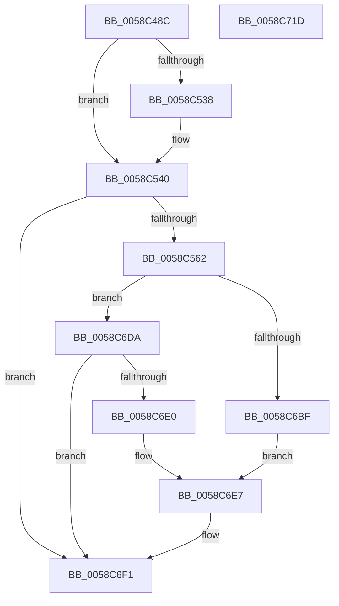

# HvlpLogGuestStateScrubbingStatus

- RVA: `0x0058C48C`–`0x0058C71E` (길이 `658` bytes)
- VA: `0x000000014058C48C`
- 실행 섹션: `.text`
- PDB 이름 있음: `예`; PDB Function 태그: `아니요`
- unwind 정보 RVA: `0x000C6940`
- 디코드: `167`개 명령, `658/658` bytes 표시
- 미해석 바이트: `0` (있으면 어셈블리에 `.byte`로 보존)

> 이 문서는 커널 이미지의 기계어와 PDB 기호를 분석해 생성했습니다. 4번과 5번은 함수 원형과 자료형을 바이너리 사용 방식에서 추정한 C 해석이며 원본 소스 복구 결과는 아닙니다.

## 1. Dependencies

- 직접 호출 지점: **9**; 고유 호출 대상: **5**
- 직접 호출자로 확인된 함수: **1**
- RIP 상대 이미지 참조: **8**

### Outgoing calls
- `0x0058C4FA` → [HvlpAcquireHypercallPage](../47/HvlpAcquireHypercallPage_function_00471410.md) (function, `0x00471410`)
- `0x0058C514` → [HvlpAcquireHypercallPage](../47/HvlpAcquireHypercallPage_function_00471410.md) (function, `0x00471410`)
- `0x0058C52E` → [HvcallInitiateHypercall](../31/HvcallInitiateHypercall_function_00313630.md) (function, `0x00313630`)
- `0x0058C545` → [HvlpReleaseHypercallPage](../31/HvlpReleaseHypercallPage_function_00313480.md) (function, `0x00313480`)
- `0x0058C54F` → [HvlpReleaseHypercallPage](../31/HvlpReleaseHypercallPage_function_00313480.md) (function, `0x00313480`)
- `0x0058C637` → [HvlpWriteEventLog](HvlpWriteEventLog_function_0058C9E4.md) (function, `0x0058C9E4`)
- `0x0058C6B0` → [HvlpWriteEventLog](HvlpWriteEventLog_function_0058C9E4.md) (function, `0x0058C9E4`)
- `0x0058C6EC` → [HvlpWriteEventLog](HvlpWriteEventLog_function_0058C9E4.md) (function, `0x0058C9E4`)
- `0x0058C6FB` → [_security_check_cookie](../6A/_security_check_cookie_function_006AC640.md) (function, `0x006AC640`)

### Direct callers
- [HvlPhase2Initialize](HvlPhase2Initialize_function_00583EA0.md) at `0x0058404B`

### Static image references
- `0x0058C4AE` → RVA `0x00E0A740` (`.data`; read)
- `0x0058C4E6` → RVA `0x00FC6B68` (`ALMOSTRO`; write)
- `0x0058C554` → RVA `0x00FC6B68` (`ALMOSTRO`; read)
- `0x0058C627` → RVA `0x00026928` (`.rdata`; read)
- `0x0058C6A3` → RVA `0x000269D8` (`.rdata`; read)
- `0x0058C6BF` → RVA `0x00FC521C` (`ALMOSTRO`; read)
- `0x0058C6C6` → RVA `0x00026988` (`.rdata`; read)
- `0x0058C6CD` → RVA `0x00026958` (`.rdata`; read)

## 2. Other-region calls and transfers

- 다른 실행 섹션으로 향하는 call: **0**
- 별도 외부 분기/꼬리 이동을 확인하지 못했습니다.

## 3. Assembly (complete function range)

```asm
0058C48C  48 8B C4                        mov rax, rsp
0058C48F  48 89 58 08                     mov qword ptr [rax + 8], rbx
0058C493  48 89 70 10                     mov qword ptr [rax + 0x10], rsi
0058C497  48 89 78 18                     mov qword ptr [rax + 0x18], rdi
0058C49B  4C 89 70 20                     mov qword ptr [rax + 0x20], r14
0058C49F  55                              push rbp
0058C4A0  48 8D A8 68 F7 FF FF            lea rbp, [rax - 0x898]
0058C4A7  48 81 EC 90 09 00 00            sub rsp, 0x990
0058C4AE  48 8B 05 8B E2 87 00            mov rax, qword ptr [rip + 0x87e28b]
0058C4B5  48 33 C4                        xor rax, rsp
0058C4B8  48 89 85 80 08 00 00            mov qword ptr [rbp + 0x880], rax
0058C4BF  33 C0                           xor eax, eax
0058C4C1  4C 8D 45 50                     lea r8, [rbp + 0x50]
0058C4C5  0F 57 C0                        xorps xmm0, xmm0
0058C4C8  48 89 45 80                     mov qword ptr [rbp - 0x80], rax
0058C4CC  33 F6                           xor esi, esi
0058C4CE  89 45 88                        mov dword ptr [rbp - 0x78], eax
0058C4D1  48 8D 4C 24 70                  lea rcx, [rsp + 0x70]
0058C4D6  48 89 44 24 60                  mov qword ptr [rsp + 0x60], rax
0058C4DB  44 8D 70 01                     lea r14d, [rax + 1]
0058C4DF  89 44 24 68                     mov dword ptr [rsp + 0x68], eax
0058C4E3  41 8B D6                        mov edx, r14d
0058C4E6  89 35 7C A6 A3 00               mov dword ptr [rip + 0xa3a67c], esi
0058C4EC  44 8D 48 10                     lea r9d, [rax + 0x10]
0058C4F0  0F 11 44 24 70                  movups xmmword ptr [rsp + 0x70], xmm0
0058C4F5  0F 11 44 24 50                  movups xmmword ptr [rsp + 0x50], xmm0
0058C4FA  E8 11 4F EE FF                  call 0x140471410
0058C4FF  41 B9 08 04 00 00               mov r9d, 0x408
0058C505  4C 8D 45 70                     lea r8, [rbp + 0x70]
0058C509  8D 56 02                        lea edx, [rsi + 2]
0058C50C  48 8B D8                        mov rbx, rax
0058C50F  48 8D 4C 24 50                  lea rcx, [rsp + 0x50]
0058C514  E8 F7 4E EE FF                  call 0x140471410
0058C519  4C 8B 44 24 68                  mov r8, qword ptr [rsp + 0x68]
0058C51E  8D 4E 7B                        lea ecx, [rsi + 0x7b]
0058C521  48 8B 55 88                     mov rdx, qword ptr [rbp - 0x78]
0058C525  48 8B F8                        mov rdi, rax
0058C528  C7 03 19 00 00 00               mov dword ptr [rbx], 0x19
0058C52E  E8 FD 70 D8 FF                  call 0x140313630
0058C533  66 85 C0                        test ax, ax
0058C536  75 08                           jne 0x14058c540
0058C538  8B 07                           mov eax, dword ptr [rdi]
0058C53A  89 05 28 A6 A3 00               mov dword ptr [rip + 0xa3a628], eax
0058C540  48 8D 4C 24 50                  lea rcx, [rsp + 0x50]
0058C545  E8 36 6F D8 FF                  call 0x140313480
0058C54A  48 8D 4C 24 70                  lea rcx, [rsp + 0x70]
0058C54F  E8 2C 6F D8 FF                  call 0x140313480
0058C554  8B 0D 0E A6 A3 00               mov ecx, dword ptr [rip + 0xa3a60e]
0058C55A  85 C9                           test ecx, ecx
0058C55C  0F 84 8F 01 00 00               je 0x14058c6f1
0058C562  BB 04 00 00 00                  mov ebx, 4
0058C567  4C 8D 45 D0                     lea r8, [rbp - 0x30]
0058C56B  8B C1                           mov eax, ecx
0058C56D  48 89 5D D8                     mov qword ptr [rbp - 0x28], rbx
0058C571  41 23 C6                        and eax, r14d
0058C574  48 89 5D E8                     mov qword ptr [rbp - 0x18], rbx
0058C578  89 44 24 24                     mov dword ptr [rsp + 0x24], eax
0058C57C  48 8D 44 24 24                  lea rax, [rsp + 0x24]
0058C581  48 89 45 D0                     mov qword ptr [rbp - 0x30], rax
0058C585  8D 53 04                        lea edx, [rbx + 4]
0058C588  8B C1                           mov eax, ecx
0058C58A  48 89 5D F8                     mov qword ptr [rbp - 8], rbx
0058C58E  D1 E8                           shr eax, 1
0058C590  41 23 C6                        and eax, r14d
0058C593  48 89 5D 08                     mov qword ptr [rbp + 8], rbx
0058C597  89 44 24 20                     mov dword ptr [rsp + 0x20], eax
0058C59B  48 8D 44 24 20                  lea rax, [rsp + 0x20]
0058C5A0  48 89 45 E0                     mov qword ptr [rbp - 0x20], rax
0058C5A4  8B C1                           mov eax, ecx
0058C5A6  C1 E8 02                        shr eax, 2
0058C5A9  41 23 C6                        and eax, r14d
0058C5AC  48 89 5D 18                     mov qword ptr [rbp + 0x18], rbx
0058C5B0  89 44 24 28                     mov dword ptr [rsp + 0x28], eax
0058C5B4  48 8D 44 24 28                  lea rax, [rsp + 0x28]
0058C5B9  48 89 45 F0                     mov qword ptr [rbp - 0x10], rax
0058C5BD  8B C1                           mov eax, ecx
0058C5BF  C1 E8 03                        shr eax, 3
0058C5C2  41 23 C6                        and eax, r14d
0058C5C5  48 89 5D 28                     mov qword ptr [rbp + 0x28], rbx
0058C5C9  89 44 24 2C                     mov dword ptr [rsp + 0x2c], eax
0058C5CD  48 8D 44 24 2C                  lea rax, [rsp + 0x2c]
0058C5D2  48 89 45 00                     mov qword ptr [rbp], rax
0058C5D6  8B C1                           mov eax, ecx
0058C5D8  C1 E8 04                        shr eax, 4
0058C5DB  41 23 C6                        and eax, r14d
0058C5DE  48 89 5D 38                     mov qword ptr [rbp + 0x38], rbx
0058C5E2  89 44 24 30                     mov dword ptr [rsp + 0x30], eax
0058C5E6  48 8D 44 24 30                  lea rax, [rsp + 0x30]
0058C5EB  48 89 45 10                     mov qword ptr [rbp + 0x10], rax
0058C5EF  8B C1                           mov eax, ecx
0058C5F1  C1 E8 05                        shr eax, 5
0058C5F4  41 23 C6                        and eax, r14d
0058C5F7  48 89 5D 48                     mov qword ptr [rbp + 0x48], rbx
0058C5FB  89 44 24 34                     mov dword ptr [rsp + 0x34], eax
0058C5FF  48 8D 44 24 34                  lea rax, [rsp + 0x34]
0058C604  48 89 45 20                     mov qword ptr [rbp + 0x20], rax
0058C608  8B C1                           mov eax, ecx
0058C60A  C1 E8 07                        shr eax, 7
0058C60D  41 23 C6                        and eax, r14d
0058C610  C1 E9 08                        shr ecx, 8
0058C613  89 44 24 38                     mov dword ptr [rsp + 0x38], eax
0058C617  41 23 CE                        and ecx, r14d
0058C61A  48 8D 44 24 38                  lea rax, [rsp + 0x38]
0058C61F  89 4C 24 3C                     mov dword ptr [rsp + 0x3c], ecx
0058C623  48 89 45 30                     mov qword ptr [rbp + 0x30], rax
0058C627  48 8D 0D FA A2 A9 FF            lea rcx, [rip - 0x565d06]
0058C62E  48 8D 44 24 3C                  lea rax, [rsp + 0x3c]
0058C633  48 89 45 40                     mov qword ptr [rbp + 0x40], rax
0058C637  E8 A8 03 00 00                  call 0x14058c9e4
0058C63C  8B 0D 26 A5 A3 00               mov ecx, dword ptr [rip + 0xa3a526]
0058C642  8B C1                           mov eax, ecx
0058C644  C1 E8 0B                        shr eax, 0xb
0058C647  41 23 C6                        and eax, r14d
0058C64A  48 89 5D 98                     mov qword ptr [rbp - 0x68], rbx
0058C64E  89 44 24 40                     mov dword ptr [rsp + 0x40], eax
0058C652  48 8D 44 24 40                  lea rax, [rsp + 0x40]
0058C657  48 89 45 90                     mov qword ptr [rbp - 0x70], rax
0058C65B  8B C1                           mov eax, ecx
0058C65D  D1 E8                           shr eax, 1
0058C65F  41 23 C6                        and eax, r14d
0058C662  48 89 5D A8                     mov qword ptr [rbp - 0x58], rbx
0058C666  89 44 24 20                     mov dword ptr [rsp + 0x20], eax
0058C66A  48 8D 44 24 20                  lea rax, [rsp + 0x20]
0058C66F  48 89 45 A0                     mov qword ptr [rbp - 0x60], rax
0058C673  8B C1                           mov eax, ecx
0058C675  C1 E8 09                        shr eax, 9
0058C678  41 23 C6                        and eax, r14d
0058C67B  48 89 5D B8                     mov qword ptr [rbp - 0x48], rbx
0058C67F  89 44 24 44                     mov dword ptr [rsp + 0x44], eax
0058C683  48 8D 44 24 44                  lea rax, [rsp + 0x44]
0058C688  48 89 45 B0                     mov qword ptr [rbp - 0x50], rax
0058C68C  C1 E9 0A                        shr ecx, 0xa
0058C68F  48 8D 44 24 48                  lea rax, [rsp + 0x48]
0058C694  41 23 CE                        and ecx, r14d
0058C697  48 89 45 C0                     mov qword ptr [rbp - 0x40], rax
0058C69B  89 4C 24 48                     mov dword ptr [rsp + 0x48], ecx
0058C69F  4C 8D 45 90                     lea r8, [rbp - 0x70]
0058C6A3  48 8D 0D 2E A3 A9 FF            lea rcx, [rip - 0x565cd2]
0058C6AA  48 89 5D C8                     mov qword ptr [rbp - 0x38], rbx
0058C6AE  8B D3                           mov edx, ebx
0058C6B0  E8 2F 03 00 00                  call 0x14058c9e4
0058C6B5  8B 05 AD A4 A3 00               mov eax, dword ptr [rip + 0xa3a4ad]
0058C6BB  A8 40                           test al, 0x40
0058C6BD  74 1B                           je 0x14058c6da
0058C6BF  40 38 35 56 8B A3 00            cmp byte ptr [rip + 0xa38b56], sil
0058C6C6  48 8D 0D BB A2 A9 FF            lea rcx, [rip - 0x565d45]
0058C6CD  48 8D 05 84 A2 A9 FF            lea rax, [rip - 0x565d7c]
0058C6D4  48 0F 44 C8                     cmove rcx, rax
0058C6D8  EB 0D                           jmp 0x14058c6e7
0058C6DA  0F BA E0 0F                     bt eax, 0xf
0058C6DE  73 11                           jae 0x14058c6f1
0058C6E0  48 8D 0D 71 A2 A9 FF            lea rcx, [rip - 0x565d8f]
0058C6E7  45 33 C0                        xor r8d, r8d
0058C6EA  33 D2                           xor edx, edx
0058C6EC  E8 F3 02 00 00                  call 0x14058c9e4
0058C6F1  48 8B 8D 80 08 00 00            mov rcx, qword ptr [rbp + 0x880]
0058C6F8  48 33 CC                        xor rcx, rsp
0058C6FB  E8 40 FF 11 00                  call 0x1406ac640
0058C700  4C 8D 9C 24 90 09 00 00         lea r11, [rsp + 0x990]
0058C708  49 8B 5B 10                     mov rbx, qword ptr [r11 + 0x10]
0058C70C  49 8B 73 18                     mov rsi, qword ptr [r11 + 0x18]
0058C710  49 8B 7B 20                     mov rdi, qword ptr [r11 + 0x20]
0058C714  4D 8B 73 28                     mov r14, qword ptr [r11 + 0x28]
0058C718  49 8B E3                        mov rsp, r11
0058C71B  5D                              pop rbp
0058C71C  C3                              ret
0058C71D  CC                              int3
```

## 4. C-style interpretation (structured pseudocode)

```c
__int64 __fastcall HvlpLogGuestStateScrubbingStatus(void)
{
    __int64 result;
    __int64 v_rsi;
    __int64 v_rsp;
    unsigned __int64 v_stack_m8;
    unsigned __int64 v_stack_m928;
    unsigned int v_stack_m930;
    unsigned __int64 v_stack_m938;
    unsigned __int64 v_stack_m948;
    unsigned __int64 v_stack_m950;
    unsigned int v_stack_m954;
    unsigned int v_stack_m958;
    unsigned int v_stack_m95C;
    unsigned int v_stack_m960;
    unsigned int v_stack_m964;
    unsigned int v_stack_m968;
    unsigned int v_stack_m96C;
    unsigned int v_stack_m970;
    unsigned int v_stack_m974;
    unsigned int v_stack_m978;

    *(unsigned __int64 *)(v_rsp + 8) = v_rbx;
    *(unsigned __int64 *)(v_rsp + 16) = v_rsi;
    *(unsigned __int64 *)(v_rsp + 24) = v_rdi;
    *(unsigned __int64 *)(v_rsp + 32) = v_r14;
    v_rsp = (v_rsp) - (0x990ULL);
    result = (*(unsigned __int64 *)(v_rip + 8905355)) ^ (v_rsp);
    *(unsigned __int64 *)(v_rsp - 2200 + 2176) = result;
    result = 0;
    *(unsigned __int64 *)(v_rsp - 2200 - 128) = 0;
    v_rsi = 0;
    *(unsigned int *)(v_rsp - 2200 - 120) = 0;
    v_stack_m938 = 0;
    v_stack_m930 = 0;
    *(unsigned int *)(v_rip + 10724988) = 0;
    v_stack_m928 = v_xmm0;
    v_stack_m948 = v_xmm0;
    result = HvlpAcquireHypercallPage(v_stack_m928, (unsigned int)((unsigned int)(result + 1)), v_rsp - 2200 + 80, result + 16);
    result = HvlpAcquireHypercallPage(v_stack_m948, v_rsi + 2, v_rsp - 2200 + 112, (unsigned int)(0x408ULL));
    *(unsigned int *)(result) = 25;
    result = HvcallInitiateHypercall(v_rsi + 123, *(unsigned __int64 *)(v_rsp - 2200 - 120), v_stack_m930, (unsigned int)(0x408ULL));
    if ((unsigned __int16)(result) == 0) {
        result = *(unsigned int *)(result);
        *(unsigned int *)(v_rip + 10724904) = (unsigned int)(result);
    }
    result = HvlpReleaseHypercallPage(v_stack_m948, *(unsigned __int64 *)(v_rsp - 2200 - 120), v_stack_m930, (unsigned int)(0x408ULL));
    result = HvlpReleaseHypercallPage(v_stack_m928, *(unsigned __int64 *)(v_rsp - 2200 - 120), v_stack_m930, (unsigned int)(0x408ULL));
    if ((unsigned int)((unsigned int)(*(unsigned int *)(v_rip + 10724878))) == 0) goto loc_0058C6F1;
    *(unsigned __int64 *)(v_rsp - 2200 - 40) = 4;
    result = (unsigned int)(((unsigned int)((unsigned int)((unsigned int)(*(unsigned int *)(v_rip + 10724878))))) & ((unsigned int)(result + 1)));
    *(unsigned __int64 *)(v_rsp - 2200 - 24) = 4;
    v_stack_m974 = (unsigned int)(result);
    *(unsigned __int64 *)(v_rsp - 2200 - 48) = v_stack_m974;
    *(unsigned __int64 *)(v_rsp - 2200 - 8) = 4;
    result = (unsigned int)(((unsigned int)((unsigned int)((unsigned int)(*(unsigned int *)(v_rip + 10724878))))) >> (1));
    result = (unsigned int)((result) & ((unsigned int)(result + 1)));
    *(unsigned __int64 *)(v_rsp - 2200 + 8) = 4;
    v_stack_m978 = (unsigned int)(result);
    *(unsigned __int64 *)(v_rsp - 2200 - 32) = v_stack_m978;
    result = (unsigned int)(((unsigned int)((unsigned int)((unsigned int)(*(unsigned int *)(v_rip + 10724878))))) >> (2));
    result = (unsigned int)((result) & ((unsigned int)(result + 1)));
    *(unsigned __int64 *)(v_rsp - 2200 + 24) = 4;
    v_stack_m970 = (unsigned int)(result);
    *(unsigned __int64 *)(v_rsp - 2200 - 16) = v_stack_m970;
    result = (unsigned int)(((unsigned int)((unsigned int)((unsigned int)(*(unsigned int *)(v_rip + 10724878))))) >> (3));
    result = (unsigned int)((result) & ((unsigned int)(result + 1)));
    *(unsigned __int64 *)(v_rsp - 2200 + 40) = 4;
    v_stack_m96C = (unsigned int)(result);
    *(unsigned __int64 *)(v_rsp - 2200) = v_stack_m96C;
    result = (unsigned int)(((unsigned int)((unsigned int)((unsigned int)(*(unsigned int *)(v_rip + 10724878))))) >> (4));
    result = (unsigned int)((result) & ((unsigned int)(result + 1)));
    *(unsigned __int64 *)(v_rsp - 2200 + 56) = 4;
    v_stack_m968 = (unsigned int)(result);
    *(unsigned __int64 *)(v_rsp - 2200 + 16) = v_stack_m968;
    result = (unsigned int)(((unsigned int)((unsigned int)((unsigned int)(*(unsigned int *)(v_rip + 10724878))))) >> (5));
    result = (unsigned int)((result) & ((unsigned int)(result + 1)));
    *(unsigned __int64 *)(v_rsp - 2200 + 72) = 4;
    v_stack_m964 = (unsigned int)(result);
    *(unsigned __int64 *)(v_rsp - 2200 + 32) = v_stack_m964;
    result = (unsigned int)(((unsigned int)((unsigned int)((unsigned int)(*(unsigned int *)(v_rip + 10724878))))) >> (7));
    result = (unsigned int)((result) & ((unsigned int)(result + 1)));
    a1 = (unsigned int)(((unsigned int)(*(unsigned int *)(v_rip + 10724878))) >> (8));
    v_stack_m960 = (unsigned int)(result);
    a1 = (unsigned int)((a1) & ((unsigned int)(result + 1)));
    v_stack_m95C = (unsigned int)(a1);
    *(unsigned __int64 *)(v_rsp - 2200 + 48) = v_stack_m960;
    *(unsigned __int64 *)(v_rsp - 2200 + 64) = v_stack_m95C;
    result = HvlpWriteEventLog(v_rip - 5659910, 4 + 4, v_rsp - 2200 - 48, (unsigned int)(0x408ULL));
    result = (unsigned int)(((unsigned int)((unsigned int)((unsigned int)(*(unsigned int *)(v_rip + 10724646))))) >> (11));
    result = (unsigned int)((result) & ((unsigned int)(result + 1)));
    *(unsigned __int64 *)(v_rsp - 2200 - 104) = 4;
    v_stack_m958 = (unsigned int)(result);
    *(unsigned __int64 *)(v_rsp - 2200 - 112) = v_stack_m958;
    result = (unsigned int)(((unsigned int)((unsigned int)((unsigned int)(*(unsigned int *)(v_rip + 10724646))))) >> (1));
    result = (unsigned int)((result) & ((unsigned int)(result + 1)));
    *(unsigned __int64 *)(v_rsp - 2200 - 88) = 4;
    v_stack_m978 = (unsigned int)(result);
    *(unsigned __int64 *)(v_rsp - 2200 - 96) = v_stack_m978;
    result = (unsigned int)(((unsigned int)((unsigned int)((unsigned int)(*(unsigned int *)(v_rip + 10724646))))) >> (9));
    result = (unsigned int)((result) & ((unsigned int)(result + 1)));
    *(unsigned __int64 *)(v_rsp - 2200 - 72) = 4;
    v_stack_m954 = (unsigned int)(result);
    *(unsigned __int64 *)(v_rsp - 2200 - 80) = v_stack_m954;
    a1 = (unsigned int)(((unsigned int)(*(unsigned int *)(v_rip + 10724646))) >> (10));
    a1 = (unsigned int)((a1) & ((unsigned int)(result + 1)));
    *(unsigned __int64 *)(v_rsp - 2200 - 64) = v_stack_m950;
    v_stack_m950 = (unsigned int)(a1);
    *(unsigned __int64 *)(v_rsp - 2200 - 56) = 4;
    result = HvlpWriteEventLog(v_rip - 5659858, 4, v_rsp - 2200 - 112, (unsigned int)(0x408ULL));
    if ((((unsigned __int8)((unsigned int)(*(unsigned int *)(v_rip + 10724525)))) & (64)) == 0) goto loc_0058C6DA;
    a1 = v_rip - 5659973;
    if ((*(unsigned __int8 *)(v_rip + 10718038)) == 0) { a1 = v_rip - 5660028; }
    goto loc_0058C6E7;
loc_0058C6DA:
    if ((*(unsigned __int8 *)(v_rip + 10718038)) >= 0) goto loc_0058C6F1;
loc_0058C6E7:
    a3 = 0;
    a2 = 0;
    result = HvlpWriteEventLog(v_rip - 5660047, a2, a3, (unsigned int)(0x408ULL));
loc_0058C6F1:
    a1 = (*(unsigned __int64 *)(v_rsp - 2200 + 2176)) ^ (v_rsp);
    result = _security_check_cookie(a1, a2, a3, (unsigned int)(0x408ULL));
    return result;
}
```

## 5. (Beta) C Style

```c
void HvlpLogGuestStateScrubbingStatus(void)
{
    int64_t result;
    int64_t local_rsi;
    int64_t local_rsp;
    uint64_t v_stack_m8;
    uint64_t v_stack_m928;
    uint32_t v_stack_m930;
    uint64_t v_stack_m938;
    uint64_t v_stack_m948;
    uint64_t v_stack_m950;
    uint32_t v_stack_m954;
    uint32_t v_stack_m958;
    uint32_t v_stack_m95C;
    uint32_t v_stack_m960;
    uint32_t v_stack_m964;
    uint32_t v_stack_m968;
    uint32_t v_stack_m96C;
    uint32_t v_stack_m970;
    uint32_t v_stack_m974;
    uint32_t v_stack_m978;

    *(uint64_t *)(local_rsp + 0x8) = local_rbx;
    *(uint64_t *)(local_rsp + 0x10) = local_rsi;
    *(uint64_t *)(local_rsp + 0x18) = local_rdi;
    *(uint64_t *)(local_rsp + 0x20) = local_r14;
    local_rsp = (local_rsp) - (0x990ULL);
    result = (*(uint64_t *)(v_rip + 0x87E28B)) ^ (local_rsp);
    *(uint64_t *)(local_rsp - 0x898 + 0x880) = result;
    result = 0;
    *(uint64_t *)(local_rsp - 0x898 - 0x80) = 0;
    local_rsi = 0;
    *(uint32_t *)(local_rsp - 0x898 - 0x78) = 0;
    v_stack_m938 = 0;
    v_stack_m930 = 0;
    *(uint32_t *)(v_rip + 0xA3A67C) = 0;
    v_stack_m928 = v_xmm0;
    v_stack_m948 = v_xmm0;
    result = HvlpAcquireHypercallPage(v_stack_m928, (uint32_t)((uint32_t)(result + 1)), local_rsp - 2200 + 80, result + 16);
    result = HvlpAcquireHypercallPage(v_stack_m948, local_rsi + 2, local_rsp - 2200 + 112, (uint32_t)(0x408ULL));
    *(uint32_t *)(result) = 25;
    result = HvcallInitiateHypercall(local_rsi + 123, *(uint64_t *)(local_rsp - 0x898 - 0x78), v_stack_m930, (uint32_t)(0x408ULL));
    if ((uint16_t)(result) == 0) {
        result = *(uint32_t *)(result);
        *(uint32_t *)(v_rip + 0xA3A628) = (uint32_t)(result);
    }
    result = HvlpReleaseHypercallPage(v_stack_m948, *(uint64_t *)(local_rsp - 0x898 - 0x78), v_stack_m930, (uint32_t)(0x408ULL));
    result = HvlpReleaseHypercallPage(v_stack_m928, *(uint64_t *)(local_rsp - 0x898 - 0x78), v_stack_m930, (uint32_t)(0x408ULL));
    if ((uint32_t)((uint32_t)(*(uint32_t *)(v_rip + 0xA3A60E))) == 0) goto loc_0058C6F1;
    *(uint64_t *)(local_rsp - 0x898 - 0x28) = 4;
    result = (uint32_t)(((uint32_t)((uint32_t)((uint32_t)(*(uint32_t *)(v_rip + 0xA3A60E))))) & ((uint32_t)(result + 1)));
    *(uint64_t *)(local_rsp - 0x898 - 0x18) = 4;
    v_stack_m974 = (uint32_t)(result);
    *(uint64_t *)(local_rsp - 0x898 - 0x30) = v_stack_m974;
    *(uint64_t *)(local_rsp - 0x898 - 0x8) = 4;
    result = (uint32_t)(((uint32_t)((uint32_t)((uint32_t)(*(uint32_t *)(v_rip + 0xA3A60E))))) >> (1));
    result = (uint32_t)((result) & ((uint32_t)(result + 1)));
    *(uint64_t *)(local_rsp - 0x898 + 0x8) = 4;
    v_stack_m978 = (uint32_t)(result);
    *(uint64_t *)(local_rsp - 0x898 - 0x20) = v_stack_m978;
    result = (uint32_t)(((uint32_t)((uint32_t)((uint32_t)(*(uint32_t *)(v_rip + 0xA3A60E))))) >> (2));
    result = (uint32_t)((result) & ((uint32_t)(result + 1)));
    *(uint64_t *)(local_rsp - 0x898 + 0x18) = 4;
    v_stack_m970 = (uint32_t)(result);
    *(uint64_t *)(local_rsp - 0x898 - 0x10) = v_stack_m970;
    result = (uint32_t)(((uint32_t)((uint32_t)((uint32_t)(*(uint32_t *)(v_rip + 0xA3A60E))))) >> (3));
    result = (uint32_t)((result) & ((uint32_t)(result + 1)));
    *(uint64_t *)(local_rsp - 0x898 + 0x28) = 4;
    v_stack_m96C = (uint32_t)(result);
    *(uint64_t *)(local_rsp - 0x898) = v_stack_m96C;
    result = (uint32_t)(((uint32_t)((uint32_t)((uint32_t)(*(uint32_t *)(v_rip + 0xA3A60E))))) >> (4));
    result = (uint32_t)((result) & ((uint32_t)(result + 1)));
    *(uint64_t *)(local_rsp - 0x898 + 0x38) = 4;
    v_stack_m968 = (uint32_t)(result);
    *(uint64_t *)(local_rsp - 0x898 + 0x10) = v_stack_m968;
    result = (uint32_t)(((uint32_t)((uint32_t)((uint32_t)(*(uint32_t *)(v_rip + 0xA3A60E))))) >> (5));
    result = (uint32_t)((result) & ((uint32_t)(result + 1)));
    *(uint64_t *)(local_rsp - 0x898 + 0x48) = 4;
    v_stack_m964 = (uint32_t)(result);
    *(uint64_t *)(local_rsp - 0x898 + 0x20) = v_stack_m964;
    result = (uint32_t)(((uint32_t)((uint32_t)((uint32_t)(*(uint32_t *)(v_rip + 0xA3A60E))))) >> (7));
    result = (uint32_t)((result) & ((uint32_t)(result + 1)));
    a1 = (uint32_t)(((uint32_t)(*(uint32_t *)(v_rip + 0xA3A60E))) >> (8));
    v_stack_m960 = (uint32_t)(result);
    a1 = (uint32_t)((a1) & ((uint32_t)(result + 1)));
    v_stack_m95C = (uint32_t)(a1);
    *(uint64_t *)(local_rsp - 0x898 + 0x30) = v_stack_m960;
    *(uint64_t *)(local_rsp - 0x898 + 0x40) = v_stack_m95C;
    result = HvlpWriteEventLog(v_rip - 5659910, 4 + 4, local_rsp - 2200 - 48, (uint32_t)(0x408ULL));
    result = (uint32_t)(((uint32_t)((uint32_t)((uint32_t)(*(uint32_t *)(v_rip + 0xA3A526))))) >> (11));
    result = (uint32_t)((result) & ((uint32_t)(result + 1)));
    *(uint64_t *)(local_rsp - 0x898 - 0x68) = 4;
    v_stack_m958 = (uint32_t)(result);
    *(uint64_t *)(local_rsp - 0x898 - 0x70) = v_stack_m958;
    result = (uint32_t)(((uint32_t)((uint32_t)((uint32_t)(*(uint32_t *)(v_rip + 0xA3A526))))) >> (1));
    result = (uint32_t)((result) & ((uint32_t)(result + 1)));
    *(uint64_t *)(local_rsp - 0x898 - 0x58) = 4;
    v_stack_m978 = (uint32_t)(result);
    *(uint64_t *)(local_rsp - 0x898 - 0x60) = v_stack_m978;
    result = (uint32_t)(((uint32_t)((uint32_t)((uint32_t)(*(uint32_t *)(v_rip + 0xA3A526))))) >> (9));
    result = (uint32_t)((result) & ((uint32_t)(result + 1)));
    *(uint64_t *)(local_rsp - 0x898 - 0x48) = 4;
    v_stack_m954 = (uint32_t)(result);
    *(uint64_t *)(local_rsp - 0x898 - 0x50) = v_stack_m954;
    a1 = (uint32_t)(((uint32_t)(*(uint32_t *)(v_rip + 0xA3A526))) >> (10));
    a1 = (uint32_t)((a1) & ((uint32_t)(result + 1)));
    *(uint64_t *)(local_rsp - 0x898 - 0x40) = v_stack_m950;
    v_stack_m950 = (uint32_t)(a1);
    *(uint64_t *)(local_rsp - 0x898 - 0x38) = 4;
    result = HvlpWriteEventLog(v_rip - 5659858, 4, local_rsp - 2200 - 112, (uint32_t)(0x408ULL));
    if ((((uint8_t)((uint32_t)(*(uint32_t *)(v_rip + 0xA3A4AD)))) & (64)) == 0) goto loc_0058C6DA;
    a1 = v_rip - 5659973;
    if ((*(uint8_t *)(v_rip + 0xA38B56)) == 0) { a1 = v_rip - 5660028; }
    goto loc_0058C6E7;
loc_0058C6DA:
    if ((*(uint8_t *)(v_rip + 0xA38B56)) >= 0) goto loc_0058C6F1;
loc_0058C6E7:
    a3 = 0;
    a2 = 0;
    result = HvlpWriteEventLog(v_rip - 5660047, a2, a3, (uint32_t)(0x408ULL));
loc_0058C6F1:
    a1 = (*(uint64_t *)(local_rsp - 0x898 + 0x880)) ^ (local_rsp);
    result = _security_check_cookie(a1, a2, a3, (uint32_t)(0x408ULL));
    return result;
}
```

## 6. Execution-region graph

[열기: 2D/3D 그래프와 함수 탐색 컨트롤 패널](../../../control-panel.html?section=text&rva=0x0058C48C&view=graph)

- 2D 그래프는 위에서 아래로 흐르고, 3D 그래프는 빈 공간을 드래그해 회전합니다. Shift+드래그는 이동, 휠은 확대·축소, 함수 노드 선택은 대상 보고서 이동입니다.

### Static fallback


