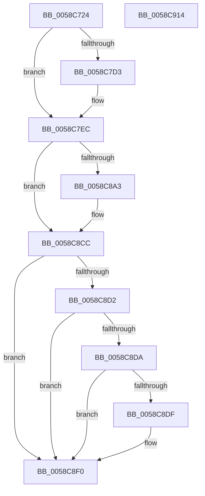

# HvlpLogIommuInitStatus

- RVA: `0x0058C724`–`0x0058C915` (길이 `497` bytes)
- VA: `0x000000014058C724`
- 실행 섹션: `.text`
- PDB 이름 있음: `예`; PDB Function 태그: `아니요`
- unwind 정보 RVA: `0x000C6968`
- 디코드: `109`개 명령, `497/497` bytes 표시
- 미해석 바이트: `0` (있으면 어셈블리에 `.byte`로 보존)

> 이 문서는 커널 이미지의 기계어와 PDB 기호를 분석해 생성했습니다. 4번과 5번은 함수 원형과 자료형을 바이너리 사용 방식에서 추정한 C 해석이며 원본 소스 복구 결과는 아닙니다.

## 1. Dependencies

- 직접 호출 지점: **9**; 고유 호출 대상: **5**
- 직접 호출자로 확인된 함수: **1**
- RIP 상대 이미지 참조: **4**

### Outgoing calls
- `0x0058C78E` → [HvlpAcquireHypercallPage](../47/HvlpAcquireHypercallPage_function_00471410.md) (function, `0x00471410`)
- `0x0058C7AA` → [HvlpAcquireHypercallPage](../47/HvlpAcquireHypercallPage_function_00471410.md) (function, `0x00471410`)
- `0x0058C7C7` → [HvcallInitiateHypercall](../31/HvcallInitiateHypercall_function_00313630.md) (function, `0x00313630`)
- `0x0058C7F1` → [HvlpReleaseHypercallPage](../31/HvlpReleaseHypercallPage_function_00313480.md) (function, `0x00313480`)
- `0x0058C7FB` → [HvlpReleaseHypercallPage](../31/HvlpReleaseHypercallPage_function_00313480.md) (function, `0x00313480`)
- `0x0058C896` → [HvlpWriteEventLog](HvlpWriteEventLog_function_0058C9E4.md) (function, `0x0058C9E4`)
- `0x0058C8C3` → [HvlpWriteEventLog](HvlpWriteEventLog_function_0058C9E4.md) (function, `0x0058C9E4`)
- `0x0058C8EB` → [HvlpWriteEventLog](HvlpWriteEventLog_function_0058C9E4.md) (function, `0x0058C9E4`)
- `0x0058C8FA` → [_security_check_cookie](../6A/_security_check_cookie_function_006AC640.md) (function, `0x006AC640`)

### Direct callers
- [HvlPhase2Initialize](HvlPhase2Initialize_function_00583EA0.md) at `0x00584046`

### Static image references
- `0x0058C73E` → RVA `0x00E0A740` (`.data`; read)
- `0x0058C80D` → RVA `0x000269B8` (`.rdata`; read)
- `0x0058C8BC` → RVA `0x000269A8` (`.rdata`; read)
- `0x0058C8E2` → RVA `0x000269E8` (`.rdata`; read)

## 2. Other-region calls and transfers

- 다른 실행 섹션으로 향하는 call: **0**
- 별도 외부 분기/꼬리 이동을 확인하지 못했습니다.

## 3. Assembly (complete function range)

```asm
0058C724  48 89 5C 24 08                  mov qword ptr [rsp + 8], rbx
0058C729  48 89 7C 24 10                  mov qword ptr [rsp + 0x10], rdi
0058C72E  55                              push rbp
0058C72F  48 8D AC 24 B0 F7 FF FF         lea rbp, [rsp - 0x850]
0058C737  48 81 EC 50 09 00 00            sub rsp, 0x950
0058C73E  48 8B 05 FB DF 87 00            mov rax, qword ptr [rip + 0x87dffb]
0058C745  48 33 C4                        xor rax, rsp
0058C748  48 89 85 40 08 00 00            mov qword ptr [rbp + 0x840], rax
0058C74F  33 C0                           xor eax, eax
0058C751  4C 8D 45 10                     lea r8, [rbp + 0x10]
0058C755  0F 57 C0                        xorps xmm0, xmm0
0058C758  48 89 44 24 58                  mov qword ptr [rsp + 0x58], rax
0058C75D  48 8D 4C 24 48                  lea rcx, [rsp + 0x48]
0058C762  89 44 24 60                     mov dword ptr [rsp + 0x60], eax
0058C766  0F 11 44 24 48                  movups xmmword ptr [rsp + 0x48], xmm0
0058C76B  44 8D 48 10                     lea r9d, [rax + 0x10]
0058C76F  48 89 44 24 38                  mov qword ptr [rsp + 0x38], rax
0058C774  8D 50 01                        lea edx, [rax + 1]
0058C777  89 44 24 40                     mov dword ptr [rsp + 0x40], eax
0058C77B  0F 11 44 24 28                  movups xmmword ptr [rsp + 0x28], xmm0
0058C780  0F 11 44 24 68                  movups xmmword ptr [rsp + 0x68], xmm0
0058C785  0F 11 44 24 78                  movups xmmword ptr [rsp + 0x78], xmm0
0058C78A  0F 11 45 88                     movups xmmword ptr [rbp - 0x78], xmm0
0058C78E  E8 7D 4C EE FF                  call 0x140471410
0058C793  41 B9 08 04 00 00               mov r9d, 0x408
0058C799  4C 8D 45 30                     lea r8, [rbp + 0x30]
0058C79D  BA 02 00 00 00                  mov edx, 2
0058C7A2  48 8D 4C 24 28                  lea rcx, [rsp + 0x28]
0058C7A7  48 8B D8                        mov rbx, rax
0058C7AA  E8 61 4C EE FF                  call 0x140471410
0058C7AF  4C 8B 44 24 40                  mov r8, qword ptr [rsp + 0x40]
0058C7B4  B9 7B 00 00 00                  mov ecx, 0x7b
0058C7B9  48 8B 54 24 60                  mov rdx, qword ptr [rsp + 0x60]
0058C7BE  48 8B F8                        mov rdi, rax
0058C7C1  C7 03 05 00 00 00               mov dword ptr [rbx], 5
0058C7C7  E8 64 6E D8 FF                  call 0x140313630
0058C7CC  33 DB                           xor ebx, ebx
0058C7CE  66 85 C0                        test ax, ax
0058C7D1  75 19                           jne 0x14058c7ec
0058C7D3  0F 10 07                        movups xmm0, xmmword ptr [rdi]
0058C7D6  0F 11 44 24 68                  movups xmmword ptr [rsp + 0x68], xmm0
0058C7DB  0F 10 4F 10                     movups xmm1, xmmword ptr [rdi + 0x10]
0058C7DF  0F 11 4C 24 78                  movups xmmword ptr [rsp + 0x78], xmm1
0058C7E4  0F 10 47 20                     movups xmm0, xmmword ptr [rdi + 0x20]
0058C7E8  0F 11 45 88                     movups xmmword ptr [rbp - 0x78], xmm0
0058C7EC  48 8D 4C 24 28                  lea rcx, [rsp + 0x28]
0058C7F1  E8 8A 6C D8 FF                  call 0x140313480
0058C7F6  48 8D 4C 24 48                  lea rcx, [rsp + 0x48]
0058C7FB  E8 80 6C D8 FF                  call 0x140313480
0058C800  0F B6 44 24 68                  movzx eax, byte ptr [rsp + 0x68]
0058C805  4C 8D 45 A0                     lea r8, [rbp - 0x60]
0058C809  89 44 24 20                     mov dword ptr [rsp + 0x20], eax
0058C80D  48 8D 0D A4 A1 A9 FF            lea rcx, [rip - 0x565e5c]
0058C814  48 8D 44 24 20                  lea rax, [rsp + 0x20]
0058C819  48 C7 45 A8 04 00 00 00         mov qword ptr [rbp - 0x58], 4
0058C821  48 89 45 A0                     mov qword ptr [rbp - 0x60], rax
0058C825  BA 07 00 00 00                  mov edx, 7
0058C82A  0F B6 44 24 69                  movzx eax, byte ptr [rsp + 0x69]
0058C82F  89 44 24 24                     mov dword ptr [rsp + 0x24], eax
0058C833  48 8D 44 24 24                  lea rax, [rsp + 0x24]
0058C838  48 89 45 B0                     mov qword ptr [rbp - 0x50], rax
0058C83C  48 8D 44 24 70                  lea rax, [rsp + 0x70]
0058C841  48 89 45 C0                     mov qword ptr [rbp - 0x40], rax
0058C845  48 8D 44 24 78                  lea rax, [rsp + 0x78]
0058C84A  48 89 45 D0                     mov qword ptr [rbp - 0x30], rax
0058C84E  48 8D 45 80                     lea rax, [rbp - 0x80]
0058C852  48 89 45 E0                     mov qword ptr [rbp - 0x20], rax
0058C856  48 8D 45 88                     lea rax, [rbp - 0x78]
0058C85A  48 89 45 F0                     mov qword ptr [rbp - 0x10], rax
0058C85E  48 8D 45 90                     lea rax, [rbp - 0x70]
0058C862  48 89 45 00                     mov qword ptr [rbp], rax
0058C866  48 C7 45 B8 04 00 00 00         mov qword ptr [rbp - 0x48], 4
0058C86E  48 C7 45 C8 08 00 00 00         mov qword ptr [rbp - 0x38], 8
0058C876  48 C7 45 D8 08 00 00 00         mov qword ptr [rbp - 0x28], 8
0058C87E  48 C7 45 E8 08 00 00 00         mov qword ptr [rbp - 0x18], 8
0058C886  48 C7 45 F8 08 00 00 00         mov qword ptr [rbp - 8], 8
0058C88E  48 C7 45 08 08 00 00 00         mov qword ptr [rbp + 8], 8
0058C896  E8 49 01 00 00                  call 0x14058c9e4
0058C89B  48 8B 45 88                     mov rax, qword ptr [rbp - 0x78]
0058C89F  85 C0                           test eax, eax
0058C8A1  74 29                           je 0x14058c8cc
0058C8A3  48 8D 45 88                     lea rax, [rbp - 0x78]
0058C8A7  48 C7 45 A8 08 00 00 00         mov qword ptr [rbp - 0x58], 8
0058C8AF  4C 8D 45 A0                     lea r8, [rbp - 0x60]
0058C8B3  48 89 45 A0                     mov qword ptr [rbp - 0x60], rax
0058C8B7  BA 01 00 00 00                  mov edx, 1
0058C8BC  48 8D 0D E5 A0 A9 FF            lea rcx, [rip - 0x565f1b]
0058C8C3  E8 1C 01 00 00                  call 0x14058c9e4
0058C8C8  48 8B 45 88                     mov rax, qword ptr [rbp - 0x78]
0058C8CC  38 5C 24 69                     cmp byte ptr [rsp + 0x69], bl
0058C8D0  74 1E                           je 0x14058c8f0
0058C8D2  48 83 7C 24 70 01               cmp qword ptr [rsp + 0x70], 1
0058C8D8  75 16                           jne 0x14058c8f0
0058C8DA  48 85 C0                        test rax, rax
0058C8DD  74 11                           je 0x14058c8f0
0058C8DF  45 33 C0                        xor r8d, r8d
0058C8E2  48 8D 0D FF A0 A9 FF            lea rcx, [rip - 0x565f01]
0058C8E9  33 D2                           xor edx, edx
0058C8EB  E8 F4 00 00 00                  call 0x14058c9e4
0058C8F0  48 8B 8D 40 08 00 00            mov rcx, qword ptr [rbp + 0x840]
0058C8F7  48 33 CC                        xor rcx, rsp
0058C8FA  E8 41 FD 11 00                  call 0x1406ac640
0058C8FF  4C 8D 9C 24 50 09 00 00         lea r11, [rsp + 0x950]
0058C907  49 8B 5B 10                     mov rbx, qword ptr [r11 + 0x10]
0058C90B  49 8B 7B 18                     mov rdi, qword ptr [r11 + 0x18]
0058C90F  49 8B E3                        mov rsp, r11
0058C912  5D                              pop rbp
0058C913  C3                              ret
0058C914  CC                              int3
```

## 4. C-style interpretation (structured pseudocode)

```c
__int64 __fastcall HvlpLogIommuInitStatus(void)
{
    __int64 result;
    __int64 v_rbx;
    __int64 v_rsp;
    unsigned __int64 v_stack_m18;
    unsigned __int64 v_stack_m8;
    unsigned __int64 v_stack_m828;
    unsigned __int64 v_stack_m848;
    unsigned __int64 v_stack_m850;
    unsigned __int64 v_stack_m858;
    unsigned __int64 v_stack_m860;
    unsigned __int64 v_stack_m868;
    unsigned __int64 v_stack_m870;
    unsigned __int64 v_stack_m878;
    unsigned __int64 v_stack_m880;
    unsigned __int64 v_stack_m888;
    unsigned __int64 v_stack_m890;
    unsigned __int64 v_stack_m898;
    unsigned __int64 v_stack_m8A0;
    unsigned __int64 v_stack_m8A8;
    unsigned __int64 v_stack_m8B0;
    unsigned __int64 v_stack_m8B8;
    unsigned __int64 v_stack_m8C8;
    unsigned __int64 v_stack_m8D0;
    unsigned __int64 v_stack_m8D8;
    unsigned __int64 v_stack_m8E0;
    unsigned __int64 v_stack_m8E8;
    unsigned __int8 v_stack_m8EF;
    unsigned __int64 v_stack_m8F0;
    unsigned int v_stack_m8F8;
    unsigned __int64 v_stack_m900;
    unsigned __int64 v_stack_m910;
    unsigned int v_stack_m918;
    unsigned __int64 v_stack_m920;
    unsigned __int64 v_stack_m930;
    unsigned int v_stack_m934;
    unsigned int v_stack_m938;
    unsigned __int64 v_stack_p10;
    unsigned __int64 v_stack_p8;

    v_stack_p8 = v_rbx;
    v_stack_p10 = v_rdi;
    v_rsp = (v_rsp) - (0x950ULL);
    result = (*(unsigned __int64 *)(v_rip + 8904699)) ^ (v_rsp);
    v_stack_m18 = result;
    result = 0;
    v_stack_m900 = 0;
    v_stack_m8F8 = 0;
    v_stack_m910 = v_xmm0;
    v_stack_m920 = 0;
    v_stack_m918 = 0;
    v_stack_m930 = v_xmm0;
    v_stack_m8F0 = v_xmm0;
    v_stack_m8E0 = v_xmm0;
    v_stack_m8D0 = v_xmm0;
    result = HvlpAcquireHypercallPage(v_stack_m910, result + 1, v_stack_m848, result + 16);
    result = HvlpAcquireHypercallPage(v_stack_m930, 2, v_stack_m828, (unsigned int)(0x408ULL));
    *(unsigned int *)(result) = 5;
    result = HvcallInitiateHypercall(123, v_stack_m8F8, v_stack_m918, (unsigned int)(0x408ULL));
    v_rbx = 0;
    if ((unsigned __int16)(result) == 0) {
        v_stack_m8F0 = v_xmm0;
        v_stack_m8E0 = v_xmm1;
        v_stack_m8D0 = v_xmm0;
    }
    result = HvlpReleaseHypercallPage(v_stack_m930, v_stack_m8F8, v_stack_m918, (unsigned int)(0x408ULL));
    result = HvlpReleaseHypercallPage(v_stack_m910, v_stack_m8F8, v_stack_m918, (unsigned int)(0x408ULL));
    v_stack_m938 = (unsigned int)(v_stack_m8F0);
    v_stack_m8B0 = 4;
    v_stack_m8B8 = v_stack_m938;
    v_stack_m934 = (unsigned int)(v_stack_m8EF);
    v_stack_m8A8 = v_stack_m934;
    v_stack_m898 = v_stack_m8E8;
    v_stack_m888 = v_stack_m8E0;
    v_stack_m878 = v_stack_m8D8;
    v_stack_m868 = v_stack_m8D0;
    v_stack_m858 = v_stack_m8C8;
    v_stack_m8A0 = 4;
    v_stack_m890 = 8;
    v_stack_m880 = 8;
    v_stack_m870 = 8;
    v_stack_m860 = 8;
    v_stack_m850 = 8;
    result = HvlpWriteEventLog(v_rip - 5660252, 7, v_stack_m8B8, (unsigned int)(0x408ULL));
    result = v_stack_m8D0;
    if ((unsigned int)(v_stack_m8D0) != 0) {
        result = v_stack_m8D0;
        v_stack_m8B0 = 8;
        a3 = v_stack_m8B8;
        v_stack_m8B8 = result;
        a2 = 1;
        a1 = v_rip - 5660443;
        result = HvlpWriteEventLog(a1, a2, a3, (unsigned int)(0x408ULL));
        result = v_stack_m8D0;
    }
    if (v_stack_m8EF == 0) goto loc_0058C8F0;
    if (v_stack_m8E8 != 1) goto loc_0058C8F0;
    if (result != 0) {
        a3 = 0;
        a1 = v_rip - 5660417;
        a2 = 0;
        result = HvlpWriteEventLog(a1, a2, a3, (unsigned int)(0x408ULL));
    }
    a1 = (v_stack_m18) ^ (v_rsp);
    result = _security_check_cookie(a1, a2, a3, (unsigned int)(0x408ULL));
    return result;
}
```

## 5. (Beta) C Style

```c
void HvlpLogIommuInitStatus(void)
{
    int64_t result;
    int64_t local_rbx;
    int64_t local_rsp;
    uint64_t v_stack_m18;
    uint64_t v_stack_m8;
    uint64_t v_stack_m828;
    uint64_t v_stack_m848;
    uint64_t v_stack_m850;
    uint64_t v_stack_m858;
    uint64_t v_stack_m860;
    uint64_t v_stack_m868;
    uint64_t v_stack_m870;
    uint64_t v_stack_m878;
    uint64_t v_stack_m880;
    uint64_t v_stack_m888;
    uint64_t v_stack_m890;
    uint64_t v_stack_m898;
    uint64_t v_stack_m8A0;
    uint64_t v_stack_m8A8;
    uint64_t v_stack_m8B0;
    uint64_t v_stack_m8B8;
    uint64_t v_stack_m8C8;
    uint64_t v_stack_m8D0;
    uint64_t v_stack_m8D8;
    uint64_t v_stack_m8E0;
    uint64_t v_stack_m8E8;
    uint8_t v_stack_m8EF;
    uint64_t v_stack_m8F0;
    uint32_t v_stack_m8F8;
    uint64_t v_stack_m900;
    uint64_t v_stack_m910;
    uint32_t v_stack_m918;
    uint64_t v_stack_m920;
    uint64_t v_stack_m930;
    uint32_t v_stack_m934;
    uint32_t v_stack_m938;
    uint64_t v_stack_p10;
    uint64_t v_stack_p8;

    v_stack_p8 = local_rbx;
    v_stack_p10 = local_rdi;
    local_rsp = (local_rsp) - (0x950ULL);
    result = (*(uint64_t *)(v_rip + 0x87DFFB)) ^ (local_rsp);
    v_stack_m18 = result;
    result = 0;
    v_stack_m900 = 0;
    v_stack_m8F8 = 0;
    v_stack_m910 = v_xmm0;
    v_stack_m920 = 0;
    v_stack_m918 = 0;
    v_stack_m930 = v_xmm0;
    v_stack_m8F0 = v_xmm0;
    v_stack_m8E0 = v_xmm0;
    v_stack_m8D0 = v_xmm0;
    result = HvlpAcquireHypercallPage(v_stack_m910, result + 1, v_stack_m848, result + 16);
    result = HvlpAcquireHypercallPage(v_stack_m930, 2, v_stack_m828, (uint32_t)(0x408ULL));
    *(uint32_t *)(result) = 5;
    result = HvcallInitiateHypercall(123, v_stack_m8F8, v_stack_m918, (uint32_t)(0x408ULL));
    local_rbx = 0;
    if ((uint16_t)(result) == 0) {
        v_stack_m8F0 = v_xmm0;
        v_stack_m8E0 = v_xmm1;
        v_stack_m8D0 = v_xmm0;
    }
    result = HvlpReleaseHypercallPage(v_stack_m930, v_stack_m8F8, v_stack_m918, (uint32_t)(0x408ULL));
    result = HvlpReleaseHypercallPage(v_stack_m910, v_stack_m8F8, v_stack_m918, (uint32_t)(0x408ULL));
    v_stack_m938 = (uint32_t)(v_stack_m8F0);
    v_stack_m8B0 = 4;
    v_stack_m8B8 = v_stack_m938;
    v_stack_m934 = (uint32_t)(v_stack_m8EF);
    v_stack_m8A8 = v_stack_m934;
    v_stack_m898 = v_stack_m8E8;
    v_stack_m888 = v_stack_m8E0;
    v_stack_m878 = v_stack_m8D8;
    v_stack_m868 = v_stack_m8D0;
    v_stack_m858 = v_stack_m8C8;
    v_stack_m8A0 = 4;
    v_stack_m890 = 8;
    v_stack_m880 = 8;
    v_stack_m870 = 8;
    v_stack_m860 = 8;
    v_stack_m850 = 8;
    result = HvlpWriteEventLog(v_rip - 5660252, 7, v_stack_m8B8, (uint32_t)(0x408ULL));
    result = v_stack_m8D0;
    if ((uint32_t)(v_stack_m8D0) != 0) {
        result = v_stack_m8D0;
        v_stack_m8B0 = 8;
        a3 = v_stack_m8B8;
        v_stack_m8B8 = result;
        a2 = 1;
        a1 = v_rip - 5660443;
        result = HvlpWriteEventLog(a1, a2, a3, (uint32_t)(0x408ULL));
        result = v_stack_m8D0;
    }
    if (v_stack_m8EF == 0) goto loc_0058C8F0;
    if (v_stack_m8E8 != 1) goto loc_0058C8F0;
    if (result != 0) {
        a3 = 0;
        a1 = v_rip - 5660417;
        a2 = 0;
        result = HvlpWriteEventLog(a1, a2, a3, (uint32_t)(0x408ULL));
    }
    a1 = (v_stack_m18) ^ (local_rsp);
    result = _security_check_cookie(a1, a2, a3, (uint32_t)(0x408ULL));
    return result;
}
```

## 6. Execution-region graph

[열기: 2D/3D 그래프와 함수 탐색 컨트롤 패널](../../../control-panel.html?section=text&rva=0x0058C724&view=graph)

- 2D 그래프는 위에서 아래로 흐르고, 3D 그래프는 빈 공간을 드래그해 회전합니다. Shift+드래그는 이동, 휠은 확대·축소, 함수 노드 선택은 대상 보고서 이동입니다.

### Static fallback


